# Run profile — hg-45e

```
Profile: hg-45e · 1 invocation · 2026-10-31T21:52Z → 2026-10-31T22:20Z · wall 28m (task graph 25m, after the last landing 2m) · agents 100 (timed 100) · beads dispatched 5, landed 0, planned 18
Profile: graph scope — observed invocation/residual graph; historical topology is unknown
Profile: shape — 18 beads · 46 edges · depth 6 · width 3 · beads per level 5/1/4/4/3/1 · widest fan-out hg-45e.1 (2 direct, 13 transitive dependents)
Profile: bound — no model: nothing landed
Profile: critical path — 25m = implement 3m · review 2m · merge 5m · seam 5m · blocker 52s · planning 8m · ready 5s · startup 16s · dispatch 1m · of which other beads' merge-lane turns 9m
Profile: diagnosis — planning 8m (33% of first dispatch to last task step)
Profile: critical chain — close-epics ready 5s → plan planning 8m → hg-45e.1 implement+review+merge+seam 6m → merge lane ×4 9m (seam 4m) → hg-45e.8 blocker 52s
Profile: bottleneck — hg-45e.1 (did not land) — 6m on the critical path (24%) · implement 3m · review 2m · merge 42s · seam 33s · dispatch 14s · implement on the path 3m: test 2m · git 3s · read 3s · shell 8s · model 1m (longest: "git status --short" 40s, "python3 - <<'EOF'" 35s) · dependents 2 direct, 13 transitive
Profile: waits — ready→start, summed per bead (beads wait at the same time, so not wall time): 0s over 0 of 0 landed beads
Profile: early unblock — 0 landed beads had in-run blockers · stacked on an implementation 0 · bounced on a stack conflict then waited for the merge 0 (0s) · waited for a merge without one 0
Profile: rework — 46m of dispatch time in attempts that did not land — hg-45e.8 11m (IMPLEMENTED, IMPLEMENTED; never landed) · hg-45e.2 10m (IMPLEMENTED, IMPLEMENTED; never landed) · hg-45e.17 10m (IMPLEMENTED, IMPLEMENTED; never landed) · 2 more
Profile: tests — implementers and fixers, summed: 11m running tests and 0s polling background runs, 43% of their 26m · 0 Bash call(s) ran into the 10-minute tool limit
Profile: slow tests — cargo test --locked --offline plan::tests 3m (5 runs, longest 2m) · cargo test --locked --offline transcripts::tests::summary 2m (3 runs, longest 1m) · cargo test --offline --locked setup 2m (2 runs, longest 2m)
Profile: merge lane — busy 10m of 11m (90%) · seam reviews and fixes 5m (50% of busy) · 15 merge dispatches, first try not merged for unknown (no merge results) · queue wait 0s total, peak 0 waiting · stack-parent wait 0s
Profile: runtime — peak 8 agents at once of 16 runtime slots · full 0% of the run · slot cap 6
Profile: concurrency scope — all-agent concurrency peak 8 · task-slot concurrency peak 5, cap 6 (ordinary chains retain a slot through merge)
Profile: context — agents 101 (measured 101) · peak≥80% 0 · compacted 0 agents, 0 compactions · coordinator 531K/1000K (53%), 0 compactions · max coordinator 53%
Profile: context agent — coordinator peak 531K/1000K (53%) · first 150K · compactions 0
Profile: unmeasured — 5 dispatched bead(s) did not land (not in the model): hg-45e.1, hg-45e.2, hg-45e.8, hg-45e.17, hg-45e.10; Claude context windows from the model table: claude-opus-5-5 1000K, claude-sonnet-5-5 1000K
```

## Per bead

Offsets are from the run's first dispatch. `wait` starts at evidenced creation/mapping/dependency availability, bounded by invocation start; unknown readiness means unknown wait. Creation, mapping and dependency timestamps stay distinct in JSON. `stack` waits for parents to merge; `queue` waits for the single merge lane; `lane` is its lane turn (merge plus seam work).

| bead | deps | dependents | attempts | wait (cause) | implement | of it: tools | review | fix | stack | queue | lane (seam) | landed | critical |
|---|---|---|---|---|---|---|---|---|---|---|---|---|---|
| hg-45e.1 | 0 | 2 | IMPLEMENTED | - | 3m | test 2m · git 3s · read 3s · shell 8s | 2m | - | - | 3s | 1m (33s) | not landed | 6m |
| hg-45e.10 | 0 | 4 | IMPLEMENTED | - | 5m | test 2m · build 55s · git 4s · read 9s · shell 16s | 34s | - | - | 4m | 1m (43s) | not landed | 2m |
| hg-45e.17 | 0 | 2 | IMPLEMENTED, IMPLEMENTED | 9m (retry) | 22s | test 2s · shell 1s | 21s | - | - | 3m | 1m (42s) | not landed | 3m |
| hg-45e.2 | 0 | 2 | IMPLEMENTED, IMPLEMENTED | 10m (retry) | 36s | test 3s · git 1s · read 1s · shell 5s | 24s | - | - | 2m | 1m (34s) | not landed | 3m |
| hg-45e.8 | 0 | 3 | IMPLEMENTED, IMPLEMENTED | 12m (retry) | 21s | test 2s · git 1s | 33s | - | - | 2m | 48s (30s) | not landed | 3m |

## Critical path, step by step

| at | step | kind | via | duration |
|---|---|---|---|---|
| +0s | run start | startup |  | 16s |
| +16s | close-epics | ready |  | 5s |
| +21s | previous → plan | dispatch |  | 2s |
| +23s | plan | planning | previous | 8m |
| +9m | planned → impl:hg-45e.1 | dispatch |  | 2s |
| +9m | impl:hg-45e.1 | implement | planned | 3m |
| +12m | chain → review:hg-45e.1 | dispatch |  | 2s |
| +12m | review:hg-45e.1 | review | chain | 2m |
| +14m | chain → merge:hg-45e.1 | dispatch |  | 3s |
| +14m | merge:hg-45e.1 | merge | chain | 22s |
| +14m | chain → fix:hg-45e.1:check | dispatch |  | 2s |
| +14m | fix:hg-45e.1:check | seam | chain | 23s |
| +14m | chain → seam-review:hg-45e.1:check | dispatch |  | 2s |
| +14m | seam-review:hg-45e.1:check | seam | chain | 10s |
| +15m | chain → merge:hg-45e.1:check-fixed | dispatch |  | 2s |
| +15m | merge:hg-45e.1:check-fixed | merge | chain | 20s |
| +15m | merge-lane → merge:hg-45e.17 | dispatch |  | 2s |
| +15m | merge:hg-45e.17 | merge | merge-lane | 19s |
| +15m | chain → fix:hg-45e.17:check | dispatch |  | 2s |
| +15m | fix:hg-45e.17:check | seam | chain | 24s |
| +16m | chain → seam-review:hg-45e.17:check | dispatch |  | 2s |
| +16m | seam-review:hg-45e.17:check | seam | chain | 11s |
| +16m | chain → merge:hg-45e.17:check-fixed | dispatch |  | 2s |
| +16m | merge:hg-45e.17:check-fixed | merge | chain | 19s |
| +16m | merge-lane → merge:hg-45e.2 | dispatch |  | 2s |
| +16m | merge:hg-45e.2 | merge | merge-lane | 19s |
| +17m | chain → fix:hg-45e.2:check | dispatch |  | 2s |
| +17m | fix:hg-45e.2:check | seam | chain | 30s |
| +17m | chain → seam-review:hg-45e.2:check | dispatch |  | 2s |
| +17m | seam-review:hg-45e.2:check | seam | chain | 14s |
| +17m | chain → merge:hg-45e.2:check-fixed | dispatch |  | 2s |
| +17m | merge:hg-45e.2:check-fixed | merge | chain | 18s |
| +18m | merge-lane → merge:hg-45e.8 | dispatch |  | 2s |
| +18m | merge:hg-45e.8 | merge | merge-lane | 21s |
| +18m | chain → fix:hg-45e.8:check | dispatch |  | 2s |
| +18m | fix:hg-45e.8:check | seam | chain | 27s |
| +19m | chain → seam-review:hg-45e.8:check | dispatch |  | 2s |
| +19m | seam-review:hg-45e.8:check | seam | chain | 8s |
| +19m | chain → merge:hg-45e.8:check-fixed | dispatch |  | 2s |
| +19m | merge:hg-45e.8:check-fixed | merge | chain | 20s |
| +19m | merge-lane → merge:hg-45e.10 | dispatch |  | 2s |
| +19m | merge:hg-45e.10 | merge | merge-lane | 22s |
| +20m | chain → fix:hg-45e.10:check | dispatch |  | 2s |
| +20m | fix:hg-45e.10:check | seam | chain | 28s |
| +20m | chain → seam-review:hg-45e.10:check | dispatch |  | 2s |
| +20m | seam-review:hg-45e.10:check | seam | chain | 15s |
| +20m | chain → merge:hg-45e.10:check-fixed | dispatch |  | 3s |
| +20m | merge:hg-45e.10:check-fixed | merge | chain | 22s |
| +21m | merge-lane → merge:hg-45e.17 | dispatch |  | 2s |
| +21m | merge:hg-45e.17 | merge | merge-lane | 17s |
| +21m | chain → fix:hg-45e.17:check | dispatch |  | 2s |
| +21m | fix:hg-45e.17:check | seam | chain | 28s |
| +22m | chain → seam-review:hg-45e.17:check | dispatch |  | 2s |
| +22m | seam-review:hg-45e.17:check | seam | chain | 13s |
| +22m | chain → merge:hg-45e.17:check-fixed | dispatch |  | 2s |
| +22m | merge:hg-45e.17:check-fixed | merge | chain | 19s |
| +22m | merge-lane → merge:hg-45e.2 | dispatch |  | 2s |
| +22m | merge:hg-45e.2 | merge | merge-lane | 18s |
| +23m | chain → fix:hg-45e.2:check | dispatch |  | 2s |
| +23m | fix:hg-45e.2:check | seam | chain | 21s |
| +23m | chain → seam-review:hg-45e.2:check | dispatch |  | 2s |
| +23m | seam-review:hg-45e.2:check | seam | chain | 14s |
| +23m | chain → merge:hg-45e.2:check-fixed | dispatch |  | 3s |
| +23m | merge:hg-45e.2:check-fixed | merge | chain | 18s |
| +24m | merge-lane → merge:hg-45e.8 | dispatch |  | 2s |
| +24m | merge:hg-45e.8 | merge | merge-lane | 19s |
| +24m | chain → fix:hg-45e.8:check | dispatch |  | 2s |
| +24m | fix:hg-45e.8:check | seam | chain | 22s |
| +24m | chain → seam-review:hg-45e.8:check | dispatch |  | 2s |
| +24m | seam-review:hg-45e.8:check | seam | chain | 8s |
| +24m | chain → missing-blocker:hg-45e.8 | dispatch |  | 2s |
| +24m | missing-blocker:hg-45e.8 | blocker | chain | 14s |
| +25m | chain → triage:hg-45e.8 | dispatch |  | 2s |
| +25m | triage:hg-45e.8 | blocker | chain | 34s |
| +25m | chain → notify:hg-45e.8 | dispatch |  | 2s |
| +25m | notify:hg-45e.8 | blocker | chain | 5s |

## Longest tool calls in the bottleneck's implement (hg-45e.1)

| tool | category | what | duration |
|---|---|---|---|
| Bash | test | git status --short | 40s |
| Bash | test | python3 - <<'EOF' | 35s |
| Bash | test | ls -a /var/home/alepar/AleCode/herdr-graph/third_party/herd… | 19s |
| Bash | shell | S=/var/home/alepar/.aisw/profiles/claude/claude-1/plugins/c… | 4s |
| Bash | test | cargo test --offline --lib 2> | 3s |
| Bash | shell | cat /var/home/alepar/AleCode/herdr-graph/.worktrees/super-a… | 2s |
| Bash | git | ls -la third_party/ third_party/herdr-threads | 1s |
| Bash | shell | S=/var/home/alepar/.aisw/profiles/claude/claude-1/plugins/c… | 1s |
| Bash | read | grep -n "Teamspace\\|ALL\\|define_id!\\|^use\\|13\]" src/model/… | 1s |
| Bash | read | ls /var/home/alepar/AleCode/herdr-graph/third_party/herdr-t… | 1s |

## Timeline

each bead's final attempt; critical-path steps are marked crit.

```mermaid
gantt
  dateFormat x
  axisFormat %H:%M
  section hg-45e.1
  impl :crit, 1793484090594, 1793484264406
  review :crit, 1793484266498, 1793484367019
  merge :crit, 1793484369637, 1793484391213
  fix check :crit, 1793484393680, 1793484416826
  seam-review check :crit, 1793484418764, 1793484428890
  merge check-fixed :crit, 1793484431231, 1793484451694
  missing-blocker :1793484453944, 1793484465686
  triage :1793484468080, 1793484506243
  notify :1793484508246, 1793484513303
  section hg-45e.10
  impl :1793484093065, 1793484408052
  review :1793484410104, 1793484444320
  merge :crit, 1793484710282, 1793484732444
  fix check :crit, 1793484734915, 1793484762964
  seam-review check :crit, 1793484765049, 1793484779777
  merge check-fixed :crit, 1793484782526, 1793484804738
  missing-blocker :1793484806808, 1793484820554
  triage :1793484822619, 1793484857501
  notify :1793484859653, 1793484864592
  section hg-45e.17
  impl :1793484608739, 1793484630730
  review :1793484632700, 1793484653334
  merge :crit, 1793484806807, 1793484823887
  fix check :crit, 1793484825937, 1793484854315
  seam-review check :crit, 1793484856179, 1793484869341
  merge check-fixed :crit, 1793484871110, 1793484890596
  missing-blocker :1793484892681, 1793484906393
  triage :1793484908763, 1793484947470
  notify :1793484949293, 1793484954020
  section hg-45e.2
  impl :1793484714532, 1793484750777
  review :1793484753012, 1793484777397
  merge :crit, 1793484892680, 1793484910861
  fix check :crit, 1793484912782, 1793484933531
  seam-review check :crit, 1793484935522, 1793484949151
  merge check-fixed :crit, 1793484951715, 1793484969611
  missing-blocker :1793484971692, 1793484982617
  triage :1793484984700, 1793485012171
  notify :1793485014305, 1793485019445
  section hg-45e.8
  impl :1793484790412, 1793484811215
  review :1793484813245, 1793484846218
  merge :crit, 1793484971692, 1793484990237
  fix check :crit, 1793484992182, 1793485013825
  seam-review check :crit, 1793485015688, 1793485023826
  missing-blocker :crit, 1793485025756, 1793485039623
  triage :crit, 1793485041617, 1793485075165
  notify :crit, 1793485077068, 1793485081931
```



## Context

- Profile: context — agents 101 (measured 101) · peak≥80% 0 · compacted 0 agents, 0 compactions · coordinator 531K/1000K (53%), 0 compactions · max coordinator 53%
- Profile: context agent — coordinator peak 531K/1000K (53%) · first 150K · compactions 0

| agent | role | model | tasks | requests | first | peak | window | source | peak% | compactions |
| --- | --- | --- | --- | --- | --- | --- | --- | --- | --- | --- |
| coordinator | coordinator | claude-opus-5-5 | 5 | 130 | 150K | 531K | 1000K | table | 53% | 0 |
| plan-rest | agent | claude-opus-5-5 | 1 | 59 | 29K | 292K | 1000K | table | 29% | 0 |
| plan | agent | claude-opus-5-5 | 1 | 46 | 29K | 202K | 1000K | table | 20% | 0 |
| impl:hg-45e.10 | agent | claude-sonnet-5-5 | 1 | 22 | 33K | 105K | 1000K | table | 11% | 0 |
| impl:hg-45e.8 | agent | claude-sonnet-5-5 | 1 | 28 | 33K | 105K | 1000K | table | 11% | 0 |
| impl:hg-45e.1 | agent | claude-sonnet-5-5 | 1 | 15 | 33K | 72K | 1000K | table | 7% | 0 |
| impl:hg-45e.17 | agent | claude-sonnet-5-5 | 1 | 17 | 33K | 69K | 1000K | table | 7% | 0 |
| impl:hg-45e.2 | agent | claude-sonnet-5-5 | 1 | 15 | 33K | 71K | 1000K | table | 7% | 0 |
| impl:hg-45e.2 | agent | claude-sonnet-5-5 | 1 | 8 | 33K | 60K | 1000K | table | 6% | 0 |
| review:hg-45e.10 | agent | claude-sonnet-5-5 | 1 | 6 | 31K | 63K | 1000K | table | 6% | 0 |
| review:hg-45e.2 | agent | claude-sonnet-5-5 | 1 | 5 | 31K | 57K | 1000K | table | 6% | 0 |
| review:hg-45e.8 | agent | claude-sonnet-5-5 | 1 | 5 | 31K | 60K | 1000K | table | 6% | 0 |
| fix:hg-45e.10:check | agent | claude-sonnet-5-5 | 1 | 5 | 33K | 45K | 1000K | table | 5% | 0 |
| impl:hg-45e.17 | agent | claude-sonnet-5-5 | 1 | 6 | 33K | 51K | 1000K | table | 5% | 0 |
| impl:hg-45e.8 | agent | claude-sonnet-5-5 | 1 | 6 | 33K | 47K | 1000K | table | 5% | 0 |
| review:hg-45e.1 | agent | claude-sonnet-5-5 | 1 | 5 | 31K | 51K | 1000K | table | 5% | 0 |
| review:hg-45e.17 | agent | claude-sonnet-5-5 | 1 | 5 | 31K | 51K | 1000K | table | 5% | 0 |
| review:hg-45e.2 | agent | claude-sonnet-5-5 | 1 | 5 | 31K | 47K | 1000K | table | 5% | 0 |
| review:hg-45e.8 | agent | claude-sonnet-5-5 | 1 | 4 | 31K | 55K | 1000K | table | 5% | 0 |
| triage:hg-45e.1 | agent | claude-opus-5-5 | 1 | 5 | 28K | 45K | 1000K | table | 5% | 0 |
| triage:hg-45e.10 | agent | claude-opus-5-5 | 1 | 5 | 28K | 48K | 1000K | table | 5% | 0 |
| edge-add:2 | agent | claude-sonnet-5-5 | 1 | 3 | 28K | 38K | 1000K | table | 4% | 0 |
| fix:hg-45e.1:check | agent | claude-sonnet-5-5 | 1 | 4 | 33K | 38K | 1000K | table | 4% | 0 |
| fix:hg-45e.17:check | agent | claude-sonnet-5-5 | 1 | 4 | 33K | 38K | 1000K | table | 4% | 0 |
| fix:hg-45e.17:check | agent | claude-sonnet-5-5 | 1 | 6 | 33K | 43K | 1000K | table | 4% | 0 |
| fix:hg-45e.2:check | agent | claude-sonnet-5-5 | 1 | 6 | 33K | 40K | 1000K | table | 4% | 0 |
| fix:hg-45e.2:check | agent | claude-sonnet-5-5 | 1 | 5 | 33K | 42K | 1000K | table | 4% | 0 |
| fix:hg-45e.8:check | agent | claude-sonnet-5-5 | 1 | 5 | 33K | 42K | 1000K | table | 4% | 0 |
| fix:hg-45e.8:check | agent | claude-sonnet-5-5 | 1 | 6 | 33K | 40K | 1000K | table | 4% | 0 |
| merge:hg-45e.1 | agent | claude-sonnet-5-5 | 1 | 6 | 32K | 40K | 1000K | table | 4% | 0 |
| merge:hg-45e.1:check-fixed | agent | claude-sonnet-5-5 | 1 | 6 | 32K | 38K | 1000K | table | 4% | 0 |
| merge:hg-45e.10 | agent | claude-sonnet-5-5 | 1 | 7 | 32K | 40K | 1000K | table | 4% | 0 |
| merge:hg-45e.10:check-fixed | agent | claude-sonnet-5-5 | 1 | 7 | 32K | 40K | 1000K | table | 4% | 0 |
| merge:hg-45e.17 | agent | claude-sonnet-5-5 | 1 | 6 | 32K | 39K | 1000K | table | 4% | 0 |
| merge:hg-45e.17 | agent | claude-sonnet-5-5 | 1 | 5 | 32K | 38K | 1000K | table | 4% | 0 |
| merge:hg-45e.17:check-fixed | agent | claude-sonnet-5-5 | 1 | 6 | 32K | 38K | 1000K | table | 4% | 0 |
| merge:hg-45e.17:check-fixed | agent | claude-sonnet-5-5 | 1 | 7 | 32K | 39K | 1000K | table | 4% | 0 |
| merge:hg-45e.2 | agent | claude-sonnet-5-5 | 1 | 6 | 32K | 39K | 1000K | table | 4% | 0 |
| merge:hg-45e.2 | agent | claude-sonnet-5-5 | 1 | 6 | 32K | 39K | 1000K | table | 4% | 0 |
| merge:hg-45e.2:check-fixed | agent | claude-sonnet-5-5 | 1 | 6 | 32K | 38K | 1000K | table | 4% | 0 |
| merge:hg-45e.2:check-fixed | agent | claude-sonnet-5-5 | 1 | 6 | 32K | 39K | 1000K | table | 4% | 0 |
| merge:hg-45e.8 | agent | claude-sonnet-5-5 | 1 | 6 | 32K | 39K | 1000K | table | 4% | 0 |
| merge:hg-45e.8 | agent | claude-sonnet-5-5 | 1 | 6 | 32K | 39K | 1000K | table | 4% | 0 |
| merge:hg-45e.8:check-fixed | agent | claude-sonnet-5-5 | 1 | 6 | 32K | 38K | 1000K | table | 4% | 0 |
| missing-blocker:hg-45e.8 | agent | claude-sonnet-5-5 | 1 | 4 | 30K | 35K | 1000K | table | 4% | 0 |
| read-ledger:finish | agent | claude-sonnet-5-5 | 1 | 2 | 29K | 36K | 1000K | table | 4% | 0 |
| review:hg-45e.17 | agent | claude-sonnet-5-5 | 1 | 4 | 31K | 44K | 1000K | table | 4% | 0 |
| triage:hg-45e.17 | agent | claude-opus-5-5 | 1 | 5 | 28K | 41K | 1000K | table | 4% | 0 |
| triage:hg-45e.17 | agent | claude-opus-5-5 | 1 | 4 | 28K | 42K | 1000K | table | 4% | 0 |
| triage:hg-45e.2 | agent | claude-opus-5-5 | 1 | 5 | 28K | 43K | 1000K | table | 4% | 0 |
| triage:hg-45e.2 | agent | claude-opus-5-5 | 1 | 4 | 28K | 39K | 1000K | table | 4% | 0 |
| triage:hg-45e.8 | agent | claude-opus-5-5 | 1 | 6 | 28K | 43K | 1000K | table | 4% | 0 |
| triage:hg-45e.8 | agent | claude-opus-5-5 | 1 | 4 | 28K | 40K | 1000K | table | 4% | 0 |
| worktree-sweep | agent | claude-sonnet-5-5 | 1 | 3 | 29K | 42K | 1000K | table | 4% | 0 |
| bd-ready | agent | claude-sonnet-5-5 | 1 | 2 | 28K | 30K | 1000K | table | 3% | 0 |
| bd-ready | agent | claude-sonnet-5-5 | 1 | 2 | 28K | 30K | 1000K | table | 3% | 0 |
| blocker-check | agent | claude-sonnet-5-5 | 1 | 2 | 28K | 30K | 1000K | table | 3% | 0 |
| clarify:hg-45e.17 | agent | claude-sonnet-5-5 | 1 | 2 | 29K | 32K | 1000K | table | 3% | 0 |
| clarify:hg-45e.2 | agent | claude-sonnet-5-5 | 1 | 2 | 29K | 32K | 1000K | table | 3% | 0 |
| clarify:hg-45e.8 | agent | claude-sonnet-5-5 | 1 | 2 | 28K | 31K | 1000K | table | 3% | 0 |
| close-epics | agent | claude-sonnet-5-5 | 1 | 2 | 28K | 30K | 1000K | table | 3% | 0 |
| close-epics | agent | claude-sonnet-5-5 | 1 | 2 | 28K | 30K | 1000K | table | 3% | 0 |
| edge-add:1 | agent | claude-sonnet-5-5 | 1 | 4 | 28K | 33K | 1000K | table | 3% | 0 |
| ledger-append:detector | agent | claude-sonnet-5-5 | 1 | 2 | 28K | 31K | 1000K | table | 3% | 0 |
| ledger-append:edge-add:1 | agent | claude-sonnet-5-5 | 1 | 2 | 28K | 31K | 1000K | table | 3% | 0 |
| ledger-append:edge-add:2 | agent | claude-sonnet-5-5 | 1 | 2 | 28K | 31K | 1000K | table | 3% | 0 |
| ledger-append:launch | agent | claude-sonnet-5-5 | 1 | 2 | 28K | 31K | 1000K | table | 3% | 0 |
| ledger-append:metrics | agent | claude-sonnet-5-5 | 1 | 2 | 28K | 31K | 1000K | table | 3% | 0 |
| ledger-append:recovery:deferred:hg-45e:sweep:h1-instruction-gate-20261031T205333 | agent | claude-sonnet-5-5 | 1 | 2 | 28K | 30K | 1000K | table | 3% | 0 |
| ledger-append:surface:1 | agent | claude-sonnet-5-5 | 1 | 2 | 28K | 31K | 1000K | table | 3% | 0 |
| ledger-append:surface:2 | agent | claude-sonnet-5-5 | 1 | 2 | 28K | 31K | 1000K | table | 3% | 0 |
| ledger:hg-45e.1 | agent | claude-sonnet-5-5 | 1 | 2 | 29K | 32K | 1000K | table | 3% | 0 |
| ledger:hg-45e.10 | agent | claude-sonnet-5-5 | 1 | 3 | 29K | 33K | 1000K | table | 3% | 0 |
| ledger:hg-45e.17 | agent | claude-sonnet-5-5 | 1 | 2 | 29K | 33K | 1000K | table | 3% | 0 |
| ledger:hg-45e.17 | agent | claude-sonnet-5-5 | 1 | 2 | 29K | 33K | 1000K | table | 3% | 0 |
| ledger:hg-45e.2 | agent | claude-sonnet-5-5 | 1 | 3 | 29K | 34K | 1000K | table | 3% | 0 |
| ledger:hg-45e.2 | agent | claude-sonnet-5-5 | 1 | 2 | 29K | 33K | 1000K | table | 3% | 0 |
| ledger:hg-45e.8 | agent | claude-sonnet-5-5 | 1 | 2 | 29K | 32K | 1000K | table | 3% | 0 |
| ledger:hg-45e.8 | agent | claude-sonnet-5-5 | 1 | 2 | 29K | 33K | 1000K | table | 3% | 0 |
| missing-blocker:hg-45e.1 | agent | claude-sonnet-5-5 | 1 | 3 | 29K | 34K | 1000K | table | 3% | 0 |
| missing-blocker:hg-45e.10 | agent | claude-sonnet-5-5 | 1 | 4 | 29K | 35K | 1000K | table | 3% | 0 |
| missing-blocker:hg-45e.17 | agent | claude-sonnet-5-5 | 1 | 4 | 29K | 34K | 1000K | table | 3% | 0 |
| missing-blocker:hg-45e.17 | agent | claude-sonnet-5-5 | 1 | 4 | 29K | 35K | 1000K | table | 3% | 0 |
| missing-blocker:hg-45e.2 | agent | claude-sonnet-5-5 | 1 | 4 | 29K | 35K | 1000K | table | 3% | 0 |
| missing-blocker:hg-45e.2 | agent | claude-sonnet-5-5 | 1 | 3 | 29K | 34K | 1000K | table | 3% | 0 |
| missing-blocker:hg-45e.8 | agent | claude-sonnet-5-5 | 1 | 4 | 29K | 35K | 1000K | table | 3% | 0 |
| notify:hg-45e.1 | agent | claude-sonnet-5-5 | 1 | 3 | 28K | 32K | 1000K | table | 3% | 0 |
| notify:hg-45e.10 | agent | claude-sonnet-5-5 | 1 | 3 | 28K | 32K | 1000K | table | 3% | 0 |
| notify:hg-45e.17 | agent | claude-sonnet-5-5 | 1 | 3 | 29K | 32K | 1000K | table | 3% | 0 |
| notify:hg-45e.2 | agent | claude-sonnet-5-5 | 1 | 3 | 28K | 32K | 1000K | table | 3% | 0 |
| notify:hg-45e.8 | agent | claude-sonnet-5-5 | 1 | 3 | 29K | 32K | 1000K | table | 3% | 0 |
| read-ledger | agent | claude-sonnet-5-5 | 1 | 2 | 28K | 32K | 1000K | table | 3% | 0 |
| reconcile-buckets | agent | claude-sonnet-5-5 | 1 | 2 | 28K | 30K | 1000K | table | 3% | 0 |
| seam-review:hg-45e.1:check | agent | claude-sonnet-5-5 | 1 | 2 | 30K | 32K | 1000K | table | 3% | 0 |
| seam-review:hg-45e.10:check | agent | claude-sonnet-5-5 | 1 | 3 | 30K | 34K | 1000K | table | 3% | 0 |
| seam-review:hg-45e.17:check | agent | claude-sonnet-5-5 | 1 | 3 | 30K | 34K | 1000K | table | 3% | 0 |
| seam-review:hg-45e.17:check | agent | claude-sonnet-5-5 | 1 | 3 | 30K | 34K | 1000K | table | 3% | 0 |
| seam-review:hg-45e.2:check | agent | claude-sonnet-5-5 | 1 | 3 | 30K | 34K | 1000K | table | 3% | 0 |
| seam-review:hg-45e.2:check | agent | claude-sonnet-5-5 | 1 | 3 | 30K | 34K | 1000K | table | 3% | 0 |
| seam-review:hg-45e.8:check | agent | claude-sonnet-5-5 | 1 | 2 | 30K | 33K | 1000K | table | 3% | 0 |
| seam-review:hg-45e.8:check | agent | claude-sonnet-5-5 | 1 | 2 | 30K | 33K | 1000K | table | 3% | 0 |

## Unmeasured

- 5 dispatched bead(s) did not land (not in the model): hg-45e.1, hg-45e.2, hg-45e.8, hg-45e.17, hg-45e.10
- Claude context windows from the model table: claude-opus-5-5 1000K, claude-sonnet-5-5 1000K
