# Run profile — hg-45e

```
Profile: hg-45e · 1 invocation · 2026-10-31T22:22Z → 2026-10-31T23:22Z · wall 1h00m (task graph 36m, after the last landing 24m) · agents 155 (timed 155) · beads dispatched 17, landed 15, planned 18
Profile: graph scope — observed invocation/residual graph; historical topology is unknown
Profile: shape — 18 beads · 46 edges · depth 6 · width 3 · beads per level 5/1/4/4/3/1 · widest fan-out hg-45e.1 (2 direct, 13 transitive dependents)
Profile: bound — graph lower bound 28m along hg-45e.3 → hg-45e.6 → hg-45e.4 → hg-45e.5 (unlimited slots and merge lanes) · model of the run 33m (cap 6, one merge lane) vs actual 36m (90%) → merge-lane-bound: 4m of the 4m above the graph's bound is the serial merge lane
Profile: critical path — 36m = implement 11m · review 1m · merge 13m · seam 6m · planning 2m · ready 6s · startup 34s · dispatch 2m · of which other beads' merge-lane turns 16m
Profile: diagnosis — planning 2m (7% of first dispatch to last landing)
Profile: critical chain — bd-ready ready 6s → plan planning 1m → plan-rest planning 1m → hg-45e.3 implement 4m → hg-45e.6 implement+review+merge+seam 9m → merge lane ×8 17m (seam 5m)
Profile: bottleneck — hg-45e.6 — 10m on the critical path (27%) · implement 6m · review 1m · merge 1m · seam 41s · dispatch 13s · implement on the path 6m: test 2m · build 1m · git 6s · bd 3s · read 9s · shell 14s · model 3m (longest: "cat >> src/bootstrap/tests.rs <<'EOF'" 2m, "cargo check --locked --offline --all-targets 2>" 48s) · dependents 5 direct, 8 transitive
Profile: waits — ready→start, summed per bead (beads wait at the same time, so not wall time): 1m over 1 of 15 landed beads — unexplained 1m (1)
Profile: early unblock — 10 landed beads had in-run blockers · stacked on an implementation 10 · bounced on a stack conflict then waited for the merge 0 (0s) · waited for a merge without one 0
Profile: rework — 5m of dispatch time in attempts that did not land — hg-45e.11 3m (SETUP_FAILED; never landed) · hg-45e.12 2m (SETUP_FAILED; never landed)
Profile: tests — implementers and fixers, summed: 28m running tests and 3m polling background runs, 45% of their 1h09m · 0 Bash call(s) ran into the 10-minute tool limit
Profile: slow tests — cargo test --offline cli::seat 3m (3 runs, longest 2m) · cargo test --locked --offline bootstrap::tests::seat 3m (3 runs, longest 2m) · cargo test --locked --offline daemon::doctor 3m (4 runs, longest 1m) · cargo test --locked --offline plan::tests::instructions 2m (1 run, longest 2m) · cargo test --locked --offline cap_warning 2m (1 run, longest 2m)
Profile: merge lane — busy 29m of 33m (88%) · seam reviews and fixes 7m (23% of busy) · 22 merge dispatches, first try not merged for 7 of 15 · queue wait 1h02m total, peak 4 waiting · stack-parent wait 4m
Profile: conflicts — src/bootstrap/tests.rs (stack conflicts 0, seam overlaps 5, declared by 7) · src/bootstrap/mod.rs (stack conflicts 0, seam overlaps 2, declared by 3) · skills/seat/SKILL.md (stack conflicts 0, seam overlaps 1, declared by 2) · src/model/change.rs (stack conflicts 0, seam overlaps 1, declared by 2)
Profile: runtime — peak 11 agents at once of 16 runtime slots · full 0% of the run · slot cap 6
Profile: concurrency scope — all-agent concurrency peak 11 · task-slot concurrency peak 6, cap 6 (ordinary chains retain a slot through merge)
Profile: what-if estimate — unlimited merge lanes → 28m (−4m, 14%) — merges in parallel, each still after its stack parents; first dispatch to last landing, planning retained
Profile: what-if estimate — seam work off the merge lane → 30m (−3m, 8%) — rebase and seam review/fix before queueing; the lane only merges (an engine change); first dispatch to last landing, planning retained
Profile: context — agents 156 (measured 156) · peak≥80% 0 · compacted 0 agents, 0 compactions · coordinator 554K/1000K (55%), 0 compactions · max coordinator 55%
Profile: context agent — coordinator peak 554K/1000K (55%) · first 150K · compactions 0
Profile: unmeasured — 2 dispatched bead(s) did not land (not in the model): hg-45e.12, hg-45e.11; Claude context windows from the model table: claude-opus-5-5 1000K, claude-sonnet-5-5 1000K
```

## Per bead

Offsets are from the run's first dispatch. `wait` starts at evidenced creation/mapping/dependency availability, bounded by invocation start; unknown readiness means unknown wait. Creation, mapping and dependency timestamps stay distinct in JSON. `stack` waits for parents to merge; `queue` waits for the single merge lane; `lane` is its lane turn (merge plus seam work).

| bead | deps | dependents | attempts | wait (cause) | implement | of it: tools | review | fix | stack | queue | lane (seam) | landed | critical |
|---|---|---|---|---|---|---|---|---|---|---|---|---|---|
| hg-45e.1 | 0 | 2 | IMPLEMENTED | - | 32s | test 6s · git 3s · read 4s | 42s | - | 10s | 3m | 54s | +7m |  |
| hg-45e.2 | 0 | 2 | IMPLEMENTED | - | 39s | test 13s · git 1s · bd 1s · shell 1s | 35s | - | 20s | 10m | 2m | +15m |  |
| hg-45e.8 | 0 | 3 | IMPLEMENTED | - | 21s | bd 1s | 33s | - | 19s | - | 2m | +5m |  |
| hg-45e.17 | 0 | 2 | IMPLEMENTED | - | 29s | test 2s · git 2s · shell 3s | 43s | - | 19s | 4m | 52s | +8m |  |
| hg-45e.10 | 0 | 4 | IMPLEMENTED | - | 32s | test 7s · git 1s · read 4s · shell 2s | 1m | - | - | 5m | 2m (43s) | +10m |  |
| hg-45e.3 | 1 | 8 | IMPLEMENTED | - | 4m | test 2m · git 5s · read 4s · shell 14s | 1m | - | - | 2m | 3m | +13m | 4m |
| hg-45e.13 | 1 | 2 | IMPLEMENTED | - | 4m | test 2m · build 17s · git 2s · read 6s · shell 33s | 30s | - | 1m | 4m | 1m | +19m | 2m |
| hg-45e.6 | 1 | 5 | IMPLEMENTED | - | 6m | test 2m · build 1m · git 6s · bd 3s · read 9s · shell 14s | 1m | - | - | 4s | 2m (41s) | +17m | 10m |
| hg-45e.15 | 2 | 3 | IMPLEMENTED | - | 4m | test 3m · git 3s · read 8s · shell 21s | 22s | - | 55s | 6m | 2m | +21m | 2m |
| hg-45e.9 | 2 | 2 | IMPLEMENTED | - | 9m | test 4m · build 44s · git 10s · read 1m · shell 49s | 37s | - | - | 4m | 4m (2m) | +25m | 4m |
| hg-45e.4 | 3 | 4 | IMPLEMENTED | - | 7m | test 2m · poll 1m · build 31s · git 1s · read 10s · shell 59s | 55s | - | - | 3m | 2m (34s) | +27m | 2m |
| hg-45e.7 | 1 | 3 | IMPLEMENTED | - | 8m | test 4m · build 1m · git 5s · read 10s · shell 1m | 46s | - | - | 4m | 2m (36s) | +29m | 2m |
| hg-45e.18 | 2 | 1 | IMPLEMENTED | - | 11m | test 4m · poll 2m · build 36s · git 3s · bd 44s · read 12s · shell 8s | 34s | - | - | 6m | 2m (39s) | +33m | 3m |
| hg-45e.14 | 2 | 2 | IMPLEMENTED | 1m (unexplained) | 8m | test 3m · build 3m · git 20s · read 4s · shell 5s | 26s | - | - | 6m | 2m (1m) | +31m | 2m |
| hg-45e.5 | 1 | 1 | IMPLEMENTED | - | 4m | test 2m · git 4s · bd 14s · read 6s · shell 14s | 32s | - | 59s | 7m | 2m | +36m | 3m |
| hg-45e.12 | 4 | 1 | SETUP_FAILED | - | 32s | read 3s · shell 11s | 0s | - | - | - | - | not landed |  |
| hg-45e.11 | 9 | 1 | SETUP_FAILED | - | 30s | git 2s · shell 6s | 0s | - | - | - | - | not landed |  |

## Critical path, step by step

| at | step | kind | via | duration |
|---|---|---|---|---|
| +0s | run start | startup |  | 34s |
| +34s | bd-ready | ready |  | 6s |
| +40s | previous → plan | dispatch |  | 2s |
| +42s | plan | planning | previous | 1m |
| +2m | previous → plan-rest | dispatch |  | 3s |
| +2m | plan-rest | planning | previous | 1m |
| +3m | planned → impl:hg-45e.3 | dispatch |  | 2s |
| +3m | impl:hg-45e.3 | implement | planned | 4m |
| +8m | dep → impl:hg-45e.6 | dispatch |  | 2s |
| +8m | impl:hg-45e.6 | implement | dep | 6m |
| +14m | chain → review:hg-45e.6 | dispatch |  | 2s |
| +14m | review:hg-45e.6 | review | chain | 1m |
| +15m | chain → merge:hg-45e.6 | dispatch |  | 4s |
| +15m | merge:hg-45e.6 | merge | chain | 16s |
| +16m | chain → seam-review:hg-45e.6 | dispatch |  | 2s |
| +16m | seam-review:hg-45e.6 | seam | chain | 41s |
| +16m | chain → merge:hg-45e.6:seam-cleared | dispatch |  | 2s |
| +16m | merge:hg-45e.6:seam-cleared | merge | chain | 53s |
| +17m | merge-lane → merge:hg-45e.13 | dispatch |  | 10s |
| +17m | merge:hg-45e.13 | merge | merge-lane | 1m |
| +19m | merge-lane → merge:hg-45e.15 | dispatch |  | 12s |
| +19m | merge:hg-45e.15 | merge | merge-lane | 2m |
| +21m | merge-lane → merge:hg-45e.9 | dispatch |  | 17s |
| +21m | merge:hg-45e.9 | merge | merge-lane | 16s |
| +21m | chain → seam-review:hg-45e.9 | dispatch |  | 2s |
| +21m | seam-review:hg-45e.9 | seam | chain | 2m |
| +24m | chain → merge:hg-45e.9:seam-cleared | dispatch |  | 2s |
| +24m | merge:hg-45e.9:seam-cleared | merge | chain | 1m |
| +25m | merge-lane → merge:hg-45e.4 | dispatch |  | 13s |
| +25m | merge:hg-45e.4 | merge | merge-lane | 12s |
| +25m | chain → seam-review:hg-45e.4 | dispatch |  | 3s |
| +25m | seam-review:hg-45e.4 | seam | chain | 34s |
| +26m | chain → merge:hg-45e.4:seam-cleared | dispatch |  | 2s |
| +26m | merge:hg-45e.4:seam-cleared | merge | chain | 51s |
| +27m | merge-lane → merge:hg-45e.7 | dispatch |  | 10s |
| +27m | merge:hg-45e.7 | merge | merge-lane | 14s |
| +27m | chain → seam-review:hg-45e.7 | dispatch |  | 2s |
| +27m | seam-review:hg-45e.7 | seam | chain | 36s |
| +28m | chain → merge:hg-45e.7:seam-cleared | dispatch |  | 3s |
| +28m | merge:hg-45e.7:seam-cleared | merge | chain | 51s |
| +29m | merge-lane → merge:hg-45e.14 | dispatch |  | 9s |
| +29m | merge:hg-45e.14 | merge | merge-lane | 13s |
| +29m | chain → seam-review:hg-45e.14 | dispatch |  | 3s |
| +29m | seam-review:hg-45e.14 | seam | chain | 1m |
| +30m | chain → merge:hg-45e.14:seam-cleared | dispatch |  | 2s |
| +30m | merge:hg-45e.14:seam-cleared | merge | chain | 38s |
| +31m | merge-lane → merge:hg-45e.18 | dispatch |  | 8s |
| +31m | merge:hg-45e.18 | merge | merge-lane | 22s |
| +31m | chain → seam-review:hg-45e.18 | dispatch |  | 2s |
| +31m | seam-review:hg-45e.18 | seam | chain | 39s |
| +32m | chain → merge:hg-45e.18:seam-cleared | dispatch |  | 2s |
| +32m | merge:hg-45e.18:seam-cleared | merge | chain | 1m |
| +33m | merge-lane → merge:hg-45e.5 | dispatch |  | 13s |
| +34m | merge:hg-45e.5 | merge | merge-lane | 2m |

## Longest tool calls in the bottleneck's implement (hg-45e.6)

| tool | category | what | duration |
|---|---|---|---|
| Bash | test | cat >> src/bootstrap/tests.rs <<'EOF' | 2m |
| Bash | build | cargo check --locked --offline --all-targets 2> | 48s |
| Bash | build | sed -i 's/rec\.instructions_sections/rec.overrides.instruct… | 13s |
| Bash | test | S=/var/home/alepar/.aisw/profiles/claude/claude-1/plugins/c… | 12s |
| Bash | test | python3 - <<'EOF' | 9s |
| Bash | shell | S=/var/home/alepar/.aisw/profiles/claude/claude-1/plugins/c… | 8s |
| Bash | shell | S=/var/home/alepar/.aisw/profiles/claude/claude-1/plugins/c… | 5s |
| Bash | bd | bd show hg-45e.6 --json | 3s |
| Bash | git | git -c protocol.file.allow=always submodule update --init -… | 3s |
| Bash | read | cat > /var/home/alepar/AleCode/herdr-graph/.worktrees/super… | 3s |

## Conflict files

Files named in stack-conflict findings and in merges' seam overlaps, with how many planned beads declared them.

| file | stack conflicts | seam overlaps | declared by |
|---|---|---|---|
| src/bootstrap/tests.rs | 0 | 5 | 7 |
| src/bootstrap/mod.rs | 0 | 2 | 3 |
| skills/seat/SKILL.md | 0 | 1 | 2 |
| src/model/change.rs | 0 | 1 | 2 |
| src/plan/tests.rs | 0 | 1 | 3 |
| tests/daemon_composed.rs | 0 | 1 | 2 |
| tests/integration_sweep.rs | 0 | 1 | 4 |

## Schedule model

Landed beads replayed with their measured implement, review+fix and lane times; creation, mapping and invocation bounds retained, with dispatch as the conservative release when readiness is unknown. In-model dependencies release at their modeled implementation/merge times; known releases outside the model stay fixed. Window: first dispatch to last landing; planning retained. Model of the run: 33m against 36m measured. Estimates, not measurements.

| scenario | makespan | saving |
|---|---|---|
| as run (cap 6, one merge lane) | 33m | - |
| unlimited slots | 33m | 0s |
| unlimited merge lanes | 28m | 4m |
| graph lower bound (both) | 28m | 4m |
| seam work off the merge lane | 30m | 3m |

## Timeline

each bead's final attempt; critical-path steps are marked crit.

```mermaid
gantt
  dateFormat x
  axisFormat %H:%M
  section hg-45e.1
  impl :1793485494859, 1793485527248
  review :1793485529182, 1793485571551
  review-bead :1793485564577, 1793485581582
  merge :1793485744965, 1793485799258
  close-check :1793485801409, 1793485814258
  section hg-45e.2
  impl :1793485497631, 1793485536762
  review :1793485538984, 1793485574139
  review-bead :1793485564578, 1793485594020
  merge :1793486180514, 1793486272066
  close-check :1793486274266, 1793486287906
  section hg-45e.8
  impl :1793485497632, 1793485518524
  review :1793485520859, 1793485553785
  merge :1793485556033, 1793485700533
  review-bead :1793485562922, 1793485572510
  close-check :1793485702563, 1793485707717
  close-only landed :1793485709482, 1793485734968
  close-check :1793485737657, 1793485743026
  section hg-45e.17
  impl :1793485497632, 1793485526457
  review :1793485528264, 1793485571515
  review-bead :1793485564576, 1793485590071
  merge :1793485816494, 1793485868136
  close-check :1793485870054, 1793485875338
  section hg-45e.10
  impl :1793485497632, 1793485529518
  review :1793485531759, 1793485599266
  review-bead :1793485564577, 1793485576819
  merge :1793485877392, 1793485888960
  seam-review :1793485890887, 1793485934166
  merge seam-cleared :1793485936120, 1793486001100
  close-check :1793486003288, 1793486009920
  section hg-45e.3
  impl :crit, 1793485562923, 1793485828041
  review-bead :1793485830063, 1793485868931
  review :1793485830063, 1793485902848
  merge :1793486011774, 1793486171783
  close-check :1793486173683, 1793486178581
  section hg-45e.13
  impl :1793485830065, 1793486071203
  review :1793486073688, 1793486103440
  review-bead :1793486073689, 1793486085279
  merge :crit, 1793486413442, 1793486500261
  close-check :1793486502451, 1793486510344
  section hg-45e.6
  impl :crit, 1793485830065, 1793486202186
  review :crit, 1793486204226, 1793486285484
  review-bead :1793486204227, 1793486253123
  merge :crit, 1793486289549, 1793486305207
  seam-review :crit, 1793486307395, 1793486347956
  merge seam-cleared :crit, 1793486350366, 1793486403251
  close-check :1793486405085, 1793486411465
  section hg-45e.15
  impl :1793485830066, 1793486092139
  review :1793486094008, 1793486116442
  review-bead :1793486094009, 1793486116114
  merge :crit, 1793486512672, 1793486619464
  close-check :1793486621672, 1793486634147
  section hg-45e.9
  impl :1793485830066, 1793486363096
  review :1793486365181, 1793486402312
  review-bead :1793486365182, 1793486377801
  merge :crit, 1793486636249, 1793486651911
  seam-review :crit, 1793486653943, 1793486793759
  merge seam-cleared :crit, 1793486795621, 1793486867753
  close-check :1793486869582, 1793486878957
  section hg-45e.4
  impl :1793486204228, 1793486632760
  review :1793486635200, 1793486690276
  review-bead :1793486635202, 1793486652006
  merge :crit, 1793486881050, 1793486892647
  seam-review :crit, 1793486896026, 1793486929923
  merge seam-cleared :crit, 1793486932145, 1793486982892
  close-check :1793486984975, 1793486990659
  section hg-45e.7
  impl :1793486204228, 1793486699916
  review :1793486702918, 1793486748540
  review-bead :1793486702920, 1793486715958
  merge :crit, 1793486992449, 1793487006730
  seam-review :crit, 1793487008820, 1793487045079
  merge seam-cleared :crit, 1793487047855, 1793487098863
  close-check :1793487100813, 1793487105674
  section hg-45e.18
  impl :1793486204229, 1793486841131
  review :1793486844938, 1793486878818
  review-bead :1793486844939, 1793486874308
  merge :crit, 1793487231853, 1793487254068
  seam-review :crit, 1793487255904, 1793487295193
  merge seam-cleared :crit, 1793487297084, 1793487377350
  close-check :1793487379210, 1793487387930
  section hg-45e.14
  impl :1793486287349, 1793486749173
  review :1793486751259, 1793486777287
  review-bead :1793486751260, 1793486761879
  merge :crit, 1793487107642, 1793487120168
  seam-review :crit, 1793487123043, 1793487184153
  merge seam-cleared :crit, 1793487186051, 1793487223559
  close-check :1793487225483, 1793487230122
  section hg-45e.5
  impl :1793486635204, 1793486889121
  review-bead :1793486891444, 1793486902140
  review :1793486891444, 1793486923607
  merge :crit, 1793487389873, 1793487536942
  close-check :1793487538862, 1793487551352
  section hg-45e.12
  impl :1793486702924, 1793486735136
  missing-blocker :1793486736979, 1793486748634
  triage :1793486750655, 1793486799917
  clarify :1793486801917, 1793486813862
  section hg-45e.11
  impl :1793486751261, 1793486780939
  missing-blocker :1793486782916, 1793486808172
  triage :1793486809929, 1793486923349
  clarify :1793486925116, 1793486936755
```



## Context

- Profile: context — agents 156 (measured 156) · peak≥80% 0 · compacted 0 agents, 0 compactions · coordinator 554K/1000K (55%), 0 compactions · max coordinator 55%
- Profile: context agent — coordinator peak 554K/1000K (55%) · first 150K · compactions 0

| agent | role | model | tasks | requests | first | peak | window | source | peak% | compactions |
| --- | --- | --- | --- | --- | --- | --- | --- | --- | --- | --- |
| coordinator | coordinator | claude-opus-5-5 | 7 | 146 | 150K | 554K | 1000K | table | 55% | 0 |
| final-review:cluster:4 | agent | claude-opus-5-5 | 1 | 27 | 30K | 139K | 1000K | table | 14% | 0 |
| final-review:seam | agent | claude-opus-5-5 | 1 | 22 | 31K | 133K | 1000K | table | 13% | 0 |
| impl:hg-45e.4 | agent | claude-sonnet-5-5 | 1 | 31 | 34K | 125K | 1000K | table | 13% | 0 |
| impl:hg-45e.9 | agent | claude-sonnet-5-5 | 1 | 41 | 34K | 127K | 1000K | table | 13% | 0 |
| final-review:cluster:5 | agent | claude-opus-5-5 | 1 | 26 | 30K | 118K | 1000K | table | 12% | 0 |
| impl:hg-45e.6 | agent | claude-sonnet-5-5 | 1 | 21 | 34K | 117K | 1000K | table | 12% | 0 |
| final-review:cluster:1 | agent | claude-opus-5-5 | 1 | 19 | 30K | 105K | 1000K | table | 10% | 0 |
| final-review:cluster:10 | agent | claude-opus-5-5 | 1 | 20 | 30K | 99K | 1000K | table | 10% | 0 |
| final-review:cluster:17 | agent | claude-opus-5-5 | 1 | 27 | 30K | 105K | 1000K | table | 10% | 0 |
| final-review:cluster:6 | agent | claude-opus-5-5 | 1 | 23 | 30K | 99K | 1000K | table | 10% | 0 |
| final-review:cluster:8 | agent | claude-opus-5-5 | 1 | 24 | 30K | 104K | 1000K | table | 10% | 0 |
| impl:hg-45e.18 | agent | claude-sonnet-5-5 | 1 | 27 | 34K | 100K | 1000K | table | 10% | 0 |
| impl:hg-45e.3 | agent | claude-sonnet-5-5 | 1 | 16 | 34K | 104K | 1000K | table | 10% | 0 |
| impl:hg-45e.7 | agent | claude-sonnet-5-5 | 1 | 21 | 34K | 98K | 1000K | table | 10% | 0 |
| final-review:cluster:11 | agent | claude-opus-5-5 | 1 | 26 | 30K | 88K | 1000K | table | 9% | 0 |
| impl:hg-45e.13 | agent | claude-sonnet-5-5 | 1 | 18 | 34K | 86K | 1000K | table | 9% | 0 |
| impl:hg-45e.15 | agent | claude-sonnet-5-5 | 1 | 19 | 34K | 86K | 1000K | table | 9% | 0 |
| impl:hg-45e.5 | agent | claude-sonnet-5-5 | 1 | 22 | 34K | 93K | 1000K | table | 9% | 0 |
| final-review:cluster:14 | agent | claude-opus-5-5 | 1 | 21 | 30K | 85K | 1000K | table | 8% | 0 |
| final-review:cluster:2 | agent | claude-opus-5-5 | 1 | 19 | 30K | 80K | 1000K | table | 8% | 0 |
| final-review:cluster:3 | agent | claude-opus-5-5 | 1 | 15 | 30K | 85K | 1000K | table | 8% | 0 |
| final-review:cluster:7 | agent | claude-opus-5-5 | 1 | 14 | 30K | 75K | 1000K | table | 8% | 0 |
| impl:hg-45e.14 | agent | claude-sonnet-5-5 | 1 | 22 | 34K | 83K | 1000K | table | 8% | 0 |
| final-review:cluster:13 | agent | claude-opus-5-5 | 1 | 13 | 30K | 66K | 1000K | table | 7% | 0 |
| impl:hg-45e.1 | agent | claude-sonnet-5-5 | 1 | 7 | 33K | 66K | 1000K | table | 7% | 0 |
| review:hg-45e.10 | agent | claude-sonnet-5-5 | 1 | 6 | 31K | 69K | 1000K | table | 7% | 0 |
| review:hg-45e.6 | agent | claude-sonnet-5-5 | 1 | 8 | 31K | 69K | 1000K | table | 7% | 0 |
| triage:hg-45e.11 | agent | claude-opus-5-5 | 1 | 13 | 28K | 65K | 1000K | table | 7% | 0 |
| assemble:final | agent | claude-sonnet-5-5 | 1 | 12 | 30K | 60K | 1000K | table | 6% | 0 |
| final-review:cluster:12 | agent | claude-opus-5-5 | 1 | 10 | 30K | 57K | 1000K | table | 6% | 0 |
| final-review:cluster:15 | agent | claude-opus-5-5 | 1 | 15 | 30K | 55K | 1000K | table | 6% | 0 |
| impl:hg-45e.10 | agent | claude-sonnet-5-5 | 1 | 6 | 33K | 57K | 1000K | table | 6% | 0 |
| impl:hg-45e.12 | agent | claude-sonnet-5-5 | 1 | 6 | 34K | 58K | 1000K | table | 6% | 0 |
| review:hg-45e.14 | agent | claude-sonnet-5-5 | 1 | 7 | 31K | 59K | 1000K | table | 6% | 0 |
| review:hg-45e.15 | agent | claude-sonnet-5-5 | 1 | 5 | 31K | 56K | 1000K | table | 6% | 0 |
| review:hg-45e.18 | agent | claude-sonnet-5-5 | 1 | 6 | 31K | 59K | 1000K | table | 6% | 0 |
| review:hg-45e.3 | agent | claude-sonnet-5-5 | 1 | 6 | 31K | 63K | 1000K | table | 6% | 0 |
| review:hg-45e.4 | agent | claude-sonnet-5-5 | 1 | 6 | 31K | 64K | 1000K | table | 6% | 0 |
| review:hg-45e.5 | agent | claude-sonnet-5-5 | 1 | 6 | 31K | 55K | 1000K | table | 6% | 0 |
| review:hg-45e.7 | agent | claude-sonnet-5-5 | 1 | 6 | 31K | 59K | 1000K | table | 6% | 0 |
| review:hg-45e.9 | agent | claude-sonnet-5-5 | 1 | 6 | 31K | 61K | 1000K | table | 6% | 0 |
| final-review:cluster:16 | agent | claude-opus-5-5 | 1 | 10 | 30K | 54K | 1000K | table | 5% | 0 |
| final-review:cluster:9 | agent | claude-opus-5-5 | 1 | 11 | 30K | 51K | 1000K | table | 5% | 0 |
| impl:hg-45e.11 | agent | claude-sonnet-5-5 | 1 | 6 | 34K | 51K | 1000K | table | 5% | 0 |
| impl:hg-45e.17 | agent | claude-sonnet-5-5 | 1 | 5 | 33K | 54K | 1000K | table | 5% | 0 |
| impl:hg-45e.2 | agent | claude-sonnet-5-5 | 1 | 6 | 33K | 54K | 1000K | table | 5% | 0 |
| impl:hg-45e.8 | agent | claude-sonnet-5-5 | 1 | 5 | 33K | 52K | 1000K | table | 5% | 0 |
| merge:hg-45e.1 | agent | claude-sonnet-5-5 | 1 | 9 | 32K | 47K | 1000K | table | 5% | 0 |
| merge:hg-45e.13 | agent | claude-sonnet-5-5 | 1 | 10 | 33K | 48K | 1000K | table | 5% | 0 |
| merge:hg-45e.14:seam-cleared | agent | claude-sonnet-5-5 | 1 | 9 | 32K | 46K | 1000K | table | 5% | 0 |
| merge:hg-45e.15 | agent | claude-sonnet-5-5 | 1 | 8 | 33K | 47K | 1000K | table | 5% | 0 |
| merge:hg-45e.17 | agent | claude-sonnet-5-5 | 1 | 9 | 32K | 48K | 1000K | table | 5% | 0 |
| merge:hg-45e.18:seam-cleared | agent | claude-sonnet-5-5 | 1 | 16 | 32K | 51K | 1000K | table | 5% | 0 |
| merge:hg-45e.4:seam-cleared | agent | claude-sonnet-5-5 | 1 | 9 | 32K | 48K | 1000K | table | 5% | 0 |
| merge:hg-45e.5 | agent | claude-sonnet-5-5 | 1 | 8 | 33K | 46K | 1000K | table | 5% | 0 |
| merge:hg-45e.6:seam-cleared | agent | claude-sonnet-5-5 | 1 | 9 | 32K | 47K | 1000K | table | 5% | 0 |
| merge:hg-45e.7:seam-cleared | agent | claude-sonnet-5-5 | 1 | 9 | 32K | 46K | 1000K | table | 5% | 0 |
| merge:hg-45e.8 | agent | claude-sonnet-5-5 | 1 | 8 | 32K | 45K | 1000K | table | 5% | 0 |
| merge:hg-45e.9:seam-cleared | agent | claude-sonnet-5-5 | 1 | 13 | 32K | 52K | 1000K | table | 5% | 0 |
| plan | agent | claude-opus-5-5 | 1 | 9 | 29K | 55K | 1000K | table | 5% | 0 |
| plan-rest | agent | claude-opus-5-5 | 1 | 9 | 29K | 54K | 1000K | table | 5% | 0 |
| review:hg-45e.1 | agent | claude-sonnet-5-5 | 1 | 5 | 31K | 55K | 1000K | table | 5% | 0 |
| review:hg-45e.13 | agent | claude-sonnet-5-5 | 1 | 5 | 31K | 50K | 1000K | table | 5% | 0 |
| review:hg-45e.17 | agent | claude-sonnet-5-5 | 1 | 4 | 31K | 53K | 1000K | table | 5% | 0 |
| review:hg-45e.2 | agent | claude-sonnet-5-5 | 1 | 4 | 31K | 48K | 1000K | table | 5% | 0 |
| review:hg-45e.8 | agent | claude-sonnet-5-5 | 1 | 4 | 31K | 53K | 1000K | table | 5% | 0 |
| seam-review:hg-45e.14 | agent | claude-sonnet-5-5 | 1 | 5 | 30K | 45K | 1000K | table | 5% | 0 |
| seam-review:hg-45e.6 | agent | claude-sonnet-5-5 | 1 | 4 | 30K | 46K | 1000K | table | 5% | 0 |
| seam-review:hg-45e.9 | agent | claude-sonnet-5-5 | 1 | 6 | 30K | 50K | 1000K | table | 5% | 0 |
| triage:hg-45e.12 | agent | claude-opus-5-5 | 1 | 6 | 28K | 49K | 1000K | table | 5% | 0 |
| close-only:hg-45e.8:landed | agent | claude-sonnet-5-5 | 1 | 4 | 30K | 41K | 1000K | table | 4% | 0 |
| edge-add:1 | agent | claude-sonnet-5-5 | 1 | 3 | 29K | 41K | 1000K | table | 4% | 0 |
| ledger:hg-45e.13 | agent | claude-sonnet-5-5 | 1 | 2 | 28K | 37K | 1000K | table | 4% | 0 |
| ledger:hg-45e.15 | agent | claude-sonnet-5-5 | 1 | 2 | 28K | 36K | 1000K | table | 4% | 0 |
| ledger:hg-45e.7 | agent | claude-sonnet-5-5 | 1 | 2 | 28K | 35K | 1000K | table | 4% | 0 |
| merge:hg-45e.10 | agent | claude-sonnet-5-5 | 1 | 4 | 32K | 37K | 1000K | table | 4% | 0 |
| merge:hg-45e.10:seam-cleared | agent | claude-sonnet-5-5 | 1 | 8 | 32K | 41K | 1000K | table | 4% | 0 |
| merge:hg-45e.14 | agent | claude-sonnet-5-5 | 1 | 4 | 33K | 37K | 1000K | table | 4% | 0 |
| merge:hg-45e.18 | agent | claude-sonnet-5-5 | 1 | 7 | 33K | 40K | 1000K | table | 4% | 0 |
| merge:hg-45e.2 | agent | claude-sonnet-5-5 | 1 | 8 | 32K | 42K | 1000K | table | 4% | 0 |
| merge:hg-45e.3 | agent | claude-sonnet-5-5 | 1 | 7 | 33K | 42K | 1000K | table | 4% | 0 |
| merge:hg-45e.4 | agent | claude-sonnet-5-5 | 1 | 4 | 33K | 37K | 1000K | table | 4% | 0 |
| merge:hg-45e.6 | agent | claude-sonnet-5-5 | 1 | 4 | 33K | 37K | 1000K | table | 4% | 0 |
| merge:hg-45e.7 | agent | claude-sonnet-5-5 | 1 | 4 | 33K | 37K | 1000K | table | 4% | 0 |
| merge:hg-45e.9 | agent | claude-sonnet-5-5 | 1 | 4 | 33K | 37K | 1000K | table | 4% | 0 |
| read-ledger | agent | claude-sonnet-5-5 | 1 | 2 | 29K | 35K | 1000K | table | 4% | 0 |
| read-ledger:finish | agent | claude-sonnet-5-5 | 1 | 2 | 29K | 39K | 1000K | table | 4% | 0 |
| seam-review:hg-45e.10 | agent | claude-sonnet-5-5 | 1 | 4 | 30K | 40K | 1000K | table | 4% | 0 |
| seam-review:hg-45e.18 | agent | claude-sonnet-5-5 | 1 | 4 | 30K | 40K | 1000K | table | 4% | 0 |
| seam-review:hg-45e.4 | agent | claude-sonnet-5-5 | 1 | 5 | 30K | 41K | 1000K | table | 4% | 0 |
| seam-review:hg-45e.7 | agent | claude-sonnet-5-5 | 1 | 4 | 30K | 42K | 1000K | table | 4% | 0 |
| worktree-sweep | agent | claude-sonnet-5-5 | 1 | 3 | 29K | 42K | 1000K | table | 4% | 0 |
| bd-ready | agent | claude-sonnet-5-5 | 1 | 2 | 28K | 30K | 1000K | table | 3% | 0 |
| bd-ready | agent | claude-sonnet-5-5 | 1 | 2 | 28K | 30K | 1000K | table | 3% | 0 |
| clarify:hg-45e.11 | agent | claude-sonnet-5-5 | 1 | 2 | 29K | 33K | 1000K | table | 3% | 0 |
| clarify:hg-45e.12 | agent | claude-sonnet-5-5 | 1 | 2 | 29K | 32K | 1000K | table | 3% | 0 |
| close-check:hg-45e.1 | agent | claude-sonnet-5-5 | 1 | 2 | 28K | 30K | 1000K | table | 3% | 0 |
| close-check:hg-45e.10 | agent | claude-sonnet-5-5 | 1 | 2 | 28K | 30K | 1000K | table | 3% | 0 |
| close-check:hg-45e.13 | agent | claude-sonnet-5-5 | 1 | 2 | 28K | 30K | 1000K | table | 3% | 0 |
| close-check:hg-45e.14 | agent | claude-sonnet-5-5 | 1 | 2 | 28K | 30K | 1000K | table | 3% | 0 |
| close-check:hg-45e.15 | agent | claude-sonnet-5-5 | 1 | 2 | 28K | 30K | 1000K | table | 3% | 0 |
| close-check:hg-45e.17 | agent | claude-sonnet-5-5 | 1 | 2 | 28K | 30K | 1000K | table | 3% | 0 |
| close-check:hg-45e.18 | agent | claude-sonnet-5-5 | 1 | 2 | 28K | 29K | 1000K | table | 3% | 0 |
| close-check:hg-45e.2 | agent | claude-sonnet-5-5 | 1 | 2 | 28K | 30K | 1000K | table | 3% | 0 |
| close-check:hg-45e.3 | agent | claude-sonnet-5-5 | 1 | 2 | 28K | 30K | 1000K | table | 3% | 0 |
| close-check:hg-45e.4 | agent | claude-sonnet-5-5 | 1 | 2 | 28K | 30K | 1000K | table | 3% | 0 |
| close-check:hg-45e.5 | agent | claude-sonnet-5-5 | 1 | 2 | 28K | 30K | 1000K | table | 3% | 0 |
| close-check:hg-45e.6 | agent | claude-sonnet-5-5 | 1 | 2 | 28K | 30K | 1000K | table | 3% | 0 |
| close-check:hg-45e.7 | agent | claude-sonnet-5-5 | 1 | 2 | 28K | 30K | 1000K | table | 3% | 0 |
| close-check:hg-45e.8 | agent | claude-sonnet-5-5 | 1 | 2 | 28K | 30K | 1000K | table | 3% | 0 |
| close-check:hg-45e.8 | agent | claude-sonnet-5-5 | 1 | 2 | 28K | 30K | 1000K | table | 3% | 0 |
| close-check:hg-45e.9 | agent | claude-sonnet-5-5 | 1 | 2 | 28K | 30K | 1000K | table | 3% | 0 |
| close-epics | agent | claude-sonnet-5-5 | 1 | 2 | 28K | 30K | 1000K | table | 3% | 0 |
| close-epics | agent | claude-sonnet-5-5 | 1 | 2 | 28K | 30K | 1000K | table | 3% | 0 |
| edge-add:2 | agent | claude-sonnet-5-5 | 1 | 4 | 29K | 35K | 1000K | table | 3% | 0 |
| ledger-append:detector | agent | claude-sonnet-5-5 | 1 | 2 | 28K | 30K | 1000K | table | 3% | 0 |
| ledger-append:detector | agent | claude-sonnet-5-5 | 1 | 2 | 28K | 30K | 1000K | table | 3% | 0 |
| ledger-append:edge-add:1 | agent | claude-sonnet-5-5 | 1 | 2 | 29K | 32K | 1000K | table | 3% | 0 |
| ledger-append:edge-add:2 | agent | claude-sonnet-5-5 | 1 | 2 | 29K | 33K | 1000K | table | 3% | 0 |
| ledger-append:human-action:1 | agent | claude-sonnet-5-5 | 1 | 2 | 28K | 30K | 1000K | table | 3% | 0 |
| ledger-append:launch | agent | claude-sonnet-5-5 | 1 | 2 | 28K | 31K | 1000K | table | 3% | 0 |
| ledger-append:metrics | agent | claude-sonnet-5-5 | 1 | 2 | 28K | 31K | 1000K | table | 3% | 0 |
| ledger-append:recovery:deferred:hg-45e:sweep:h1-instruction-gate-20261031T205333 | agent | claude-sonnet-5-5 | 1 | 2 | 28K | 30K | 1000K | table | 3% | 0 |
| ledger-append:surface:1 | agent | claude-sonnet-5-5 | 1 | 2 | 28K | 31K | 1000K | table | 3% | 0 |
| ledger-recurring:1 | agent | claude-sonnet-5-5 | 1 | 2 | 28K | 30K | 1000K | table | 3% | 0 |
| ledger:hg-45e.10 | agent | claude-sonnet-5-5 | 1 | 2 | 28K | 30K | 1000K | table | 3% | 0 |
| ledger:hg-45e.11 | agent | claude-sonnet-5-5 | 1 | 2 | 29K | 33K | 1000K | table | 3% | 0 |
| ledger:hg-45e.12 | agent | claude-sonnet-5-5 | 1 | 3 | 29K | 33K | 1000K | table | 3% | 0 |
| ledger:hg-45e.14 | agent | claude-sonnet-5-5 | 1 | 2 | 28K | 31K | 1000K | table | 3% | 0 |
| ledger:hg-45e.17 | agent | claude-sonnet-5-5 | 1 | 2 | 28K | 30K | 1000K | table | 3% | 0 |
| ledger:hg-45e.18 | agent | claude-sonnet-5-5 | 1 | 2 | 28K | 30K | 1000K | table | 3% | 0 |
| ledger:hg-45e.2 | agent | claude-sonnet-5-5 | 1 | 2 | 28K | 30K | 1000K | table | 3% | 0 |
| ledger:hg-45e.3 | agent | claude-sonnet-5-5 | 1 | 2 | 28K | 31K | 1000K | table | 3% | 0 |
| ledger:hg-45e.4 | agent | claude-sonnet-5-5 | 1 | 2 | 28K | 31K | 1000K | table | 3% | 0 |
| ledger:hg-45e.5 | agent | claude-sonnet-5-5 | 1 | 2 | 28K | 32K | 1000K | table | 3% | 0 |
| ledger:hg-45e.6 | agent | claude-sonnet-5-5 | 1 | 2 | 28K | 31K | 1000K | table | 3% | 0 |
| ledger:hg-45e.8 | agent | claude-sonnet-5-5 | 1 | 2 | 28K | 31K | 1000K | table | 3% | 0 |
| ledger:hg-45e.9 | agent | claude-sonnet-5-5 | 1 | 2 | 28K | 34K | 1000K | table | 3% | 0 |
| missing-blocker:hg-45e.11 | agent | claude-sonnet-5-5 | 1 | 3 | 29K | 33K | 1000K | table | 3% | 0 |
| missing-blocker:hg-45e.12 | agent | claude-sonnet-5-5 | 1 | 3 | 29K | 32K | 1000K | table | 3% | 0 |
| review-bead:hg-45e.1 | agent | claude-sonnet-5-5 | 1 | 2 | 28K | 30K | 1000K | table | 3% | 0 |
| review-bead:hg-45e.10 | agent | claude-sonnet-5-5 | 1 | 2 | 28K | 30K | 1000K | table | 3% | 0 |
| review-bead:hg-45e.13 | agent | claude-sonnet-5-5 | 1 | 2 | 28K | 30K | 1000K | table | 3% | 0 |
| review-bead:hg-45e.14 | agent | claude-sonnet-5-5 | 1 | 2 | 28K | 30K | 1000K | table | 3% | 0 |
| review-bead:hg-45e.15 | agent | claude-sonnet-5-5 | 1 | 2 | 28K | 30K | 1000K | table | 3% | 0 |
| review-bead:hg-45e.17 | agent | claude-sonnet-5-5 | 1 | 2 | 28K | 30K | 1000K | table | 3% | 0 |
| review-bead:hg-45e.18 | agent | claude-sonnet-5-5 | 1 | 2 | 28K | 30K | 1000K | table | 3% | 0 |
| review-bead:hg-45e.2 | agent | claude-sonnet-5-5 | 1 | 2 | 28K | 30K | 1000K | table | 3% | 0 |
| review-bead:hg-45e.3 | agent | claude-sonnet-5-5 | 1 | 2 | 28K | 30K | 1000K | table | 3% | 0 |
| review-bead:hg-45e.4 | agent | claude-sonnet-5-5 | 1 | 2 | 28K | 30K | 1000K | table | 3% | 0 |
| review-bead:hg-45e.5 | agent | claude-sonnet-5-5 | 1 | 2 | 28K | 30K | 1000K | table | 3% | 0 |
| review-bead:hg-45e.6 | agent | claude-sonnet-5-5 | 1 | 2 | 28K | 30K | 1000K | table | 3% | 0 |
| review-bead:hg-45e.7 | agent | claude-sonnet-5-5 | 1 | 2 | 28K | 30K | 1000K | table | 3% | 0 |
| review-bead:hg-45e.8 | agent | claude-sonnet-5-5 | 1 | 2 | 28K | 30K | 1000K | table | 3% | 0 |
| review-bead:hg-45e.9 | agent | claude-sonnet-5-5 | 1 | 2 | 28K | 30K | 1000K | table | 3% | 0 |

## Unmeasured

- 2 dispatched bead(s) did not land (not in the model): hg-45e.12, hg-45e.11
- Claude context windows from the model table: claude-opus-5-5 1000K, claude-sonnet-5-5 1000K
