# Run profile — hg-45e

```
Profile: hg-45e · 1 invocation · 2026-10-31T23:25Z → 2026-10-31T23:49Z · wall 24m (task graph 16m, after the last landing 9m) · agents 34 (timed 34) · beads dispatched 3, landed 3, planned 18
Profile: graph scope — observed invocation/residual graph; historical topology is unknown
Profile: shape — 18 beads · 2 edges · depth 2 · width 9 · beads per level 17/1 · widest fan-out hg-45e.11 (1 direct, 1 transitive dependents)
Profile: bound — graph lower bound 16m along hg-45e.11 → hg-45e.16 (unlimited slots and merge lanes) · model of the run 16m (cap 6, one merge lane) vs actual 16m (99%) → graph-bound: the 2-bead dependency chain set the pace — reshaping it is the lever
Profile: critical path — 16m = implement 11m · review 22s · merge 40s · planning 56s · ready 5s · startup 2m · dispatch 10s
Profile: diagnosis — planning 56s (6% of first dispatch to last landing)
Profile: critical chain — bd-ready ready 5s → plan planning 56s → hg-45e.11 implement 4m → hg-45e.16 implement+review+merge 9m
Profile: bottleneck — hg-45e.16 — 9m on the critical path (55%) · implement 8m · review 22s · merge 40s · dispatch 6s · implement on the path 8m: test 2m · poll 2m · git 6s · read 15s · shell 40s · model 2m (longest: "cargo fmt 2>" 1m, "L=/tmp/sp-e3b5b304/hg-45e.16/logs" 1m) · dependents 0
Profile: waits — ready→start, summed per bead (beads wait at the same time, so not wall time): 0s over 0 of 3 landed beads
Profile: early unblock — 1 landed beads had in-run blockers · stacked on an implementation 1 · bounced on a stack conflict then waited for the merge 0 (0s) · waited for a merge without one 0
Profile: tests — implementers and fixers, summed: 5m running tests and 2m polling background runs, 47% of their 15m · 0 Bash call(s) ran into the 10-minute tool limit
Profile: slow tests — cargo test --offline --test integration_sweep sweep_summary 1m (1 run, longest 1m) · cargo test --offline bootstrap::tests::setup_claude_installs 1m (2 runs, longest 1m)
Profile: merge lane — busy 2m of 9m (24%) · seam reviews and fixes 0s (0% of busy) · 3 merge dispatches, first try not merged for 0 of 3 · queue wait 6s total, peak 1 waiting · stack-parent wait 0s
Profile: runtime — peak 4 agents at once of 16 runtime slots · full 0% of the run · slot cap 6
Profile: concurrency scope — all-agent concurrency peak 4 · task-slot concurrency peak 3, cap 6 (ordinary chains retain a slot through merge)
Profile: what-if estimate — faster hg-45e.16 → 12m (−4m, 24%) — its implement time halved; first dispatch to last landing, planning retained
Profile: context — agents 35 (measured 35) · peak≥80% 0 · compacted 0 agents, 0 compactions · coordinator 568K/1000K (57%), 0 compactions · max coordinator 57%
Profile: context agent — coordinator peak 568K/1000K (57%) · first 150K · compactions 0
Profile: unmeasured — Claude context windows from the model table: claude-opus-5-5 1000K, claude-sonnet-5-5 1000K
```

## Per bead

Offsets are from the run's first dispatch. `wait` starts at evidenced creation/mapping/dependency availability, bounded by invocation start; unknown readiness means unknown wait. Creation, mapping and dependency timestamps stay distinct in JSON. `stack` waits for parents to merge; `queue` waits for the single merge lane; `lane` is its lane turn (merge plus seam work).

| bead | deps | dependents | attempts | wait (cause) | implement | of it: tools | review | fix | stack | queue | lane (seam) | landed | critical |
|---|---|---|---|---|---|---|---|---|---|---|---|---|---|
| hg-45e.11 | 0 | 1 | IMPLEMENTED | - | 4m | test 2m · git 2s · read 7s · shell 11s | 48s | - | - | 2s | 47s | +9m | 4m |
| hg-45e.12 | 0 | 1 | IMPLEMENTED | - | 3m | test 1m · build 30s · git 5s · read 5s · shell 4s | 23s | - | - | 2s | 43s | +7m |  |
| hg-45e.16 | 2 | 0 | IMPLEMENTED | - | 8m | test 2m · poll 2m · git 6s · read 15s · shell 40s | 22s | - | - | 2s | 40s | +16m | 9m |

## Critical path, step by step

| at | step | kind | via | duration |
|---|---|---|---|---|
| +0s | run start | startup |  | 2m |
| +2m | bd-ready | ready |  | 5s |
| +2m | previous → plan | dispatch |  | 2s |
| +2m | plan | planning | previous | 56s |
| +3m | planned → impl:hg-45e.11 | dispatch |  | 2s |
| +3m | impl:hg-45e.11 | implement | planned | 4m |
| +7m | dep → impl:hg-45e.16 | dispatch |  | 2s |
| +7m | impl:hg-45e.16 | implement | dep | 8m |
| +15m | chain → review:hg-45e.16 | dispatch |  | 2s |
| +15m | review:hg-45e.16 | review | chain | 22s |
| +15m | chain → merge:hg-45e.16 | dispatch |  | 2s |
| +15m | merge:hg-45e.16 | merge | chain | 40s |

## Longest tool calls in the bottleneck's implement (hg-45e.16)

| tool | category | what | duration |
|---|---|---|---|
| Bash | test | cargo fmt 2> | 1m |
| Bash | poll | L=/tmp/sp-e3b5b304/hg-45e.16/logs | 1m |
| Bash | poll | git log --oneline -2 | 43s |
| Bash | test | L=$TMPDIR/logs | 27s |
| Bash | test | python3 - <<'EOF' | 24s |
| Bash | shell | git commit -qam "test: waive isolation scan on env-cleared … | 22s |
| Bash | test | S=/var/home/alepar/.aisw/profiles/claude/claude-1/plugins/c… | 14s |
| Bash | shell | S=/var/home/alepar/.aisw/profiles/claude/claude-1/plugins/c… | 6s |
| Bash | git | git submodule update --init 2> | 5s |
| Bash | shell | git branch --list 'task-hg-45e.16' | 5s |

## Schedule model

Landed beads replayed with their measured implement, review+fix and lane times; creation, mapping and invocation bounds retained, with dispatch as the conservative release when readiness is unknown. In-model dependencies release at their modeled implementation/merge times; known releases outside the model stay fixed. Window: first dispatch to last landing; planning retained. Model of the run: 16m against 16m measured. Estimates, not measurements.

| scenario | makespan | saving |
|---|---|---|
| as run (cap 6, one merge lane) | 16m | - |
| unlimited slots | 16m | 0s |
| unlimited merge lanes | 16m | 0s |
| graph lower bound (both) | 16m | 0s |
| faster hg-45e.16 | 12m | 4m |

## Timeline

each bead's final attempt; critical-path steps are marked crit.

```mermaid
gantt
  dateFormat x
  axisFormat %H:%M
  section hg-45e.11
  impl :crit, 1793489305386, 1793489542523
  review :1793489544586, 1793489592449
  review-bead :1793489544587, 1793489555416
  merge :1793489594364, 1793489640975
  close-check :1793489643027, 1793489652780
  section hg-45e.12
  impl :1793489308018, 1793489497818
  review :1793489499906, 1793489523044
  review-bead :1793489499907, 1793489508371
  merge :1793489525068, 1793489568225
  close-check :1793489569985, 1793489586831
  section hg-45e.16
  impl :crit, 1793489544589, 1793489995509
  review :crit, 1793489997580, 1793490019450
  merge :crit, 1793490021609, 1793490061182
  close-check :1793490063065, 1793490067881
```



## Context

- Profile: context — agents 35 (measured 35) · peak≥80% 0 · compacted 0 agents, 0 compactions · coordinator 568K/1000K (57%), 0 compactions · max coordinator 57%
- Profile: context agent — coordinator peak 568K/1000K (57%) · first 150K · compactions 0

| agent | role | model | tasks | requests | first | peak | window | source | peak% | compactions |
| --- | --- | --- | --- | --- | --- | --- | --- | --- | --- | --- |
| coordinator | coordinator | claude-opus-5-5 | 8 | 152 | 150K | 568K | 1000K | table | 57% | 0 |
| final-review | agent | claude-opus-5-5 | 1 | 29 | 32K | 142K | 1000K | table | 14% | 0 |
| impl:hg-45e.16 | agent | claude-sonnet-5-5 | 1 | 37 | 34K | 131K | 1000K | table | 13% | 0 |
| impl:hg-45e.11 | agent | claude-sonnet-5-5 | 1 | 28 | 33K | 106K | 1000K | table | 11% | 0 |
| impl:hg-45e.12 | agent | claude-sonnet-5-5 | 1 | 20 | 33K | 95K | 1000K | table | 10% | 0 |
| review:hg-45e.11 | agent | claude-sonnet-5-5 | 1 | 9 | 31K | 63K | 1000K | table | 6% | 0 |
| review:hg-45e.12 | agent | claude-sonnet-5-5 | 1 | 5 | 31K | 58K | 1000K | table | 6% | 0 |
| merge:hg-45e.11 | agent | claude-sonnet-5-5 | 1 | 9 | 32K | 47K | 1000K | table | 5% | 0 |
| merge:hg-45e.12 | agent | claude-sonnet-5-5 | 1 | 9 | 32K | 46K | 1000K | table | 5% | 0 |
| merge:hg-45e.16 | agent | claude-sonnet-5-5 | 1 | 9 | 33K | 48K | 1000K | table | 5% | 0 |
| plan | agent | claude-opus-5-5 | 1 | 7 | 29K | 55K | 1000K | table | 5% | 0 |
| plan-rest | agent | claude-opus-5-5 | 1 | 6 | 29K | 51K | 1000K | table | 5% | 0 |
| review:hg-45e.16 | agent | claude-sonnet-5-5 | 1 | 4 | 31K | 49K | 1000K | table | 5% | 0 |
| assemble:final | agent | claude-sonnet-5-5 | 1 | 4 | 30K | 38K | 1000K | table | 4% | 0 |
| read-ledger | agent | claude-sonnet-5-5 | 1 | 2 | 29K | 40K | 1000K | table | 4% | 0 |
| read-ledger:finish | agent | claude-sonnet-5-5 | 1 | 2 | 29K | 42K | 1000K | table | 4% | 0 |
| read-ledger:finish:retry | agent | claude-sonnet-5-5 | 1 | 2 | 29K | 42K | 1000K | table | 4% | 0 |
| read-ledger:retry | agent | claude-sonnet-5-5 | 1 | 2 | 29K | 40K | 1000K | table | 4% | 0 |
| worktree-sweep | agent | claude-sonnet-5-5 | 1 | 3 | 29K | 41K | 1000K | table | 4% | 0 |
| bd-ready | agent | claude-sonnet-5-5 | 1 | 2 | 28K | 30K | 1000K | table | 3% | 0 |
| bd-ready | agent | claude-sonnet-5-5 | 1 | 2 | 28K | 30K | 1000K | table | 3% | 0 |
| close-check:hg-45e.11 | agent | claude-sonnet-5-5 | 1 | 3 | 28K | 31K | 1000K | table | 3% | 0 |
| close-check:hg-45e.12 | agent | claude-sonnet-5-5 | 1 | 3 | 28K | 31K | 1000K | table | 3% | 0 |
| close-check:hg-45e.16 | agent | claude-sonnet-5-5 | 1 | 2 | 28K | 30K | 1000K | table | 3% | 0 |
| close-epics | agent | claude-sonnet-5-5 | 1 | 2 | 28K | 30K | 1000K | table | 3% | 0 |
| close-epics | agent | claude-sonnet-5-5 | 1 | 2 | 28K | 30K | 1000K | table | 3% | 0 |
| ledger-append:detector | agent | claude-sonnet-5-5 | 1 | 2 | 28K | 30K | 1000K | table | 3% | 0 |
| ledger-append:launch | agent | claude-sonnet-5-5 | 1 | 2 | 28K | 31K | 1000K | table | 3% | 0 |
| ledger-append:metrics | agent | claude-sonnet-5-5 | 1 | 2 | 28K | 31K | 1000K | table | 3% | 0 |
| ledger-append:recovery:deferred:hg-45e:sweep:h1-instruction-gate-20261031T205333 | agent | claude-sonnet-5-5 | 1 | 2 | 28K | 30K | 1000K | table | 3% | 0 |
| ledger-append:surface:1 | agent | claude-sonnet-5-5 | 1 | 2 | 28K | 31K | 1000K | table | 3% | 0 |
| ledger:hg-45e.11 | agent | claude-sonnet-5-5 | 1 | 2 | 28K | 31K | 1000K | table | 3% | 0 |
| ledger:hg-45e.16 | agent | claude-sonnet-5-5 | 1 | 2 | 28K | 33K | 1000K | table | 3% | 0 |
| review-bead:hg-45e.11 | agent | claude-sonnet-5-5 | 1 | 2 | 28K | 30K | 1000K | table | 3% | 0 |
| review-bead:hg-45e.12 | agent | claude-sonnet-5-5 | 1 | 2 | 28K | 30K | 1000K | table | 3% | 0 |

## Unmeasured

- Claude context windows from the model table: claude-opus-5-5 1000K, claude-sonnet-5-5 1000K
