# Run profile — hg-45e

```
Profile: hg-45e · 1 invocation · 2026-11-01T00:12Z → 2026-11-01T00:57Z · wall 46m (task graph 35m, after the last landing 11m) · agents 65 (timed 65) · beads dispatched 6, landed 6, planned 25
Profile: graph scope — observed invocation/residual graph; historical topology is unknown
Profile: shape — 25 beads · 0 edges · depth 1 · width 25 · beads per level 25
Profile: bound — graph lower bound 27m (unlimited slots and merge lanes) · model of the run 27m (cap 6, one merge lane) vs actual 35m (77%) → bead-bound: hg-45e.41 alone set the pace — split it or make it faster
Profile: critical path — 35m = implement 14m · review 2m · merge 2m · blocker 59s · close 5s · planning 12m · ready 15s · startup 2m · dispatch 58s
Profile: diagnosis — planning 12m (34% of first dispatch to last landing)
Profile: critical chain — close-epics ready 8s → plan planning 12m → hg-45e.36 implement+review+blocker+merge+close 9m → bd-ready ready 7s → hg-45e.41 implement+review+merge 10m
Profile: bottleneck — hg-45e.36 — 10m on the critical path (29%) · implement 6m · review 2m · merge 1m · blocker 59s · close 5s · dispatch 37s · implement on the path 6m: test 3m · git 13s · read 8s · shell 13s · model 2m (longest: "cargo test check_content 2>" 2m, "python3 - <<'EOF'" 27s) · 2 attempts (IMPLEMENTED, IMPLEMENTED) · dependents 0
Profile: waits — ready→start, summed per bead (beads wait at the same time, so not wall time): 21m over 3 of 6 landed beads — ready-query 16m (2) · retry 5m (1)
Profile: early unblock — 0 landed beads had in-run blockers · stacked on an implementation 0 · bounced on a stack conflict then waited for the merge 0 (0s) · waited for a merge without one 0
Profile: rework — 7m of dispatch time in attempts that did not land — hg-45e.36 7m (IMPLEMENTED; landed later)
Profile: tests — implementers and fixers, summed: 15m running tests and 3m polling background runs, 59% of their 31m · 0 Bash call(s) ran into the 10-minute tool limit
Profile: slow tests — cargo test --offline cli::undo::tests 2m (2 runs, longest 2m) · cargo test --lib -- summary_after_output cap_warning_names from_path_resolves crlf_content 2m (2 runs, longest 2m) · cargo test --offline plan::tests::instructions 2m (4 runs, longest 1m) · cargo test check_content 2m (2 runs, longest 2m) · cargo test --offline h1_untested 2m (2 runs, longest 2m)
Profile: redo — on the critical path, up to retries 7m (hg-45e.36) — from a bead's first attempt to its final one; the what-ifs model the real saving
Profile: merge lane — busy 6m of 16m (35%) · seam reviews and fixes 42s (12% of busy) · 7 merge dispatches, first try not merged for 1 of 6 · queue wait 1m total, peak 2 waiting · stack-parent wait 0s
Profile: conflicts — src/bootstrap/tests.rs (stack conflicts 0, seam overlaps 1, declared by 10)
Profile: runtime — peak 6 agents at once of 16 runtime slots · full 0% of the run · slot cap 6
Profile: concurrency scope — all-agent concurrency peak 6 · task-slot concurrency peak 4, cap 6 (ordinary chains retain a slot through merge)
Profile: what-if estimate — faster hg-45e.41 → 24m (−3m, 11%) — its implement time halved; first dispatch to last landing, planning retained
Profile: context — agents 66 (measured 66) · peak≥80% 0 · compacted 0 agents, 0 compactions · coordinator 624K/1000K (62%), 0 compactions · max coordinator 62%
Profile: context agent — coordinator peak 624K/1000K (62%) · first 150K · compactions 0
Profile: unmeasured — Claude context windows from the model table: claude-opus-5-5 1000K, claude-sonnet-5-5 1000K
```

## Per bead

Offsets are from the run's first dispatch. `wait` starts at evidenced creation/mapping/dependency availability, bounded by invocation start; unknown readiness means unknown wait. Creation, mapping and dependency timestamps stay distinct in JSON. `stack` waits for parents to merge; `queue` waits for the single merge lane; `lane` is its lane turn (merge plus seam work).

| bead | deps | dependents | attempts | wait (cause) | implement | of it: tools | review | fix | stack | queue | lane (seam) | landed | critical |
|---|---|---|---|---|---|---|---|---|---|---|---|---|---|
| hg-45e.37 | 0 | 0 | IMPLEMENTED | - | 6m | test 2m · poll 52s · git 5s · read 13s · shell 13s | 27s | - | - | 7s | 50s | +22m |  |
| hg-45e.38 | 0 | 0 | IMPLEMENTED | - | 3m | test 2m · git 2s · read 1s · shell 9s | 32s | - | - | 2s | 52s | +19m |  |
| hg-45e.40 | 0 | 0 | IMPLEMENTED | - | 3m | test 2m · git 2s · read 4s · shell 7s | 24s | - | - | 1m | 2m (42s) | +21m |  |
| hg-45e.36 | 0 | 0 | IMPLEMENTED, IMPLEMENTED | 5m (retry) | 57s | test 22s · git 4s · shell 2s | 33s | - | - | 2s | 1m | +24m | 10m |
| hg-45e.41 | 0 | 0 | IMPLEMENTED | 8m (ready-query) | 8m | test 4m · poll 1m · git 8s · read 10s · shell 5s | 48s | - | - | 3s | 41s | +35m | 10m |
| hg-45e.42 | 0 | 0 | IMPLEMENTED | 8m (ready-query) | 5m | test 2m · poll 1m · git 5s · read 6s · shell 10s | 18s | - | - | 2s | 45s | +30m |  |

## Critical path, step by step

| at | step | kind | via | duration |
|---|---|---|---|---|
| +0s | run start | startup |  | 2m |
| +2m | close-epics | ready |  | 8s |
| +2m | previous → plan | dispatch |  | 2s |
| +2m | plan | planning | previous | 12m |
| +14m | planned → impl:hg-45e.36 | dispatch |  | 19s |
| +15m | impl:hg-45e.36 | implement | planned | 5m |
| +19m | chain → review:hg-45e.36 | dispatch |  | 2s |
| +19m | review:hg-45e.36 | review | chain | 39s |
| +20m | chain → review:hg-45e.36:retry | dispatch |  | 2s |
| +20m | review:hg-45e.36:retry | review | chain | 29s |
| +20m | chain → missing-blocker:hg-45e.36 | dispatch |  | 2s |
| +20m | missing-blocker:hg-45e.36 | blocker | chain | 18s |
| +21m | chain → triage:hg-45e.36 | dispatch |  | 3s |
| +21m | triage:hg-45e.36 | blocker | chain | 32s |
| +21m | chain → clarify:hg-45e.36 | dispatch |  | 2s |
| +21m | clarify:hg-45e.36 | blocker | chain | 10s |
| +22m | retry → impl:hg-45e.36 | dispatch |  | 2s |
| +22m | impl:hg-45e.36 | implement | retry | 57s |
| +23m | chain → review:hg-45e.36 | dispatch |  | 2s |
| +23m | review:hg-45e.36 | review | chain | 33s |
| +23m | chain → merge:hg-45e.36 | dispatch |  | 2s |
| +23m | merge:hg-45e.36 | merge | chain | 1m |
| +24m | chain → close-check:hg-45e.36 | dispatch |  | 2s |
| +24m | close-check:hg-45e.36 | close | chain | 5s |
| +24m | previous → bd-ready | dispatch |  | 10s |
| +24m | bd-ready | ready | previous | 7s |
| +25m | ready-query → impl:hg-45e.41 | dispatch |  | 2s |
| +25m | impl:hg-45e.41 | implement | ready-query | 8m |
| +33m | chain → review:hg-45e.41 | dispatch |  | 2s |
| +33m | review:hg-45e.41 | review | chain | 16s |
| +33m | chain → review:hg-45e.41:retry | dispatch |  | 2s |
| +33m | review:hg-45e.41:retry | review | chain | 32s |
| +34m | chain → merge:hg-45e.41 | dispatch |  | 3s |
| +34m | merge:hg-45e.41 | merge | chain | 41s |

## Longest tool calls in the bottleneck's implement (hg-45e.36)

| tool | category | what | duration |
|---|---|---|---|
| Bash | test | mkdir -p /tmp/sp-e3b5b304/hg-45e.36 | 22s |
| Bash | git | bd show hg-45e.36 --json | 2s |
| Bash | git | git rebase super-auto/h1-instruction-gate 2> | 1s |
| Bash | shell | grep -c "FAILED" /tmp/sp-e3b5b304/hg-45e.36/full2.log | 1s |
| Bash | git | cat ../../.superpowers/sdd/hg-45e-plan/task-19-report.md | 1s |
| Bash | shell | git status --short | 1s |
| Bash | git | git worktree list | 0s |
| Read | read |  | 0s |

## Conflict files

Files named in stack-conflict findings and in merges' seam overlaps, with how many planned beads declared them.

| file | stack conflicts | seam overlaps | declared by |
|---|---|---|---|
| src/bootstrap/tests.rs | 0 | 1 | 10 |

## Schedule model

Landed beads replayed with their measured implement, review+fix and lane times; creation, mapping and invocation bounds retained, with dispatch as the conservative release when readiness is unknown. In-model dependencies release at their modeled implementation/merge times; known releases outside the model stay fixed. Window: first dispatch to last landing; planning retained. Model of the run: 27m against 35m measured. Estimates, not measurements.

| scenario | makespan | saving |
|---|---|---|
| as run (cap 6, one merge lane) | 27m | - |
| unlimited slots | 27m | 0s |
| unlimited merge lanes | 27m | 0s |
| graph lower bound (both) | 27m | 0s |
| faster hg-45e.41 | 24m | 3m |

## Timeline

each bead's final attempt; critical-path steps are marked crit.

```mermaid
gantt
  dateFormat x
  axisFormat %H:%M
  section hg-45e.37
  impl :1793492800629, 1793493167609
  review :1793493170809, 1793493197913
  merge :1793493204566, 1793493254105
  close-check :1793493255972, 1793493260702
  section hg-45e.38
  impl :1793492800630, 1793492990263
  review :1793492992411, 1793493024174
  merge :1793493025972, 1793493077626
  close-check :1793493079803, 1793493095684
  section hg-45e.40
  impl :1793492800630, 1793492997422
  review :1793492999630, 1793493023583
  merge :1793493097455, 1793493110683
  seam-review :1793493112469, 1793493154701
  merge seam-cleared :1793493156528, 1793493196672
  close-check :1793493198425, 1793493202812
  section hg-45e.36
  impl :crit, 1793493221844, 1793493278474
  review :crit, 1793493280294, 1793493313310
  merge :crit, 1793493315184, 1793493374905
  close-check :crit, 1793493376968, 1793493382188
  section hg-45e.41
  impl :crit, 1793493400880, 1793493905843
  review :crit, 1793493907872, 1793493924288
  review retry :crit, 1793493926167, 1793493958180
  merge :crit, 1793493961274, 1793494001996
  close-check :1793494003820, 1793494009188
  section hg-45e.42
  impl :1793493400882, 1793493685232
  review :1793493687616, 1793493705176
  merge :1793493707161, 1793493751951
  close-check :1793493754667, 1793493762246
```



## Context

- Profile: context — agents 66 (measured 66) · peak≥80% 0 · compacted 0 agents, 0 compactions · coordinator 624K/1000K (62%), 0 compactions · max coordinator 62%
- Profile: context agent — coordinator peak 624K/1000K (62%) · first 150K · compactions 0

| agent | role | model | tasks | requests | first | peak | window | source | peak% | compactions |
| --- | --- | --- | --- | --- | --- | --- | --- | --- | --- | --- |
| coordinator | coordinator | claude-opus-5-5 | 11 | 185 | 150K | 624K | 1000K | table | 62% | 0 |
| plan | agent | claude-opus-5-5 | 1 | 71 | 29K | 247K | 1000K | table | 25% | 0 |
| final-review | agent | claude-opus-5-5 | 1 | 43 | 32K | 214K | 1000K | table | 21% | 0 |
| impl:hg-45e.41 | agent | claude-sonnet-5-5 | 1 | 40 | 33K | 132K | 1000K | table | 13% | 0 |
| impl:hg-45e.37 | agent | claude-sonnet-5-5 | 1 | 33 | 33K | 123K | 1000K | table | 12% | 0 |
| impl:hg-45e.36 | agent | claude-sonnet-5-5 | 1 | 23 | 33K | 105K | 1000K | table | 10% | 0 |
| impl:hg-45e.40 | agent | claude-sonnet-5-5 | 1 | 15 | 33K | 90K | 1000K | table | 9% | 0 |
| impl:hg-45e.38 | agent | claude-sonnet-5-5 | 1 | 14 | 33K | 80K | 1000K | table | 8% | 0 |
| impl:hg-45e.42 | agent | claude-sonnet-5-5 | 1 | 18 | 33K | 80K | 1000K | table | 8% | 0 |
| plan-rest | agent | claude-opus-5-5 | 1 | 13 | 29K | 76K | 1000K | table | 8% | 0 |
| impl:hg-45e.36 | agent | claude-sonnet-5-5 | 1 | 8 | 33K | 63K | 1000K | table | 6% | 0 |
| review:hg-45e.36 | agent | claude-sonnet-5-5 | 1 | 6 | 31K | 58K | 1000K | table | 6% | 0 |
| review:hg-45e.41:retry | agent | claude-sonnet-5-5 | 1 | 7 | 31K | 63K | 1000K | table | 6% | 0 |
| merge:hg-45e.37 | agent | claude-sonnet-5-5 | 1 | 8 | 32K | 46K | 1000K | table | 5% | 0 |
| merge:hg-45e.38 | agent | claude-sonnet-5-5 | 1 | 9 | 32K | 48K | 1000K | table | 5% | 0 |
| merge:hg-45e.40:seam-cleared | agent | claude-sonnet-5-5 | 1 | 8 | 32K | 46K | 1000K | table | 5% | 0 |
| merge:hg-45e.42 | agent | claude-sonnet-5-5 | 1 | 8 | 32K | 46K | 1000K | table | 5% | 0 |
| review:hg-45e.36 | agent | claude-sonnet-5-5 | 1 | 6 | 31K | 46K | 1000K | table | 5% | 0 |
| review:hg-45e.37 | agent | claude-sonnet-5-5 | 1 | 5 | 31K | 53K | 1000K | table | 5% | 0 |
| review:hg-45e.38 | agent | claude-sonnet-5-5 | 1 | 4 | 31K | 52K | 1000K | table | 5% | 0 |
| review:hg-45e.40 | agent | claude-sonnet-5-5 | 1 | 4 | 31K | 47K | 1000K | table | 5% | 0 |
| review:hg-45e.42 | agent | claude-sonnet-5-5 | 1 | 4 | 31K | 48K | 1000K | table | 5% | 0 |
| assemble:final | agent | claude-sonnet-5-5 | 1 | 6 | 30K | 41K | 1000K | table | 4% | 0 |
| ledger:hg-45e.36 | agent | claude-sonnet-5-5 | 1 | 2 | 28K | 35K | 1000K | table | 4% | 0 |
| ledger:hg-45e.37 | agent | claude-sonnet-5-5 | 1 | 2 | 28K | 35K | 1000K | table | 4% | 0 |
| ledger:hg-45e.38 | agent | claude-sonnet-5-5 | 1 | 2 | 28K | 35K | 1000K | table | 4% | 0 |
| merge:hg-45e.36 | agent | claude-sonnet-5-5 | 1 | 7 | 32K | 44K | 1000K | table | 4% | 0 |
| merge:hg-45e.40 | agent | claude-sonnet-5-5 | 1 | 3 | 32K | 36K | 1000K | table | 4% | 0 |
| merge:hg-45e.41 | agent | claude-sonnet-5-5 | 1 | 8 | 32K | 45K | 1000K | table | 4% | 0 |
| missing-blocker:hg-45e.36 | agent | claude-sonnet-5-5 | 1 | 4 | 30K | 35K | 1000K | table | 4% | 0 |
| read-ledger | agent | claude-sonnet-5-5 | 1 | 2 | 29K | 41K | 1000K | table | 4% | 0 |
| read-ledger:finish | agent | claude-sonnet-5-5 | 1 | 2 | 29K | 43K | 1000K | table | 4% | 0 |
| read-ledger:finish:retry | agent | claude-sonnet-5-5 | 1 | 2 | 29K | 43K | 1000K | table | 4% | 0 |
| read-ledger:retry | agent | claude-sonnet-5-5 | 1 | 2 | 29K | 41K | 1000K | table | 4% | 0 |
| review:hg-45e.36:retry | agent | claude-sonnet-5-5 | 1 | 5 | 31K | 45K | 1000K | table | 4% | 0 |
| review:hg-45e.41 | agent | claude-sonnet-5-5 | 1 | 3 | 31K | 42K | 1000K | table | 4% | 0 |
| seam-review:hg-45e.40 | agent | claude-sonnet-5-5 | 1 | 7 | 30K | 43K | 1000K | table | 4% | 0 |
| triage:hg-45e.36 | agent | claude-opus-5-5 | 1 | 4 | 28K | 42K | 1000K | table | 4% | 0 |
| worktree-sweep | agent | claude-sonnet-5-5 | 1 | 3 | 29K | 42K | 1000K | table | 4% | 0 |
| bd-ready | agent | claude-sonnet-5-5 | 1 | 2 | 28K | 30K | 1000K | table | 3% | 0 |
| bd-ready | agent | claude-sonnet-5-5 | 1 | 2 | 28K | 30K | 1000K | table | 3% | 0 |
| bd-ready | agent | claude-sonnet-5-5 | 1 | 2 | 28K | 30K | 1000K | table | 3% | 0 |
| clarify:hg-45e.36 | agent | claude-sonnet-5-5 | 1 | 2 | 29K | 32K | 1000K | table | 3% | 0 |
| close-check:hg-45e.36 | agent | claude-sonnet-5-5 | 1 | 2 | 28K | 30K | 1000K | table | 3% | 0 |
| close-check:hg-45e.37 | agent | claude-sonnet-5-5 | 1 | 2 | 28K | 30K | 1000K | table | 3% | 0 |
| close-check:hg-45e.38 | agent | claude-sonnet-5-5 | 1 | 2 | 28K | 30K | 1000K | table | 3% | 0 |
| close-check:hg-45e.40 | agent | claude-sonnet-5-5 | 1 | 2 | 28K | 30K | 1000K | table | 3% | 0 |
| close-check:hg-45e.41 | agent | claude-sonnet-5-5 | 1 | 2 | 28K | 30K | 1000K | table | 3% | 0 |
| close-check:hg-45e.42 | agent | claude-sonnet-5-5 | 1 | 2 | 28K | 29K | 1000K | table | 3% | 0 |
| close-epics | agent | claude-sonnet-5-5 | 1 | 2 | 28K | 30K | 1000K | table | 3% | 0 |
| close-epics | agent | claude-sonnet-5-5 | 1 | 2 | 28K | 30K | 1000K | table | 3% | 0 |
| close-epics | agent | claude-sonnet-5-5 | 1 | 2 | 28K | 30K | 1000K | table | 3% | 0 |
| edge-audit:1 | agent | claude-opus-5-5 | 1 | 3 | 29K | 32K | 1000K | table | 3% | 0 |
| ledger-append:detector | agent | claude-sonnet-5-5 | 1 | 2 | 28K | 30K | 1000K | table | 3% | 0 |
| ledger-append:detector | agent | claude-sonnet-5-5 | 1 | 2 | 28K | 30K | 1000K | table | 3% | 0 |
| ledger-append:edge-audit:1 | agent | claude-sonnet-5-5 | 1 | 2 | 28K | 30K | 1000K | table | 3% | 0 |
| ledger-append:launch | agent | claude-sonnet-5-5 | 1 | 2 | 28K | 31K | 1000K | table | 3% | 0 |
| ledger-append:metrics | agent | claude-sonnet-5-5 | 1 | 2 | 28K | 31K | 1000K | table | 3% | 0 |
| ledger-append:recovery:deferred:hg-45e:sweep:h1-instruction-gate-20261031T205333 | agent | claude-sonnet-5-5 | 1 | 2 | 28K | 31K | 1000K | table | 3% | 0 |
| ledger-append:split:hg-45e.39 | agent | claude-sonnet-5-5 | 1 | 2 | 28K | 30K | 1000K | table | 3% | 0 |
| ledger-append:surface:1 | agent | claude-sonnet-5-5 | 1 | 2 | 28K | 31K | 1000K | table | 3% | 0 |
| ledger-append:surface:2 | agent | claude-sonnet-5-5 | 1 | 2 | 28K | 30K | 1000K | table | 3% | 0 |
| ledger:hg-45e.36 | agent | claude-sonnet-5-5 | 1 | 2 | 29K | 32K | 1000K | table | 3% | 0 |
| ledger:hg-45e.40 | agent | claude-sonnet-5-5 | 1 | 2 | 28K | 32K | 1000K | table | 3% | 0 |
| ledger:hg-45e.41 | agent | claude-sonnet-5-5 | 1 | 2 | 28K | 31K | 1000K | table | 3% | 0 |
| split:hg-45e.39 | agent | claude-sonnet-5-5 | 1 | 2 | 29K | 33K | 1000K | table | 3% | 0 |

## Unmeasured

- Claude context windows from the model table: claude-opus-5-5 1000K, claude-sonnet-5-5 1000K
