# Run profile — hg-45e

```
Profile: hg-45e · 1 invocation · 2026-11-01T01:09Z → 2026-11-01T01:52Z · wall 43m (task graph 32m, after the last landing 11m) · agents 50 (timed 50) · beads dispatched 5, landed 5, planned 31
Profile: graph scope — observed invocation/residual graph; historical topology is unknown
Profile: shape — 31 beads · 0 edges · depth 1 · width 31 · beads per level 31
Profile: bound — graph lower bound 24m (unlimited slots and merge lanes) · model of the run 25m (cap 4, one merge lane) vs actual 32m (78%) → bead-bound: hg-45e.47 alone set the pace — split it or make it faster
Profile: critical path — 32m = implement 12m · review 46s · merge 4m · close 4s · planning 11m · ready 13s · startup 3m · dispatch 53s · of which other beads' merge-lane turns 37s
Profile: diagnosis — planning 11m (34% of first dispatch to last landing)
Profile: critical chain — close-epics ready 7s → plan planning 11m → hg-45e.44 implement+review+merge+close 10m → close-epics ready 6s → hg-45e.48 implement+review+merge 7m → merge lane ×1 42s
Profile: bottleneck — hg-45e.44 — 10m on the critical path (32%) · implement 7m · review 27s · merge 3m · close 4s · dispatch 26s · implement on the path 7m: test 2m · poll 1m · build 26s · git 1s · read 12s · shell 10s · model 3m (longest: "ls -A third_party/herdr-threads" 1m, "for i in $(seq 50)" 1m) · dependents 0
Profile: waits — ready→start, summed per bead (beads wait at the same time, so not wall time): 15m over 2 of 5 landed beads — ready-query 15m (2)
Profile: early unblock — 0 landed beads had in-run blockers · stacked on an implementation 0 · bounced on a stack conflict then waited for the merge 0 (0s) · waited for a merge without one 0
Profile: tests — implementers and fixers, summed: 12m running tests and 4m polling background runs, 60% of their 27m · 0 Bash call(s) ran into the 10-minute tool limit
Profile: slow tests — cargo test --offline 4m (5 runs, longest 2m) · cargo test --offline --lib -- template_edit_cap_warning seat_override_clear_sections 2m (2 runs, longest 2m) · cargo test --offline each_render_part 2m (2 runs, longest 2m) · cargo test --offline --locked setup_ 1m (3 runs, longest 1m) · cargo test --offline -- template_edit_undo seat_override_section undo_instruction undo_re… 1m (2 runs, longest 1m)
Profile: merge lane — busy 6m of 13m (45%) · seam reviews and fixes 0s (0% of busy) · 5 merge dispatches, first try not merged for 0 of 5 · queue wait 2m total, peak 1 waiting · stack-parent wait 0s
Profile: runtime — peak 5 agents at once of 16 runtime slots · full 0% of the run · slot cap 4
Profile: concurrency scope — all-agent concurrency peak 5 · task-slot concurrency peak 3, cap 4 (ordinary chains retain a slot through merge)
Profile: what-if estimate — none saves more than 1% of the modelled 25m; first dispatch to last landing, planning retained
Profile: context — agents 51 (measured 51) · peak≥80% 0 · compacted 0 agents, 0 compactions · coordinator 673K/1000K (67%), 0 compactions · max coordinator 67%
Profile: context agent — coordinator peak 673K/1000K (67%) · first 150K · compactions 0
Profile: unmeasured — Claude context windows from the model table: claude-opus-5-5 1000K, claude-sonnet-5-5 1000K
```

## Per bead

Offsets are from the run's first dispatch. `wait` starts at evidenced creation/mapping/dependency availability, bounded by invocation start; unknown readiness means unknown wait. Creation, mapping and dependency timestamps stay distinct in JSON. `stack` waits for parents to merge; `queue` waits for the single merge lane; `lane` is its lane turn (merge plus seam work).

| bead | deps | dependents | attempts | wait (cause) | implement | of it: tools | review | fix | stack | queue | lane (seam) | landed | critical |
|---|---|---|---|---|---|---|---|---|---|---|---|---|---|
| hg-45e.43 | 0 | 0 | IMPLEMENTED | - | 4m | test 1m · poll 1m · git 5s · read 2s · shell 9s | 50s | - | - | 2s | 1m | +20m |  |
| hg-45e.46 | 0 | 0 | IMPLEMENTED | - | 5m | test 1m · poll 1m · git 7s · read 6s · shell 13s | 25s | - | - | 1m | 41s | +21m |  |
| hg-45e.44 | 0 | 0 | IMPLEMENTED | - | 7m | test 2m · poll 1m · build 26s · git 1s · read 12s · shell 10s | 27s | - | - | 2s | 3m | +24m | 10m |
| hg-45e.47 | 0 | 0 | IMPLEMENTED | 8m (ready-query) | 6m | test 4m · git 1s · read 14s · shell 13s | 23s | - | - | 33s | 42s | +32m | 51s |
| hg-45e.48 | 0 | 0 | IMPLEMENTED | 8m (ready-query) | 6m | test 4m · git 7s · read 4s · edit 2s · shell 9s | 19s | - | - | 2s | 37s | +31m | 7m |

## Critical path, step by step

| at | step | kind | via | duration |
|---|---|---|---|---|
| +0s | run start | startup |  | 3m |
| +3m | close-epics | ready |  | 7s |
| +3m | previous → plan | dispatch |  | 2s |
| +3m | plan | planning | previous | 11m |
| +14m | planned → impl:hg-45e.44 | dispatch |  | 20s |
| +14m | impl:hg-45e.44 | implement | planned | 7m |
| +21m | chain → review:hg-45e.44 | dispatch |  | 2s |
| +21m | review:hg-45e.44 | review | chain | 27s |
| +21m | chain → merge:hg-45e.44 | dispatch |  | 2s |
| +21m | merge:hg-45e.44 | merge | chain | 3m |
| +24m | chain → close-check:hg-45e.44 | dispatch |  | 2s |
| +24m | close-check:hg-45e.44 | close | chain | 4s |
| +24m | previous → close-epics | dispatch |  | 10s |
| +24m | close-epics | ready | previous | 6s |
| +24m | ready-query → impl:hg-45e.48 | dispatch |  | 2s |
| +24m | impl:hg-45e.48 | implement | ready-query | 6m |
| +30m | chain → review:hg-45e.48 | dispatch |  | 2s |
| +30m | review:hg-45e.48 | review | chain | 19s |
| +30m | chain → merge:hg-45e.48 | dispatch |  | 2s |
| +30m | merge:hg-45e.48 | merge | chain | 37s |
| +31m | merge-lane → merge:hg-45e.47 | dispatch |  | 9s |
| +31m | merge:hg-45e.47 | merge | merge-lane | 42s |

## Longest tool calls in the bottleneck's implement (hg-45e.44)

| tool | category | what | duration |
|---|---|---|---|
| Bash | test | ls -A third_party/herdr-threads | 1m |
| Bash | poll | for i in $(seq 50) | 1m |
| Bash | build | grep -E "^exit\|test result: F" ts.log | 26s |
| Bash | test | cargo test --offline 2> | 24s |
| Bash | test | cargo fmt | 12s |
| Bash | test | python3 - <<'EOF' | 7s |
| Bash | test | sed -i 's\|agents_doc("solo", &a, "root", "new\\n", "ok")\|ag… | 6s |
| Bash | read | cat > /var/home/alepar/AleCode/herdr-graph/.worktrees/super… | 3s |
| Bash | shell | S=/var/home/alepar/.aisw/profiles/claude/claude-1/plugins/c… | 3s |
| Bash | shell | cp -a --reflink=always /var/home/alepar/AleCode/herdr-graph… | 2s |

## Schedule model

Landed beads replayed with their measured implement, review+fix and lane times; creation, mapping and invocation bounds retained, with dispatch as the conservative release when readiness is unknown. In-model dependencies release at their modeled implementation/merge times; known releases outside the model stay fixed. Window: first dispatch to last landing; planning retained. Model of the run: 25m against 32m measured. Estimates, not measurements.

| scenario | makespan | saving |
|---|---|---|
| as run (cap 4, one merge lane) | 25m | - |
| unlimited slots | 25m | 10s |
| unlimited merge lanes | 25m | 0s |
| graph lower bound (both) | 24m | 1m |

## Timeline

each bead's final attempt; critical-path steps are marked crit.

```mermaid
gantt
  dateFormat x
  axisFormat %H:%M
  section hg-45e.43
  impl :1793496229338, 1793496452755
  review :1793496454633, 1793496504811
  merge :1793496506633, 1793496581655
  close-check :1793496583799, 1793496589754
  section hg-45e.46
  impl :1793496231580, 1793496510160
  review :1793496512095, 1793496536917
  merge :1793496596447, 1793496637058
  close-check :1793496638997, 1793496643780
  section hg-45e.44
  impl :crit, 1793496231580, 1793496630825
  review :crit, 1793496632836, 1793496659851
  merge :crit, 1793496661688, 1793496818314
  close-check :crit, 1793496820103, 1793496824213
  section hg-45e.47
  impl :1793496842428, 1793497194606
  review :1793497197981, 1793497220640
  merge :crit, 1793497253335, 1793497295488
  close-check :1793497297225, 1793497304657
  section hg-45e.48
  impl :crit, 1793496842429, 1793497184558
  review :crit, 1793497186488, 1793497205836
  merge :crit, 1793497207537, 1793497244401
  close-check :1793497246425, 1793497251279
```



## Context

- Profile: context — agents 51 (measured 51) · peak≥80% 0 · compacted 0 agents, 0 compactions · coordinator 673K/1000K (67%), 0 compactions · max coordinator 67%
- Profile: context agent — coordinator peak 673K/1000K (67%) · first 150K · compactions 0

| agent | role | model | tasks | requests | first | peak | window | source | peak% | compactions |
| --- | --- | --- | --- | --- | --- | --- | --- | --- | --- | --- |
| coordinator | coordinator | claude-opus-5-5 | 16 | 215 | 150K | 673K | 1000K | table | 67% | 0 |
| plan | agent | claude-opus-5-5 | 1 | 49 | 29K | 237K | 1000K | table | 24% | 0 |
| final-review | agent | claude-opus-5-5 | 1 | 51 | 33K | 199K | 1000K | table | 20% | 0 |
| impl:hg-45e.44 | agent | claude-sonnet-5-5 | 1 | 31 | 33K | 125K | 1000K | table | 13% | 0 |
| impl:hg-45e.47 | agent | claude-sonnet-5-5 | 1 | 23 | 33K | 109K | 1000K | table | 11% | 0 |
| impl:hg-45e.46 | agent | claude-sonnet-5-5 | 1 | 25 | 33K | 100K | 1000K | table | 10% | 0 |
| impl:hg-45e.48 | agent | claude-sonnet-5-5 | 1 | 21 | 33K | 86K | 1000K | table | 9% | 0 |
| impl:hg-45e.43 | agent | claude-sonnet-5-5 | 1 | 17 | 33K | 80K | 1000K | table | 8% | 0 |
| plan-rest | agent | claude-opus-5-5 | 1 | 12 | 29K | 78K | 1000K | table | 8% | 0 |
| merge:hg-45e.44 | agent | claude-sonnet-5-5 | 1 | 8 | 32K | 46K | 1000K | table | 5% | 0 |
| merge:hg-45e.46 | agent | claude-sonnet-5-5 | 1 | 8 | 32K | 46K | 1000K | table | 5% | 0 |
| merge:hg-45e.47 | agent | claude-sonnet-5-5 | 1 | 10 | 32K | 46K | 1000K | table | 5% | 0 |
| review:hg-45e.43 | agent | claude-sonnet-5-5 | 1 | 5 | 31K | 50K | 1000K | table | 5% | 0 |
| review:hg-45e.44 | agent | claude-sonnet-5-5 | 1 | 5 | 31K | 54K | 1000K | table | 5% | 0 |
| review:hg-45e.46 | agent | claude-sonnet-5-5 | 1 | 5 | 31K | 55K | 1000K | table | 5% | 0 |
| review:hg-45e.47 | agent | claude-sonnet-5-5 | 1 | 5 | 31K | 55K | 1000K | table | 5% | 0 |
| review:hg-45e.48 | agent | claude-sonnet-5-5 | 1 | 4 | 31K | 48K | 1000K | table | 5% | 0 |
| assemble:final | agent | claude-sonnet-5-5 | 1 | 5 | 30K | 39K | 1000K | table | 4% | 0 |
| merge:hg-45e.43 | agent | claude-sonnet-5-5 | 1 | 8 | 32K | 45K | 1000K | table | 4% | 0 |
| merge:hg-45e.48 | agent | claude-sonnet-5-5 | 1 | 8 | 32K | 44K | 1000K | table | 4% | 0 |
| read-ledger | agent | claude-sonnet-5-5 | 1 | 2 | 29K | 43K | 1000K | table | 4% | 0 |
| read-ledger:finish | agent | claude-sonnet-5-5 | 1 | 2 | 28K | 44K | 1000K | table | 4% | 0 |
| read-ledger:retry | agent | claude-sonnet-5-5 | 1 | 2 | 29K | 43K | 1000K | table | 4% | 0 |
| worktree-sweep | agent | claude-sonnet-5-5 | 1 | 3 | 29K | 42K | 1000K | table | 4% | 0 |
| bd-ready | agent | claude-sonnet-5-5 | 1 | 2 | 28K | 30K | 1000K | table | 3% | 0 |
| bd-ready | agent | claude-sonnet-5-5 | 1 | 2 | 28K | 30K | 1000K | table | 3% | 0 |
| bd-ready | agent | claude-sonnet-5-5 | 1 | 2 | 28K | 30K | 1000K | table | 3% | 0 |
| close-check:hg-45e.43 | agent | claude-sonnet-5-5 | 1 | 2 | 28K | 30K | 1000K | table | 3% | 0 |
| close-check:hg-45e.44 | agent | claude-sonnet-5-5 | 1 | 2 | 28K | 30K | 1000K | table | 3% | 0 |
| close-check:hg-45e.46 | agent | claude-sonnet-5-5 | 1 | 2 | 28K | 30K | 1000K | table | 3% | 0 |
| close-check:hg-45e.47 | agent | claude-sonnet-5-5 | 1 | 3 | 27K | 30K | 1000K | table | 3% | 0 |
| close-check:hg-45e.48 | agent | claude-sonnet-5-5 | 1 | 2 | 28K | 30K | 1000K | table | 3% | 0 |
| close-epics | agent | claude-sonnet-5-5 | 1 | 2 | 28K | 30K | 1000K | table | 3% | 0 |
| close-epics | agent | claude-sonnet-5-5 | 1 | 2 | 28K | 30K | 1000K | table | 3% | 0 |
| close-epics | agent | claude-sonnet-5-5 | 1 | 2 | 27K | 29K | 1000K | table | 3% | 0 |
| edge-audit:1 | agent | claude-opus-5-5 | 1 | 4 | 29K | 33K | 1000K | table | 3% | 0 |
| ledger-append:detector | agent | claude-sonnet-5-5 | 1 | 2 | 28K | 30K | 1000K | table | 3% | 0 |
| ledger-append:detector | agent | claude-sonnet-5-5 | 1 | 2 | 27K | 29K | 1000K | table | 3% | 0 |
| ledger-append:edge-audit:1 | agent | claude-sonnet-5-5 | 1 | 2 | 27K | 30K | 1000K | table | 3% | 0 |
| ledger-append:launch | agent | claude-sonnet-5-5 | 1 | 2 | 28K | 31K | 1000K | table | 3% | 0 |
| ledger-append:metrics | agent | claude-sonnet-5-5 | 1 | 2 | 28K | 31K | 1000K | table | 3% | 0 |
| ledger-append:recovery:deferred:hg-45e:sweep:h1-instruction-gate-20261031T205333 | agent | claude-sonnet-5-5 | 1 | 2 | 27K | 30K | 1000K | table | 3% | 0 |
| ledger-append:split:hg-45e.45 | agent | claude-sonnet-5-5 | 1 | 2 | 28K | 30K | 1000K | table | 3% | 0 |
| ledger-append:surface:1 | agent | claude-sonnet-5-5 | 1 | 2 | 29K | 31K | 1000K | table | 3% | 0 |
| ledger-append:surface:2 | agent | claude-sonnet-5-5 | 1 | 2 | 28K | 30K | 1000K | table | 3% | 0 |
| ledger:hg-45e.43 | agent | claude-sonnet-5-5 | 1 | 2 | 28K | 33K | 1000K | table | 3% | 0 |
| ledger:hg-45e.44 | agent | claude-sonnet-5-5 | 1 | 2 | 28K | 33K | 1000K | table | 3% | 0 |
| ledger:hg-45e.46 | agent | claude-sonnet-5-5 | 1 | 2 | 28K | 30K | 1000K | table | 3% | 0 |
| ledger:hg-45e.47 | agent | claude-sonnet-5-5 | 1 | 2 | 27K | 30K | 1000K | table | 3% | 0 |
| ledger:hg-45e.48 | agent | claude-sonnet-5-5 | 1 | 2 | 28K | 30K | 1000K | table | 3% | 0 |
| split:hg-45e.45 | agent | claude-sonnet-5-5 | 1 | 2 | 29K | 32K | 1000K | table | 3% | 0 |

## Unmeasured

- Claude context windows from the model table: claude-opus-5-5 1000K, claude-sonnet-5-5 1000K
