# Run profile — hg-45e

```
Profile: hg-45e · 1 invocation · 2026-11-01T02:02Z → 2026-11-01T02:22Z · wall 20m (task graph 10m, after the last landing 10m) · agents 21 (timed 21) · beads dispatched 1, landed 1, planned 32
Profile: graph scope — observed invocation/residual graph; historical topology is unknown
Profile: shape — 32 beads · 0 edges · depth 1 · width 32 · beads per level 32
Profile: bound — graph lower bound 10m (unlimited slots and merge lanes) · model of the run 10m (cap 2, one merge lane) vs actual 10m (99%) → bead-bound: hg-45e.49 alone set the pace — split it or make it faster
Profile: critical path — 10m = implement 5m · review 21s · merge 35s · planning 3m · ready 6s · startup 2m · dispatch 9s
Profile: diagnosis — planning 3m (26% of first dispatch to last landing)
Profile: critical chain — close-epics ready 6s → plan planning 3m → hg-45e.49 implement+review+merge 6m
Profile: bottleneck — hg-45e.49 — 6m on the critical path (57%) · implement 5m · review 21s · merge 35s · dispatch 7s · implement on the path 5m: test 3m · git 5s · read 1s · shell 10s · model 59s (longest: "git checkout src/bootstrap/tests.rs" 2m, "cargo test template_edit_undo_old_record 2>" 1m) · dependents 0
Profile: waits — ready→start, summed per bead (beads wait at the same time, so not wall time): 0s over 0 of 1 landed beads
Profile: early unblock — 0 landed beads had in-run blockers · stacked on an implementation 0 · bounced on a stack conflict then waited for the merge 0 (0s) · waited for a merge without one 0
Profile: tests — implementers and fixers, summed: 3m running tests and 0s polling background runs, 73% of their 5m · 0 Bash call(s) ran into the 10-minute tool limit
Profile: slow tests — cargo test template_edit_undo 2m (2 runs, longest 2m) · cargo test template_edit_undo_old_record 1m (2 runs, longest 1m)
Profile: merge lane — busy 35s of 35s (100%) · seam reviews and fixes 0s (0% of busy) · 1 merge dispatches, first try not merged for 0 of 1 · queue wait 2s total, peak 1 waiting · stack-parent wait 0s
Profile: runtime — peak 3 agents at once of 16 runtime slots · full 0% of the run · slot cap 2
Profile: concurrency scope — all-agent concurrency peak 3 · task-slot concurrency peak 1, cap 2 (ordinary chains retain a slot through merge)
Profile: what-if estimate — faster hg-45e.49 → 8m (−2m, 23%) — its implement time halved; first dispatch to last landing, planning retained
Profile: context — agents 22 (measured 22) · peak≥80% 0 · compacted 0 agents, 0 compactions · coordinator 694K/1000K (69%), 0 compactions · max coordinator 69%
Profile: context agent — coordinator peak 694K/1000K (69%) · first 150K · compactions 0
Profile: unmeasured — Claude context windows from the model table: claude-opus-5-5 1000K, claude-sonnet-5-5 1000K
```

## Per bead

Offsets are from the run's first dispatch. `wait` starts at evidenced creation/mapping/dependency availability, bounded by invocation start; unknown readiness means unknown wait. Creation, mapping and dependency timestamps stay distinct in JSON. `stack` waits for parents to merge; `queue` waits for the single merge lane; `lane` is its lane turn (merge plus seam work).

| bead | deps | dependents | attempts | wait (cause) | implement | of it: tools | review | fix | stack | queue | lane (seam) | landed | critical |
|---|---|---|---|---|---|---|---|---|---|---|---|---|---|
| hg-45e.49 | 0 | 0 | IMPLEMENTED | - | 5m | test 3m · git 5s · read 1s · shell 10s | 21s | - | - | 2s | 35s | +10m | 6m |

## Critical path, step by step

| at | step | kind | via | duration |
|---|---|---|---|---|
| +0s | run start | startup |  | 2m |
| +2m | close-epics | ready |  | 6s |
| +2m | previous → plan | dispatch |  | 2s |
| +2m | plan | planning | previous | 3m |
| +4m | planned → impl:hg-45e.49 | dispatch |  | 2s |
| +4m | impl:hg-45e.49 | implement | planned | 5m |
| +9m | chain → review:hg-45e.49 | dispatch |  | 3s |
| +9m | review:hg-45e.49 | review | chain | 21s |
| +9m | chain → merge:hg-45e.49 | dispatch |  | 2s |
| +9m | merge:hg-45e.49 | merge | chain | 35s |

## Longest tool calls in the bottleneck's implement (hg-45e.49)

| tool | category | what | duration |
|---|---|---|---|
| Bash | test | git checkout src/bootstrap/tests.rs | 2m |
| Bash | test | cargo test template_edit_undo_old_record 2> | 1m |
| Bash | test | python3 - <<'EOF' | 6s |
| Bash | git | git submodule update --init 2> | 4s |
| Bash | shell | git worktree add $W -b task-hg-45e.49 super-auto/h1-instruc… | 4s |
| Bash | shell | bash /var/home/alepar/.aisw/profiles/claude/claude-1/plugin… | 3s |
| Bash | shell | sed -n 735,800p src/undo/preview.rs | 2s |
| Bash | test | python3 - <<'EOF' | 1s |
| Bash | read | sed -n 2575,2740p src/templates/tests.rs | 1s |
| Bash | shell | git status --short | 1s |

## Schedule model

Landed beads replayed with their measured implement, review+fix and lane times; creation, mapping and invocation bounds retained, with dispatch as the conservative release when readiness is unknown. In-model dependencies release at their modeled implementation/merge times; known releases outside the model stay fixed. Window: first dispatch to last landing; planning retained. Model of the run: 10m against 10m measured. Estimates, not measurements.

| scenario | makespan | saving |
|---|---|---|
| as run (cap 2, one merge lane) | 10m | - |
| unlimited slots | 10m | 0s |
| unlimited merge lanes | 10m | 0s |
| graph lower bound (both) | 10m | 0s |
| faster hg-45e.49 | 8m | 2m |

## Timeline

each bead's final attempt; critical-path steps are marked crit.

```mermaid
gantt
  dateFormat x
  axisFormat %H:%M
  section hg-45e.49
  impl :crit, 1793498843178, 1793499120378
  review :crit, 1793499122951, 1793499144298
  merge :crit, 1793499146672, 1793499181696
  close-check :1793499183590, 1793499188340
```



## Context

- Profile: context — agents 22 (measured 22) · peak≥80% 0 · compacted 0 agents, 0 compactions · coordinator 694K/1000K (69%), 0 compactions · max coordinator 69%
- Profile: context agent — coordinator peak 694K/1000K (69%) · first 150K · compactions 0

| agent | role | model | tasks | requests | first | peak | window | source | peak% | compactions |
| --- | --- | --- | --- | --- | --- | --- | --- | --- | --- | --- |
| coordinator | coordinator | claude-opus-5-5 | 19 | 226 | 150K | 694K | 1000K | table | 69% | 0 |
| final-review | agent | claude-opus-5-5 | 1 | 33 | 32K | 158K | 1000K | table | 16% | 0 |
| plan | agent | claude-opus-5-5 | 1 | 17 | 29K | 93K | 1000K | table | 9% | 0 |
| impl:hg-45e.49 | agent | claude-sonnet-5-5 | 1 | 16 | 33K | 68K | 1000K | table | 7% | 0 |
| plan-rest | agent | claude-opus-5-5 | 1 | 9 | 29K | 59K | 1000K | table | 6% | 0 |
| merge:hg-45e.49 | agent | claude-sonnet-5-5 | 1 | 9 | 32K | 46K | 1000K | table | 5% | 0 |
| read-ledger:finish | agent | claude-sonnet-5-5 | 1 | 2 | 29K | 45K | 1000K | table | 5% | 0 |
| read-ledger:finish:retry | agent | claude-sonnet-5-5 | 1 | 2 | 29K | 45K | 1000K | table | 5% | 0 |
| review:hg-45e.49 | agent | claude-sonnet-5-5 | 1 | 4 | 30K | 51K | 1000K | table | 5% | 0 |
| assemble:final | agent | claude-sonnet-5-5 | 1 | 4 | 30K | 38K | 1000K | table | 4% | 0 |
| read-ledger | agent | claude-sonnet-5-5 | 1 | 2 | 29K | 44K | 1000K | table | 4% | 0 |
| worktree-sweep | agent | claude-sonnet-5-5 | 1 | 3 | 29K | 42K | 1000K | table | 4% | 0 |
| bd-ready | agent | claude-sonnet-5-5 | 1 | 2 | 28K | 30K | 1000K | table | 3% | 0 |
| bd-ready | agent | claude-sonnet-5-5 | 1 | 2 | 28K | 30K | 1000K | table | 3% | 0 |
| close-check:hg-45e.49 | agent | claude-sonnet-5-5 | 1 | 2 | 28K | 30K | 1000K | table | 3% | 0 |
| close-epics | agent | claude-sonnet-5-5 | 1 | 2 | 28K | 30K | 1000K | table | 3% | 0 |
| close-epics | agent | claude-sonnet-5-5 | 1 | 2 | 28K | 30K | 1000K | table | 3% | 0 |
| ledger-append:detector | agent | claude-sonnet-5-5 | 1 | 2 | 28K | 30K | 1000K | table | 3% | 0 |
| ledger-append:launch | agent | claude-sonnet-5-5 | 1 | 2 | 28K | 31K | 1000K | table | 3% | 0 |
| ledger-append:metrics | agent | claude-sonnet-5-5 | 1 | 2 | 28K | 31K | 1000K | table | 3% | 0 |
| ledger-append:recovery:deferred:hg-45e:sweep:h1-instruction-gate-20261031T205333 | agent | claude-sonnet-5-5 | 1 | 2 | 28K | 31K | 1000K | table | 3% | 0 |
| ledger-append:surface:1 | agent | claude-sonnet-5-5 | 1 | 2 | 29K | 31K | 1000K | table | 3% | 0 |

## Unmeasured

- Claude context windows from the model table: claude-opus-5-5 1000K, claude-sonnet-5-5 1000K
