# Run profile — hg-66u

```
Profile: hg-66u · 1 invocation · 2026-11-06T20:13Z → 2026-11-06T21:14Z · wall 1h01m (task graph 48m, after the last landing 13m) · agents 81 (timed 81) · beads dispatched 3, landed 3, planned 57
Profile: graph scope — observed invocation/residual graph; historical topology is unknown
Profile: shape — 57 beads · 29 edges · depth 7 · width 8.1 · beads per level 47/1/1/1/3/3/1 · widest fan-out hg-66u.43 (8 direct, 10 transitive dependents)
Profile: bound — graph lower bound 29m (unlimited slots and merge lanes) · model of the run 29m (cap 6, one merge lane) vs actual 48m (61%) → bead-bound: hg-66u.82 alone set the pace — split it or make it faster
Profile: critical path — 48m = implement 31m · review 1m · merge 41s · blocker 1m · planning 8m · ready 7s · startup 6m · dispatch 22s
Profile: diagnosis — planning 8m (16% of first dispatch to last landing)
Profile: critical chain — close-epics ready 7s → plan planning 8m → hg-66u.83 implement+review+blocker+merge 34m
Profile: bottleneck — hg-66u.83 — 34m on the critical path (71%) · implement 31m · review 1m · merge 41s · blocker 1m · dispatch 20s · implement on the path 31m: poll 28m · git 9s · read 8s · shell 27s · model 3m (longest: "for i in $(seq 55)" 9m, "toolbox run -c ht-build bash -lc "cd $PWD && TMPDIR=$TMPDIR…" 9m) · 2 attempts (IMPLEMENTED, IMPLEMENTED) · dependents 0
Profile: waits — ready→start, summed per bead (beads wait at the same time, so not wall time): 30m over 1 of 3 landed beads — retry 30m (1)
Profile: early unblock — 0 landed beads had in-run blockers · stacked on an implementation 0 · bounced on a stack conflict then waited for the merge 0 (0s) · waited for a merge without one 0
Profile: rework — 33m of dispatch time in attempts that did not land — hg-66u.83 33m (IMPLEMENTED; landed later)
Profile: tests — implementers and fixers, summed: 0s running tests and 29m polling background runs, 61% of their 47m · 1 Bash call(s) ran into the 10-minute tool limit
Profile: redo — on the critical path, up to retries 33m (hg-66u.83) — from a bead's first attempt to its final one; the what-ifs model the real saving
Profile: merge lane — busy 2m of 31m (7%) · seam reviews and fixes 0s (0% of busy) · 3 merge dispatches, first try not merged for 0 of 3 · queue wait 6s total, peak 1 waiting · stack-parent wait 0s
Profile: runtime — peak 5 agents at once of 16 runtime slots · full 0% of the run · slot cap 6
Profile: concurrency scope — all-agent concurrency peak 5 · task-slot concurrency peak 3, cap 6 (ordinary chains retain a slot through merge)
Profile: what-if estimate — faster hg-66u.82 → 22m (−7m, 24%) — its implement time halved; first dispatch to last landing, planning retained
Profile: context — agents 82 (measured 82) · peak≥80% 1 · compacted 0 agents, 0 compactions · coordinator 852K/1000K (85%), 0 compactions · max coordinator 85%
Profile: context agent — coordinator peak 852K/1000K (85%) · first 96K · compactions 0
Profile: unmeasured — the schedule model is 61% of actual, so the what-ifs are rough; Claude context windows from the model table: claude-opus-5-5 1000K, claude-sonnet-5-5 1000K
```

## Per bead

Offsets are from the run's first dispatch. `wait` starts at evidenced creation/mapping/dependency availability, bounded by invocation start; unknown readiness means unknown wait. Creation, mapping and dependency timestamps stay distinct in JSON. `stack` waits for parents to merge; `queue` waits for the single merge lane; `lane` is its lane turn (merge plus seam work).

| bead | deps | dependents | attempts | wait (cause) | implement | of it: tools | review | fix | stack | queue | lane (seam) | landed | critical |
|---|---|---|---|---|---|---|---|---|---|---|---|---|---|
| hg-66u.82 | 0 | 0 | IMPLEMENTED | - | 14m | read 5s · shell 13m | 37s | - | - | 2s | 57s | +29m |  |
| hg-66u.84 | 0 | 0 | IMPLEMENTED | - | 2m | poll 1m · git 2s · shell 15s | 29s | - | - | 2s | 41s | +17m |  |
| hg-66u.83 | 0 | 0 | IMPLEMENTED, IMPLEMENTED | 30m (retry) | 18s | shell 2s | 25s | - | - | 2s | 41s | +48m | 34m |

## Critical path, step by step

| at | step | kind | via | duration |
|---|---|---|---|---|
| +0s | run start | startup |  | 6m |
| +6m | close-epics | ready |  | 7s |
| +6m | previous → plan | dispatch |  | 2s |
| +6m | plan | planning | previous | 8m |
| +14m | planned → impl:hg-66u.83 | dispatch |  | 5s |
| +14m | impl:hg-66u.83 | implement | planned | 31m |
| +45m | chain → review:hg-66u.83 | dispatch |  | 2s |
| +45m | review:hg-66u.83 | review | chain | 17s |
| +45m | chain → review:hg-66u.83:retry | dispatch |  | 2s |
| +45m | review:hg-66u.83:retry | review | chain | 18s |
| +45m | chain → missing-blocker:hg-66u.83 | dispatch |  | 2s |
| +45m | missing-blocker:hg-66u.83 | blocker | chain | 16s |
| +46m | chain → triage:hg-66u.83 | dispatch |  | 2s |
| +46m | triage:hg-66u.83 | blocker | chain | 43s |
| +46m | chain → clarify:hg-66u.83 | dispatch |  | 2s |
| +46m | clarify:hg-66u.83 | blocker | chain | 11s |
| +47m | retry → impl:hg-66u.83 | dispatch |  | 2s |
| +47m | impl:hg-66u.83 | implement | retry | 18s |
| +47m | chain → review:hg-66u.83 | dispatch |  | 2s |
| +47m | review:hg-66u.83 | review | chain | 25s |
| +47m | chain → merge:hg-66u.83 | dispatch |  | 2s |
| +47m | merge:hg-66u.83 | merge | chain | 41s |

## Longest tool calls in the bottleneck's implement (hg-66u.83)

| tool | category | what | duration |
|---|---|---|---|
| Bash | shell | mkdir -p /tmp/sp-39aed274/hg-66u.83 | 2s |
| Bash | git | cat /var/home/alepar/.aisw/profiles/claude/claude-1/plugins… | 1s |
| Bash | git | git diff --stat 74c5e5b be07633 | 0s |

## Schedule model

Landed beads replayed with their measured implement, review+fix and lane times; creation, mapping and invocation bounds retained, with dispatch as the conservative release when readiness is unknown. In-model dependencies release at their modeled implementation/merge times; known releases outside the model stay fixed. Window: first dispatch to last landing; planning retained. Model of the run: 29m against 48m measured. Estimates, not measurements.

| scenario | makespan | saving |
|---|---|---|
| as run (cap 6, one merge lane) | 29m | - |
| unlimited slots | 29m | 0s |
| unlimited merge lanes | 29m | 0s |
| graph lower bound (both) | 29m | 0s |
| faster hg-66u.82 | 22m | 7m |

## Timeline

each bead's final attempt; critical-path steps are marked crit.

```mermaid
gantt
  dateFormat x
  axisFormat %H:%M
  section hg-66u.82
  impl :1793996839466, 1793997675208
  review :1793997679060, 1793997716248
  merge :1793997718074, 1793997774846
  close-check :1793997776721, 1793997781612
  section hg-66u.84
  impl :1793996842006, 1793996985697
  review :1793996987660, 1793997016557
  merge :1793997018556, 1793997059598
  close-check :1793997061484, 1793997073080
  section hg-66u.83
  impl :crit, 1793998807777, 1793998825984
  review :crit, 1793998827800, 1793998852311
  merge :crit, 1793998854493, 1793998895707
  close-check :1793998897654, 1793998905550
```



## Context

- Profile: context — agents 82 (measured 82) · peak≥80% 1 · compacted 0 agents, 0 compactions · coordinator 852K/1000K (85%), 0 compactions · max coordinator 85%
- Profile: context agent — coordinator peak 852K/1000K (85%) · first 96K · compactions 0

| agent | role | model | tasks | requests | first | peak | window | source | peak% | compactions |
| --- | --- | --- | --- | --- | --- | --- | --- | --- | --- | --- |
| coordinator | coordinator | claude-opus-5-5 | 38 | 335 | 96K | 852K | 1000K | table | 85% | 0 |
| final-review | agent | claude-opus-5-5 | 1 | 32 | 34K | 254K | 1000K | table | 25% | 0 |
| plan | agent | claude-opus-5-5 | 1 | 35 | 30K | 169K | 1000K | table | 17% | 0 |
| impl:hg-66u.83 | agent | claude-sonnet-5-5 | 1 | 37 | 35K | 112K | 1000K | table | 11% | 0 |
| impl:hg-66u.82 | agent | claude-sonnet-5-5 | 1 | 16 | 35K | 71K | 1000K | table | 7% | 0 |
| plan-rest | agent | claude-opus-5-5 | 1 | 11 | 30K | 68K | 1000K | table | 7% | 0 |
| read-ledger | agent | claude-sonnet-5-5 | 1 | 5 | 30K | 71K | 1000K | table | 7% | 0 |
| read-ledger:finish | agent | claude-sonnet-5-5 | 1 | 5 | 30K | 67K | 1000K | table | 7% | 0 |
| impl:hg-66u.84 | agent | claude-sonnet-5-5 | 1 | 10 | 35K | 64K | 1000K | table | 6% | 0 |
| read-ledger:retry | agent | claude-sonnet-5-5 | 1 | 5 | 30K | 63K | 1000K | table | 6% | 0 |
| impl:hg-66u.83 | agent | claude-sonnet-5-5 | 1 | 4 | 35K | 53K | 1000K | table | 5% | 0 |
| merge:hg-66u.82 | agent | claude-sonnet-5-5 | 1 | 9 | 33K | 45K | 1000K | table | 5% | 0 |
| merge:hg-66u.84 | agent | claude-sonnet-5-5 | 1 | 8 | 33K | 45K | 1000K | table | 5% | 0 |
| review:hg-66u.82 | agent | claude-sonnet-5-5 | 1 | 5 | 32K | 50K | 1000K | table | 5% | 0 |
| review:hg-66u.83 | agent | claude-sonnet-5-5 | 1 | 5 | 32K | 49K | 1000K | table | 5% | 0 |
| review:hg-66u.84 | agent | claude-sonnet-5-5 | 1 | 5 | 32K | 48K | 1000K | table | 5% | 0 |
| assemble:final | agent | claude-sonnet-5-5 | 1 | 5 | 31K | 40K | 1000K | table | 4% | 0 |
| merge:hg-66u.83 | agent | claude-sonnet-5-5 | 1 | 8 | 33K | 45K | 1000K | table | 4% | 0 |
| missing-blocker:hg-66u.83 | agent | claude-sonnet-5-5 | 1 | 4 | 31K | 36K | 1000K | table | 4% | 0 |
| review:hg-66u.83 | agent | claude-sonnet-5-5 | 1 | 3 | 32K | 43K | 1000K | table | 4% | 0 |
| review:hg-66u.83:retry | agent | claude-sonnet-5-5 | 1 | 3 | 32K | 43K | 1000K | table | 4% | 0 |
| triage:hg-66u.83 | agent | claude-opus-5-5 | 1 | 6 | 29K | 45K | 1000K | table | 4% | 0 |
| worktree-sweep | agent | claude-sonnet-5-5 | 1 | 3 | 30K | 41K | 1000K | table | 4% | 0 |
| bd-ready | agent | claude-sonnet-5-5 | 1 | 2 | 29K | 31K | 1000K | table | 3% | 0 |
| bd-ready | agent | claude-sonnet-5-5 | 1 | 2 | 29K | 31K | 1000K | table | 3% | 0 |
| bd-ready-topup | agent | claude-sonnet-5-5 | 1 | 2 | 29K | 32K | 1000K | table | 3% | 0 |
| bd-ready-topup | agent | claude-sonnet-5-5 | 1 | 3 | 29K | 33K | 1000K | table | 3% | 0 |
| bd-ready-topup | agent | claude-sonnet-5-5 | 1 | 2 | 29K | 33K | 1000K | table | 3% | 0 |
| bd-ready-topup | agent | claude-sonnet-5-5 | 1 | 3 | 29K | 33K | 1000K | table | 3% | 0 |
| bd-ready-topup | agent | claude-sonnet-5-5 | 1 | 3 | 29K | 33K | 1000K | table | 3% | 0 |
| bd-ready-topup | agent | claude-sonnet-5-5 | 1 | 3 | 29K | 32K | 1000K | table | 3% | 0 |
| bd-ready-topup | agent | claude-sonnet-5-5 | 1 | 3 | 29K | 33K | 1000K | table | 3% | 0 |
| bd-ready-topup | agent | claude-sonnet-5-5 | 1 | 3 | 29K | 32K | 1000K | table | 3% | 0 |
| bd-ready-topup | agent | claude-sonnet-5-5 | 1 | 3 | 29K | 32K | 1000K | table | 3% | 0 |
| bd-ready-topup | agent | claude-sonnet-5-5 | 1 | 3 | 29K | 33K | 1000K | table | 3% | 0 |
| bd-ready-topup | agent | claude-sonnet-5-5 | 1 | 3 | 29K | 33K | 1000K | table | 3% | 0 |
| bd-ready-topup | agent | claude-sonnet-5-5 | 1 | 3 | 29K | 32K | 1000K | table | 3% | 0 |
| bd-ready-topup | agent | claude-sonnet-5-5 | 1 | 3 | 29K | 32K | 1000K | table | 3% | 0 |
| bd-ready-topup | agent | claude-sonnet-5-5 | 1 | 3 | 29K | 33K | 1000K | table | 3% | 0 |
| bd-ready-topup | agent | claude-sonnet-5-5 | 1 | 3 | 29K | 32K | 1000K | table | 3% | 0 |
| bd-ready-topup | agent | claude-sonnet-5-5 | 1 | 3 | 29K | 33K | 1000K | table | 3% | 0 |
| bd-ready-topup | agent | claude-sonnet-5-5 | 1 | 3 | 29K | 32K | 1000K | table | 3% | 0 |
| bd-ready-topup | agent | claude-sonnet-5-5 | 1 | 3 | 29K | 32K | 1000K | table | 3% | 0 |
| bd-ready-topup | agent | claude-sonnet-5-5 | 1 | 3 | 29K | 33K | 1000K | table | 3% | 0 |
| bd-ready-topup | agent | claude-sonnet-5-5 | 1 | 3 | 29K | 32K | 1000K | table | 3% | 0 |
| bd-ready-topup | agent | claude-sonnet-5-5 | 1 | 3 | 29K | 33K | 1000K | table | 3% | 0 |
| bd-ready-topup | agent | claude-sonnet-5-5 | 1 | 3 | 29K | 34K | 1000K | table | 3% | 0 |
| bd-ready-topup | agent | claude-sonnet-5-5 | 1 | 3 | 29K | 34K | 1000K | table | 3% | 0 |
| bd-ready-topup | agent | claude-sonnet-5-5 | 1 | 2 | 29K | 33K | 1000K | table | 3% | 0 |
| bd-ready-topup | agent | claude-sonnet-5-5 | 1 | 2 | 29K | 33K | 1000K | table | 3% | 0 |
| bd-ready-topup | agent | claude-sonnet-5-5 | 1 | 3 | 29K | 33K | 1000K | table | 3% | 0 |
| bd-ready-topup | agent | claude-sonnet-5-5 | 1 | 3 | 29K | 33K | 1000K | table | 3% | 0 |
| bd-ready-topup | agent | claude-sonnet-5-5 | 1 | 3 | 29K | 34K | 1000K | table | 3% | 0 |
| bd-ready-topup | agent | claude-sonnet-5-5 | 1 | 3 | 29K | 33K | 1000K | table | 3% | 0 |
| bd-ready-topup | agent | claude-sonnet-5-5 | 1 | 2 | 29K | 33K | 1000K | table | 3% | 0 |
| bd-ready-topup | agent | claude-sonnet-5-5 | 1 | 3 | 29K | 34K | 1000K | table | 3% | 0 |
| bd-ready-topup | agent | claude-sonnet-5-5 | 1 | 2 | 29K | 33K | 1000K | table | 3% | 0 |
| bd-ready-topup | agent | claude-sonnet-5-5 | 1 | 3 | 29K | 33K | 1000K | table | 3% | 0 |
| bd-ready-topup | agent | claude-sonnet-5-5 | 1 | 3 | 29K | 34K | 1000K | table | 3% | 0 |
| bd-ready-topup | agent | claude-sonnet-5-5 | 1 | 3 | 29K | 33K | 1000K | table | 3% | 0 |
| bd-ready-topup | agent | claude-sonnet-5-5 | 1 | 3 | 29K | 33K | 1000K | table | 3% | 0 |
| bd-ready-topup | agent | claude-sonnet-5-5 | 1 | 3 | 29K | 34K | 1000K | table | 3% | 0 |
| bd-ready-topup | agent | claude-sonnet-5-5 | 1 | 2 | 29K | 33K | 1000K | table | 3% | 0 |
| bd-ready-topup | agent | claude-sonnet-5-5 | 1 | 2 | 29K | 33K | 1000K | table | 3% | 0 |
| bd-ready-topup | agent | claude-sonnet-5-5 | 1 | 3 | 29K | 32K | 1000K | table | 3% | 0 |
| clarify:hg-66u.83 | agent | claude-sonnet-5-5 | 1 | 2 | 30K | 33K | 1000K | table | 3% | 0 |
| close-check:hg-66u.82 | agent | claude-sonnet-5-5 | 1 | 2 | 29K | 31K | 1000K | table | 3% | 0 |
| close-check:hg-66u.83 | agent | claude-sonnet-5-5 | 1 | 2 | 29K | 31K | 1000K | table | 3% | 0 |
| close-check:hg-66u.84 | agent | claude-sonnet-5-5 | 1 | 3 | 29K | 32K | 1000K | table | 3% | 0 |
| close-epics | agent | claude-sonnet-5-5 | 1 | 2 | 29K | 31K | 1000K | table | 3% | 0 |
| close-epics | agent | claude-sonnet-5-5 | 1 | 2 | 29K | 31K | 1000K | table | 3% | 0 |
| ledger-append:detector | agent | claude-sonnet-5-5 | 1 | 2 | 29K | 31K | 1000K | table | 3% | 0 |
| ledger-append:human-action:1 | agent | claude-sonnet-5-5 | 1 | 2 | 29K | 31K | 1000K | table | 3% | 0 |
| ledger-append:launch | agent | claude-sonnet-5-5 | 1 | 2 | 29K | 32K | 1000K | table | 3% | 0 |
| ledger-append:metrics | agent | claude-sonnet-5-5 | 1 | 2 | 29K | 32K | 1000K | table | 3% | 0 |
| ledger-append:recovery:deferred:hg-66u:sweep:threads-seat-identity-20261105T073527 | agent | claude-sonnet-5-5 | 1 | 2 | 29K | 32K | 1000K | table | 3% | 0 |
| ledger-append:surface:1 | agent | claude-sonnet-5-5 | 1 | 2 | 31K | 33K | 1000K | table | 3% | 0 |
| ledger-recurring:1 | agent | claude-sonnet-5-5 | 1 | 2 | 29K | 33K | 1000K | table | 3% | 0 |
| ledger:hg-66u.82 | agent | claude-sonnet-5-5 | 1 | 2 | 30K | 33K | 1000K | table | 3% | 0 |
| ledger:hg-66u.83 | agent | claude-sonnet-5-5 | 1 | 2 | 30K | 33K | 1000K | table | 3% | 0 |
| ledger:hg-66u.83 | agent | claude-sonnet-5-5 | 1 | 2 | 29K | 31K | 1000K | table | 3% | 0 |
| ledger:hg-66u.84 | agent | claude-sonnet-5-5 | 1 | 2 | 29K | 33K | 1000K | table | 3% | 0 |

## Unmeasured

- the schedule model is 61% of actual, so the what-ifs are rough
- Claude context windows from the model table: claude-opus-5-5 1000K, claude-sonnet-5-5 1000K
