# Run profile — hg-66u

```
Profile: hg-66u · 1 invocation · 2026-11-07T10:38Z → 2026-11-07T12:11Z · wall 1h33m (task graph 1h19m, after the last landing 15m) · agents 104 (timed 104) · beads dispatched 11, landed 10, planned 57
Profile: graph scope — observed invocation/residual graph; historical topology is unknown
Profile: shape — 57 beads · 29 edges · depth 7 · width 8.1 · beads per level 47/1/1/1/3/3/1 · widest fan-out hg-66u.43 (8 direct, 10 transitive dependents)
Profile: bound — graph lower bound 1h12m along hg-66u.43 → hg-66u.40 → hg-66u.31 → hg-66u.44 → hg-66u.33 → hg-66u.15 (unlimited slots and merge lanes) · model of the run 1h14m (cap 6, one merge lane) vs actual 1h19m (94%) → graph-bound: the 6-bead dependency chain set the pace — reshaping it is the lever
Profile: critical path — 1h19m = implement 54m · review 30s · fix 5m · merge 7m · seam 2m · blocker 3m · planning 3m · ready 8s · startup 3m · dispatch 1m · of which other beads' merge-lane turns 6m
Profile: diagnosis — planning 3m (4% of first dispatch to last landing)
Profile: critical chain — bd-ready ready 8s → plan planning 3m → hg-66u.43 implement 14m → hg-66u.40 implement+blocker 8m → hg-66u.31 implement 14m → hg-66u.44 implement+blocker 13m → hg-66u.33 implement+review+fix+merge+seam 18m → merge lane ×2 5m (seam 56s)
Profile: bottleneck — hg-66u.33 — 18m on the critical path (23%) · implement 9m · review 30s · fix 5m · merge 2m · seam 51s · dispatch 14s · implement on the path 9m: test 1m · git 8s · read 17s · shell 3m · model 5m (longest: "cp -a --reflink=auto ../super-auto-threads-seat-identity--t…" 1m, "cp src/reconcile/planner.rs /tmp/sp-39aed274/hg-66u.33/plan…" 52s) · dependents 3 direct, 3 transitive
Profile: waits — ready→start, summed per bead (beads wait at the same time, so not wall time): 4m over 2 of 10 landed beads — retry 4m (2)
Profile: early unblock — 8 landed beads had in-run blockers · stacked on an implementation 7 · bounced on a stack conflict then waited for the merge 0 (0s) · waited for a merge without one 0
Profile: rework — 7m of dispatch time in attempts that did not land — hg-66u.14 3m (BLOCKED; never landed) · hg-66u.40 2m (SETUP_FAILED; landed later) · hg-66u.44 2m (SETUP_FAILED; landed later)
Profile: tests — implementers and fixers, summed: 2m running tests and 58s polling background runs, 3% of their 1h46m · 0 Bash call(s) ran into the 10-minute tool limit
Profile: slow tests — cargo test --lib reconcile:: 1m (2 runs, longest 1m) · cargo test --lib threads:: 1m (2 runs, longest 1m)
Profile: redo — on the critical path, up to retries 4m (hg-66u.40, hg-66u.44) — from a bead's first attempt to its final one; the what-ifs model the real saving
Profile: merge lane — busy 18m of 1h07m (26%) · seam reviews and fixes 3m (15% of busy) · 14 merge dispatches, first try not merged for 4 of 10 · queue wait 4m total, peak 2 waiting · stack-parent wait 0s
Profile: conflicts — src/threads/tests.rs (stack conflicts 0, seam overlaps 3, declared by 24) · src/reconcile/planner.rs (stack conflicts 0, seam overlaps 2, declared by 15) · src/reconcile/tests.rs (stack conflicts 0, seam overlaps 2, declared by 17) · src/threads/effects.rs (stack conflicts 0, seam overlaps 1, declared by 15)
Profile: runtime — peak 7 agents at once of 16 runtime slots · full 0% of the run · slot cap 6
Profile: concurrency scope — all-agent concurrency peak 7 · task-slot concurrency peak 6, cap 6 (ordinary chains retain a slot through merge)
Profile: what-if estimate — cut hg-66u.44 <- hg-66u.31 → 55m (−20m, 26%) — payoff if this edge were cut — whether it can be is a design call; first dispatch to last landing, planning retained
Profile: what-if estimate — split hg-66u.43 → 1h04m (−10m, 13%) — its 7 dependent(s) wait only for a contract slice ≈30% of its implement time; first dispatch to last landing, planning retained
Profile: what-if estimate — split hg-66u.31 → 1h05m (−10m, 13%) — its 2 dependent(s) wait only for a contract slice ≈30% of its implement time; first dispatch to last landing, planning retained
Profile: what-if estimate — faster hg-66u.43 → 1h07m (−7m, 9%) — its implement time halved; first dispatch to last landing, planning retained
Profile: what-if estimate — faster hg-66u.31 → 1h07m (−7m, 9%) — its implement time halved; first dispatch to last landing, planning retained
Profile: what-if estimate — cut hg-66u.40 <- hg-66u.43 → 1h09m (−6m, 8%) — payoff if this edge were cut — whether it can be is a design call; first dispatch to last landing, planning retained
Profile: context — agents 105 (measured 105) · peak≥80% 1 · compacted 0 agents, 0 compactions · coordinator 948K/1000K (95%), 0 compactions · max coordinator 95%
Profile: context agent — coordinator peak 948K/1000K (95%) · first 96K · compactions 0
Profile: unmeasured — 1 dispatched bead(s) did not land (not in the model): hg-66u.14; Claude context windows from the model table: claude-opus-5-5 1000K, claude-sonnet-5-5 1000K
```

## Per bead

Offsets are from the run's first dispatch. `wait` starts at evidenced creation/mapping/dependency availability, bounded by invocation start; unknown readiness means unknown wait. Creation, mapping and dependency timestamps stay distinct in JSON. `stack` waits for parents to merge; `queue` waits for the single merge lane; `lane` is its lane turn (merge plus seam work).

| bead | deps | dependents | attempts | wait (cause) | implement | of it: tools | review | fix | stack | queue | lane (seam) | landed | critical |
|---|---|---|---|---|---|---|---|---|---|---|---|---|---|
| hg-66u.24 | 0 | 1 | IMPLEMENTED | - | 6m | git 11s · read 9s · shell 3m | 22s | - | - | 2s | 1m | +14m |  |
| hg-66u.43 | 0 | 8 | IMPLEMENTED | - | 14m | poll 27s · git 9s · read 30s · shell 6m | 38s | - | - | 2s | 3m (47s) | +24m | 14m |
| hg-66u.40 | 1 | 5 | SETUP_FAILED, IMPLEMENTED | 2m (retry) | 6m | git 2s · bd 1s · read 11s · shell 2m | 26s | - | - | 2s | 1m | +30m | 8m |
| hg-66u.31 | 2 | 2 | IMPLEMENTED | - | 14m | poll 31s · git 12s · read 27s · shell 4m | 44s | - | - | 2s | 54s | +44m | 14m |
| hg-66u.44 | 2 | 5 | SETUP_FAILED, IMPLEMENTED | 2m (retry) | 11m | git 1s · read 19s · shell 6m | 51s | - | - | 2s | 50s | +57m | 13m |
| hg-66u.33 | 3 | 3 | IMPLEMENTED | - | 9m | test 1m · git 8s · read 17s · shell 3m | 30s | 5m | - | 5s | 3m (51s) | +1h13m | 18m |
| hg-66u.68 | 2 | 2 | IMPLEMENTED | - | 9m | read 14s · shell 5m | 29s | - | - | 3s | 1m | +1h06m |  |
| hg-66u.21 | 3 | 1 | IMPLEMENTED | - | 14m | test 1m · git 5s · read 11s · shell 9m | 25s | - | - | 2s | 47s | +1h10m |  |
| hg-66u.14 | 4 | 1 | BLOCKED | - | 3m | git 3s · bd 3s · read 8s · shell 11s | 0s | - | - | - | - | not landed |  |
| hg-66u.15 | 4 | 0 | IMPLEMENTED | - | 8m | git 11s · read 11s · shell 4m | 1m | - | - | 3m | 3m (22s) | +1h19m | 3m |
| hg-66u.32 | 2 | 1 | IMPLEMENTED | - | 8m | git 8s · read 16s · shell 3m | 45s | - | - | 1m | 3m (34s) | +1h16m | 3m |

## Critical path, step by step

| at | step | kind | via | duration |
|---|---|---|---|---|
| +0s | run start | startup |  | 3m |
| +3m | bd-ready | ready |  | 8s |
| +3m | previous → plan | dispatch |  | 2s |
| +3m | plan | planning | previous | 3m |
| +6m | planned → impl:hg-66u.43 | dispatch |  | 4s |
| +6m | impl:hg-66u.43 | implement | planned | 14m |
| +20m | dep → impl:hg-66u.40 | dispatch |  | 2s |
| +20m | impl:hg-66u.40 | implement | dep | 26s |
| +21m | chain → missing-blocker:hg-66u.40 | dispatch |  | 2s |
| +21m | missing-blocker:hg-66u.40 | blocker | chain | 11s |
| +21m | chain → triage:hg-66u.40 | dispatch |  | 2s |
| +21m | triage:hg-66u.40 | blocker | chain | 1m |
| +22m | chain → clarify:hg-66u.40 | dispatch |  | 2s |
| +22m | clarify:hg-66u.40 | blocker | chain | 16s |
| +22m | retry → impl:hg-66u.40 | dispatch |  | 2s |
| +22m | impl:hg-66u.40 | implement | retry | 6m |
| +28m | dep → impl:hg-66u.31 | dispatch |  | 2s |
| +28m | impl:hg-66u.31 | implement | dep | 14m |
| +42m | dep → impl:hg-66u.44 | dispatch |  | 2s |
| +42m | impl:hg-66u.44 | implement | dep | 21s |
| +42m | chain → missing-blocker:hg-66u.44 | dispatch |  | 2s |
| +42m | missing-blocker:hg-66u.44 | blocker | chain | 10s |
| +43m | chain → triage:hg-66u.44 | dispatch |  | 2s |
| +43m | triage:hg-66u.44 | blocker | chain | 1m |
| +44m | chain → clarify:hg-66u.44 | dispatch |  | 2s |
| +44m | clarify:hg-66u.44 | blocker | chain | 10s |
| +44m | retry → impl:hg-66u.44 | dispatch |  | 2s |
| +44m | impl:hg-66u.44 | implement | retry | 11m |
| +55m | dep → impl:hg-66u.33 | dispatch |  | 2s |
| +55m | impl:hg-66u.33 | implement | dep | 9m |
| +1h04m | chain → review:hg-66u.33 | dispatch |  | 2s |
| +1h04m | review:hg-66u.33 | review | chain | 30s |
| +1h04m | chain → fix:hg-66u.33 | dispatch |  | 2s |
| +1h04m | fix:hg-66u.33 | fix | chain | 5m |
| +1h10m | chain → merge:hg-66u.33 | dispatch |  | 5s |
| +1h10m | merge:hg-66u.33 | merge | chain | 46s |
| +1h11m | chain → seam-review:hg-66u.33 | dispatch |  | 2s |
| +1h11m | seam-review:hg-66u.33 | seam | chain | 51s |
| +1h11m | chain → merge:hg-66u.33:seam-cleared | dispatch |  | 2s |
| +1h11m | merge:hg-66u.33:seam-cleared | merge | chain | 2m |
| +1h13m | merge-lane → merge:hg-66u.32 | dispatch |  | 16s |
| +1h13m | merge:hg-66u.32 | merge | merge-lane | 50s |
| +1h14m | chain → seam-review:hg-66u.32 | dispatch |  | 2s |
| +1h14m | seam-review:hg-66u.32 | seam | chain | 34s |
| +1h15m | chain → merge:hg-66u.32:seam-cleared | dispatch |  | 2s |
| +1h15m | merge:hg-66u.32:seam-cleared | merge | chain | 1m |
| +1h16m | merge-lane → merge:hg-66u.15 | dispatch |  | 10s |
| +1h16m | merge:hg-66u.15 | merge | merge-lane | 15s |
| +1h16m | chain → seam-review:hg-66u.15 | dispatch |  | 2s |
| +1h16m | seam-review:hg-66u.15 | seam | chain | 22s |
| +1h17m | chain → merge:hg-66u.15:seam-cleared | dispatch |  | 2s |
| +1h17m | merge:hg-66u.15:seam-cleared | merge | chain | 2m |

## Longest tool calls in the bottleneck's implement (hg-66u.33)

| tool | category | what | duration |
|---|---|---|---|
| Bash | test | cp -a --reflink=auto ../super-auto-threads-seat-identity--t… | 1m |
| Bash | shell | cp src/reconcile/planner.rs /tmp/sp-39aed274/hg-66u.33/plan… | 52s |
| Bash | shell | python3 - <<'E' | 22s |
| Bash | shell | toolbox run -c hg-build bash -c "cd $PWD && TMPDIR=$TMPDIR … | 18s |
| Bash | shell | toolbox run -c hg-build bash -c "cd $PWD && TMPDIR=$TMPDIR … | 13s |
| Bash | shell | python3 - <<'E' | 8s |
| Bash | shell | toolbox run -c hg-build bash -c "cd $PWD && TMPDIR=$TMPDIR … | 8s |
| Bash | shell | python3 - <<'E' | 7s |
| Bash | shell | git checkout tests/daemon_composed.rs | 7s |
| Bash | shell | python3 - <<'E' | 6s |

## Conflict files

Files named in stack-conflict findings and in merges' seam overlaps, with how many planned beads declared them.

| file | stack conflicts | seam overlaps | declared by |
|---|---|---|---|
| src/threads/tests.rs | 0 | 3 | 24 |
| src/reconcile/planner.rs | 0 | 2 | 15 |
| src/reconcile/tests.rs | 0 | 2 | 17 |
| src/threads/effects.rs | 0 | 1 | 15 |
| src/threads/mapping.rs | 0 | 1 | 13 |
| src/threads/service_tests.rs | 0 | 1 | 2 |

## Schedule model

Landed beads replayed with their measured implement, review+fix and lane times; creation, mapping and invocation bounds retained, with dispatch as the conservative release when readiness is unknown. In-model dependencies release at their modeled implementation/merge times; known releases outside the model stay fixed. Window: first dispatch to last landing; planning retained. Model of the run: 1h14m against 1h19m measured. Estimates, not measurements.

| scenario | makespan | saving |
|---|---|---|
| as run (cap 6, one merge lane) | 1h14m | - |
| unlimited slots | 1h14m | 0s |
| unlimited merge lanes | 1h12m | 3m |
| graph lower bound (both) | 1h12m | 3m |
| cut hg-66u.44 <- hg-66u.31 | 55m | 20m |
| split hg-66u.43 | 1h04m | 10m |
| split hg-66u.31 | 1h05m | 10m |
| faster hg-66u.43 | 1h07m | 7m |
| faster hg-66u.31 | 1h07m | 7m |
| cut hg-66u.40 <- hg-66u.43 | 1h09m | 6m |
| cut hg-66u.31 <- hg-66u.40 | 1h09m | 6m |

## Timeline

each bead's final attempt; critical-path steps are marked crit.

```mermaid
gantt
  dateFormat x
  axisFormat %H:%M
  section hg-66u.24
  impl :1794048260330, 1794048590925
  review :1794048593353, 1794048615046
  review-bead :1794048593354, 1794048602787
  merge :1794048616795, 1794048698523
  close-check :1794048701057, 1794048705921
  section hg-66u.43
  impl :crit, 1794048262262, 1794049105990
  review-bead :1794049108063, 1794049116853
  review :1794049108063, 1794049145632
  merge :1794049147421, 1794049183813
  seam-review :1794049186000, 1794049233411
  merge seam-cleared :1794049235181, 1794049320474
  close-check :1794049322275, 1794049333755
  section hg-66u.40
  impl :crit, 1794049228000, 1794049572792
  review :1794049574633, 1794049600620
  review-bead :1794049574634, 1794049584157
  merge :1794049602434, 1794049670163
  close-check :1794049671887, 1794049677393
  section hg-66u.31
  impl :crit, 1794049574635, 1794050404752
  review :1794050406904, 1794050451309
  review-bead :1794050406905, 1794050416408
  merge :1794050452945, 1794050507107
  close-check :1794050508810, 1794050519672
  section hg-66u.44
  impl :crit, 1794050518823, 1794051169660
  review-bead :1794051171630, 1794051180575
  review :1794051171630, 1794051222951
  merge :1794051224667, 1794051275011
  close-check :1794051276785, 1794051282266
  section hg-66u.33
  impl :crit, 1794051171632, 1794051705716
  review :crit, 1794051707616, 1794051737855
  review-bead :1794051707617, 1794051717537
  fix :crit, 1794051739733, 1794052063318
  merge :crit, 1794052068394, 1794052114204
  seam-review :crit, 1794052115964, 1794052167290
  merge seam-cleared :crit, 1794052168947, 1794052266245
  close-check :1794052268118, 1794052280265
  section hg-66u.68
  impl :1794051171632, 1794051717010
  review :1794051718969, 1794051748180
  review-bead :1794051718970, 1794051729363
  merge :1794051751023, 1794051818240
  close-check :1794051820048, 1794051828407
  section hg-66u.21
  impl :1794051171632, 1794051983829
  review :1794051985762, 1794052010745
  review-bead :1794051985763, 1794051995439
  merge :1794052012500, 1794052059733
  close-check :1794052061545, 1794052066632
  section hg-66u.14
  impl :1794051707618, 1794051861160
  triage :1794051862996, 1794051911934
  notify :1794051913843, 1794051918968
  section hg-66u.15
  impl :1794051707618, 1794052200356
  review :1794052202277, 1794052273267
  merge :crit, 1794052455935, 1794052470880
  seam-review :crit, 1794052472686, 1794052494491
  merge seam-cleared :crit, 1794052496319, 1794052619354
  close-check :1794052621127, 1794052626428
  section hg-66u.32
  impl :1794051718971, 1794052171135
  review :1794052173418, 1794052217954
  review-bead :1794052173419, 1794052189936
  merge :crit, 1794052282031, 1794052332067
  seam-review :crit, 1794052333820, 1794052368152
  merge seam-cleared :crit, 1794052369974, 1794052446242
  close-check :1794052448013, 1794052453652
```



## Context

- Profile: context — agents 105 (measured 105) · peak≥80% 1 · compacted 0 agents, 0 compactions · coordinator 948K/1000K (95%), 0 compactions · max coordinator 95%
- Profile: context agent — coordinator peak 948K/1000K (95%) · first 96K · compactions 0

| agent | role | model | tasks | requests | first | peak | window | source | peak% | compactions |
| --- | --- | --- | --- | --- | --- | --- | --- | --- | --- | --- |
| coordinator | coordinator | claude-opus-5-5 | 50 | 385 | 96K | 948K | 1000K | table | 95% | 0 |
| impl:hg-66u.31 | agent | claude-sonnet-5-5 | 1 | 78 | 37K | 268K | 1000K | table | 27% | 0 |
| impl:hg-66u.43 | agent | claude-sonnet-5-5 | 1 | 74 | 35K | 273K | 1000K | table | 27% | 0 |
| final-review | agent | claude-opus-5-5 | 1 | 42 | 34K | 223K | 1000K | table | 22% | 0 |
| impl:hg-66u.32 | agent | claude-sonnet-5-5 | 1 | 36 | 37K | 165K | 1000K | table | 16% | 0 |
| impl:hg-66u.33 | agent | claude-sonnet-5-5 | 1 | 48 | 37K | 161K | 1000K | table | 16% | 0 |
| impl:hg-66u.44 | agent | claude-sonnet-5-5 | 1 | 46 | 36K | 162K | 1000K | table | 16% | 0 |
| impl:hg-66u.68 | agent | claude-sonnet-5-5 | 1 | 37 | 37K | 159K | 1000K | table | 16% | 0 |
| impl:hg-66u.15 | agent | claude-sonnet-5-5 | 1 | 45 | 36K | 154K | 1000K | table | 15% | 0 |
| impl:hg-66u.21 | agent | claude-sonnet-5-5 | 1 | 44 | 36K | 133K | 1000K | table | 13% | 0 |
| fix:hg-66u.33 | agent | claude-sonnet-5-5 | 1 | 34 | 33K | 111K | 1000K | table | 11% | 0 |
| impl:hg-66u.24 | agent | claude-sonnet-5-5 | 1 | 27 | 35K | 112K | 1000K | table | 11% | 0 |
| impl:hg-66u.40 | agent | claude-sonnet-5-5 | 1 | 31 | 36K | 115K | 1000K | table | 11% | 0 |
| impl:hg-66u.14 | agent | claude-sonnet-5-5 | 1 | 20 | 36K | 100K | 1000K | table | 10% | 0 |
| plan | agent | claude-opus-5-5 | 1 | 15 | 30K | 95K | 1000K | table | 9% | 0 |
| plan-rest | agent | claude-opus-5-5 | 1 | 10 | 30K | 77K | 1000K | table | 8% | 0 |
| read-ledger:finish | agent | claude-sonnet-5-5 | 1 | 7 | 30K | 81K | 1000K | table | 8% | 0 |
| read-ledger:finish:retry | agent | claude-sonnet-5-5 | 1 | 8 | 30K | 79K | 1000K | table | 8% | 0 |
| impl:hg-66u.40 | agent | claude-sonnet-5-5 | 1 | 5 | 36K | 66K | 1000K | table | 7% | 0 |
| merge:hg-66u.15:seam-cleared | agent | claude-sonnet-5-5 | 1 | 22 | 33K | 73K | 1000K | table | 7% | 0 |
| read-ledger | agent | claude-sonnet-5-5 | 1 | 6 | 30K | 74K | 1000K | table | 7% | 0 |
| read-ledger:retry | agent | claude-sonnet-5-5 | 1 | 7 | 30K | 70K | 1000K | table | 7% | 0 |
| review:hg-66u.15 | agent | claude-sonnet-5-5 | 1 | 6 | 32K | 72K | 1000K | table | 7% | 0 |
| review:hg-66u.31 | agent | claude-sonnet-5-5 | 1 | 9 | 32K | 70K | 1000K | table | 7% | 0 |
| review:hg-66u.32 | agent | claude-sonnet-5-5 | 1 | 7 | 32K | 75K | 1000K | table | 7% | 0 |
| review:hg-66u.40 | agent | claude-sonnet-5-5 | 1 | 5 | 32K | 69K | 1000K | table | 7% | 0 |
| review:hg-66u.43 | agent | claude-sonnet-5-5 | 1 | 6 | 32K | 74K | 1000K | table | 7% | 0 |
| review:hg-66u.44 | agent | claude-sonnet-5-5 | 1 | 11 | 32K | 66K | 1000K | table | 7% | 0 |
| review:hg-66u.68 | agent | claude-sonnet-5-5 | 1 | 4 | 32K | 65K | 1000K | table | 7% | 0 |
| triage:hg-66u.40 | agent | claude-opus-5-5 | 1 | 12 | 29K | 67K | 1000K | table | 7% | 0 |
| review:hg-66u.33 | agent | claude-sonnet-5-5 | 1 | 5 | 32K | 65K | 1000K | table | 6% | 0 |
| impl:hg-66u.44 | agent | claude-sonnet-5-5 | 1 | 4 | 36K | 48K | 1000K | table | 5% | 0 |
| merge:hg-66u.21 | agent | claude-sonnet-5-5 | 1 | 9 | 34K | 46K | 1000K | table | 5% | 0 |
| merge:hg-66u.24 | agent | claude-sonnet-5-5 | 1 | 8 | 33K | 45K | 1000K | table | 5% | 0 |
| merge:hg-66u.31 | agent | claude-sonnet-5-5 | 1 | 9 | 34K | 47K | 1000K | table | 5% | 0 |
| merge:hg-66u.32 | agent | claude-sonnet-5-5 | 1 | 10 | 34K | 48K | 1000K | table | 5% | 0 |
| merge:hg-66u.32:seam-cleared | agent | claude-sonnet-5-5 | 1 | 13 | 33K | 52K | 1000K | table | 5% | 0 |
| merge:hg-66u.33 | agent | claude-sonnet-5-5 | 1 | 10 | 34K | 49K | 1000K | table | 5% | 0 |
| merge:hg-66u.33:seam-cleared | agent | claude-sonnet-5-5 | 1 | 10 | 33K | 46K | 1000K | table | 5% | 0 |
| merge:hg-66u.40 | agent | claude-sonnet-5-5 | 1 | 9 | 34K | 47K | 1000K | table | 5% | 0 |
| merge:hg-66u.43 | agent | claude-sonnet-5-5 | 1 | 10 | 33K | 47K | 1000K | table | 5% | 0 |
| merge:hg-66u.43:seam-cleared | agent | claude-sonnet-5-5 | 1 | 9 | 33K | 46K | 1000K | table | 5% | 0 |
| merge:hg-66u.44 | agent | claude-sonnet-5-5 | 1 | 9 | 34K | 46K | 1000K | table | 5% | 0 |
| merge:hg-66u.68 | agent | claude-sonnet-5-5 | 1 | 10 | 34K | 47K | 1000K | table | 5% | 0 |
| review:hg-66u.21 | agent | claude-sonnet-5-5 | 1 | 5 | 32K | 52K | 1000K | table | 5% | 0 |
| review:hg-66u.24 | agent | claude-sonnet-5-5 | 1 | 4 | 32K | 55K | 1000K | table | 5% | 0 |
| seam-review:hg-66u.15 | agent | claude-sonnet-5-5 | 1 | 4 | 31K | 50K | 1000K | table | 5% | 0 |
| seam-review:hg-66u.33 | agent | claude-sonnet-5-5 | 1 | 6 | 31K | 54K | 1000K | table | 5% | 0 |
| triage:hg-66u.14 | agent | claude-opus-5-5 | 1 | 10 | 29K | 52K | 1000K | table | 5% | 0 |
| triage:hg-66u.44 | agent | claude-opus-5-5 | 1 | 11 | 29K | 47K | 1000K | table | 5% | 0 |
| assemble:final | agent | claude-sonnet-5-5 | 1 | 4 | 31K | 38K | 1000K | table | 4% | 0 |
| merge:hg-66u.15 | agent | claude-sonnet-5-5 | 1 | 4 | 34K | 38K | 1000K | table | 4% | 0 |
| seam-review:hg-66u.32 | agent | claude-sonnet-5-5 | 1 | 6 | 31K | 41K | 1000K | table | 4% | 0 |
| seam-review:hg-66u.43 | agent | claude-sonnet-5-5 | 1 | 7 | 31K | 42K | 1000K | table | 4% | 0 |
| worktree-sweep | agent | claude-sonnet-5-5 | 1 | 3 | 30K | 43K | 1000K | table | 4% | 0 |
| bd-ready | agent | claude-sonnet-5-5 | 1 | 2 | 29K | 31K | 1000K | table | 3% | 0 |
| bd-ready | agent | claude-sonnet-5-5 | 1 | 2 | 29K | 31K | 1000K | table | 3% | 0 |
| blocker-check | agent | claude-sonnet-5-5 | 1 | 2 | 29K | 31K | 1000K | table | 3% | 0 |
| clarify:hg-66u.40 | agent | claude-sonnet-5-5 | 1 | 2 | 29K | 33K | 1000K | table | 3% | 0 |
| clarify:hg-66u.44 | agent | claude-sonnet-5-5 | 1 | 2 | 29K | 33K | 1000K | table | 3% | 0 |
| close-check:hg-66u.15 | agent | claude-sonnet-5-5 | 1 | 2 | 29K | 31K | 1000K | table | 3% | 0 |
| close-check:hg-66u.21 | agent | claude-sonnet-5-5 | 1 | 2 | 29K | 31K | 1000K | table | 3% | 0 |
| close-check:hg-66u.24 | agent | claude-sonnet-5-5 | 1 | 2 | 29K | 31K | 1000K | table | 3% | 0 |
| close-check:hg-66u.31 | agent | claude-sonnet-5-5 | 1 | 2 | 29K | 31K | 1000K | table | 3% | 0 |
| close-check:hg-66u.32 | agent | claude-sonnet-5-5 | 1 | 2 | 29K | 31K | 1000K | table | 3% | 0 |
| close-check:hg-66u.33 | agent | claude-sonnet-5-5 | 1 | 2 | 29K | 31K | 1000K | table | 3% | 0 |
| close-check:hg-66u.40 | agent | claude-sonnet-5-5 | 1 | 2 | 29K | 31K | 1000K | table | 3% | 0 |
| close-check:hg-66u.43 | agent | claude-sonnet-5-5 | 1 | 3 | 29K | 32K | 1000K | table | 3% | 0 |
| close-check:hg-66u.44 | agent | claude-sonnet-5-5 | 1 | 2 | 29K | 31K | 1000K | table | 3% | 0 |
| close-check:hg-66u.68 | agent | claude-sonnet-5-5 | 1 | 2 | 29K | 31K | 1000K | table | 3% | 0 |
| close-epics | agent | claude-sonnet-5-5 | 1 | 2 | 29K | 31K | 1000K | table | 3% | 0 |
| close-epics | agent | claude-sonnet-5-5 | 1 | 2 | 29K | 31K | 1000K | table | 3% | 0 |
| ledger-append:detector | agent | claude-sonnet-5-5 | 1 | 2 | 29K | 31K | 1000K | table | 3% | 0 |
| ledger-append:human-action:1 | agent | claude-sonnet-5-5 | 1 | 2 | 29K | 31K | 1000K | table | 3% | 0 |
| ledger-append:launch | agent | claude-sonnet-5-5 | 1 | 2 | 29K | 34K | 1000K | table | 3% | 0 |
| ledger-append:metrics | agent | claude-sonnet-5-5 | 1 | 2 | 29K | 32K | 1000K | table | 3% | 0 |
| ledger-append:recovery:deferred:hg-66u:sweep:threads-seat-identity-20261105T073527 | agent | claude-sonnet-5-5 | 1 | 2 | 29K | 32K | 1000K | table | 3% | 0 |
| ledger-append:surface:1 | agent | claude-sonnet-5-5 | 1 | 2 | 30K | 33K | 1000K | table | 3% | 0 |
| ledger-recurring:1 | agent | claude-sonnet-5-5 | 1 | 2 | 29K | 31K | 1000K | table | 3% | 0 |
| ledger:hg-66u.14 | agent | claude-sonnet-5-5 | 1 | 3 | 30K | 35K | 1000K | table | 3% | 0 |
| ledger:hg-66u.15 | agent | claude-sonnet-5-5 | 1 | 2 | 29K | 32K | 1000K | table | 3% | 0 |
| ledger:hg-66u.21 | agent | claude-sonnet-5-5 | 1 | 2 | 29K | 32K | 1000K | table | 3% | 0 |
| ledger:hg-66u.24 | agent | claude-sonnet-5-5 | 1 | 2 | 29K | 32K | 1000K | table | 3% | 0 |
| ledger:hg-66u.31 | agent | claude-sonnet-5-5 | 1 | 2 | 29K | 32K | 1000K | table | 3% | 0 |
| ledger:hg-66u.32 | agent | claude-sonnet-5-5 | 1 | 2 | 29K | 35K | 1000K | table | 3% | 0 |
| ledger:hg-66u.33 | agent | claude-sonnet-5-5 | 1 | 2 | 30K | 33K | 1000K | table | 3% | 0 |
| ledger:hg-66u.40 | agent | claude-sonnet-5-5 | 1 | 2 | 30K | 33K | 1000K | table | 3% | 0 |
| ledger:hg-66u.40 | agent | claude-sonnet-5-5 | 1 | 2 | 29K | 32K | 1000K | table | 3% | 0 |
| ledger:hg-66u.43 | agent | claude-sonnet-5-5 | 1 | 2 | 29K | 33K | 1000K | table | 3% | 0 |
| ledger:hg-66u.44 | agent | claude-sonnet-5-5 | 1 | 2 | 30K | 33K | 1000K | table | 3% | 0 |
| ledger:hg-66u.44 | agent | claude-sonnet-5-5 | 1 | 2 | 29K | 32K | 1000K | table | 3% | 0 |
| ledger:hg-66u.68 | agent | claude-sonnet-5-5 | 1 | 2 | 29K | 32K | 1000K | table | 3% | 0 |
| missing-blocker:hg-66u.40 | agent | claude-sonnet-5-5 | 1 | 3 | 30K | 34K | 1000K | table | 3% | 0 |
| missing-blocker:hg-66u.44 | agent | claude-sonnet-5-5 | 1 | 3 | 30K | 34K | 1000K | table | 3% | 0 |
| notify:hg-66u.14 | agent | claude-sonnet-5-5 | 1 | 3 | 29K | 33K | 1000K | table | 3% | 0 |
| reconcile-buckets | agent | claude-sonnet-5-5 | 1 | 3 | 29K | 32K | 1000K | table | 3% | 0 |
| review-bead:hg-66u.21 | agent | claude-sonnet-5-5 | 1 | 2 | 29K | 31K | 1000K | table | 3% | 0 |
| review-bead:hg-66u.24 | agent | claude-sonnet-5-5 | 1 | 2 | 29K | 31K | 1000K | table | 3% | 0 |
| review-bead:hg-66u.31 | agent | claude-sonnet-5-5 | 1 | 2 | 29K | 31K | 1000K | table | 3% | 0 |
| review-bead:hg-66u.32 | agent | claude-sonnet-5-5 | 1 | 2 | 29K | 31K | 1000K | table | 3% | 0 |
| review-bead:hg-66u.33 | agent | claude-sonnet-5-5 | 1 | 2 | 29K | 31K | 1000K | table | 3% | 0 |
| review-bead:hg-66u.40 | agent | claude-sonnet-5-5 | 1 | 2 | 29K | 31K | 1000K | table | 3% | 0 |
| review-bead:hg-66u.43 | agent | claude-sonnet-5-5 | 1 | 2 | 29K | 31K | 1000K | table | 3% | 0 |
| review-bead:hg-66u.44 | agent | claude-sonnet-5-5 | 1 | 2 | 29K | 31K | 1000K | table | 3% | 0 |
| review-bead:hg-66u.68 | agent | claude-sonnet-5-5 | 1 | 2 | 29K | 31K | 1000K | table | 3% | 0 |

## Unmeasured

- 1 dispatched bead(s) did not land (not in the model): hg-66u.14
- Claude context windows from the model table: claude-opus-5-5 1000K, claude-sonnet-5-5 1000K
