# Run profile — hg-66u

```
Profile: hg-66u · 1 invocation · 2026-11-05T10:40Z → 2026-11-05T11:31Z · wall 51m (task graph 14m, after the last landing 37m) · agents 104 (timed 104) · beads dispatched 5, landed 4, planned 31
Profile: graph scope — observed invocation/residual graph; historical topology is unknown
Profile: shape — 31 beads · 66 edges · depth 10 · width 3.1 · beads per level 11/2/2/2/3/2/2/3/3/1 · widest fan-out hg-66u.4 (3 direct, 20 transitive dependents) · 1 edge cut(s) applied mid-run
Profile: bound — graph lower bound 12m (unlimited slots and merge lanes) · model of the run 13m (cap 6, one merge lane) vs actual 14m (94%) → bead-bound: hg-66u.6 alone set the pace — split it or make it faster
Profile: critical path — 14m = implement 3m · review 40s · merge 3m · seam 30s · blocker 1m · planning 5m · ready 14s · startup 1m · dispatch 14s
Profile: diagnosis — planning 5m (32% of first dispatch to last landing)
Profile: critical chain — bd-ready ready 14s → plan planning 1m → plan-rest planning 3m → hg-66u.6 implement+blocker+review+merge+seam 8m
Profile: bottleneck — hg-66u.6 — 8m on the critical path (58%) · implement 3m · review 40s · merge 3m · seam 30s · blocker 1m · dispatch 10s · implement on the path 3m: poll 40s · git 12s · shell 13s · model 2m (longest: "rm -f evidence/hg-66u.6/status" 33s, "for i in $(seq 55)" 7s) · 2 attempts (SETUP_FAILED, IMPLEMENTED) · dependents 5 direct, 17 transitive
Profile: waits — ready→start, summed per bead (beads wait at the same time, so not wall time): 2m over 1 of 4 landed beads — retry 2m (1)
Profile: early unblock — 3 landed beads had in-run blockers · stacked on an implementation 2 · bounced on a stack conflict then waited for the merge 0 (0s) · waited for a merge without one 0
Profile: rework — 3m of dispatch time in attempts that did not land — hg-66u.6 2m (SETUP_FAILED; landed later) · hg-66u.28 2m (SETUP_FAILED; never landed)
Profile: tests — implementers and fixers, summed: 0s running tests and 51s polling background runs, 13% of their 7m · 0 Bash call(s) ran into the 10-minute tool limit
Profile: redo — on the critical path, up to retries 2m (hg-66u.6) — from a bead's first attempt to its final one; the what-ifs model the real saving
Profile: merge lane — busy 7m of 10m (76%) · seam reviews and fixes 30s (7% of busy) · 5 merge dispatches, first try not merged for 1 of 4 · queue wait 9s total, peak 1 waiting · stack-parent wait 2m
Profile: conflicts — src/daemon/compose.rs (stack conflicts 0, seam overlaps 1, declared by 9) · src/threads/mapping.rs (stack conflicts 0, seam overlaps 1, declared by 10) · src/threads/mod.rs (stack conflicts 0, seam overlaps 1, declared by 4) · src/threads/tests.rs (stack conflicts 0, seam overlaps 1, declared by 15)
Profile: runtime — peak 7 agents at once of 16 runtime slots · full 0% of the run · slot cap 6
Profile: concurrency scope — all-agent concurrency peak 7 · task-slot concurrency peak 4, cap 6 (ordinary chains retain a slot through merge)
Profile: what-if estimate — unlimited merge lanes → 12m (−1m, 8%) — merges in parallel, each still after its stack parents; first dispatch to last landing, planning retained
Profile: context — agents 105 (measured 105) · peak≥80% 0 · compacted 0 agents, 0 compactions · coordinator 589K/1000K (59%), 0 compactions · max coordinator 59%
Profile: context agent — coordinator peak 589K/1000K (59%) · first 96K · compactions 0
Profile: unmeasured — 1 dispatched bead(s) did not land (not in the model): hg-66u.28; Claude context windows from the model table: claude-opus-5-5 1000K, claude-sonnet-5-5 1000K
```

## Per bead

Offsets are from the run's first dispatch. `wait` starts at evidenced creation/mapping/dependency availability, bounded by invocation start; unknown readiness means unknown wait. Creation, mapping and dependency timestamps stay distinct in JSON. `stack` waits for parents to merge; `queue` waits for the single merge lane; `lane` is its lane turn (merge plus seam work).

| bead | deps | dependents | attempts | wait (cause) | implement | of it: tools | review | fix | stack | queue | lane (seam) | landed | critical |
|---|---|---|---|---|---|---|---|---|---|---|---|---|---|
| hg-66u.4 | 0 | 3 | IMPLEMENTED | - | 1m | git 1s · shell 28s | 33s | - | 2m | - | 2m | +6m |  |
| hg-66u.7 | 1 | 9 | IMPLEMENTED | - | 1m | git 3s · shell 17s | 49s | - | - | 1s | 1m | +9m |  |
| hg-66u.8 | 1 | 2 | IMPLEMENTED | - | 1m | poll 10s · git 2s · shell 10s | 43s | - | 9s | 8s | 1m | +10m |  |
| hg-66u.6 | 1 | 5 | SETUP_FAILED, IMPLEMENTED | 2m (retry) | 2m | poll 40s · git 10s · shell 10s | 40s | - | - | 1s | 3m (30s) | +14m | 8m |
| hg-66u.28 | 1 | 6 | SETUP_FAILED | - | 33s | bd 2s · shell 8s | 0s | - | - | - | - | not landed |  |

## Critical path, step by step

| at | step | kind | via | duration |
|---|---|---|---|---|
| +0s | run start | startup |  | 1m |
| +1m | bd-ready | ready |  | 14s |
| +1m | previous → plan | dispatch |  | 2s |
| +1m | plan | planning | previous | 1m |
| +3m | previous → plan-rest | dispatch |  | 2s |
| +3m | plan-rest | planning | previous | 3m |
| +6m | planned → impl:hg-66u.6 | dispatch |  | 1s |
| +6m | impl:hg-66u.6 | implement | planned | 28s |
| +6m | chain → missing-blocker:hg-66u.6 | dispatch |  | 4s |
| +6m | missing-blocker:hg-66u.6 | blocker | chain | 25s |
| +7m | chain → triage:hg-66u.6 | dispatch |  | 1s |
| +7m | triage:hg-66u.6 | blocker | chain | 39s |
| +8m | chain → clarify:hg-66u.6 | dispatch |  | 1s |
| +8m | clarify:hg-66u.6 | blocker | chain | 12s |
| +8m | retry → impl:hg-66u.6 | dispatch |  | 1s |
| +8m | impl:hg-66u.6 | implement | retry | 2m |
| +10m | chain → review:hg-66u.6 | dispatch |  | 1s |
| +10m | review:hg-66u.6 | review | chain | 40s |
| +11m | chain → merge:hg-66u.6 | dispatch |  | 1s |
| +11m | merge:hg-66u.6 | merge | chain | 1m |
| +12m | chain → seam-review:hg-66u.6 | dispatch |  | 1s |
| +12m | seam-review:hg-66u.6 | seam | chain | 30s |
| +13m | chain → merge:hg-66u.6:seam-cleared | dispatch |  | 1s |
| +13m | merge:hg-66u.6:seam-cleared | merge | chain | 1m |

## Longest tool calls in the bottleneck's implement (hg-66u.6)

| tool | category | what | duration |
|---|---|---|---|
| Bash | poll | rm -f evidence/hg-66u.6/status | 33s |
| Bash | poll | for i in $(seq 55) | 7s |
| Bash | shell | W=/var/home/alepar/AleCode/herdr-graph/.worktrees/threads-s… | 4s |
| Bash | git | bd show hg-66u.6 --json | 2s |
| Bash | git | git add src/daemon/compose.rs | 2s |
| Bash | git | git rev-parse super-auto/threads-seat-identity | 2s |
| Bash | shell | mkdir -p evidence/hg-66u.6 | 2s |
| Bash | shell | cp $E $E.prev | 2s |
| Bash | git | git status | 1s |
| Bash | shell | git diff 91d38b9 8888c3a --stat | 1s |

## Conflict files

Files named in stack-conflict findings and in merges' seam overlaps, with how many planned beads declared them.

| file | stack conflicts | seam overlaps | declared by |
|---|---|---|---|
| src/daemon/compose.rs | 0 | 1 | 9 |
| src/threads/mapping.rs | 0 | 1 | 10 |
| src/threads/mod.rs | 0 | 1 | 4 |
| src/threads/tests.rs | 0 | 1 | 15 |

## Schedule model

Landed beads replayed with their measured implement, review+fix and lane times; creation, mapping and invocation bounds retained, with dispatch as the conservative release when readiness is unknown. In-model dependencies release at their modeled implementation/merge times; known releases outside the model stay fixed. Window: first dispatch to last landing; planning retained. Model of the run: 13m against 14m measured. Estimates, not measurements.

| scenario | makespan | saving |
|---|---|---|
| as run (cap 6, one merge lane) | 13m | - |
| unlimited slots | 13m | 0s |
| unlimited merge lanes | 12m | 1m |
| graph lower bound (both) | 12m | 1m |

## Timeline

each bead's final attempt; critical-path steps are marked crit.

```mermaid
gantt
  dateFormat x
  axisFormat %H:%M
  section hg-66u.4
  impl :1793875424247, 1793875491980
  review :1793875492796, 1793875526169
  merge :1793875526925, 1793875634760
  review-bead :1793875612459, 1793875621850
  close-check :1793875635509, 1793875640722
  close-only landed :1793875641535, 1793875676820
  close-check :1793875677548, 1793875685768
  section hg-66u.7
  impl :1793875612461, 1793875674778
  review-bead :1793875675542, 1793875682628
  review :1793875675542, 1793875724054
  merge :1793875724805, 1793875789029
  close-check :1793875789833, 1793875796000
  section hg-66u.8
  impl :1793875675543, 1793875736440
  review-bead :1793875737210, 1793875751839
  review :1793875737210, 1793875780077
  merge :1793875796768, 1793875872629
  close-check :1793875873381, 1793875881615
  section hg-66u.6
  impl :crit, 1793875722949, 1793875868170
  review-bead :1793875868993, 1793875881158
  review :crit, 1793875868993, 1793875909040
  merge :crit, 1793875909767, 1793875997010
  seam-review :crit, 1793875997796, 1793876027937
  merge seam-cleared :crit, 1793876028667, 1793876100604
  close-check :1793876101304, 1793876107573
  section hg-66u.28
  impl :1793875868994, 1793875901631
  missing-blocker :1793875902427, 1793875915948
  triage :1793875916681, 1793875958169
  clarify :1793875958897, 1793875972386
```



## Context

- Profile: context — agents 105 (measured 105) · peak≥80% 0 · compacted 0 agents, 0 compactions · coordinator 589K/1000K (59%), 0 compactions · max coordinator 59%
- Profile: context agent — coordinator peak 589K/1000K (59%) · first 96K · compactions 0

| agent | role | model | tasks | requests | first | peak | window | source | peak% | compactions |
| --- | --- | --- | --- | --- | --- | --- | --- | --- | --- | --- |
| coordinator | coordinator | claude-opus-5-5 | 11 | 193 | 96K | 589K | 1000K | table | 59% | 0 |
| final-review:cluster:18 | agent | claude-opus-5-5 | 1 | 45 | 32K | 173K | 1000K | table | 17% | 0 |
| final-review:cluster:16 | agent | claude-opus-5-5 | 1 | 40 | 32K | 154K | 1000K | table | 15% | 0 |
| final-review:cluster:21 | agent | claude-opus-5-5 | 1 | 42 | 32K | 136K | 1000K | table | 14% | 0 |
| final-review:seam | agent | claude-opus-5-5 | 1 | 32 | 34K | 132K | 1000K | table | 13% | 0 |
| final-review:cluster:10 | agent | claude-opus-5-5 | 1 | 31 | 32K | 118K | 1000K | table | 12% | 0 |
| final-review:cluster:14 | agent | claude-opus-5-5 | 1 | 27 | 32K | 108K | 1000K | table | 11% | 0 |
| final-review:cluster:5 | agent | claude-opus-5-5 | 1 | 28 | 32K | 111K | 1000K | table | 11% | 0 |
| final-review:cluster:12 | agent | claude-opus-5-5 | 1 | 15 | 32K | 96K | 1000K | table | 10% | 0 |
| final-review:cluster:13 | agent | claude-opus-5-5 | 1 | 24 | 32K | 101K | 1000K | table | 10% | 0 |
| final-review:cluster:15 | agent | claude-opus-5-5 | 1 | 24 | 32K | 100K | 1000K | table | 10% | 0 |
| final-review:cluster:19 | agent | claude-opus-5-5 | 1 | 25 | 32K | 102K | 1000K | table | 10% | 0 |
| final-review:cluster:20 | agent | claude-opus-5-5 | 1 | 30 | 32K | 104K | 1000K | table | 10% | 0 |
| final-review:cluster:6 | agent | claude-opus-5-5 | 1 | 22 | 32K | 97K | 1000K | table | 10% | 0 |
| plan-rest | agent | claude-opus-5-5 | 1 | 16 | 31K | 104K | 1000K | table | 10% | 0 |
| final-review:cluster:1 | agent | claude-opus-5-5 | 1 | 24 | 32K | 87K | 1000K | table | 9% | 0 |
| final-review:cluster:11 | agent | claude-opus-5-5 | 1 | 22 | 32K | 89K | 1000K | table | 9% | 0 |
| review:hg-66u.8 | agent | claude-sonnet-5-5 | 1 | 6 | 32K | 79K | 1000K | table | 8% | 0 |
| edge-audit:1 | agent | claude-opus-5-5 | 1 | 8 | 30K | 73K | 1000K | table | 7% | 0 |
| final-review:cluster:2 | agent | claude-opus-5-5 | 1 | 14 | 32K | 73K | 1000K | table | 7% | 0 |
| final-review:cluster:3 | agent | claude-opus-5-5 | 1 | 15 | 32K | 68K | 1000K | table | 7% | 0 |
| final-review:cluster:8 | agent | claude-opus-5-5 | 1 | 18 | 32K | 70K | 1000K | table | 7% | 0 |
| impl:hg-66u.6 | agent | claude-sonnet-5-5 | 1 | 18 | 36K | 73K | 1000K | table | 7% | 0 |
| impl:hg-66u.8 | agent | claude-sonnet-5-5 | 1 | 9 | 37K | 66K | 1000K | table | 7% | 0 |
| plan | agent | claude-opus-5-5 | 1 | 7 | 30K | 65K | 1000K | table | 7% | 0 |
| review:hg-66u.6 | agent | claude-sonnet-5-5 | 1 | 5 | 32K | 72K | 1000K | table | 7% | 0 |
| review:hg-66u.7 | agent | claude-sonnet-5-5 | 1 | 6 | 32K | 68K | 1000K | table | 7% | 0 |
| assemble:final | agent | claude-sonnet-5-5 | 1 | 11 | 31K | 64K | 1000K | table | 6% | 0 |
| final-review:cluster:17 | agent | claude-opus-5-5 | 1 | 12 | 32K | 55K | 1000K | table | 6% | 0 |
| final-review:cluster:7 | agent | claude-opus-5-5 | 1 | 22 | 32K | 64K | 1000K | table | 6% | 0 |
| final-review:cluster:9 | agent | claude-opus-5-5 | 1 | 12 | 32K | 57K | 1000K | table | 6% | 0 |
| impl:hg-66u.28 | agent | claude-sonnet-5-5 | 1 | 4 | 36K | 56K | 1000K | table | 6% | 0 |
| impl:hg-66u.4 | agent | claude-sonnet-5-5 | 1 | 9 | 36K | 64K | 1000K | table | 6% | 0 |
| impl:hg-66u.7 | agent | claude-sonnet-5-5 | 1 | 10 | 36K | 60K | 1000K | table | 6% | 0 |
| merge:hg-66u.6 | agent | claude-sonnet-5-5 | 1 | 13 | 34K | 55K | 1000K | table | 6% | 0 |
| impl:hg-66u.6 | agent | claude-sonnet-5-5 | 1 | 5 | 37K | 50K | 1000K | table | 5% | 0 |
| merge:hg-66u.4 | agent | claude-sonnet-5-5 | 1 | 9 | 34K | 46K | 1000K | table | 5% | 0 |
| merge:hg-66u.7 | agent | claude-sonnet-5-5 | 1 | 8 | 34K | 46K | 1000K | table | 5% | 0 |
| merge:hg-66u.8 | agent | claude-sonnet-5-5 | 1 | 11 | 34K | 49K | 1000K | table | 5% | 0 |
| review:hg-66u.4 | agent | claude-sonnet-5-5 | 1 | 6 | 32K | 52K | 1000K | table | 5% | 0 |
| seam-review:hg-66u.6 | agent | claude-sonnet-5-5 | 1 | 5 | 31K | 52K | 1000K | table | 5% | 0 |
| triage:hg-66u.28 | agent | claude-opus-5-5 | 1 | 6 | 30K | 51K | 1000K | table | 5% | 0 |
| triage:hg-66u.6 | agent | claude-opus-5-5 | 1 | 6 | 30K | 49K | 1000K | table | 5% | 0 |
| close-only:hg-66u.4:landed | agent | claude-sonnet-5-5 | 1 | 4 | 32K | 39K | 1000K | table | 4% | 0 |
| edge-add:1 | agent | claude-sonnet-5-5 | 1 | 4 | 29K | 41K | 1000K | table | 4% | 0 |
| edge-add:2 | agent | claude-sonnet-5-5 | 1 | 3 | 29K | 40K | 1000K | table | 4% | 0 |
| edge-add:3 | agent | claude-sonnet-5-5 | 1 | 3 | 30K | 42K | 1000K | table | 4% | 0 |
| edge-cuts:1 | agent | claude-sonnet-5-5 | 1 | 3 | 30K | 37K | 1000K | table | 4% | 0 |
| ledger-append:edge-audit:1 | agent | claude-sonnet-5-5 | 1 | 2 | 30K | 39K | 1000K | table | 4% | 0 |
| ledger:hg-66u.28 | agent | claude-sonnet-5-5 | 1 | 2 | 30K | 40K | 1000K | table | 4% | 0 |
| ledger:hg-66u.6 | agent | claude-sonnet-5-5 | 1 | 8 | 30K | 43K | 1000K | table | 4% | 0 |
| merge:hg-66u.6:seam-cleared | agent | claude-sonnet-5-5 | 1 | 9 | 34K | 44K | 1000K | table | 4% | 0 |
| missing-blocker:hg-66u.6 | agent | claude-sonnet-5-5 | 1 | 4 | 31K | 36K | 1000K | table | 4% | 0 |
| read-ledger | agent | claude-sonnet-5-5 | 1 | 3 | 30K | 40K | 1000K | table | 4% | 0 |
| read-ledger:finish | agent | claude-sonnet-5-5 | 1 | 3 | 30K | 42K | 1000K | table | 4% | 0 |
| worktree-sweep | agent | claude-sonnet-5-5 | 1 | 3 | 30K | 40K | 1000K | table | 4% | 0 |
| bd-ready | agent | claude-sonnet-5-5 | 1 | 2 | 29K | 31K | 1000K | table | 3% | 0 |
| bd-ready | agent | claude-sonnet-5-5 | 1 | 2 | 29K | 31K | 1000K | table | 3% | 0 |
| bd-ready-topup | agent | claude-sonnet-5-5 | 1 | 3 | 30K | 34K | 1000K | table | 3% | 0 |
| bd-ready-topup | agent | claude-sonnet-5-5 | 1 | 3 | 30K | 33K | 1000K | table | 3% | 0 |
| bd-ready-topup | agent | claude-sonnet-5-5 | 1 | 3 | 30K | 34K | 1000K | table | 3% | 0 |
| bd-ready-topup | agent | claude-sonnet-5-5 | 1 | 3 | 30K | 33K | 1000K | table | 3% | 0 |
| bd-ready-topup | agent | claude-sonnet-5-5 | 1 | 3 | 30K | 33K | 1000K | table | 3% | 0 |
| bd-ready-topup | agent | claude-sonnet-5-5 | 1 | 3 | 30K | 34K | 1000K | table | 3% | 0 |
| bd-ready-topup | agent | claude-sonnet-5-5 | 1 | 3 | 30K | 33K | 1000K | table | 3% | 0 |
| bd-ready-topup | agent | claude-sonnet-5-5 | 1 | 3 | 30K | 34K | 1000K | table | 3% | 0 |
| bd-ready-topup | agent | claude-sonnet-5-5 | 1 | 3 | 30K | 33K | 1000K | table | 3% | 0 |
| bd-ready-topup | agent | claude-sonnet-5-5 | 1 | 3 | 30K | 33K | 1000K | table | 3% | 0 |
| bd-ready-topup | agent | claude-sonnet-5-5 | 1 | 3 | 30K | 33K | 1000K | table | 3% | 0 |
| bd-ready-topup | agent | claude-sonnet-5-5 | 1 | 3 | 30K | 33K | 1000K | table | 3% | 0 |
| bd-ready-topup | agent | claude-sonnet-5-5 | 1 | 3 | 30K | 33K | 1000K | table | 3% | 0 |
| bd-ready-topup | agent | claude-sonnet-5-5 | 1 | 3 | 30K | 34K | 1000K | table | 3% | 0 |
| bd-ready-topup | agent | claude-sonnet-5-5 | 1 | 3 | 30K | 34K | 1000K | table | 3% | 0 |
| bd-ready-topup | agent | claude-sonnet-5-5 | 1 | 2 | 30K | 33K | 1000K | table | 3% | 0 |
| bd-ready-topup | agent | claude-sonnet-5-5 | 1 | 2 | 30K | 33K | 1000K | table | 3% | 0 |
| clarify:hg-66u.28 | agent | claude-sonnet-5-5 | 1 | 2 | 30K | 33K | 1000K | table | 3% | 0 |
| clarify:hg-66u.6 | agent | claude-sonnet-5-5 | 1 | 2 | 30K | 34K | 1000K | table | 3% | 0 |
| close-check:hg-66u.4 | agent | claude-sonnet-5-5 | 1 | 2 | 29K | 31K | 1000K | table | 3% | 0 |
| close-check:hg-66u.4 | agent | claude-sonnet-5-5 | 1 | 2 | 29K | 31K | 1000K | table | 3% | 0 |
| close-check:hg-66u.6 | agent | claude-sonnet-5-5 | 1 | 2 | 29K | 31K | 1000K | table | 3% | 0 |
| close-check:hg-66u.7 | agent | claude-sonnet-5-5 | 1 | 2 | 29K | 31K | 1000K | table | 3% | 0 |
| close-check:hg-66u.8 | agent | claude-sonnet-5-5 | 1 | 2 | 29K | 31K | 1000K | table | 3% | 0 |
| close-epics | agent | claude-sonnet-5-5 | 1 | 2 | 29K | 31K | 1000K | table | 3% | 0 |
| close-epics | agent | claude-sonnet-5-5 | 1 | 2 | 29K | 31K | 1000K | table | 3% | 0 |
| ledger-append:detector | agent | claude-sonnet-5-5 | 1 | 2 | 29K | 32K | 1000K | table | 3% | 0 |
| ledger-append:detector | agent | claude-sonnet-5-5 | 1 | 2 | 29K | 31K | 1000K | table | 3% | 0 |
| ledger-append:edge-add:1 | agent | claude-sonnet-5-5 | 1 | 2 | 29K | 32K | 1000K | table | 3% | 0 |
| ledger-append:edge-add:2 | agent | claude-sonnet-5-5 | 1 | 2 | 29K | 32K | 1000K | table | 3% | 0 |
| ledger-append:edge-add:3 | agent | claude-sonnet-5-5 | 1 | 2 | 30K | 33K | 1000K | table | 3% | 0 |
| ledger-append:edge-cuts:1 | agent | claude-sonnet-5-5 | 1 | 2 | 29K | 32K | 1000K | table | 3% | 0 |
| ledger-append:launch | agent | claude-sonnet-5-5 | 1 | 2 | 30K | 33K | 1000K | table | 3% | 0 |
| ledger-append:metrics | agent | claude-sonnet-5-5 | 1 | 2 | 29K | 32K | 1000K | table | 3% | 0 |
| ledger-append:recovery:deferred:hg-66u:sweep:threads-seat-identity-20261105T073527 | agent | claude-sonnet-5-5 | 1 | 2 | 29K | 32K | 1000K | table | 3% | 0 |
| ledger-append:surface:1 | agent | claude-sonnet-5-5 | 1 | 2 | 30K | 32K | 1000K | table | 3% | 0 |
| ledger-append:surface:2 | agent | claude-sonnet-5-5 | 1 | 2 | 29K | 31K | 1000K | table | 3% | 0 |
| ledger-recurring:1 | agent | claude-sonnet-5-5 | 1 | 2 | 29K | 34K | 1000K | table | 3% | 0 |
| ledger:hg-66u.4 | agent | claude-sonnet-5-5 | 1 | 2 | 29K | 32K | 1000K | table | 3% | 0 |
| ledger:hg-66u.6 | agent | claude-sonnet-5-5 | 1 | 2 | 29K | 32K | 1000K | table | 3% | 0 |
| ledger:hg-66u.7 | agent | claude-sonnet-5-5 | 1 | 2 | 29K | 32K | 1000K | table | 3% | 0 |
| ledger:hg-66u.8 | agent | claude-sonnet-5-5 | 1 | 2 | 29K | 32K | 1000K | table | 3% | 0 |
| missing-blocker:hg-66u.28 | agent | claude-sonnet-5-5 | 1 | 3 | 31K | 35K | 1000K | table | 3% | 0 |
| review-bead:hg-66u.4 | agent | claude-sonnet-5-5 | 1 | 2 | 29K | 31K | 1000K | table | 3% | 0 |
| review-bead:hg-66u.6 | agent | claude-sonnet-5-5 | 1 | 2 | 29K | 31K | 1000K | table | 3% | 0 |
| review-bead:hg-66u.7 | agent | claude-sonnet-5-5 | 1 | 2 | 29K | 31K | 1000K | table | 3% | 0 |
| review-bead:hg-66u.8 | agent | claude-sonnet-5-5 | 1 | 2 | 29K | 31K | 1000K | table | 3% | 0 |

## Unmeasured

- 1 dispatched bead(s) did not land (not in the model): hg-66u.28
- Claude context windows from the model table: claude-opus-5-5 1000K, claude-sonnet-5-5 1000K
