# Run profile — hg-66u

```
Profile: hg-66u · 1 invocation · 2026-11-06T18:40Z → 2026-11-06T19:23Z · wall 43m (task graph 28m, after the last landing 15m) · agents 42 (timed 42) · beads dispatched 1, landed 1, planned 54
Profile: graph scope — observed invocation/residual graph; historical topology is unknown
Profile: shape — 54 beads · 29 edges · depth 7 · width 7.7 · beads per level 44/1/1/1/3/3/1 · widest fan-out hg-66u.43 (8 direct, 10 transitive dependents)
Profile: bound — graph lower bound 28m (unlimited slots and merge lanes) · model of the run 28m (cap 6, one merge lane) vs actual 28m (100%) → bead-bound: hg-66u.81 alone set the pace — split it or make it faster
Profile: critical path — 28m = implement 12m · review 41s · merge 59s · planning 10m · ready 15s · startup 3m · dispatch 10s
Profile: diagnosis — planning 10m (36% of first dispatch to last landing)
Profile: critical chain — close-epics ready 15s → plan planning 10m → hg-66u.81 implement+review+merge 14m
Profile: bottleneck — hg-66u.81 — 14m on the critical path (51%) · implement 12m · review 41s · merge 59s · dispatch 7s · implement on the path 12m: git 3s · read 11s · shell 8m · model 4m (longest: "B=$PWD/.tmp-base" 2m, "F=docs/superpowers/runs/2026-11-04-threads-seat-identity/20…" 2m) · dependents 0
Profile: waits — ready→start, summed per bead (beads wait at the same time, so not wall time): 0s over 0 of 1 landed beads
Profile: early unblock — 0 landed beads had in-run blockers · stacked on an implementation 0 · bounced on a stack conflict then waited for the merge 0 (0s) · waited for a merge without one 0
Profile: tests — implementers and fixers, summed: 0s running tests and 0s polling background runs, 0% of their 12m · 0 Bash call(s) ran into the 10-minute tool limit
Profile: merge lane — busy 59s of 59s (100%) · seam reviews and fixes 0s (0% of busy) · 1 merge dispatches, first try not merged for 0 of 1 · queue wait 2s total, peak 1 waiting · stack-parent wait 0s
Profile: runtime — peak 3 agents at once of 16 runtime slots · full 0% of the run · slot cap 6
Profile: concurrency scope — all-agent concurrency peak 3 · task-slot concurrency peak 1, cap 6 (ordinary chains retain a slot through merge)
Profile: what-if estimate — faster hg-66u.81 → 21m (−6m, 23%) — its implement time halved; first dispatch to last landing, planning retained
Profile: context — agents 43 (measured 43) · peak≥80% 1 · compacted 0 agents, 0 compactions · coordinator 803K/1000K (80%), 0 compactions · max coordinator 80%
Profile: context agent — coordinator peak 803K/1000K (80%) · first 96K · compactions 0
Profile: unmeasured — Claude context windows from the model table: claude-opus-5-5 1000K, claude-sonnet-5-5 1000K
```

## Per bead

Offsets are from the run's first dispatch. `wait` starts at evidenced creation/mapping/dependency availability, bounded by invocation start; unknown readiness means unknown wait. Creation, mapping and dependency timestamps stay distinct in JSON. `stack` waits for parents to merge; `queue` waits for the single merge lane; `lane` is its lane turn (merge plus seam work).

| bead | deps | dependents | attempts | wait (cause) | implement | of it: tools | review | fix | stack | queue | lane (seam) | landed | critical |
|---|---|---|---|---|---|---|---|---|---|---|---|---|---|
| hg-66u.81 | 0 | 0 | IMPLEMENTED | - | 12m | git 3s · read 11s · shell 8m | 41s | - | - | 2s | 59s | +28m | 14m |

## Critical path, step by step

| at | step | kind | via | duration |
|---|---|---|---|---|
| +0s | run start | startup |  | 3m |
| +3m | close-epics | ready |  | 15s |
| +4m | previous → plan | dispatch |  | 3s |
| +4m | plan | planning | previous | 10m |
| +14m | planned → impl:hg-66u.81 | dispatch |  | 2s |
| +14m | impl:hg-66u.81 | implement | planned | 12m |
| +26m | chain → review:hg-66u.81 | dispatch |  | 3s |
| +26m | review:hg-66u.81 | review | chain | 41s |
| +27m | chain → merge:hg-66u.81 | dispatch |  | 2s |
| +27m | merge:hg-66u.81 | merge | chain | 59s |

## Longest tool calls in the bottleneck's implement (hg-66u.81)

| tool | category | what | duration |
|---|---|---|---|
| Bash | shell | B=$PWD/.tmp-base | 2m |
| Bash | shell | F=docs/superpowers/runs/2026-11-04-threads-seat-identity/20… | 2m |
| Bash | shell | grep -E "^test result\|FAILED\|failed" /tmp/sp-39aed274/hg-66… | 2m |
| Bash | shell | ls -la third_party/ | 1m |
| Bash | shell | W=$PWD | 1m |
| Bash | shell | cat > /tmp/sp-39aed274/hg-66u.81/ed6.py <<'EOF' | 11s |
| Bash | shell | sed -i 's/pub(crate) fn restore_commit(c: &mut CloneRecord,… | 7s |
| Bash | shell | W=$PWD | 7s |
| Bash | shell | cat > /tmp/sp-39aed274/hg-66u.81/ed5.py <<'EOF' | 7s |
| Bash | shell | W=$PWD | 5s |

## Schedule model

Landed beads replayed with their measured implement, review+fix and lane times; creation, mapping and invocation bounds retained, with dispatch as the conservative release when readiness is unknown. In-model dependencies release at their modeled implementation/merge times; known releases outside the model stay fixed. Window: first dispatch to last landing; planning retained. Model of the run: 28m against 28m measured. Estimates, not measurements.

| scenario | makespan | saving |
|---|---|---|
| as run (cap 6, one merge lane) | 28m | - |
| unlimited slots | 28m | 0s |
| unlimited merge lanes | 28m | 0s |
| graph lower bound (both) | 28m | 0s |
| faster hg-66u.81 | 21m | 6m |

## Timeline

each bead's final attempt; critical-path steps are marked crit.

```mermaid
gantt
  dateFormat x
  axisFormat %H:%M
  section hg-66u.81
  impl :crit, 1793991247682, 1793991994987
  review :crit, 1793991997926, 1793992038839
  merge :crit, 1793992040878, 1793992100266
  close-check :1793992102236, 1793992110741
```



## Context

- Profile: context — agents 43 (measured 43) · peak≥80% 1 · compacted 0 agents, 0 compactions · coordinator 803K/1000K (80%), 0 compactions · max coordinator 80%
- Profile: context agent — coordinator peak 803K/1000K (80%) · first 96K · compactions 0

| agent | role | model | tasks | requests | first | peak | window | source | peak% | compactions |
| --- | --- | --- | --- | --- | --- | --- | --- | --- | --- | --- |
| coordinator | coordinator | claude-opus-5-5 | 31 | 305 | 96K | 803K | 1000K | table | 80% | 0 |
| final-review | agent | claude-opus-5-5 | 1 | 39 | 34K | 237K | 1000K | table | 24% | 0 |
| plan | agent | claude-opus-5-5 | 1 | 48 | 30K | 202K | 1000K | table | 20% | 0 |
| impl:hg-66u.81 | agent | claude-sonnet-5-5 | 1 | 40 | 35K | 137K | 1000K | table | 14% | 0 |
| plan-rest | agent | claude-opus-5-5 | 1 | 11 | 30K | 79K | 1000K | table | 8% | 0 |
| read-ledger:finish | agent | claude-sonnet-5-5 | 1 | 5 | 30K | 75K | 1000K | table | 7% | 0 |
| read-ledger | agent | claude-sonnet-5-5 | 1 | 5 | 30K | 60K | 1000K | table | 6% | 0 |
| read-ledger:finish:retry | agent | claude-sonnet-5-5 | 1 | 4 | 30K | 60K | 1000K | table | 6% | 0 |
| review:hg-66u.81 | agent | claude-sonnet-5-5 | 1 | 6 | 32K | 60K | 1000K | table | 6% | 0 |
| merge:hg-66u.81 | agent | claude-sonnet-5-5 | 1 | 9 | 33K | 46K | 1000K | table | 5% | 0 |
| assemble:final | agent | claude-sonnet-5-5 | 1 | 5 | 31K | 40K | 1000K | table | 4% | 0 |
| worktree-sweep | agent | claude-sonnet-5-5 | 1 | 3 | 30K | 41K | 1000K | table | 4% | 0 |
| bd-ready | agent | claude-sonnet-5-5 | 1 | 2 | 29K | 31K | 1000K | table | 3% | 0 |
| bd-ready | agent | claude-sonnet-5-5 | 1 | 2 | 29K | 31K | 1000K | table | 3% | 0 |
| bd-ready-topup | agent | claude-sonnet-5-5 | 1 | 2 | 29K | 32K | 1000K | table | 3% | 0 |
| bd-ready-topup | agent | claude-sonnet-5-5 | 1 | 2 | 29K | 32K | 1000K | table | 3% | 0 |
| bd-ready-topup | agent | claude-sonnet-5-5 | 1 | 2 | 29K | 32K | 1000K | table | 3% | 0 |
| bd-ready-topup | agent | claude-sonnet-5-5 | 1 | 2 | 29K | 32K | 1000K | table | 3% | 0 |
| bd-ready-topup | agent | claude-sonnet-5-5 | 1 | 2 | 29K | 32K | 1000K | table | 3% | 0 |
| bd-ready-topup | agent | claude-sonnet-5-5 | 1 | 2 | 29K | 32K | 1000K | table | 3% | 0 |
| bd-ready-topup | agent | claude-sonnet-5-5 | 1 | 2 | 29K | 32K | 1000K | table | 3% | 0 |
| bd-ready-topup | agent | claude-sonnet-5-5 | 1 | 2 | 29K | 32K | 1000K | table | 3% | 0 |
| bd-ready-topup | agent | claude-sonnet-5-5 | 1 | 2 | 29K | 32K | 1000K | table | 3% | 0 |
| bd-ready-topup | agent | claude-sonnet-5-5 | 1 | 2 | 29K | 32K | 1000K | table | 3% | 0 |
| bd-ready-topup | agent | claude-sonnet-5-5 | 1 | 2 | 29K | 32K | 1000K | table | 3% | 0 |
| bd-ready-topup | agent | claude-sonnet-5-5 | 1 | 2 | 29K | 32K | 1000K | table | 3% | 0 |
| bd-ready-topup | agent | claude-sonnet-5-5 | 1 | 2 | 29K | 32K | 1000K | table | 3% | 0 |
| bd-ready-topup | agent | claude-sonnet-5-5 | 1 | 2 | 29K | 32K | 1000K | table | 3% | 0 |
| bd-ready-topup | agent | claude-sonnet-5-5 | 1 | 2 | 29K | 32K | 1000K | table | 3% | 0 |
| bd-ready-topup | agent | claude-sonnet-5-5 | 1 | 2 | 29K | 32K | 1000K | table | 3% | 0 |
| bd-ready-topup | agent | claude-sonnet-5-5 | 1 | 2 | 29K | 32K | 1000K | table | 3% | 0 |
| bd-ready-topup | agent | claude-sonnet-5-5 | 1 | 3 | 29K | 33K | 1000K | table | 3% | 0 |
| bd-ready-topup | agent | claude-sonnet-5-5 | 1 | 3 | 29K | 32K | 1000K | table | 3% | 0 |
| bd-ready-topup | agent | claude-sonnet-5-5 | 1 | 3 | 29K | 33K | 1000K | table | 3% | 0 |
| close-check:hg-66u.81 | agent | claude-sonnet-5-5 | 1 | 3 | 29K | 31K | 1000K | table | 3% | 0 |
| close-epics | agent | claude-sonnet-5-5 | 1 | 2 | 29K | 31K | 1000K | table | 3% | 0 |
| close-epics | agent | claude-sonnet-5-5 | 1 | 2 | 29K | 31K | 1000K | table | 3% | 0 |
| ledger-append:detector | agent | claude-sonnet-5-5 | 1 | 2 | 29K | 31K | 1000K | table | 3% | 0 |
| ledger-append:launch | agent | claude-sonnet-5-5 | 1 | 2 | 29K | 32K | 1000K | table | 3% | 0 |
| ledger-append:metrics | agent | claude-sonnet-5-5 | 1 | 2 | 29K | 32K | 1000K | table | 3% | 0 |
| ledger-append:recovery:deferred:hg-66u:sweep:threads-seat-identity-20261105T073527 | agent | claude-sonnet-5-5 | 1 | 2 | 29K | 32K | 1000K | table | 3% | 0 |
| ledger-append:surface:1 | agent | claude-sonnet-5-5 | 1 | 2 | 30K | 33K | 1000K | table | 3% | 0 |
| ledger:hg-66u.81 | agent | claude-sonnet-5-5 | 1 | 2 | 30K | 33K | 1000K | table | 3% | 0 |

## Unmeasured

- Claude context windows from the model table: claude-opus-5-5 1000K, claude-sonnet-5-5 1000K
