# Run profile — hg-66u

```
Profile: hg-66u · 1 invocation · 2026-11-06T16:58Z → 2026-11-06T17:48Z · wall 50m (task graph 32m, after the last landing 18m) · agents 77 (timed 77) · beads dispatched 5, landed 4, planned 52
Profile: graph scope — observed invocation/residual graph; historical topology is unknown
Profile: shape — 52 beads · 29 edges · depth 7 · width 7.4 · beads per level 42/1/1/1/3/3/1 · widest fan-out hg-66u.43 (8 direct, 10 transitive dependents)
Profile: bound — graph lower bound 31m (unlimited slots and merge lanes) · model of the run 31m (cap 6, one merge lane) vs actual 32m (97%) → bead-bound: hg-66u.78 alone set the pace — split it or make it faster
Profile: critical path — 32m = implement 8m · review 34s · merge 4m · seam 52s · planning 15m · ready 9s · startup 3m · dispatch 58s · of which other beads' merge-lane turns 2m
Profile: diagnosis — planning 15m (46% of first dispatch to last landing)
Profile: critical chain — close-epics ready 9s → plan planning 15m → hg-66u.75 implement+review+merge 10m → merge lane ×2 3m (seam 52s)
Profile: bottleneck — hg-66u.75 — 10m on the critical path (32%) · implement 8m · review 34s · merge 1m · dispatch 24s · implement on the path 8m: git 10s · read 4s · shell 7m · model 2m (longest: "sed -i '4s/CloneRecord, InvitationState, InviteConstraint, …" 2m, "date" 2m) · dependents 0
Profile: waits — ready→start, summed per bead (beads wait at the same time, so not wall time): 47s over 1 of 4 landed beads — ready-query 47s (1)
Profile: early unblock — 0 landed beads had in-run blockers · stacked on an implementation 0 · bounced on a stack conflict then waited for the merge 0 (0s) · waited for a merge without one 0
Profile: rework — 1m of dispatch time in attempts that did not land — hg-66u.80 1m (?; never landed)
Profile: tests — implementers and fixers, summed: 0s running tests and 0s polling background runs, 0% of their 27m · 0 Bash call(s) ran into the 10-minute tool limit
Profile: merge lane — busy 5m of 9m (59%) · seam reviews and fixes 52s (16% of busy) · 5 merge dispatches, first try not merged for 1 of 4 · queue wait 1m total, peak 1 waiting · stack-parent wait 0s
Profile: conflicts — src/observe/tests.rs (stack conflicts 0, seam overlaps 1, declared by 11)
Profile: runtime — peak 5 agents at once of 16 runtime slots · full 0% of the run · slot cap 6
Profile: concurrency scope — all-agent concurrency peak 5 · task-slot concurrency peak 4, cap 6 (ordinary chains retain a slot through merge)
Profile: what-if estimate — faster hg-66u.78 → 29m (−2m, 7%) — its implement time halved; first dispatch to last landing, planning retained
Profile: context — agents 78 (measured 78) · peak≥80% 0 · compacted 0 agents, 0 compactions · coordinator 756K/1000K (76%), 0 compactions · max coordinator 76%
Profile: context agent — coordinator peak 756K/1000K (76%) · first 96K · compactions 0
Profile: unmeasured — availability/readiness timing unknown for 1 bead(s): waits unmeasured; schedule estimates retain dispatch as the release boundary; 1 dispatched bead(s) did not land (not in the model): hg-66u.80; Claude context windows from the model table: claude-opus-5-5 1000K, claude-sonnet-5-5 1000K
```

## Per bead

Offsets are from the run's first dispatch. `wait` starts at evidenced creation/mapping/dependency availability, bounded by invocation start; unknown readiness means unknown wait. Creation, mapping and dependency timestamps stay distinct in JSON. `stack` waits for parents to merge; `queue` waits for the single merge lane; `lane` is its lane turn (merge plus seam work).

| bead | deps | dependents | attempts | wait (cause) | implement | of it: tools | review | fix | stack | queue | lane (seam) | landed | critical |
|---|---|---|---|---|---|---|---|---|---|---|---|---|---|
| hg-66u.75 | 0 | 0 | IMPLEMENTED | - | 8m | git 10s · read 4s · shell 7m | 34s | - | - | 2s | 1m | +28m | 10m |
| hg-66u.77 | 0 | 0 | IMPLEMENTED | - | 4m | git 2s · read 3s · shell 3m | 27s | - | - | 2s | 55s | +24m |  |
| hg-66u.78 | 0 | 0 | IMPLEMENTED | - | 10m | git 4s · read 9s · shell 7m | 38s | - | - | 55s | 2m (52s) | +32m | 3m |
| hg-66u.79 | 0 | 0 | IMPLEMENTED | 47s (ready-query) | 4m | git 6s · read 7s · shell 3m | 29s | - | - | 29s | 1m | +30m | 1m |
| hg-66u.80 | 0 | 0 | ? | unknown | 0s | - | 0s | - | - | - | - | not landed |  |

## Critical path, step by step

| at | step | kind | via | duration |
|---|---|---|---|---|
| +0s | run start | startup |  | 3m |
| +3m | close-epics | ready |  | 9s |
| +3m | previous → plan | dispatch |  | 2s |
| +3m | plan | planning | previous | 15m |
| +18m | planned → impl:hg-66u.75 | dispatch |  | 20s |
| +18m | impl:hg-66u.75 | implement | planned | 8m |
| +27m | chain → review:hg-66u.75 | dispatch |  | 2s |
| +27m | review:hg-66u.75 | review | chain | 34s |
| +27m | chain → merge:hg-66u.75 | dispatch |  | 2s |
| +27m | merge:hg-66u.75 | merge | chain | 1m |
| +28m | merge-lane → merge:hg-66u.79 | dispatch |  | 15s |
| +29m | merge:hg-66u.79 | merge | merge-lane | 1m |
| +30m | merge-lane → merge:hg-66u.78 | dispatch |  | 12s |
| +30m | merge:hg-66u.78 | merge | merge-lane | 16s |
| +30m | chain → seam-review:hg-66u.78 | dispatch |  | 2s |
| +30m | seam-review:hg-66u.78 | seam | chain | 52s |
| +31m | chain → merge:hg-66u.78:seam-cleared | dispatch |  | 2s |
| +31m | merge:hg-66u.78:seam-cleared | merge | chain | 1m |

## Longest tool calls in the bottleneck's implement (hg-66u.75)

| tool | category | what | duration |
|---|---|---|---|
| Bash | shell | sed -i '4s/CloneRecord, InvitationState, InviteConstraint, … | 2m |
| Bash | shell | date | 2m |
| Bash | shell | python3 - <<'EOF' | 1m |
| Bash | shell | toolbox run -c ht-build bash -lc "cd $PWD && export TMPDIR=… | 34s |
| Bash | shell | python3 - <<'EOF' | 32s |
| Bash | shell | python3 - <<'EOF' | 21s |
| Bash | shell | git log --oneline -3 | 9s |
| Bash | git | sed -n 125,145p src/model/clone.rs | 6s |
| Bash | git | git worktree remove --force .tmp-base | 2s |
| Bash | shell | sed -n 1046,1052p src/threads/tests.rs | 2s |

## Conflict files

Files named in stack-conflict findings and in merges' seam overlaps, with how many planned beads declared them.

| file | stack conflicts | seam overlaps | declared by |
|---|---|---|---|
| src/observe/tests.rs | 0 | 1 | 11 |

## Schedule model

Landed beads replayed with their measured implement, review+fix and lane times; creation, mapping and invocation bounds retained, with dispatch as the conservative release when readiness is unknown. In-model dependencies release at their modeled implementation/merge times; known releases outside the model stay fixed. Window: first dispatch to last landing; planning retained. Model of the run: 31m against 32m measured. Estimates, not measurements.

| scenario | makespan | saving |
|---|---|---|
| as run (cap 6, one merge lane) | 31m | - |
| unlimited slots | 31m | 0s |
| unlimited merge lanes | 31m | 31s |
| graph lower bound (both) | 31m | 31s |
| faster hg-66u.78 | 29m | 2m |

## Timeline

each bead's final attempt; critical-path steps are marked crit.

```mermaid
gantt
  dateFormat x
  axisFormat %H:%M
  section hg-66u.75
  impl :crit, 1793985407918, 1793985914296
  review :crit, 1793985916347, 1793985950791
  merge :crit, 1793985952685, 1793986016421
  close-check :1793986018293, 1793986029370
  section hg-66u.77
  impl :1793985412511, 1793985672760
  review :1793985674728, 1793985701658
  merge :1793985703538, 1793985758705
  close-check :1793985760565, 1793985776057
  section hg-66u.78
  impl :1793985412512, 1793986014468
  review :1793986018145, 1793986055747
  merge :crit, 1793986110383, 1793986126056
  seam-review :crit, 1793986127911, 1793986179445
  merge seam-cleared :crit, 1793986181514, 1793986249565
  close-check :1793986251457, 1793986266694
  section hg-66u.79
  impl :1793985738235, 1793985971973
  review :1793985973802, 1793986002644
  merge :crit, 1793986031421, 1793986097886
  close-check :1793986099787, 1793986107158
  section hg-66u.80
  unplanned-blocker :1793986533455, 1793986551944
  triage :1793986553839, 1793986595764
  notify :1793986597516, 1793986604276
```



## Context

- Profile: context — agents 78 (measured 78) · peak≥80% 0 · compacted 0 agents, 0 compactions · coordinator 756K/1000K (76%), 0 compactions · max coordinator 76%
- Profile: context agent — coordinator peak 756K/1000K (76%) · first 96K · compactions 0

| agent | role | model | tasks | requests | first | peak | window | source | peak% | compactions |
| --- | --- | --- | --- | --- | --- | --- | --- | --- | --- | --- |
| coordinator | coordinator | claude-opus-5-5 | 26 | 281 | 96K | 756K | 1000K | table | 76% | 0 |
| plan | agent | claude-opus-5-5 | 1 | 68 | 30K | 257K | 1000K | table | 26% | 0 |
| final-review | agent | claude-opus-5-5 | 1 | 34 | 34K | 191K | 1000K | table | 19% | 0 |
| plan-rest | agent | claude-opus-5-5 | 1 | 23 | 30K | 131K | 1000K | table | 13% | 0 |
| impl:hg-66u.78 | agent | claude-sonnet-5-5 | 1 | 28 | 35K | 115K | 1000K | table | 11% | 0 |
| plan | agent | claude-opus-5-5 | 1 | 19 | 30K | 99K | 1000K | table | 10% | 0 |
| edge-audit:1 | agent | claude-opus-5-5 | 1 | 9 | 30K | 78K | 1000K | table | 8% | 0 |
| impl:hg-66u.75 | agent | claude-sonnet-5-5 | 1 | 18 | 35K | 84K | 1000K | table | 8% | 0 |
| impl:hg-66u.77 | agent | claude-sonnet-5-5 | 1 | 19 | 35K | 79K | 1000K | table | 8% | 0 |
| impl:hg-66u.79 | agent | claude-sonnet-5-5 | 1 | 11 | 35K | 75K | 1000K | table | 7% | 0 |
| read-ledger:finish | agent | claude-sonnet-5-5 | 1 | 6 | 30K | 68K | 1000K | table | 7% | 0 |
| read-ledger:finish:retry | agent | claude-sonnet-5-5 | 1 | 6 | 30K | 63K | 1000K | table | 6% | 0 |
| review:hg-66u.78 | agent | claude-sonnet-5-5 | 1 | 6 | 32K | 56K | 1000K | table | 6% | 0 |
| triage:hg-66u.80 | agent | claude-opus-5-5 | 1 | 9 | 29K | 56K | 1000K | table | 6% | 0 |
| merge:hg-66u.75 | agent | claude-sonnet-5-5 | 1 | 8 | 33K | 45K | 1000K | table | 5% | 0 |
| merge:hg-66u.78:seam-cleared | agent | claude-sonnet-5-5 | 1 | 9 | 33K | 46K | 1000K | table | 5% | 0 |
| merge:hg-66u.79 | agent | claude-sonnet-5-5 | 1 | 9 | 33K | 45K | 1000K | table | 5% | 0 |
| read-ledger | agent | claude-sonnet-5-5 | 1 | 4 | 30K | 54K | 1000K | table | 5% | 0 |
| review:hg-66u.75 | agent | claude-sonnet-5-5 | 1 | 5 | 32K | 54K | 1000K | table | 5% | 0 |
| review:hg-66u.77 | agent | claude-sonnet-5-5 | 1 | 5 | 32K | 45K | 1000K | table | 5% | 0 |
| review:hg-66u.79 | agent | claude-sonnet-5-5 | 1 | 4 | 32K | 51K | 1000K | table | 5% | 0 |
| assemble:final | agent | claude-sonnet-5-5 | 1 | 5 | 31K | 43K | 1000K | table | 4% | 0 |
| merge:hg-66u.77 | agent | claude-sonnet-5-5 | 1 | 9 | 33K | 42K | 1000K | table | 4% | 0 |
| merge:hg-66u.78 | agent | claude-sonnet-5-5 | 1 | 4 | 33K | 37K | 1000K | table | 4% | 0 |
| seam-review:hg-66u.78 | agent | claude-sonnet-5-5 | 1 | 5 | 31K | 40K | 1000K | table | 4% | 0 |
| unplanned-blocker:hg-66u.80 | agent | claude-sonnet-5-5 | 1 | 3 | 31K | 35K | 1000K | table | 4% | 0 |
| worktree-sweep | agent | claude-sonnet-5-5 | 1 | 3 | 30K | 41K | 1000K | table | 4% | 0 |
| bd-ready | agent | claude-sonnet-5-5 | 1 | 2 | 29K | 31K | 1000K | table | 3% | 0 |
| bd-ready | agent | claude-sonnet-5-5 | 1 | 2 | 29K | 31K | 1000K | table | 3% | 0 |
| bd-ready | agent | claude-sonnet-5-5 | 1 | 2 | 29K | 31K | 1000K | table | 3% | 0 |
| bd-ready-topup | agent | claude-sonnet-5-5 | 1 | 2 | 29K | 33K | 1000K | table | 3% | 0 |
| bd-ready-topup | agent | claude-sonnet-5-5 | 1 | 3 | 29K | 32K | 1000K | table | 3% | 0 |
| bd-ready-topup | agent | claude-sonnet-5-5 | 1 | 2 | 29K | 33K | 1000K | table | 3% | 0 |
| bd-ready-topup | agent | claude-sonnet-5-5 | 1 | 2 | 29K | 33K | 1000K | table | 3% | 0 |
| bd-ready-topup | agent | claude-sonnet-5-5 | 1 | 2 | 29K | 32K | 1000K | table | 3% | 0 |
| bd-ready-topup | agent | claude-sonnet-5-5 | 1 | 2 | 29K | 32K | 1000K | table | 3% | 0 |
| bd-ready-topup | agent | claude-sonnet-5-5 | 1 | 3 | 29K | 32K | 1000K | table | 3% | 0 |
| bd-ready-topup | agent | claude-sonnet-5-5 | 1 | 3 | 29K | 33K | 1000K | table | 3% | 0 |
| bd-ready-topup | agent | claude-sonnet-5-5 | 1 | 3 | 29K | 33K | 1000K | table | 3% | 0 |
| bd-ready-topup | agent | claude-sonnet-5-5 | 1 | 3 | 29K | 32K | 1000K | table | 3% | 0 |
| bd-ready-topup | agent | claude-sonnet-5-5 | 1 | 3 | 29K | 32K | 1000K | table | 3% | 0 |
| bd-ready-topup | agent | claude-sonnet-5-5 | 1 | 3 | 29K | 34K | 1000K | table | 3% | 0 |
| bd-ready-topup | agent | claude-sonnet-5-5 | 1 | 2 | 29K | 33K | 1000K | table | 3% | 0 |
| bd-ready-topup | agent | claude-sonnet-5-5 | 1 | 2 | 29K | 33K | 1000K | table | 3% | 0 |
| bd-ready-topup | agent | claude-sonnet-5-5 | 1 | 3 | 29K | 32K | 1000K | table | 3% | 0 |
| bd-ready-topup | agent | claude-sonnet-5-5 | 1 | 3 | 29K | 33K | 1000K | table | 3% | 0 |
| bd-ready-topup | agent | claude-sonnet-5-5 | 1 | 3 | 29K | 33K | 1000K | table | 3% | 0 |
| bd-ready-topup | agent | claude-sonnet-5-5 | 1 | 3 | 29K | 33K | 1000K | table | 3% | 0 |
| bd-ready-topup | agent | claude-sonnet-5-5 | 1 | 3 | 29K | 33K | 1000K | table | 3% | 0 |
| bd-ready-topup | agent | claude-sonnet-5-5 | 1 | 3 | 29K | 33K | 1000K | table | 3% | 0 |
| bd-ready-topup | agent | claude-sonnet-5-5 | 1 | 3 | 29K | 34K | 1000K | table | 3% | 0 |
| bd-ready-topup | agent | claude-sonnet-5-5 | 1 | 3 | 29K | 33K | 1000K | table | 3% | 0 |
| blocker-check | agent | claude-sonnet-5-5 | 1 | 2 | 29K | 31K | 1000K | table | 3% | 0 |
| close-check:hg-66u.75 | agent | claude-sonnet-5-5 | 1 | 3 | 29K | 31K | 1000K | table | 3% | 0 |
| close-check:hg-66u.77 | agent | claude-sonnet-5-5 | 1 | 3 | 29K | 30K | 1000K | table | 3% | 0 |
| close-check:hg-66u.78 | agent | claude-sonnet-5-5 | 1 | 2 | 29K | 31K | 1000K | table | 3% | 0 |
| close-check:hg-66u.79 | agent | claude-sonnet-5-5 | 1 | 3 | 29K | 32K | 1000K | table | 3% | 0 |
| close-epics | agent | claude-sonnet-5-5 | 1 | 2 | 29K | 31K | 1000K | table | 3% | 0 |
| close-epics | agent | claude-sonnet-5-5 | 1 | 2 | 29K | 31K | 1000K | table | 3% | 0 |
| close-epics | agent | claude-sonnet-5-5 | 1 | 2 | 29K | 31K | 1000K | table | 3% | 0 |
| ledger-append:detector | agent | claude-sonnet-5-5 | 1 | 2 | 29K | 31K | 1000K | table | 3% | 0 |
| ledger-append:detector | agent | claude-sonnet-5-5 | 1 | 2 | 29K | 32K | 1000K | table | 3% | 0 |
| ledger-append:edge-audit:1 | agent | claude-sonnet-5-5 | 1 | 2 | 29K | 32K | 1000K | table | 3% | 0 |
| ledger-append:launch | agent | claude-sonnet-5-5 | 1 | 3 | 29K | 33K | 1000K | table | 3% | 0 |
| ledger-append:metrics | agent | claude-sonnet-5-5 | 1 | 2 | 29K | 32K | 1000K | table | 3% | 0 |
| ledger-append:recovery:deferred:hg-66u:sweep:threads-seat-identity-20261105T073527 | agent | claude-sonnet-5-5 | 1 | 2 | 29K | 32K | 1000K | table | 3% | 0 |
| ledger-append:split:hg-66u.76 | agent | claude-sonnet-5-5 | 1 | 2 | 29K | 31K | 1000K | table | 3% | 0 |
| ledger-append:surface:1 | agent | claude-sonnet-5-5 | 1 | 3 | 30K | 34K | 1000K | table | 3% | 0 |
| ledger-append:surface:2 | agent | claude-sonnet-5-5 | 1 | 2 | 29K | 31K | 1000K | table | 3% | 0 |
| ledger-recurring:1 | agent | claude-sonnet-5-5 | 1 | 2 | 29K | 32K | 1000K | table | 3% | 0 |
| ledger:hg-66u.75 | agent | claude-sonnet-5-5 | 1 | 2 | 29K | 33K | 1000K | table | 3% | 0 |
| ledger:hg-66u.77 | agent | claude-sonnet-5-5 | 1 | 2 | 29K | 31K | 1000K | table | 3% | 0 |
| ledger:hg-66u.78 | agent | claude-sonnet-5-5 | 1 | 2 | 29K | 35K | 1000K | table | 3% | 0 |
| ledger:hg-66u.79 | agent | claude-sonnet-5-5 | 1 | 2 | 29K | 33K | 1000K | table | 3% | 0 |
| ledger:hg-66u.80 | agent | claude-sonnet-5-5 | 1 | 2 | 30K | 33K | 1000K | table | 3% | 0 |
| notify:hg-66u.80 | agent | claude-sonnet-5-5 | 1 | 3 | 29K | 33K | 1000K | table | 3% | 0 |
| reconcile-buckets | agent | claude-sonnet-5-5 | 1 | 2 | 29K | 31K | 1000K | table | 3% | 0 |
| split:hg-66u.76 | agent | claude-sonnet-5-5 | 1 | 2 | 30K | 33K | 1000K | table | 3% | 0 |

## Unmeasured

- availability/readiness timing unknown for 1 bead(s): waits unmeasured; schedule estimates retain dispatch as the release boundary
- 1 dispatched bead(s) did not land (not in the model): hg-66u.80
- Claude context windows from the model table: claude-opus-5-5 1000K, claude-sonnet-5-5 1000K
