# Run profile — hg-66u

```
Profile: hg-66u · 1 invocation · 2026-11-06T17:50Z → 2026-11-06T18:26Z · wall 36m (task graph 22m, after the last landing 14m) · agents 40 (timed 40) · beads dispatched 1, landed 1, planned 53
Profile: graph scope — observed invocation/residual graph; historical topology is unknown
Profile: shape — 53 beads · 29 edges · depth 7 · width 7.6 · beads per level 43/1/1/1/3/3/1 · widest fan-out hg-66u.43 (8 direct, 10 transitive dependents)
Profile: bound — graph lower bound 22m (unlimited slots and merge lanes) · model of the run 22m (cap 6, one merge lane) vs actual 22m (99%) → bead-bound: hg-66u.80 alone set the pace — split it or make it faster
Profile: critical path — 22m = implement 9m · review 41s · fix 48s · merge 1m · planning 6m · ready 7s · startup 4m · dispatch 14s
Profile: diagnosis — planning 6m (28% of first dispatch to last landing)
Profile: critical chain — bd-ready ready 7s → plan planning 6m → hg-66u.80 implement+review+fix+merge 12m
Profile: bottleneck — hg-66u.80 — 12m on the critical path (54%) · implement 9m · review 41s · fix 48s · merge 1m · dispatch 11s · implement on the path 9m: git 9s · read 5s · shell 6m · model 2m (longest: "toolbox run -c ht-build bash -lc "cd $PWD && TMPDIR=$T nice…" 2m, "toolbox run -c ht-build bash -lc "cd $PWD && TMPDIR=/tmp/sp…" 1m) · dependents 0
Profile: waits — ready→start, summed per bead (beads wait at the same time, so not wall time): 0s over 0 of 1 landed beads
Profile: early unblock — 0 landed beads had in-run blockers · stacked on an implementation 0 · bounced on a stack conflict then waited for the merge 0 (0s) · waited for a merge without one 0
Profile: tests — implementers and fixers, summed: 0s running tests and 0s polling background runs, 0% of their 10m · 0 Bash call(s) ran into the 10-minute tool limit
Profile: merge lane — busy 1m of 1m (100%) · seam reviews and fixes 0s (0% of busy) · 1 merge dispatches, first try not merged for 0 of 1 · queue wait 2s total, peak 1 waiting · stack-parent wait 0s
Profile: runtime — peak 3 agents at once of 16 runtime slots · full 0% of the run · slot cap 6
Profile: concurrency scope — all-agent concurrency peak 3 · task-slot concurrency peak 1, cap 6 (ordinary chains retain a slot through merge)
Profile: what-if estimate — faster hg-66u.80 → 17m (−4m, 21%) — its implement time halved; first dispatch to last landing, planning retained
Profile: context — agents 41 (measured 41) · peak≥80% 0 · compacted 0 agents, 0 compactions · coordinator 767K/1000K (77%), 0 compactions · max coordinator 77%
Profile: context agent — coordinator peak 767K/1000K (77%) · first 96K · compactions 0
Profile: unmeasured — Claude context windows from the model table: claude-opus-5-5 1000K, claude-sonnet-5-5 1000K
```

## Per bead

Offsets are from the run's first dispatch. `wait` starts at evidenced creation/mapping/dependency availability, bounded by invocation start; unknown readiness means unknown wait. Creation, mapping and dependency timestamps stay distinct in JSON. `stack` waits for parents to merge; `queue` waits for the single merge lane; `lane` is its lane turn (merge plus seam work).

| bead | deps | dependents | attempts | wait (cause) | implement | of it: tools | review | fix | stack | queue | lane (seam) | landed | critical |
|---|---|---|---|---|---|---|---|---|---|---|---|---|---|
| hg-66u.80 | 0 | 0 | IMPLEMENTED | - | 9m | git 9s · read 5s · shell 6m | 41s | 48s | - | 2s | 1m | +22m | 12m |

## Critical path, step by step

| at | step | kind | via | duration |
|---|---|---|---|---|
| +0s | run start | startup |  | 4m |
| +4m | bd-ready | ready |  | 7s |
| +4m | previous → plan | dispatch |  | 2s |
| +4m | plan | planning | previous | 6m |
| +10m | planned → impl:hg-66u.80 | dispatch |  | 6s |
| +10m | impl:hg-66u.80 | implement | planned | 9m |
| +19m | chain → review:hg-66u.80 | dispatch |  | 2s |
| +19m | review:hg-66u.80 | review | chain | 41s |
| +20m | chain → fix:hg-66u.80 | dispatch |  | 2s |
| +20m | fix:hg-66u.80 | fix | chain | 48s |
| +21m | chain → merge:hg-66u.80 | dispatch |  | 2s |
| +21m | merge:hg-66u.80 | merge | chain | 1m |

## Longest tool calls in the bottleneck's implement (hg-66u.80)

| tool | category | what | duration |
|---|---|---|---|
| Bash | shell | toolbox run -c ht-build bash -lc "cd $PWD && TMPDIR=$T nice… | 2m |
| Bash | shell | toolbox run -c ht-build bash -lc "cd $PWD && TMPDIR=/tmp/sp… | 1m |
| Bash | shell | toolbox run -c ht-build bash -lc "cd $PWD && TMPDIR=$T nice… | 53s |
| Bash | shell | toolbox run -c ht-build bash -lc "cd $PWD && TMPDIR=$T nice… | 42s |
| Bash | shell | toolbox run -c ht-build bash -lc "cd $PWD && TMPDIR=$T nice… | 32s |
| Bash | shell | python3 - <<'EOF' | 8s |
| Bash | shell | python3 - <<'EOF' | 7s |
| Bash | git | git submodule update --init 2> | 7s |
| Bash | shell | sed -i 's\|^ .filter(.c. d.pane(&c.id).is_some())\| //RED&\|' … | 6s |
| Bash | shell | toolbox run -c ht-build bash -lc "cd $PWD && TMPDIR=$T nice… | 5s |

## Schedule model

Landed beads replayed with their measured implement, review+fix and lane times; creation, mapping and invocation bounds retained, with dispatch as the conservative release when readiness is unknown. In-model dependencies release at their modeled implementation/merge times; known releases outside the model stay fixed. Window: first dispatch to last landing; planning retained. Model of the run: 22m against 22m measured. Estimates, not measurements.

| scenario | makespan | saving |
|---|---|---|
| as run (cap 6, one merge lane) | 22m | - |
| unlimited slots | 22m | 0s |
| unlimited merge lanes | 22m | 0s |
| graph lower bound (both) | 22m | 0s |
| faster hg-66u.80 | 17m | 4m |

## Timeline

each bead's final attempt; critical-path steps are marked crit.

```mermaid
gantt
  dateFormat x
  axisFormat %H:%M
  section hg-66u.80
  impl :crit, 1793988012596, 1793988546834
  review :crit, 1793988548807, 1793988590143
  fix :crit, 1793988592007, 1793988640502
  merge :crit, 1793988642390, 1793988710022
  close-check :1793988711998, 1793988718855
```



## Context

- Profile: context — agents 41 (measured 41) · peak≥80% 0 · compacted 0 agents, 0 compactions · coordinator 767K/1000K (77%), 0 compactions · max coordinator 77%
- Profile: context agent — coordinator peak 767K/1000K (77%) · first 96K · compactions 0

| agent | role | model | tasks | requests | first | peak | window | source | peak% | compactions |
| --- | --- | --- | --- | --- | --- | --- | --- | --- | --- | --- |
| coordinator | coordinator | claude-opus-5-5 | 27 | 287 | 96K | 767K | 1000K | table | 77% | 0 |
| final-review | agent | claude-opus-5-5 | 1 | 40 | 34K | 189K | 1000K | table | 19% | 0 |
| plan | agent | claude-opus-5-5 | 1 | 39 | 30K | 177K | 1000K | table | 18% | 0 |
| impl:hg-66u.80 | agent | claude-sonnet-5-5 | 1 | 25 | 35K | 103K | 1000K | table | 10% | 0 |
| plan-rest | agent | claude-opus-5-5 | 1 | 13 | 30K | 74K | 1000K | table | 7% | 0 |
| read-ledger:finish | agent | claude-sonnet-5-5 | 1 | 5 | 30K | 68K | 1000K | table | 7% | 0 |
| read-ledger:finish:retry | agent | claude-sonnet-5-5 | 1 | 5 | 30K | 69K | 1000K | table | 7% | 0 |
| read-ledger | agent | claude-sonnet-5-5 | 1 | 5 | 30K | 57K | 1000K | table | 6% | 0 |
| read-ledger:retry | agent | claude-sonnet-5-5 | 1 | 7 | 30K | 64K | 1000K | table | 6% | 0 |
| review:hg-66u.80 | agent | claude-sonnet-5-5 | 1 | 8 | 32K | 57K | 1000K | table | 6% | 0 |
| assemble:final | agent | claude-sonnet-5-5 | 1 | 6 | 31K | 45K | 1000K | table | 5% | 0 |
| fix:hg-66u.80 | agent | claude-sonnet-5-5 | 1 | 6 | 33K | 50K | 1000K | table | 5% | 0 |
| ledger-append:metrics | agent | claude-sonnet-5-5 | 1 | 2 | 29K | 48K | 1000K | table | 5% | 0 |
| merge:hg-66u.80 | agent | claude-sonnet-5-5 | 1 | 9 | 33K | 46K | 1000K | table | 5% | 0 |
| worktree-sweep | agent | claude-sonnet-5-5 | 1 | 3 | 30K | 42K | 1000K | table | 4% | 0 |
| bd-ready | agent | claude-sonnet-5-5 | 1 | 2 | 29K | 31K | 1000K | table | 3% | 0 |
| bd-ready | agent | claude-sonnet-5-5 | 1 | 2 | 29K | 31K | 1000K | table | 3% | 0 |
| bd-ready-topup | agent | claude-sonnet-5-5 | 1 | 3 | 29K | 33K | 1000K | table | 3% | 0 |
| bd-ready-topup | agent | claude-sonnet-5-5 | 1 | 3 | 29K | 33K | 1000K | table | 3% | 0 |
| bd-ready-topup | agent | claude-sonnet-5-5 | 1 | 3 | 29K | 33K | 1000K | table | 3% | 0 |
| bd-ready-topup | agent | claude-sonnet-5-5 | 1 | 3 | 29K | 33K | 1000K | table | 3% | 0 |
| bd-ready-topup | agent | claude-sonnet-5-5 | 1 | 3 | 29K | 33K | 1000K | table | 3% | 0 |
| bd-ready-topup | agent | claude-sonnet-5-5 | 1 | 3 | 29K | 33K | 1000K | table | 3% | 0 |
| bd-ready-topup | agent | claude-sonnet-5-5 | 1 | 3 | 29K | 33K | 1000K | table | 3% | 0 |
| bd-ready-topup | agent | claude-sonnet-5-5 | 1 | 3 | 29K | 33K | 1000K | table | 3% | 0 |
| bd-ready-topup | agent | claude-sonnet-5-5 | 1 | 3 | 29K | 33K | 1000K | table | 3% | 0 |
| bd-ready-topup | agent | claude-sonnet-5-5 | 1 | 3 | 29K | 33K | 1000K | table | 3% | 0 |
| bd-ready-topup | agent | claude-sonnet-5-5 | 1 | 3 | 29K | 33K | 1000K | table | 3% | 0 |
| bd-ready-topup | agent | claude-sonnet-5-5 | 1 | 3 | 29K | 33K | 1000K | table | 3% | 0 |
| bd-ready-topup | agent | claude-sonnet-5-5 | 1 | 3 | 29K | 33K | 1000K | table | 3% | 0 |
| bd-ready-topup | agent | claude-sonnet-5-5 | 1 | 2 | 29K | 33K | 1000K | table | 3% | 0 |
| bd-ready-topup | agent | claude-sonnet-5-5 | 1 | 3 | 29K | 33K | 1000K | table | 3% | 0 |
| bd-ready-topup | agent | claude-sonnet-5-5 | 1 | 2 | 29K | 33K | 1000K | table | 3% | 0 |
| close-check:hg-66u.80 | agent | claude-sonnet-5-5 | 1 | 2 | 29K | 31K | 1000K | table | 3% | 0 |
| close-epics | agent | claude-sonnet-5-5 | 1 | 2 | 29K | 31K | 1000K | table | 3% | 0 |
| close-epics | agent | claude-sonnet-5-5 | 1 | 2 | 29K | 31K | 1000K | table | 3% | 0 |
| ledger-append:detector | agent | claude-sonnet-5-5 | 1 | 2 | 29K | 31K | 1000K | table | 3% | 0 |
| ledger-append:launch | agent | claude-sonnet-5-5 | 1 | 2 | 29K | 32K | 1000K | table | 3% | 0 |
| ledger-append:recovery:deferred:hg-66u:sweep:threads-seat-identity-20261105T073527 | agent | claude-sonnet-5-5 | 1 | 2 | 29K | 32K | 1000K | table | 3% | 0 |
| ledger-append:surface:1 | agent | claude-sonnet-5-5 | 1 | 2 | 29K | 32K | 1000K | table | 3% | 0 |
| ledger:hg-66u.80 | agent | claude-sonnet-5-5 | 1 | 2 | 29K | 32K | 1000K | table | 3% | 0 |

## Unmeasured

- Claude context windows from the model table: claude-opus-5-5 1000K, claude-sonnet-5-5 1000K
