# Run profile — hg-66u

```
Profile: hg-66u · 1 invocation · 2026-11-05T11:32Z → 2026-11-05T12:27Z · wall 54m (task graph 43m, after the last landing 11m) · agents 84 (timed 84) · beads dispatched 4, landed 4, planned 31
Profile: graph scope — observed invocation/residual graph; historical topology is unknown
Profile: shape — 31 beads · 47 edges · depth 8 · width 3.9 · beads per level 15/2/3/2/2/3/3/1 · widest fan-out hg-66u.28 (6 direct, 16 transitive dependents)
Profile: bound — graph lower bound 42m along hg-66u.28 → hg-66u.30 → hg-66u.29 (unlimited slots and merge lanes) · model of the run 42m (cap 6, one merge lane) vs actual 43m (98%) → graph-bound: the 3-bead dependency chain set the pace — reshaping it is the lever
Profile: critical path — 43m = implement 34m · review 1m · fix 1m · merge 1m · seam 1m · planning 2m · ready 32s · startup 1m · dispatch 8s · wait 31s
Profile: diagnosis — planning 2m (5% of first dispatch to last landing)
Profile: critical chain — close-epics ready 11s → plan planning 2m → bd-ready-topup ready 21s → hg-66u.28 implement 9m → hg-66u.30 implement 10m → hg-66u.29 implement+review+fix+merge+seam 19m
Profile: bottleneck — hg-66u.29 — 20m on the critical path (45%) · implement 15m · review 1m · fix 1m · merge 1m · seam 1m · dispatch 5s · implement on the path 15m: git 4s · read 25s · shell 6m · model 8m (longest: "W=$PWD" 1m, "W=$PWD" 1m) · dependents 4 direct, 11 transitive
Profile: waits — ready→start, summed per bead (beads wait at the same time, so not wall time): 53s over 1 of 4 landed beads — ready-query 53s (1)
Profile: early unblock — 3 landed beads had in-run blockers · stacked on an implementation 3 · bounced on a stack conflict then waited for the merge 0 (0s) · waited for a merge without one 0
Profile: tests — implementers and fixers, summed: 7s running tests and 1s polling background runs, 0% of their 46m · 0 Bash call(s) ran into the 10-minute tool limit
Profile: merge lane — busy 6m of 29m (21%) · seam reviews and fixes 1m (17% of busy) · 5 merge dispatches, first try not merged for 1 of 4 · queue wait 1m total, peak 1 waiting · stack-parent wait 0s
Profile: conflicts — src/observe/tests.rs (stack conflicts 0, seam overlaps 1, declared by 6)
Profile: runtime — peak 5 agents at once of 16 runtime slots · full 0% of the run · slot cap 6
Profile: concurrency scope — all-agent concurrency peak 5 · task-slot concurrency peak 3, cap 6 (ordinary chains retain a slot through merge)
Profile: what-if estimate — cut hg-66u.29 <- hg-66u.30 → 32m (−10m, 24%) — payoff if this edge were cut — whether it can be is a design call; first dispatch to last landing, planning retained
Profile: what-if estimate — faster hg-66u.29 → 35m (−7m, 17%) — its implement time halved; first dispatch to last landing, planning retained
Profile: what-if estimate — split hg-66u.30 → 35m (−7m, 17%) — its 1 dependent(s) wait only for a contract slice ≈30% of its implement time; first dispatch to last landing, planning retained
Profile: what-if estimate — cut hg-66u.30 <- hg-66u.28 → 36m (−6m, 15%) — payoff if this edge were cut — whether it can be is a design call; first dispatch to last landing, planning retained
Profile: what-if estimate — split hg-66u.28 → 36m (−6m, 15%) — its 3 dependent(s) wait only for a contract slice ≈30% of its implement time; first dispatch to last landing, planning retained
Profile: what-if estimate — faster hg-66u.30 → 37m (−5m, 12%) — its implement time halved; first dispatch to last landing, planning retained
Profile: context — agents 85 (measured 85) · peak≥80% 0 · compacted 0 agents, 0 compactions · coordinator 603K/1000K (60%), 0 compactions · max coordinator 60%
Profile: context agent — coordinator peak 603K/1000K (60%) · first 96K · compactions 0
Profile: unmeasured — Claude context windows from the model table: claude-opus-5-5 1000K, claude-sonnet-5-5 1000K
```

## Per bead

Offsets are from the run's first dispatch. `wait` starts at evidenced creation/mapping/dependency availability, bounded by invocation start; unknown readiness means unknown wait. Creation, mapping and dependency timestamps stay distinct in JSON. `stack` waits for parents to merge; `queue` waits for the single merge lane; `lane` is its lane turn (merge plus seam work).

| bead | deps | dependents | attempts | wait (cause) | implement | of it: tools | review | fix | stack | queue | lane (seam) | landed | critical |
|---|---|---|---|---|---|---|---|---|---|---|---|---|---|
| hg-66u.28 | 0 | 6 | IMPLEMENTED | 53s (ready-query) | 9m | git 6s · read 19s · shell 3m | 47s | - | - | 1s | 1m | +16m | 9m |
| hg-66u.30 | 1 | 10 | IMPLEMENTED | - | 10m | git 11s · read 22s · shell 3m | 45s | - | - | 1s | 1m | +26m | 10m |
| hg-66u.23 | 1 | 2 | IMPLEMENTED | - | 11m | poll 1s · git 2s · read 9s · shell 6m | 51s | - | - | 1m | 1m | +27m |  |
| hg-66u.29 | 2 | 4 | IMPLEMENTED | - | 15m | git 4s · read 25s · shell 6m | 1m | 1m | - | 1s | 2m (1m) | +43m | 20m |

## Critical path, step by step

| at | step | kind | via | duration |
|---|---|---|---|---|
| +0s | run start | startup |  | 1m |
| +1m | close-epics | ready |  | 11s |
| +1m | previous → plan | dispatch |  | 1s |
| +1m | plan | planning | previous | 2m |
| +4m | previous → bd-ready-topup | wait |  | 31s |
| +4m | bd-ready-topup | ready | previous | 21s |
| +4m | ready-query → impl:hg-66u.28 | dispatch |  | 1s |
| +4m | impl:hg-66u.28 | implement | ready-query | 9m |
| +13m | dep → impl:hg-66u.30 | dispatch |  | 1s |
| +13m | impl:hg-66u.30 | implement | dep | 10m |
| +24m | dep → impl:hg-66u.29 | dispatch |  | 1s |
| +24m | impl:hg-66u.29 | implement | dep | 15m |
| +38m | chain → review:hg-66u.29 | dispatch |  | 1s |
| +38m | review:hg-66u.29 | review | chain | 1m |
| +40m | chain → fix:hg-66u.29 | dispatch |  | 1s |
| +40m | fix:hg-66u.29 | fix | chain | 1m |
| +41m | chain → merge:hg-66u.29 | dispatch |  | 1s |
| +41m | merge:hg-66u.29 | merge | chain | 17s |
| +41m | chain → seam-review:hg-66u.29 | dispatch |  | 1s |
| +41m | seam-review:hg-66u.29 | seam | chain | 1m |
| +42m | chain → merge:hg-66u.29:seam-cleared | dispatch |  | 1s |
| +42m | merge:hg-66u.29:seam-cleared | merge | chain | 1m |

## Longest tool calls in the bottleneck's implement (hg-66u.29)

| tool | category | what | duration |
|---|---|---|---|
| Bash | shell | W=$PWD | 1m |
| Bash | shell | W=$PWD | 1m |
| Bash | shell | ls -a ../../third_party/herdr-threads | 41s |
| Bash | shell | W=$PWD | 34s |
| Bash | shell | W=$PWD | 24s |
| Bash | shell | W=$PWD | 22s |
| Bash | shell | python3 - <<'EOF' | 19s |
| Bash | shell | python3 - <<'EOF' | 15s |
| Bash | shell | python3 - <<'EOF' | 11s |
| Bash | shell | python3 - <<'EOF' | 8s |

## Conflict files

Files named in stack-conflict findings and in merges' seam overlaps, with how many planned beads declared them.

| file | stack conflicts | seam overlaps | declared by |
|---|---|---|---|
| src/observe/tests.rs | 0 | 1 | 6 |

## Schedule model

Landed beads replayed with their measured implement, review+fix and lane times; creation, mapping and invocation bounds retained, with dispatch as the conservative release when readiness is unknown. In-model dependencies release at their modeled implementation/merge times; known releases outside the model stay fixed. Window: first dispatch to last landing; planning retained. Model of the run: 42m against 43m measured. Estimates, not measurements.

| scenario | makespan | saving |
|---|---|---|
| as run (cap 6, one merge lane) | 42m | - |
| unlimited slots | 42m | 0s |
| unlimited merge lanes | 42m | 0s |
| graph lower bound (both) | 42m | 0s |
| cut hg-66u.29 <- hg-66u.30 | 32m | 10m |
| faster hg-66u.29 | 35m | 7m |
| split hg-66u.30 | 35m | 7m |
| cut hg-66u.30 <- hg-66u.28 | 36m | 6m |
| split hg-66u.28 | 36m | 6m |
| faster hg-66u.30 | 37m | 5m |

## Timeline

each bead's final attempt; critical-path steps are marked crit.

```mermaid
gantt
  dateFormat x
  axisFormat %H:%M
  section hg-66u.28
  impl :crit, 1793878638386, 1793879182413
  review-bead :1793879183202, 1793879224529
  review :1793879183202, 1793879229871
  merge :1793879230923, 1793879313225
  close-check :1793879314305, 1793879321602
  section hg-66u.30
  impl :crit, 1793879183203, 1793879800335
  review-bead :1793879801264, 1793879821352
  review :1793879801264, 1793879846115
  merge :1793879846856, 1793879927088
  close-check :1793879927962, 1793879933131
  section hg-66u.23
  impl :1793879183203, 1793879817671
  review :1793879818473, 1793879869938
  review-bead :1793879818474, 1793879826695
  merge :1793879933895, 1793880002505
  close-check :1793880003281, 1793880015858
  section hg-66u.29
  impl :crit, 1793879801265, 1793880682815
  review :crit, 1793880683733, 1793880754775
  review-bead :1793880683734, 1793880692154
  fix :crit, 1793880755764, 1793880833397
  merge :crit, 1793880834292, 1793880850918
  seam-review :crit, 1793880851772, 1793880913181
  merge seam-cleared :crit, 1793880914027, 1793880974205
  close-check :1793880975683, 1793880981888
```



## Context

- Profile: context — agents 85 (measured 85) · peak≥80% 0 · compacted 0 agents, 0 compactions · coordinator 603K/1000K (60%), 0 compactions · max coordinator 60%
- Profile: context agent — coordinator peak 603K/1000K (60%) · first 96K · compactions 0

| agent | role | model | tasks | requests | first | peak | window | source | peak% | compactions |
| --- | --- | --- | --- | --- | --- | --- | --- | --- | --- | --- |
| coordinator | coordinator | claude-opus-5-5 | 13 | 200 | 96K | 603K | 1000K | table | 60% | 0 |
| impl:hg-66u.29 | agent | claude-sonnet-5-5 | 1 | 62 | 36K | 237K | 1000K | table | 24% | 0 |
| final-review | agent | claude-opus-5-5 | 1 | 41 | 34K | 207K | 1000K | table | 21% | 0 |
| impl:hg-66u.30 | agent | claude-sonnet-5-5 | 1 | 42 | 36K | 215K | 1000K | table | 21% | 0 |
| impl:hg-66u.28 | agent | claude-sonnet-5-5 | 1 | 42 | 36K | 183K | 1000K | table | 18% | 0 |
| impl:hg-66u.23 | agent | claude-sonnet-5-5 | 1 | 25 | 36K | 146K | 1000K | table | 15% | 0 |
| plan | agent | claude-opus-5-5 | 1 | 8 | 30K | 86K | 1000K | table | 9% | 0 |
| review:hg-66u.28 | agent | claude-sonnet-5-5 | 1 | 5 | 32K | 85K | 1000K | table | 9% | 0 |
| plan-rest | agent | claude-opus-5-5 | 1 | 11 | 31K | 76K | 1000K | table | 8% | 0 |
| review:hg-66u.29 | agent | claude-sonnet-5-5 | 1 | 9 | 32K | 76K | 1000K | table | 8% | 0 |
| review:hg-66u.23 | agent | claude-sonnet-5-5 | 1 | 7 | 32K | 70K | 1000K | table | 7% | 0 |
| review:hg-66u.30 | agent | claude-sonnet-5-5 | 1 | 6 | 32K | 67K | 1000K | table | 7% | 0 |
| fix:hg-66u.29 | agent | claude-sonnet-5-5 | 1 | 12 | 34K | 64K | 1000K | table | 6% | 0 |
| merge:hg-66u.23 | agent | claude-sonnet-5-5 | 1 | 9 | 34K | 47K | 1000K | table | 5% | 0 |
| merge:hg-66u.28 | agent | claude-sonnet-5-5 | 1 | 8 | 34K | 45K | 1000K | table | 5% | 0 |
| merge:hg-66u.30 | agent | claude-sonnet-5-5 | 1 | 9 | 34K | 46K | 1000K | table | 5% | 0 |
| read-ledger:finish | agent | claude-sonnet-5-5 | 1 | 3 | 30K | 46K | 1000K | table | 5% | 0 |
| assemble:final | agent | claude-sonnet-5-5 | 1 | 5 | 31K | 40K | 1000K | table | 4% | 0 |
| ledger:hg-66u.29 | agent | claude-sonnet-5-5 | 1 | 2 | 33K | 37K | 1000K | table | 4% | 0 |
| merge:hg-66u.29 | agent | claude-sonnet-5-5 | 1 | 4 | 34K | 38K | 1000K | table | 4% | 0 |
| merge:hg-66u.29:seam-cleared | agent | claude-sonnet-5-5 | 1 | 9 | 34K | 42K | 1000K | table | 4% | 0 |
| read-ledger | agent | claude-sonnet-5-5 | 1 | 3 | 30K | 41K | 1000K | table | 4% | 0 |
| seam-review:hg-66u.29 | agent | claude-sonnet-5-5 | 1 | 8 | 31K | 43K | 1000K | table | 4% | 0 |
| worktree-sweep | agent | claude-sonnet-5-5 | 1 | 3 | 30K | 40K | 1000K | table | 4% | 0 |
| bd-ready | agent | claude-sonnet-5-5 | 1 | 2 | 29K | 31K | 1000K | table | 3% | 0 |
| bd-ready | agent | claude-sonnet-5-5 | 1 | 2 | 29K | 31K | 1000K | table | 3% | 0 |
| bd-ready-topup | agent | claude-sonnet-5-5 | 1 | 3 | 30K | 33K | 1000K | table | 3% | 0 |
| bd-ready-topup | agent | claude-sonnet-5-5 | 1 | 3 | 30K | 33K | 1000K | table | 3% | 0 |
| bd-ready-topup | agent | claude-sonnet-5-5 | 1 | 3 | 30K | 33K | 1000K | table | 3% | 0 |
| bd-ready-topup | agent | claude-sonnet-5-5 | 1 | 3 | 30K | 33K | 1000K | table | 3% | 0 |
| bd-ready-topup | agent | claude-sonnet-5-5 | 1 | 3 | 30K | 33K | 1000K | table | 3% | 0 |
| bd-ready-topup | agent | claude-sonnet-5-5 | 1 | 3 | 30K | 33K | 1000K | table | 3% | 0 |
| bd-ready-topup | agent | claude-sonnet-5-5 | 1 | 3 | 30K | 33K | 1000K | table | 3% | 0 |
| bd-ready-topup | agent | claude-sonnet-5-5 | 1 | 3 | 30K | 33K | 1000K | table | 3% | 0 |
| bd-ready-topup | agent | claude-sonnet-5-5 | 1 | 3 | 30K | 33K | 1000K | table | 3% | 0 |
| bd-ready-topup | agent | claude-sonnet-5-5 | 1 | 3 | 30K | 34K | 1000K | table | 3% | 0 |
| bd-ready-topup | agent | claude-sonnet-5-5 | 1 | 3 | 30K | 33K | 1000K | table | 3% | 0 |
| bd-ready-topup | agent | claude-sonnet-5-5 | 1 | 3 | 30K | 34K | 1000K | table | 3% | 0 |
| bd-ready-topup | agent | claude-sonnet-5-5 | 1 | 3 | 30K | 33K | 1000K | table | 3% | 0 |
| bd-ready-topup | agent | claude-sonnet-5-5 | 1 | 3 | 30K | 33K | 1000K | table | 3% | 0 |
| bd-ready-topup | agent | claude-sonnet-5-5 | 1 | 3 | 30K | 34K | 1000K | table | 3% | 0 |
| bd-ready-topup | agent | claude-sonnet-5-5 | 1 | 3 | 30K | 34K | 1000K | table | 3% | 0 |
| bd-ready-topup | agent | claude-sonnet-5-5 | 1 | 3 | 30K | 33K | 1000K | table | 3% | 0 |
| bd-ready-topup | agent | claude-sonnet-5-5 | 1 | 3 | 30K | 33K | 1000K | table | 3% | 0 |
| bd-ready-topup | agent | claude-sonnet-5-5 | 1 | 3 | 30K | 33K | 1000K | table | 3% | 0 |
| bd-ready-topup | agent | claude-sonnet-5-5 | 1 | 3 | 30K | 33K | 1000K | table | 3% | 0 |
| bd-ready-topup | agent | claude-sonnet-5-5 | 1 | 3 | 30K | 33K | 1000K | table | 3% | 0 |
| bd-ready-topup | agent | claude-sonnet-5-5 | 1 | 3 | 30K | 33K | 1000K | table | 3% | 0 |
| bd-ready-topup | agent | claude-sonnet-5-5 | 1 | 3 | 30K | 34K | 1000K | table | 3% | 0 |
| bd-ready-topup | agent | claude-sonnet-5-5 | 1 | 3 | 30K | 33K | 1000K | table | 3% | 0 |
| bd-ready-topup | agent | claude-sonnet-5-5 | 1 | 3 | 30K | 34K | 1000K | table | 3% | 0 |
| bd-ready-topup | agent | claude-sonnet-5-5 | 1 | 3 | 30K | 34K | 1000K | table | 3% | 0 |
| bd-ready-topup | agent | claude-sonnet-5-5 | 1 | 3 | 30K | 33K | 1000K | table | 3% | 0 |
| bd-ready-topup | agent | claude-sonnet-5-5 | 1 | 3 | 30K | 34K | 1000K | table | 3% | 0 |
| bd-ready-topup | agent | claude-sonnet-5-5 | 1 | 3 | 30K | 33K | 1000K | table | 3% | 0 |
| bd-ready-topup | agent | claude-sonnet-5-5 | 1 | 3 | 30K | 33K | 1000K | table | 3% | 0 |
| bd-ready-topup | agent | claude-sonnet-5-5 | 1 | 3 | 30K | 33K | 1000K | table | 3% | 0 |
| bd-ready-topup | agent | claude-sonnet-5-5 | 1 | 3 | 30K | 33K | 1000K | table | 3% | 0 |
| bd-ready-topup | agent | claude-sonnet-5-5 | 1 | 3 | 30K | 33K | 1000K | table | 3% | 0 |
| bd-ready-topup | agent | claude-sonnet-5-5 | 1 | 3 | 30K | 33K | 1000K | table | 3% | 0 |
| bd-ready-topup | agent | claude-sonnet-5-5 | 1 | 3 | 30K | 33K | 1000K | table | 3% | 0 |
| bd-ready-topup | agent | claude-sonnet-5-5 | 1 | 3 | 30K | 33K | 1000K | table | 3% | 0 |
| bd-ready-topup | agent | claude-sonnet-5-5 | 1 | 3 | 30K | 33K | 1000K | table | 3% | 0 |
| bd-ready-topup | agent | claude-sonnet-5-5 | 1 | 3 | 30K | 33K | 1000K | table | 3% | 0 |
| bd-ready-topup | agent | claude-sonnet-5-5 | 1 | 3 | 30K | 34K | 1000K | table | 3% | 0 |
| bd-ready-topup | agent | claude-sonnet-5-5 | 1 | 3 | 30K | 33K | 1000K | table | 3% | 0 |
| close-check:hg-66u.23 | agent | claude-sonnet-5-5 | 1 | 2 | 29K | 31K | 1000K | table | 3% | 0 |
| close-check:hg-66u.28 | agent | claude-sonnet-5-5 | 1 | 2 | 29K | 31K | 1000K | table | 3% | 0 |
| close-check:hg-66u.29 | agent | claude-sonnet-5-5 | 1 | 2 | 29K | 31K | 1000K | table | 3% | 0 |
| close-check:hg-66u.30 | agent | claude-sonnet-5-5 | 1 | 2 | 29K | 31K | 1000K | table | 3% | 0 |
| close-epics | agent | claude-sonnet-5-5 | 1 | 2 | 29K | 31K | 1000K | table | 3% | 0 |
| close-epics | agent | claude-sonnet-5-5 | 1 | 2 | 29K | 31K | 1000K | table | 3% | 0 |
| ledger-append:detector | agent | claude-sonnet-5-5 | 1 | 2 | 29K | 32K | 1000K | table | 3% | 0 |
| ledger-append:launch | agent | claude-sonnet-5-5 | 1 | 2 | 30K | 33K | 1000K | table | 3% | 0 |
| ledger-append:metrics | agent | claude-sonnet-5-5 | 1 | 2 | 29K | 32K | 1000K | table | 3% | 0 |
| ledger-append:recovery:deferred:hg-66u:sweep:threads-seat-identity-20261105T073527 | agent | claude-sonnet-5-5 | 1 | 2 | 29K | 32K | 1000K | table | 3% | 0 |
| ledger-append:surface:1 | agent | claude-sonnet-5-5 | 1 | 2 | 30K | 33K | 1000K | table | 3% | 0 |
| ledger-recurring:1 | agent | claude-sonnet-5-5 | 1 | 2 | 29K | 32K | 1000K | table | 3% | 0 |
| ledger:hg-66u.23 | agent | claude-sonnet-5-5 | 1 | 2 | 29K | 34K | 1000K | table | 3% | 0 |
| ledger:hg-66u.28 | agent | claude-sonnet-5-5 | 1 | 2 | 29K | 34K | 1000K | table | 3% | 0 |
| ledger:hg-66u.30 | agent | claude-sonnet-5-5 | 1 | 3 | 29K | 33K | 1000K | table | 3% | 0 |
| review-bead:hg-66u.23 | agent | claude-sonnet-5-5 | 1 | 2 | 29K | 31K | 1000K | table | 3% | 0 |
| review-bead:hg-66u.28 | agent | claude-sonnet-5-5 | 1 | 2 | 29K | 31K | 1000K | table | 3% | 0 |
| review-bead:hg-66u.29 | agent | claude-sonnet-5-5 | 1 | 2 | 29K | 31K | 1000K | table | 3% | 0 |
| review-bead:hg-66u.30 | agent | claude-sonnet-5-5 | 1 | 2 | 29K | 31K | 1000K | table | 3% | 0 |

## Unmeasured

- Claude context windows from the model table: claude-opus-5-5 1000K, claude-sonnet-5-5 1000K
