# Run profile — hg-66u

```
Profile: hg-66u · 1 invocation · 2026-11-05T08:44Z → 2026-11-05T10:38Z · wall 1h54m (task graph 1h08m, after the last landing 46m) · agents 307 (timed 307) · beads dispatched 11, landed 7, planned 29
Profile: graph scope — observed invocation/residual graph; historical topology is unknown
Profile: shape — 29 beads · 90 edges · depth 10 · width 2.9 · beads per level 7/4/2/2/4/2/1/3/3/1 · widest fan-out hg-66u.27 (9 direct, 20 transitive dependents)
Profile: bound — graph lower bound 1h05m (unlimited slots and merge lanes) · model of the run 1h05m (cap 14, one merge lane) vs actual 1h08m (96%) → bead-bound: hg-66u.35 alone set the pace — split it or make it faster
Profile: critical path — 1h08m = implement 13m · review 38s · merge 7m · seam 4m · split 9s · cancel 29s · planning 33m · ready 2m · finish 9s · startup 23s · dispatch 2m · wait 6m · of which other beads' merge-lane turns 9m
Profile: diagnosis — planning 33m (48% of first dispatch to last landing)
Profile: critical chain — close-epics ready 8s → plan planning 15m → split planning 24s → plan-rest planning 16m → bd-ready-topup ready 26s → hg-66u.37 implement 7m → … 3 more … → blocker-check ready 13s → reconcile-buckets finish 9s → bd-ready ready 14s → plan planning 2m → hg-66u.37 implement+review+split+merge+seam 4m → merge lane ×4 9m (seam 3m)
Profile: bottleneck — hg-66u.37 — 16m on the critical path (23%) · implement 8m · review 38s · merge 1m · seam 53s · split 9s · dispatch 15s · wait 5m · implement on the path 8m: test 6s · git 8s · read 11s · shell 4m · model 4m (longest: "git status --short" 2m, "toolbox run -c ht-build sh -c "cd $PWD && cargo fmt && carg…" 46s) · 2 attempts (IMPLEMENTED, IMPLEMENTED) · dependents 3
Profile: waits — ready→start, summed per bead (beads wait at the same time, so not wall time): 1m over 2 of 7 landed beads — planning 42s (1) · cancelled 42s (1)
Profile: early unblock — 2 landed beads had in-run blockers · stacked on an implementation 2 · bounced on a stack conflict then waited for the merge 0 (0s) · waited for a merge without one 0
Profile: rework — 2h05m of dispatch time in attempts that did not land — hg-66u.4 37m (IMPLEMENTED, IMPLEMENTED, IMPLEMENTED; never landed) · hg-66u.25 12m (IMPLEMENTED; landed later) · hg-66u.37 12m (IMPLEMENTED; landed later) · 7 more
Profile: tests — implementers and fixers, summed: 4m running tests and 12m polling background runs, 16% of their 1h44m · 0 Bash call(s) ran into the 10-minute tool limit
Profile: slow tests — cargo test 2m (4 runs, longest 1m) · cargo test --features private-herdr --test threads_real -- --nocapture --test-threads=1 2m (2 runs, longest 2m)
Profile: redo — on the critical path, up to cancelled re-dispatches 18m (hg-66u.37) — from a bead's first attempt to its final one; the what-ifs model the real saving
Profile: merge lane — busy 32m of 51m (63%) · seam reviews and fixes 14m (43% of busy) · 26 merge dispatches, first try not merged for 5 of 7 · queue wait 9m total, peak 2 waiting · stack-parent wait 16m
Profile: conflicts — src/reconcile/tests.rs (stack conflicts 0, seam overlaps 2, declared by 11) · CURRENT-DESIGN.md (stack conflicts 0, seam overlaps 1, declared by 10) · src/daemon/compose.rs (stack conflicts 0, seam overlaps 1, declared by 8) · src/herdr/fake.rs (stack conflicts 0, seam overlaps 1, declared by 2)
Profile: runtime — peak 12 agents at once of 16 runtime slots · full 0% of the run · slot cap 14
Profile: concurrency scope — all-agent concurrency peak 12 · task-slot concurrency peak 6, cap 14 (ordinary chains retain a slot through merge)
Profile: what-if estimate — none saves more than 1% of the modelled 1h05m; first dispatch to last landing, planning retained
Profile: context — agents 308 (measured 308) · peak≥80% 0 · tasks>1 1 · compacted 0 agents, 0 compactions · coordinator 569K/1000K (57%), 0 compactions · max coordinator 57%
Profile: context agent — coordinator peak 569K/1000K (57%) · first 96K · compactions 0
Profile: unmeasured — 4 dispatched bead(s) did not land (not in the model): hg-66u.4, hg-66u.7, hg-66u.6, hg-66u.8; Claude context windows from the model table: claude-opus-5-5 1000K, claude-sonnet-5-5 1000K
```

## Per bead

Offsets are from the run's first dispatch. `wait` starts at evidenced creation/mapping/dependency availability, bounded by invocation start; unknown readiness means unknown wait. Creation, mapping and dependency timestamps stay distinct in JSON. `stack` waits for parents to merge; `queue` waits for the single merge lane; `lane` is its lane turn (merge plus seam work).

| bead | deps | dependents | attempts | wait (cause) | implement | of it: tools | review | fix | stack | queue | lane (seam) | landed | critical |
|---|---|---|---|---|---|---|---|---|---|---|---|---|---|
| hg-66u.5 | 0 | 1 | IMPLEMENTED, IMPLEMENTED | - | 29s | git 4s · shell 1s | 46s | - | - | 1m | 1m | +54m |  |
| hg-66u.11 | 0 | 3 | IMPLEMENTED, IMPLEMENTED | - | 42s | git 3s · read 1s · shell 1s | 38s | - | 5m | - | 2m (28s) | +56m |  |
| hg-66u.27 | 0 | 9 | IMPLEMENTED, IMPLEMENTED | - | 49s | read 1s · shell 7s | 52s | - | 5m | 2m | 2m (46s) | +1h01m | 2m |
| hg-66u.25 | 0 | 3 | IMPLEMENTED, IMPLEMENTED | - | 40s | git 1s · read 1s · shell 6s | 33s | - | - | 1s | 1m | +52m |  |
| hg-66u.37 | 0 | 3 | IMPLEMENTED, IMPLEMENTED | - | 44s | read 1s · shell 3s | 38s | - | 5m | 7s | 2m (53s) | +58m | 16m |
| hg-66u.38 | 1 | 2 | IMPLEMENTED, IMPLEMENTED | 42s (cancelled) | 30s | git 3s · shell 3s | 32s | - | 1m | 3m | 3m (1m) | +1h04m | 9m |
| hg-66u.35 | 1 | 4 | IMPLEMENTED | 42s (planning) | 7m | git 3s · read 19s · shell 3m | 42s | - | - | 3m | 2m (28s) | +1h08m | 2m |
| hg-66u.4 | 0 | 3 | IMPLEMENTED, IMPLEMENTED, IMPLEMENTED | 12m (cancelled) | 1m | git 2s · bd 2s · shell 49s | 38s | - | - | 1s | 3m (2m) | not landed | 2m |
| hg-66u.7 | 2 | 9 | IMPLEMENTED, IMPLEMENTED | 2m (cancelled) | 1m | git 4s · bd 2s · shell 29s | 1m | - | - | - | - | not landed |  |
| hg-66u.6 | 1 | 5 | IMPLEMENTED, SETUP_FAILED | 3m (cancelled) | 28s | shell 4s | 0s | - | - | - | - | not landed |  |
| hg-66u.8 | 2 | 2 | IMPLEMENTED | - | 7m | git 9s · bd 2s · read 17s · shell 2m | 0s | - | - | - | - | not landed |  |

## Critical path, step by step

| at | step | kind | via | duration |
|---|---|---|---|---|
| +0s | run start | startup |  | 23s |
| +23s | close-epics | ready |  | 8s |
| +31s | previous → plan | dispatch |  | 2s |
| +33s | plan | planning | previous | 15m |
| +15m | previous → split:hg-66u.34 | dispatch |  | 2s |
| +15m | split:hg-66u.34 | planning | previous | 24s |
| +16m | previous → plan-rest | dispatch |  | 2s |
| +16m | plan-rest | planning | previous | 16m |
| +32m | previous → bd-ready-topup | dispatch |  | 5s |
| +32m | bd-ready-topup | ready | previous | 26s |
| +32m | ready-query → impl:hg-66u.37 | dispatch |  | 1s |
| +32m | impl:hg-66u.37 | implement | ready-query | 7m |
| +39m | dep → impl:hg-66u.38 | dispatch |  | 2s |
| +39m | impl:hg-66u.38 | implement | dep | 5m |
| +45m | chain → discard:hg-66u.38 | dispatch |  | 2s |
| +45m | discard:hg-66u.38 | cancel | chain | 29s |
| +45m | bd-ready-topup | ready | previous | 19s |
| +45m | previous → close-epics | dispatch |  | 2s |
| +45m | close-epics | ready | previous | 14s |
| +46m | previous → blocker-check | dispatch |  | 2s |
| +46m | blocker-check | ready | previous | 13s |
| +46m | previous → reconcile-buckets | dispatch |  | 12s |
| +46m | reconcile-buckets | finish | previous | 9s |
| +46m | previous → bd-ready | wait |  | 2m |
| +48m | bd-ready | ready | previous | 14s |
| +48m | previous → plan | dispatch |  | 2s |
| +48m | plan | planning | previous | 2m |
| +50m | planned → impl:hg-66u.37 | dispatch |  | 5s |
| +50m | impl:hg-66u.37 | implement | planned | 44s |
| +51m | chain → review:hg-66u.37 | dispatch |  | 1s |
| +51m | review:hg-66u.37 | review | chain | 38s |
| +51m | chain → review-bead:hg-66u.37 | wait |  | 5m |
| +56m | review-bead:hg-66u.37 | split | chain | 9s |
| +56m | split → merge:hg-66u.37 | dispatch |  | 7s |
| +56m | merge:hg-66u.37 | merge | split | 15s |
| +56m | chain → seam-review:hg-66u.37 | dispatch |  | 1s |
| +56m | seam-review:hg-66u.37 | seam | chain | 53s |
| +57m | chain → merge:hg-66u.37:seam-cleared | dispatch |  | 1s |
| +57m | merge:hg-66u.37:seam-cleared | merge | chain | 59s |
| +58m | merge-lane → merge:hg-66u.27 | dispatch |  | 10s |
| +58m | merge:hg-66u.27 | merge | merge-lane | 14s |
| +59m | chain → seam-review:hg-66u.27 | dispatch |  | 1s |
| +59m | seam-review:hg-66u.27 | seam | chain | 46s |
| +59m | chain → merge:hg-66u.27:seam-cleared | dispatch |  | 2s |
| +59m | merge:hg-66u.27:seam-cleared | merge | chain | 1m |
| +1h01m | merge-lane → merge:hg-66u.38 | dispatch |  | 11s |
| +1h01m | merge:hg-66u.38 | merge | merge-lane | 18s |
| +1h01m | chain → seam-review:hg-66u.38 | dispatch |  | 2s |
| +1h01m | seam-review:hg-66u.38 | seam | chain | 1m |
| +1h02m | chain → merge:hg-66u.38:seam-cleared | dispatch |  | 1s |
| +1h02m | merge:hg-66u.38:seam-cleared | merge | chain | 1m |
| +1h04m | merge-lane → merge:hg-66u.4 | dispatch |  | 13s |
| +1h04m | merge:hg-66u.4 | merge | merge-lane | 46s |
| +1h05m | chain → fix:hg-66u.4:check | dispatch |  | 1s |
| +1h05m | fix:hg-66u.4:check | seam | chain | 47s |
| +1h06m | chain → seam-review:hg-66u.4:check | dispatch |  | 1s |
| +1h06m | seam-review:hg-66u.4:check | seam | chain | 13s |
| +1h06m | merge-lane → merge:hg-66u.35 | dispatch |  | 1s |
| +1h06m | merge:hg-66u.35 | merge | merge-lane | 20s |
| +1h06m | chain → seam-review:hg-66u.35 | dispatch |  | 1s |
| +1h06m | seam-review:hg-66u.35 | seam | chain | 28s |
| +1h07m | chain → merge:hg-66u.35:seam-cleared | dispatch |  | 1s |
| +1h07m | merge:hg-66u.35:seam-cleared | merge | chain | 2m |

## Longest tool calls in the bottleneck's implement (hg-66u.37)

| tool | category | what | duration |
|---|---|---|---|
| Bash | shell | bash /var/home/alepar/.aisw/profiles/claude/claude-1/plugin… | 3s |
| Bash | read | ls -la task-7* | 1s |
| Bash | git | git worktree list | 1s |
| Bash | shell | mkdir -p /tmp/sp-39aed274/hg-66u.37 | 0s |
| Read | read |  | 0s |

## Conflict files

Files named in stack-conflict findings and in merges' seam overlaps, with how many planned beads declared them.

| file | stack conflicts | seam overlaps | declared by |
|---|---|---|---|
| src/reconcile/tests.rs | 0 | 2 | 11 |
| CURRENT-DESIGN.md | 0 | 1 | 10 |
| src/daemon/compose.rs | 0 | 1 | 8 |
| src/herdr/fake.rs | 0 | 1 | 2 |
| src/herdr/tests.rs | 0 | 1 | 3 |
| src/model/tests.rs | 0 | 1 | 6 |
| src/reconcile/planner.rs | 0 | 1 | 8 |
| src/threads/mod.rs | 0 | 1 | 4 |
| src/threads/tests.rs | 0 | 1 | 14 |

## Schedule model

Landed beads replayed with their measured implement, review+fix and lane times; creation, mapping and invocation bounds retained, with dispatch as the conservative release when readiness is unknown. In-model dependencies release at their modeled implementation/merge times; known releases outside the model stay fixed. Window: first dispatch to last landing; planning retained. Model of the run: 1h05m against 1h08m measured. Estimates, not measurements.

| scenario | makespan | saving |
|---|---|---|
| as run (cap 14, one merge lane) | 1h05m | - |
| unlimited slots | 1h05m | 0s |
| unlimited merge lanes | 1h05m | 25s |
| graph lower bound (both) | 1h05m | 25s |

## Timeline

each bead's final attempt; critical-path steps are marked crit.

```mermaid
gantt
  dateFormat x
  axisFormat %H:%M
  section hg-66u.5
  impl :1793871268881, 1793871297838
  review :1793871298564, 1793871344325
  merge :1793871423070, 1793871490416
  close-check :1793871491151, 1793871497434
  section hg-66u.11
  impl :1793871268881, 1793871311108
  review :1793871311918, 1793871349441
  merge :1793871498215, 1793871538333
  seam-review :1793871539111, 1793871566814
  merge seam-cleared :1793871567562, 1793871640532
  review-bead :1793871631266, 1793871645183
  close-check :1793871641363, 1793871647775
  close-only landed :1793873047570, 1793873073684
  close-check :1793873074570, 1793873080664
  section hg-66u.27
  impl :1793871268882, 1793871317709
  review :1793871318462, 1793871370380
  review-bead :1793871632696, 1793871646619
  merge :crit, 1793871786501, 1793871800411
  seam-review :crit, 1793871801179, 1793871847357
  merge seam-cleared :crit, 1793871848970, 1793871918347
  close-check :1793871920307, 1793871927328
  section hg-66u.25
  impl :1793871268882, 1793871308484
  review :1793871309236, 1793871342178
  merge :1793871342937, 1793871410466
  close-check :1793871411216, 1793871422159
  close-only landed :1793873045431, 1793873075311
  close-check :1793873076076, 1793873083629
  section hg-66u.37
  impl :crit, 1793871268882, 1793871313048
  review :crit, 1793871314094, 1793871352112
  review-bead :crit, 1793871632695, 1793871641685
  merge :crit, 1793871648525, 1793871663220
  seam-review :crit, 1793871663964, 1793871716909
  merge seam-cleared :crit, 1793871717655, 1793871776717
  close-check :1793871777471, 1793871785747
  section hg-66u.38
  impl :1793871631267, 1793871661011
  review :1793871661772, 1793871694003
  review-bead :1793871661773, 1793871671475
  merge :crit, 1793871929238, 1793871947507
  seam-review :crit, 1793871949648, 1793872024210
  merge seam-cleared :crit, 1793872024971, 1793872102534
  close-check :1793872103863, 1793872114952
  section hg-66u.35
  impl :1793871631267, 1793872021632
  review-bead :1793872022517, 1793872038235
  review :1793872022517, 1793872064796
  merge :crit, 1793872224345, 1793872244322
  seam-review :crit, 1793872245045, 1793872273433
  merge seam-cleared :crit, 1793872274213, 1793872368354
  close-check :1793872370141, 1793872378284
  section hg-66u.4
  impl :1793872304733, 1793872392032
  review-bead :1793872394001, 1793872411263
  review :1793872394001, 1793872432064
  merge :1793872432835, 1793872452338
  seam-review :1793872453079, 1793872472807
  merge seam-cleared :1793872473548, 1793872518498
  fix check :1793872519263, 1793872595411
  seam-review check :1793872596695, 1793872617202
  reopen :1793872617967, 1793872626031
  missing-blocker :1793872626786, 1793872649489
  triage :1793872651447, 1793872700964
  notify :1793872702974, 1793872714859
  section hg-66u.7
  impl :1793872508936, 1793872588461
  review :1793872589194, 1793872650073
  review-bead :1793872589195, 1793872609282
  discard :1793872650887, 1793872680564
  section hg-66u.6
  impl :1793872571301, 1793872599561
  missing-blocker :1793872600614, 1793872622144
  triage :1793872622905, 1793872678372
  clarify :1793872680148, 1793872699888
  section hg-66u.8
  impl :1793872589196, 1793872984750
  discard :1793872988216, 1793873013914
```



## Context

- Profile: context — agents 308 (measured 308) · peak≥80% 0 · tasks>1 1 · compacted 0 agents, 0 compactions · coordinator 569K/1000K (57%), 0 compactions · max coordinator 57%
- Profile: context agent — coordinator peak 569K/1000K (57%) · first 96K · compactions 0

| agent | role | model | tasks | requests | first | peak | window | source | peak% | compactions |
| --- | --- | --- | --- | --- | --- | --- | --- | --- | --- | --- |
| coordinator | coordinator | claude-opus-5-5 | 8 | 181 | 96K | 569K | 1000K | table | 57% | 0 |
| plan-rest | agent | claude-opus-5-5 | 1 | 60 | 31K | 305K | 1000K | table | 30% | 0 |
| plan | agent | claude-opus-5-5 | 1 | 73 | 30K | 254K | 1000K | table | 25% | 0 |
| final-review:seam | agent | claude-opus-5-5 | 1 | 31 | 34K | 161K | 1000K | table | 16% | 0 |
| final-review:cluster:3 | agent | claude-opus-5-5 | 1 | 23 | 32K | 154K | 1000K | table | 15% | 0 |
| impl:hg-66u.7 | agent | claude-sonnet-5-5 | 1 | 38 | 36K | 153K | 1000K | table | 15% | 0 |
| impl:hg-66u.8 | agent | claude-sonnet-5-5 | 1 | 36 | 37K | 153K | 1000K | table | 15% | 0 |
| final-review:cluster:14 | agent | claude-opus-5-5 | 1 | 45 | 32K | 140K | 1000K | table | 14% | 0 |
| impl:hg-66u.27 | agent | claude-sonnet-5-5 | 1 | 37 | 36K | 132K | 1000K | table | 13% | 0 |
| impl:hg-66u.35 | agent | claude-sonnet-5-5 | 1 | 33 | 36K | 127K | 1000K | table | 13% | 0 |
| impl:hg-66u.6 | agent | claude-sonnet-5-5 | 1 | 37 | 36K | 135K | 1000K | table | 13% | 0 |
| final-review:cluster:1 | agent | claude-opus-5-5 | 1 | 23 | 32K | 106K | 1000K | table | 11% | 0 |
| final-review:cluster:16 | agent | claude-opus-5-5 | 1 | 23 | 32K | 113K | 1000K | table | 11% | 0 |
| impl:hg-66u.25 | agent | claude-sonnet-5-5 | 1 | 35 | 36K | 113K | 1000K | table | 11% | 0 |
| impl:hg-66u.37 | agent | claude-sonnet-5-5 | 1 | 32 | 36K | 110K | 1000K | table | 11% | 0 |
| plan-rest | agent | claude-opus-5-5 | 1 | 23 | 31K | 107K | 1000K | table | 11% | 0 |
| final-review:cluster:10 | agent | claude-opus-5-5 | 1 | 22 | 32K | 105K | 1000K | table | 10% | 0 |
| final-review:cluster:12 | agent | claude-opus-5-5 | 1 | 25 | 32K | 97K | 1000K | table | 10% | 0 |
| final-review:cluster:19 | agent | claude-opus-5-5 | 1 | 32 | 32K | 98K | 1000K | table | 10% | 0 |
| impl:hg-66u.38 | agent | claude-sonnet-5-5 | 1 | 29 | 36K | 104K | 1000K | table | 10% | 0 |
| final-review:cluster:11 | agent | claude-opus-5-5 | 1 | 23 | 32K | 92K | 1000K | table | 9% | 0 |
| final-review:cluster:17 | agent | claude-opus-5-5 | 1 | 21 | 32K | 95K | 1000K | table | 9% | 0 |
| final-review:cluster:18 | agent | claude-opus-5-5 | 1 | 23 | 32K | 93K | 1000K | table | 9% | 0 |
| final-review:cluster:2 | agent | claude-opus-5-5 | 1 | 13 | 32K | 91K | 1000K | table | 9% | 0 |
| final-review:cluster:8 | agent | claude-opus-5-5 | 1 | 27 | 32K | 94K | 1000K | table | 9% | 0 |
| final-review:cluster:9 | agent | claude-opus-5-5 | 1 | 25 | 32K | 92K | 1000K | table | 9% | 0 |
| impl:hg-66u.11 | agent | claude-sonnet-5-5 | 1 | 29 | 36K | 95K | 1000K | table | 9% | 0 |
| impl:hg-66u.4 | agent | claude-sonnet-5-5 | 1 | 27 | 36K | 85K | 1000K | table | 9% | 0 |
| final-review:cluster:4 | agent | claude-opus-5-5 | 1 | 17 | 32K | 77K | 1000K | table | 8% | 0 |
| impl:hg-66u.5 | agent | claude-sonnet-5-5 | 1 | 22 | 36K | 76K | 1000K | table | 8% | 0 |
| edge-audit:1 | agent | claude-opus-5-5 | 1 | 11 | 30K | 71K | 1000K | table | 7% | 0 |
| final-review:cluster:5 | agent | claude-opus-5-5 | 1 | 14 | 32K | 68K | 1000K | table | 7% | 0 |
| final-review:cluster:6 | agent | claude-opus-5-5 | 1 | 14 | 32K | 71K | 1000K | table | 7% | 0 |
| impl:hg-66u.27 | agent | claude-sonnet-5-5 | 1 | 7 | 36K | 66K | 1000K | table | 7% | 0 |
| impl:hg-66u.4 | agent | claude-sonnet-5-5 | 1 | 16 | 36K | 74K | 1000K | table | 7% | 0 |
| plan | agent | claude-opus-5-5 | 1 | 8 | 30K | 74K | 1000K | table | 7% | 0 |
| review:hg-66u.35 | agent | claude-sonnet-5-5 | 1 | 6 | 32K | 66K | 1000K | table | 7% | 0 |
| review:hg-66u.7 | agent | claude-sonnet-5-5 | 1 | 6 | 32K | 75K | 1000K | table | 7% | 0 |
| assemble:final | agent | claude-sonnet-5-5 | 1 | 14 | 31K | 60K | 1000K | table | 6% | 0 |
| final-review:cluster:13 | agent | claude-opus-5-5 | 1 | 14 | 32K | 64K | 1000K | table | 6% | 0 |
| final-review:cluster:15 | agent | claude-opus-5-5 | 1 | 10 | 32K | 59K | 1000K | table | 6% | 0 |
| final-review:cluster:7 | agent | claude-opus-5-5 | 1 | 13 | 32K | 62K | 1000K | table | 6% | 0 |
| impl:hg-66u.11 | agent | claude-sonnet-5-5 | 1 | 6 | 36K | 56K | 1000K | table | 6% | 0 |
| impl:hg-66u.25 | agent | claude-sonnet-5-5 | 1 | 6 | 36K | 61K | 1000K | table | 6% | 0 |
| impl:hg-66u.37 | agent | claude-sonnet-5-5 | 1 | 5 | 36K | 58K | 1000K | table | 6% | 0 |
| impl:hg-66u.38 | agent | claude-sonnet-5-5 | 1 | 5 | 36K | 61K | 1000K | table | 6% | 0 |
| impl:hg-66u.4 | agent | claude-sonnet-5-5 | 1 | 7 | 36K | 57K | 1000K | table | 6% | 0 |
| impl:hg-66u.5 | agent | claude-sonnet-5-5 | 1 | 5 | 36K | 57K | 1000K | table | 6% | 0 |
| impl:hg-66u.7 | agent | claude-sonnet-5-5 | 1 | 10 | 37K | 60K | 1000K | table | 6% | 0 |
| review:hg-66u.11 | agent | claude-sonnet-5-5 | 1 | 5 | 32K | 56K | 1000K | table | 6% | 0 |
| review:hg-66u.27 | agent | claude-sonnet-5-5 | 1 | 6 | 32K | 58K | 1000K | table | 6% | 0 |
| review:hg-66u.27 | agent | claude-sonnet-5-5 | 1 | 6 | 32K | 61K | 1000K | table | 6% | 0 |
| review:hg-66u.37 | agent | claude-sonnet-5-5 | 1 | 6 | 32K | 64K | 1000K | table | 6% | 0 |
| review:hg-66u.37 | agent | claude-sonnet-5-5 | 1 | 6 | 32K | 57K | 1000K | table | 6% | 0 |
| review:hg-66u.38 | agent | claude-sonnet-5-5 | 1 | 6 | 32K | 58K | 1000K | table | 6% | 0 |
| triage:hg-66u.37 | agent | claude-opus-5-5 | 1 | 8 | 30K | 58K | 1000K | table | 6% | 0 |
| triage:hg-66u.6 | agent | claude-opus-5-5 | 1 | 11 | 30K | 62K | 1000K | table | 6% | 0 |
| fix:hg-66u.11:check | agent | claude-sonnet-5-5 | 1 | 8 | 34K | 49K | 1000K | table | 5% | 0 |
| impl:hg-66u.6 | agent | claude-sonnet-5-5 | 1 | 4 | 37K | 52K | 1000K | table | 5% | 0 |
| merge:hg-66u.11:seam-cleared | agent | claude-sonnet-5-5 | 1 | 10 | 33K | 46K | 1000K | table | 5% | 0 |
| merge:hg-66u.25 | agent | claude-sonnet-5-5 | 1 | 9 | 34K | 46K | 1000K | table | 5% | 0 |
| merge:hg-66u.27:seam-cleared | agent | claude-sonnet-5-5 | 1 | 9 | 33K | 46K | 1000K | table | 5% | 0 |
| merge:hg-66u.35:seam-cleared | agent | claude-sonnet-5-5 | 1 | 14 | 34K | 52K | 1000K | table | 5% | 0 |
| merge:hg-66u.37:seam-cleared | agent | claude-sonnet-5-5 | 1 | 9 | 33K | 46K | 1000K | table | 5% | 0 |
| merge:hg-66u.38:seam-cleared | agent | claude-sonnet-5-5 | 1 | 14 | 34K | 51K | 1000K | table | 5% | 0 |
| merge:hg-66u.5 | agent | claude-sonnet-5-5 | 1 | 9 | 34K | 46K | 1000K | table | 5% | 0 |
| review:hg-66u.11 | agent | claude-sonnet-5-5 | 1 | 4 | 32K | 53K | 1000K | table | 5% | 0 |
| review:hg-66u.25 | agent | claude-sonnet-5-5 | 1 | 5 | 32K | 51K | 1000K | table | 5% | 0 |
| review:hg-66u.25 | agent | claude-sonnet-5-5 | 1 | 5 | 32K | 52K | 1000K | table | 5% | 0 |
| review:hg-66u.4 | agent | claude-sonnet-5-5 | 1 | 4 | 32K | 50K | 1000K | table | 5% | 0 |
| review:hg-66u.4 | agent | claude-sonnet-5-5 | 1 | 6 | 32K | 50K | 1000K | table | 5% | 0 |
| review:hg-66u.4 | agent | claude-sonnet-5-5 | 1 | 5 | 32K | 54K | 1000K | table | 5% | 0 |
| review:hg-66u.5 | agent | claude-sonnet-5-5 | 1 | 5 | 32K | 53K | 1000K | table | 5% | 0 |
| review:hg-66u.5 | agent | claude-sonnet-5-5 | 1 | 5 | 32K | 53K | 1000K | table | 5% | 0 |
| seam-review:hg-66u.27 | agent | claude-sonnet-5-5 | 1 | 6 | 31K | 51K | 1000K | table | 5% | 0 |
| seam-review:hg-66u.38 | agent | claude-sonnet-5-5 | 1 | 7 | 31K | 45K | 1000K | table | 5% | 0 |
| triage:hg-66u.11 | agent | claude-opus-5-5 | 1 | 6 | 30K | 53K | 1000K | table | 5% | 0 |
| triage:hg-66u.25 | agent | claude-opus-5-5 | 1 | 6 | 30K | 52K | 1000K | table | 5% | 0 |
| triage:hg-66u.27 | agent | claude-opus-5-5 | 1 | 4 | 30K | 45K | 1000K | table | 5% | 0 |
| triage:hg-66u.4 | agent | claude-opus-5-5 | 1 | 7 | 30K | 50K | 1000K | table | 5% | 0 |
| triage:hg-66u.4 | agent | claude-opus-5-5 | 1 | 8 | 30K | 52K | 1000K | table | 5% | 0 |
| triage:hg-66u.5 | agent | claude-opus-5-5 | 1 | 7 | 30K | 49K | 1000K | table | 5% | 0 |
| close-only:hg-66u.11:landed | agent | claude-sonnet-5-5 | 1 | 4 | 32K | 39K | 1000K | table | 4% | 0 |
| close-only:hg-66u.25:landed | agent | claude-sonnet-5-5 | 1 | 5 | 32K | 40K | 1000K | table | 4% | 0 |
| edge-add:1 | agent | claude-sonnet-5-5 | 1 | 3 | 29K | 36K | 1000K | table | 4% | 0 |
| edge-add:2 | agent | claude-sonnet-5-5 | 1 | 4 | 29K | 42K | 1000K | table | 4% | 0 |
| edge-add:2 | agent | claude-sonnet-5-5 | 1 | 3 | 29K | 40K | 1000K | table | 4% | 0 |
| edge-add:3 | agent | claude-sonnet-5-5 | 1 | 3 | 29K | 41K | 1000K | table | 4% | 0 |
| edge-add:3 | agent | claude-sonnet-5-5 | 1 | 2 | 30K | 37K | 1000K | table | 4% | 0 |
| edge-add:4 | agent | claude-sonnet-5-5 | 1 | 3 | 29K | 41K | 1000K | table | 4% | 0 |
| edge-add:5 | agent | claude-sonnet-5-5 | 1 | 4 | 29K | 41K | 1000K | table | 4% | 0 |
| edge-add:6 | agent | claude-sonnet-5-5 | 1 | 3 | 29K | 38K | 1000K | table | 4% | 0 |
| edge-add:7 | agent | claude-sonnet-5-5 | 1 | 3 | 29K | 40K | 1000K | table | 4% | 0 |
| fix:hg-66u.25:check | agent | claude-sonnet-5-5 | 1 | 7 | 34K | 41K | 1000K | table | 4% | 0 |
| fix:hg-66u.27:check | agent | claude-sonnet-5-5 | 1 | 4 | 35K | 41K | 1000K | table | 4% | 0 |
| fix:hg-66u.37:check | agent | claude-sonnet-5-5 | 1 | 5 | 35K | 42K | 1000K | table | 4% | 0 |
| fix:hg-66u.4:check | agent | claude-sonnet-5-5 | 1 | 7 | 35K | 44K | 1000K | table | 4% | 0 |
| fix:hg-66u.4:check | agent | claude-sonnet-5-5 | 1 | 4 | 35K | 43K | 1000K | table | 4% | 0 |
| fix:hg-66u.4:check | agent | claude-sonnet-5-5 | 1 | 6 | 35K | 43K | 1000K | table | 4% | 0 |
| fix:hg-66u.5:check | agent | claude-sonnet-5-5 | 1 | 3 | 34K | 38K | 1000K | table | 4% | 0 |
| ledger-append:edge-add:5 | agent | claude-sonnet-5-5 | 1 | 2 | 29K | 36K | 1000K | table | 4% | 0 |
| ledger-append:edge-add:6 | agent | claude-sonnet-5-5 | 1 | 2 | 29K | 36K | 1000K | table | 4% | 0 |
| ledger-append:edge-add:7 | agent | claude-sonnet-5-5 | 1 | 2 | 29K | 36K | 1000K | table | 4% | 0 |
| ledger-append:split:hg-66u.13 | agent | claude-sonnet-5-5 | 1 | 2 | 29K | 38K | 1000K | table | 4% | 0 |
| ledger:hg-66u.38 | agent | claude-sonnet-5-5 | 1 | 2 | 29K | 41K | 1000K | table | 4% | 0 |
| merge:hg-66u.11 | agent | claude-sonnet-5-5 | 1 | 8 | 34K | 41K | 1000K | table | 4% | 0 |
| merge:hg-66u.11 | agent | claude-sonnet-5-5 | 1 | 8 | 34K | 43K | 1000K | table | 4% | 0 |
| merge:hg-66u.11:check-fixed | agent | claude-sonnet-5-5 | 1 | 9 | 33K | 43K | 1000K | table | 4% | 0 |
| merge:hg-66u.25 | agent | claude-sonnet-5-5 | 1 | 6 | 34K | 39K | 1000K | table | 4% | 0 |
| merge:hg-66u.25:check-fixed | agent | claude-sonnet-5-5 | 1 | 8 | 33K | 42K | 1000K | table | 4% | 0 |
| merge:hg-66u.27 | agent | claude-sonnet-5-5 | 1 | 6 | 34K | 40K | 1000K | table | 4% | 0 |
| merge:hg-66u.27 | agent | claude-sonnet-5-5 | 1 | 4 | 34K | 38K | 1000K | table | 4% | 0 |
| merge:hg-66u.27:check-fixed | agent | claude-sonnet-5-5 | 1 | 8 | 33K | 42K | 1000K | table | 4% | 0 |
| merge:hg-66u.35 | agent | claude-sonnet-5-5 | 1 | 4 | 34K | 38K | 1000K | table | 4% | 0 |
| merge:hg-66u.37 | agent | claude-sonnet-5-5 | 1 | 7 | 34K | 41K | 1000K | table | 4% | 0 |
| merge:hg-66u.37 | agent | claude-sonnet-5-5 | 1 | 4 | 34K | 38K | 1000K | table | 4% | 0 |
| merge:hg-66u.37:check-fixed | agent | claude-sonnet-5-5 | 1 | 9 | 33K | 41K | 1000K | table | 4% | 0 |
| merge:hg-66u.38 | agent | claude-sonnet-5-5 | 1 | 4 | 34K | 38K | 1000K | table | 4% | 0 |
| merge:hg-66u.4 | agent | claude-sonnet-5-5 | 1 | 7 | 34K | 41K | 1000K | table | 4% | 0 |
| merge:hg-66u.4 | agent | claude-sonnet-5-5 | 1 | 9 | 34K | 43K | 1000K | table | 4% | 0 |
| merge:hg-66u.4 | agent | claude-sonnet-5-5 | 1 | 4 | 34K | 38K | 1000K | table | 4% | 0 |
| merge:hg-66u.4:check-fixed | agent | claude-sonnet-5-5 | 1 | 9 | 33K | 43K | 1000K | table | 4% | 0 |
| merge:hg-66u.4:seam-cleared | agent | claude-sonnet-5-5 | 1 | 9 | 34K | 42K | 1000K | table | 4% | 0 |
| merge:hg-66u.5 | agent | claude-sonnet-5-5 | 1 | 6 | 34K | 39K | 1000K | table | 4% | 0 |
| missing-blocker:hg-66u.11 | agent | claude-sonnet-5-5 | 1 | 4 | 30K | 36K | 1000K | table | 4% | 0 |
| missing-blocker:hg-66u.25 | agent | claude-sonnet-5-5 | 1 | 4 | 31K | 36K | 1000K | table | 4% | 0 |
| missing-blocker:hg-66u.27 | agent | claude-sonnet-5-5 | 1 | 4 | 31K | 36K | 1000K | table | 4% | 0 |
| missing-blocker:hg-66u.37 | agent | claude-sonnet-5-5 | 1 | 4 | 30K | 36K | 1000K | table | 4% | 0 |
| missing-blocker:hg-66u.4 | agent | claude-sonnet-5-5 | 1 | 4 | 31K | 36K | 1000K | table | 4% | 0 |
| missing-blocker:hg-66u.4 | agent | claude-sonnet-5-5 | 1 | 4 | 31K | 36K | 1000K | table | 4% | 0 |
| missing-blocker:hg-66u.4 | agent | claude-sonnet-5-5 | 1 | 4 | 31K | 36K | 1000K | table | 4% | 0 |
| missing-blocker:hg-66u.6 | agent | claude-sonnet-5-5 | 1 | 4 | 30K | 36K | 1000K | table | 4% | 0 |
| read-ledger:finish | agent | claude-sonnet-5-5 | 1 | 3 | 30K | 39K | 1000K | table | 4% | 0 |
| seam-review:hg-66u.11 | agent | claude-sonnet-5-5 | 1 | 3 | 31K | 37K | 1000K | table | 4% | 0 |
| seam-review:hg-66u.35 | agent | claude-sonnet-5-5 | 1 | 4 | 31K | 39K | 1000K | table | 4% | 0 |
| seam-review:hg-66u.37 | agent | claude-sonnet-5-5 | 1 | 6 | 31K | 44K | 1000K | table | 4% | 0 |
| seam-review:hg-66u.4 | agent | claude-sonnet-5-5 | 1 | 3 | 31K | 37K | 1000K | table | 4% | 0 |
| seam-review:hg-66u.4:check | agent | claude-sonnet-5-5 | 1 | 3 | 32K | 36K | 1000K | table | 4% | 0 |
| seam-review:hg-66u.4:check | agent | claude-sonnet-5-5 | 1 | 3 | 32K | 36K | 1000K | table | 4% | 0 |
| split:hg-66u.13 | agent | claude-sonnet-5-5 | 1 | 2 | 31K | 36K | 1000K | table | 4% | 0 |
| split:hg-66u.39 | agent | claude-sonnet-5-5 | 1 | 2 | 31K | 35K | 1000K | table | 4% | 0 |
| triage:hg-66u.4 | agent | claude-opus-5-5 | 1 | 6 | 30K | 44K | 1000K | table | 4% | 0 |
| worktree-sweep | agent | claude-sonnet-5-5 | 1 | 3 | 30K | 39K | 1000K | table | 4% | 0 |
| bd-ready | agent | claude-sonnet-5-5 | 1 | 2 | 29K | 32K | 1000K | table | 3% | 0 |
| bd-ready | agent | claude-sonnet-5-5 | 1 | 2 | 29K | 31K | 1000K | table | 3% | 0 |
| bd-ready | agent | claude-sonnet-5-5 | 1 | 2 | 29K | 31K | 1000K | table | 3% | 0 |
| bd-ready | agent | claude-sonnet-5-5 | 1 | 2 | 29K | 32K | 1000K | table | 3% | 0 |
| bd-ready | agent | claude-sonnet-5-5 | 1 | 2 | 29K | 31K | 1000K | table | 3% | 0 |
| bd-ready-topup | agent | claude-sonnet-5-5 | 1 | 3 | 30K | 33K | 1000K | table | 3% | 0 |
| bd-ready-topup | agent | claude-sonnet-5-5 | 1 | 2 | 30K | 33K | 1000K | table | 3% | 0 |
| bd-ready-topup | agent | claude-sonnet-5-5 | 1 | 2 | 30K | 33K | 1000K | table | 3% | 0 |
| bd-ready-topup | agent | claude-sonnet-5-5 | 1 | 2 | 30K | 33K | 1000K | table | 3% | 0 |
| bd-ready-topup | agent | claude-sonnet-5-5 | 1 | 2 | 30K | 33K | 1000K | table | 3% | 0 |
| bd-ready-topup | agent | claude-sonnet-5-5 | 1 | 2 | 30K | 33K | 1000K | table | 3% | 0 |
| bd-ready-topup | agent | claude-sonnet-5-5 | 1 | 2 | 30K | 33K | 1000K | table | 3% | 0 |
| bd-ready-topup | agent | claude-sonnet-5-5 | 1 | 2 | 30K | 33K | 1000K | table | 3% | 0 |
| bd-ready-topup | agent | claude-sonnet-5-5 | 1 | 2 | 30K | 33K | 1000K | table | 3% | 0 |
| bd-ready-topup | agent | claude-sonnet-5-5 | 1 | 2 | 30K | 33K | 1000K | table | 3% | 0 |
| bd-ready-topup | agent | claude-sonnet-5-5 | 1 | 2 | 30K | 33K | 1000K | table | 3% | 0 |
| bd-ready-topup | agent | claude-sonnet-5-5 | 1 | 3 | 30K | 34K | 1000K | table | 3% | 0 |
| bd-ready-topup | agent | claude-sonnet-5-5 | 1 | 2 | 30K | 33K | 1000K | table | 3% | 0 |
| bd-ready-topup | agent | claude-sonnet-5-5 | 1 | 2 | 30K | 33K | 1000K | table | 3% | 0 |
| bd-ready-topup | agent | claude-sonnet-5-5 | 1 | 2 | 30K | 33K | 1000K | table | 3% | 0 |
| bd-ready-topup | agent | claude-sonnet-5-5 | 1 | 2 | 30K | 33K | 1000K | table | 3% | 0 |
| bd-ready-topup | agent | claude-sonnet-5-5 | 1 | 2 | 30K | 33K | 1000K | table | 3% | 0 |
| bd-ready-topup | agent | claude-sonnet-5-5 | 1 | 3 | 30K | 33K | 1000K | table | 3% | 0 |
| bd-ready-topup | agent | claude-sonnet-5-5 | 1 | 2 | 30K | 33K | 1000K | table | 3% | 0 |
| bd-ready-topup | agent | claude-sonnet-5-5 | 1 | 3 | 30K | 34K | 1000K | table | 3% | 0 |
| bd-ready-topup | agent | claude-sonnet-5-5 | 1 | 3 | 30K | 34K | 1000K | table | 3% | 0 |
| bd-ready-topup | agent | claude-sonnet-5-5 | 1 | 3 | 30K | 34K | 1000K | table | 3% | 0 |
| bd-ready-topup | agent | claude-sonnet-5-5 | 1 | 3 | 30K | 34K | 1000K | table | 3% | 0 |
| bd-ready-topup | agent | claude-sonnet-5-5 | 1 | 3 | 30K | 33K | 1000K | table | 3% | 0 |
| bd-ready-topup | agent | claude-sonnet-5-5 | 1 | 3 | 30K | 33K | 1000K | table | 3% | 0 |
| bd-ready-topup | agent | claude-sonnet-5-5 | 1 | 2 | 30K | 33K | 1000K | table | 3% | 0 |
| bd-ready-topup | agent | claude-sonnet-5-5 | 1 | 2 | 30K | 33K | 1000K | table | 3% | 0 |
| bd-ready-topup | agent | claude-sonnet-5-5 | 1 | 3 | 30K | 33K | 1000K | table | 3% | 0 |
| bd-ready-topup | agent | claude-sonnet-5-5 | 1 | 2 | 30K | 33K | 1000K | table | 3% | 0 |
| bd-ready-topup | agent | claude-sonnet-5-5 | 1 | 3 | 30K | 33K | 1000K | table | 3% | 0 |
| bd-ready-topup | agent | claude-sonnet-5-5 | 1 | 3 | 30K | 34K | 1000K | table | 3% | 0 |
| bd-ready-topup | agent | claude-sonnet-5-5 | 1 | 3 | 30K | 33K | 1000K | table | 3% | 0 |
| bd-ready-topup | agent | claude-sonnet-5-5 | 1 | 3 | 30K | 33K | 1000K | table | 3% | 0 |
| bd-ready-topup | agent | claude-sonnet-5-5 | 1 | 3 | 30K | 33K | 1000K | table | 3% | 0 |
| bd-ready-topup | agent | claude-sonnet-5-5 | 1 | 3 | 30K | 33K | 1000K | table | 3% | 0 |
| bd-ready-topup | agent | claude-sonnet-5-5 | 1 | 3 | 30K | 34K | 1000K | table | 3% | 0 |
| bd-ready-topup | agent | claude-sonnet-5-5 | 1 | 2 | 30K | 33K | 1000K | table | 3% | 0 |
| bd-ready-topup | agent | claude-sonnet-5-5 | 1 | 3 | 30K | 34K | 1000K | table | 3% | 0 |
| bd-ready-topup | agent | claude-sonnet-5-5 | 1 | 3 | 30K | 33K | 1000K | table | 3% | 0 |
| bd-ready-topup | agent | claude-sonnet-5-5 | 1 | 3 | 30K | 34K | 1000K | table | 3% | 0 |
| bd-ready-topup | agent | claude-sonnet-5-5 | 1 | 2 | 30K | 33K | 1000K | table | 3% | 0 |
| bd-ready-topup | agent | claude-sonnet-5-5 | 1 | 3 | 30K | 33K | 1000K | table | 3% | 0 |
| bd-ready-topup | agent | claude-sonnet-5-5 | 1 | 3 | 30K | 33K | 1000K | table | 3% | 0 |
| bd-ready-topup | agent | claude-sonnet-5-5 | 1 | 3 | 30K | 33K | 1000K | table | 3% | 0 |
| bd-ready-topup | agent | claude-sonnet-5-5 | 1 | 3 | 30K | 33K | 1000K | table | 3% | 0 |
| bd-ready-topup | agent | claude-sonnet-5-5 | 1 | 3 | 30K | 33K | 1000K | table | 3% | 0 |
| bd-ready-topup | agent | claude-sonnet-5-5 | 1 | 3 | 30K | 33K | 1000K | table | 3% | 0 |
| bd-ready-topup | agent | claude-sonnet-5-5 | 1 | 3 | 30K | 33K | 1000K | table | 3% | 0 |
| bd-ready-topup | agent | claude-sonnet-5-5 | 1 | 3 | 30K | 33K | 1000K | table | 3% | 0 |
| bd-ready-topup | agent | claude-sonnet-5-5 | 1 | 3 | 30K | 33K | 1000K | table | 3% | 0 |
| bd-ready-topup | agent | claude-sonnet-5-5 | 1 | 3 | 30K | 33K | 1000K | table | 3% | 0 |
| bd-ready-topup | agent | claude-sonnet-5-5 | 1 | 3 | 30K | 33K | 1000K | table | 3% | 0 |
| bd-ready-topup | agent | claude-sonnet-5-5 | 1 | 3 | 30K | 33K | 1000K | table | 3% | 0 |
| bd-ready-topup | agent | claude-sonnet-5-5 | 1 | 3 | 30K | 33K | 1000K | table | 3% | 0 |
| bd-ready-topup | agent | claude-sonnet-5-5 | 1 | 3 | 30K | 32K | 1000K | table | 3% | 0 |
| bd-ready-topup | agent | claude-sonnet-5-5 | 1 | 3 | 30K | 33K | 1000K | table | 3% | 0 |
| bd-ready-topup | agent | claude-sonnet-5-5 | 1 | 3 | 30K | 33K | 1000K | table | 3% | 0 |
| blocker-check | agent | claude-sonnet-5-5 | 1 | 2 | 29K | 31K | 1000K | table | 3% | 0 |
| blocker-check | agent | claude-sonnet-5-5 | 1 | 2 | 29K | 31K | 1000K | table | 3% | 0 |
| blocker-check | agent | claude-sonnet-5-5 | 1 | 2 | 29K | 31K | 1000K | table | 3% | 0 |
| clarify:hg-66u.4 | agent | claude-sonnet-5-5 | 1 | 2 | 30K | 33K | 1000K | table | 3% | 0 |
| clarify:hg-66u.6 | agent | claude-sonnet-5-5 | 1 | 2 | 30K | 34K | 1000K | table | 3% | 0 |
| close-check:hg-66u.11 | agent | claude-sonnet-5-5 | 1 | 2 | 29K | 31K | 1000K | table | 3% | 0 |
| close-check:hg-66u.11 | agent | claude-sonnet-5-5 | 1 | 2 | 29K | 31K | 1000K | table | 3% | 0 |
| close-check:hg-66u.25 | agent | claude-sonnet-5-5 | 1 | 2 | 29K | 31K | 1000K | table | 3% | 0 |
| close-check:hg-66u.25 | agent | claude-sonnet-5-5 | 1 | 2 | 29K | 31K | 1000K | table | 3% | 0 |
| close-check:hg-66u.27 | agent | claude-sonnet-5-5 | 1 | 2 | 29K | 31K | 1000K | table | 3% | 0 |
| close-check:hg-66u.35 | agent | claude-sonnet-5-5 | 1 | 2 | 29K | 31K | 1000K | table | 3% | 0 |
| close-check:hg-66u.37 | agent | claude-sonnet-5-5 | 1 | 2 | 29K | 31K | 1000K | table | 3% | 0 |
| close-check:hg-66u.38 | agent | claude-sonnet-5-5 | 1 | 2 | 29K | 31K | 1000K | table | 3% | 0 |
| close-check:hg-66u.5 | agent | claude-sonnet-5-5 | 1 | 2 | 29K | 31K | 1000K | table | 3% | 0 |
| close-epics | agent | claude-sonnet-5-5 | 1 | 2 | 29K | 31K | 1000K | table | 3% | 0 |
| close-epics | agent | claude-sonnet-5-5 | 1 | 2 | 29K | 31K | 1000K | table | 3% | 0 |
| close-epics | agent | claude-sonnet-5-5 | 1 | 2 | 29K | 31K | 1000K | table | 3% | 0 |
| close-epics | agent | claude-sonnet-5-5 | 1 | 2 | 29K | 31K | 1000K | table | 3% | 0 |
| close-epics | agent | claude-sonnet-5-5 | 1 | 2 | 29K | 31K | 1000K | table | 3% | 0 |
| discard:hg-66u.38 | agent | claude-sonnet-5-5 | 1 | 2 | 29K | 34K | 1000K | table | 3% | 0 |
| discard:hg-66u.6 | agent | claude-sonnet-5-5 | 1 | 2 | 29K | 34K | 1000K | table | 3% | 0 |
| discard:hg-66u.7 | agent | claude-sonnet-5-5 | 1 | 2 | 29K | 34K | 1000K | table | 3% | 0 |
| discard:hg-66u.7 | agent | claude-sonnet-5-5 | 1 | 3 | 30K | 34K | 1000K | table | 3% | 0 |
| discard:hg-66u.8 | agent | claude-sonnet-5-5 | 1 | 3 | 29K | 33K | 1000K | table | 3% | 0 |
| edge-add:1 | agent | claude-sonnet-5-5 | 1 | 4 | 29K | 34K | 1000K | table | 3% | 0 |
| ledger-append:detector | agent | claude-sonnet-5-5 | 1 | 2 | 29K | 31K | 1000K | table | 3% | 0 |
| ledger-append:detector | agent | claude-sonnet-5-5 | 1 | 2 | 29K | 31K | 1000K | table | 3% | 0 |
| ledger-append:detector | agent | claude-sonnet-5-5 | 1 | 2 | 29K | 31K | 1000K | table | 3% | 0 |
| ledger-append:edge-add:1 | agent | claude-sonnet-5-5 | 1 | 2 | 29K | 32K | 1000K | table | 3% | 0 |
| ledger-append:edge-add:1 | agent | claude-sonnet-5-5 | 1 | 2 | 29K | 32K | 1000K | table | 3% | 0 |
| ledger-append:edge-add:2 | agent | claude-sonnet-5-5 | 1 | 2 | 29K | 31K | 1000K | table | 3% | 0 |
| ledger-append:edge-add:2 | agent | claude-sonnet-5-5 | 1 | 2 | 29K | 32K | 1000K | table | 3% | 0 |
| ledger-append:edge-add:3 | agent | claude-sonnet-5-5 | 1 | 2 | 29K | 32K | 1000K | table | 3% | 0 |
| ledger-append:edge-add:3 | agent | claude-sonnet-5-5 | 1 | 2 | 30K | 34K | 1000K | table | 3% | 0 |
| ledger-append:edge-add:4 | agent | claude-sonnet-5-5 | 1 | 2 | 29K | 32K | 1000K | table | 3% | 0 |
| ledger-append:edge-audit:1 | agent | claude-sonnet-5-5 | 1 | 2 | 29K | 32K | 1000K | table | 3% | 0 |
| ledger-append:launch | agent | claude-sonnet-5-5 | 1 | 2 | 30K | 32K | 1000K | table | 3% | 0 |
| ledger-append:launch | agent | claude-sonnet-5-5 | 1 | 2 | 30K | 33K | 1000K | table | 3% | 0 |
| ledger-append:metrics | agent | claude-sonnet-5-5 | 1 | 2 | 29K | 32K | 1000K | table | 3% | 0 |
| ledger-append:recovery:deferred:hg-66u:sweep:threads-seat-identity-20261105T073527 | agent | claude-sonnet-5-5 | 1 | 2 | 29K | 33K | 1000K | table | 3% | 0 |
| ledger-append:recovery:deferred:hg-66u:sweep:threads-seat-identity-20261105T073527 | agent | claude-sonnet-5-5 | 1 | 2 | 29K | 31K | 1000K | table | 3% | 0 |
| ledger-append:split:hg-66u.34 | agent | claude-sonnet-5-5 | 1 | 2 | 29K | 31K | 1000K | table | 3% | 0 |
| ledger-append:split:hg-66u.39 | agent | claude-sonnet-5-5 | 1 | 2 | 29K | 32K | 1000K | table | 3% | 0 |
| ledger-append:surface:1 | agent | claude-sonnet-5-5 | 1 | 2 | 29K | 32K | 1000K | table | 3% | 0 |
| ledger-append:surface:1 | agent | claude-sonnet-5-5 | 1 | 2 | 30K | 32K | 1000K | table | 3% | 0 |
| ledger-append:surface:2 | agent | claude-sonnet-5-5 | 1 | 2 | 30K | 32K | 1000K | table | 3% | 0 |
| ledger-append:surface:2 | agent | claude-sonnet-5-5 | 1 | 2 | 29K | 32K | 1000K | table | 3% | 0 |
| ledger-recurring:1 | agent | claude-sonnet-5-5 | 1 | 2 | 29K | 32K | 1000K | table | 3% | 0 |
| ledger-recurring:1 | agent | claude-sonnet-5-5 | 1 | 2 | 29K | 35K | 1000K | table | 3% | 0 |
| ledger:hg-66u.11 | agent | claude-sonnet-5-5 | 1 | 2 | 30K | 33K | 1000K | table | 3% | 0 |
| ledger:hg-66u.11 | agent | claude-sonnet-5-5 | 1 | 2 | 29K | 33K | 1000K | table | 3% | 0 |
| ledger:hg-66u.11 | agent | claude-sonnet-5-5 | 1 | 2 | 29K | 31K | 1000K | table | 3% | 0 |
| ledger:hg-66u.25 | agent | claude-sonnet-5-5 | 1 | 2 | 30K | 34K | 1000K | table | 3% | 0 |
| ledger:hg-66u.25 | agent | claude-sonnet-5-5 | 1 | 2 | 29K | 34K | 1000K | table | 3% | 0 |
| ledger:hg-66u.25 | agent | claude-sonnet-5-5 | 1 | 2 | 29K | 32K | 1000K | table | 3% | 0 |
| ledger:hg-66u.27 | agent | claude-sonnet-5-5 | 1 | 2 | 30K | 33K | 1000K | table | 3% | 0 |
| ledger:hg-66u.27 | agent | claude-sonnet-5-5 | 1 | 2 | 29K | 32K | 1000K | table | 3% | 0 |
| ledger:hg-66u.35 | agent | claude-sonnet-5-5 | 1 | 2 | 29K | 34K | 1000K | table | 3% | 0 |
| ledger:hg-66u.37 | agent | claude-sonnet-5-5 | 1 | 2 | 30K | 34K | 1000K | table | 3% | 0 |
| ledger:hg-66u.37 | agent | claude-sonnet-5-5 | 1 | 2 | 29K | 33K | 1000K | table | 3% | 0 |
| ledger:hg-66u.38 | agent | claude-sonnet-5-5 | 1 | 2 | 29K | 32K | 1000K | table | 3% | 0 |
| ledger:hg-66u.4 | agent | claude-sonnet-5-5 | 1 | 2 | 31K | 34K | 1000K | table | 3% | 0 |
| ledger:hg-66u.4 | agent | claude-sonnet-5-5 | 1 | 2 | 30K | 34K | 1000K | table | 3% | 0 |
| ledger:hg-66u.4 | agent | claude-sonnet-5-5 | 1 | 2 | 31K | 35K | 1000K | table | 3% | 0 |
| ledger:hg-66u.5 | agent | claude-sonnet-5-5 | 1 | 2 | 30K | 33K | 1000K | table | 3% | 0 |
| ledger:hg-66u.5 | agent | claude-sonnet-5-5 | 1 | 2 | 29K | 33K | 1000K | table | 3% | 0 |
| ledger:hg-66u.6 | agent | claude-sonnet-5-5 | 1 | 2 | 29K | 31K | 1000K | table | 3% | 0 |
| ledger:hg-66u.6 | agent | claude-sonnet-5-5 | 1 | 2 | 30K | 34K | 1000K | table | 3% | 0 |
| ledger:hg-66u.7 | agent | claude-sonnet-5-5 | 1 | 2 | 29K | 31K | 1000K | table | 3% | 0 |
| ledger:hg-66u.7 | agent | claude-sonnet-5-5 | 1 | 2 | 29K | 33K | 1000K | table | 3% | 0 |
| ledger:hg-66u.8 | agent | claude-sonnet-5-5 | 1 | 2 | 29K | 33K | 1000K | table | 3% | 0 |
| missing-blocker:hg-66u.5 | agent | claude-sonnet-5-5 | 1 | 3 | 31K | 35K | 1000K | table | 3% | 0 |
| notify:hg-66u.11 | agent | claude-sonnet-5-5 | 1 | 3 | 29K | 33K | 1000K | table | 3% | 0 |
| notify:hg-66u.25 | agent | claude-sonnet-5-5 | 1 | 3 | 30K | 33K | 1000K | table | 3% | 0 |
| notify:hg-66u.27 | agent | claude-sonnet-5-5 | 1 | 3 | 30K | 33K | 1000K | table | 3% | 0 |
| notify:hg-66u.37 | agent | claude-sonnet-5-5 | 1 | 3 | 30K | 33K | 1000K | table | 3% | 0 |
| notify:hg-66u.4 | agent | claude-sonnet-5-5 | 1 | 3 | 30K | 33K | 1000K | table | 3% | 0 |
| notify:hg-66u.4 | agent | claude-sonnet-5-5 | 1 | 3 | 30K | 34K | 1000K | table | 3% | 0 |
| notify:hg-66u.5 | agent | claude-sonnet-5-5 | 1 | 3 | 29K | 33K | 1000K | table | 3% | 0 |
| read-ledger | agent | claude-sonnet-5-5 | 1 | 3 | 30K | 33K | 1000K | table | 3% | 0 |
| read-ledger:finish | agent | claude-sonnet-5-5 | 2 | 2 | 30K | 35K | 1000K | table | 3% | 0 |
| reconcile-buckets | agent | claude-sonnet-5-5 | 1 | 2 | 29K | 31K | 1000K | table | 3% | 0 |
| reconcile-buckets | agent | claude-sonnet-5-5 | 1 | 2 | 29K | 31K | 1000K | table | 3% | 0 |
| reopen:hg-66u.25 | agent | claude-sonnet-5-5 | 1 | 2 | 29K | 31K | 1000K | table | 3% | 0 |
| reopen:hg-66u.37 | agent | claude-sonnet-5-5 | 1 | 2 | 29K | 31K | 1000K | table | 3% | 0 |
| reopen:hg-66u.4 | agent | claude-sonnet-5-5 | 1 | 2 | 29K | 31K | 1000K | table | 3% | 0 |
| reopen:hg-66u.4 | agent | claude-sonnet-5-5 | 1 | 2 | 29K | 31K | 1000K | table | 3% | 0 |
| review-bead:hg-66u.11 | agent | claude-sonnet-5-5 | 1 | 2 | 29K | 31K | 1000K | table | 3% | 0 |
| review-bead:hg-66u.25 | agent | claude-sonnet-5-5 | 1 | 2 | 29K | 31K | 1000K | table | 3% | 0 |
| review-bead:hg-66u.27 | agent | claude-sonnet-5-5 | 1 | 2 | 29K | 31K | 1000K | table | 3% | 0 |
| review-bead:hg-66u.35 | agent | claude-sonnet-5-5 | 1 | 2 | 29K | 31K | 1000K | table | 3% | 0 |
| review-bead:hg-66u.37 | agent | claude-sonnet-5-5 | 1 | 2 | 29K | 31K | 1000K | table | 3% | 0 |
| review-bead:hg-66u.37 | agent | claude-sonnet-5-5 | 1 | 2 | 29K | 31K | 1000K | table | 3% | 0 |
| review-bead:hg-66u.38 | agent | claude-sonnet-5-5 | 1 | 2 | 29K | 31K | 1000K | table | 3% | 0 |
| review-bead:hg-66u.4 | agent | claude-sonnet-5-5 | 1 | 2 | 29K | 31K | 1000K | table | 3% | 0 |
| review-bead:hg-66u.4 | agent | claude-sonnet-5-5 | 1 | 2 | 29K | 31K | 1000K | table | 3% | 0 |
| review-bead:hg-66u.7 | agent | claude-sonnet-5-5 | 1 | 2 | 29K | 31K | 1000K | table | 3% | 0 |
| seam-review:hg-66u.11:check | agent | claude-sonnet-5-5 | 1 | 2 | 32K | 34K | 1000K | table | 3% | 0 |
| seam-review:hg-66u.25:check | agent | claude-sonnet-5-5 | 1 | 2 | 31K | 34K | 1000K | table | 3% | 0 |
| seam-review:hg-66u.27:check | agent | claude-sonnet-5-5 | 1 | 2 | 32K | 35K | 1000K | table | 3% | 0 |
| seam-review:hg-66u.37:check | agent | claude-sonnet-5-5 | 1 | 2 | 32K | 35K | 1000K | table | 3% | 0 |
| seam-review:hg-66u.4:check | agent | claude-sonnet-5-5 | 1 | 2 | 32K | 34K | 1000K | table | 3% | 0 |
| split:hg-66u.34 | agent | claude-sonnet-5-5 | 1 | 2 | 31K | 34K | 1000K | table | 3% | 0 |

## Unmeasured

- 4 dispatched bead(s) did not land (not in the model): hg-66u.4, hg-66u.7, hg-66u.6, hg-66u.8
- Claude context windows from the model table: claude-opus-5-5 1000K, claude-sonnet-5-5 1000K
