# Run profile — hg-66u

```
Profile: hg-66u · 1 invocation · 2026-11-07T19:03Z → 2026-11-07T20:28Z · wall 1h26m (task graph 1h12m, after the last landing 14m) · agents 30 (timed 30) · beads dispatched 2, landed 2, planned 57
Profile: graph scope — observed invocation/residual graph; historical topology is unknown
Profile: shape — 57 beads · 1 edges · depth 2 · width 28.5 · beads per level 56/1 · widest fan-out hg-66u.14 (1 direct, 1 transitive dependents)
Profile: bound — graph lower bound 1h12m along hg-66u.14 → hg-66u.18 (unlimited slots and merge lanes) · model of the run 1h12m (cap 6, one merge lane) vs actual 1h12m (100%) → graph-bound: the 2-bead dependency chain set the pace — reshaping it is the lever
Profile: critical path — 1h12m = implement 59m · review 1m · merge 1m · planning 6m · ready 6s · startup 4m · dispatch 11s
Profile: diagnosis — planning 6m (8% of first dispatch to last landing)
Profile: critical chain — close-epics ready 6s → plan planning 6m → hg-66u.14 implement 19m → hg-66u.18 implement+review+merge 43m
Profile: bottleneck — hg-66u.18 — 43m on the critical path (59%) · implement 40m · review 1m · merge 1m · dispatch 7s · implement on the path 40m: poll 12m · git 7s · read 28s · shell 18m · model 10m (longest: "for i in $(seq 45)" 8m, "for i in $(seq 45)" 3m) · dependents 0
Profile: waits — ready→start, summed per bead (beads wait at the same time, so not wall time): 0s over 0 of 2 landed beads
Profile: early unblock — 1 landed beads had in-run blockers · stacked on an implementation 1 · bounced on a stack conflict then waited for the merge 0 (0s) · waited for a merge without one 0
Profile: tests — implementers and fixers, summed: 1m running tests and 15m polling background runs, 26% of their 1h01m · 0 Bash call(s) ran into the 10-minute tool limit
Profile: slow tests — cargo test --lib --no-run 1m (2 runs, longest 1m)
Profile: merge lane — busy 2m of 40m (4%) · seam reviews and fixes 0s (0% of busy) · 2 merge dispatches, first try not merged for 0 of 2 · queue wait 4s total, peak 1 waiting · stack-parent wait 0s
Profile: runtime — peak 3 agents at once of 16 runtime slots · full 0% of the run · slot cap 6
Profile: concurrency scope — all-agent concurrency peak 3 · task-slot concurrency peak 2, cap 6 (ordinary chains retain a slot through merge)
Profile: what-if estimate — faster hg-66u.18 → 52m (−20m, 28%) — its implement time halved; first dispatch to last landing, planning retained
Profile: what-if estimate — cut hg-66u.18 <- hg-66u.14 → 55m (−16m, 23%) — payoff if this edge were cut — whether it can be is a design call; first dispatch to last landing, planning retained
Profile: what-if estimate — split hg-66u.14 → 59m (−13m, 18%) — its 1 dependent(s) wait only for a contract slice ≈30% of its implement time; first dispatch to last landing, planning retained
Profile: what-if estimate — faster hg-66u.14 → 1h02m (−9m, 13%) — its implement time halved; first dispatch to last landing, planning retained
Profile: context — agents 31 (measured 31) · peak≥80% 1 · compacted 0 agents, 0 compactions · coordinator 969K/1000K (97%), 0 compactions · max coordinator 97%
Profile: context agent — coordinator peak 969K/1000K (97%) · first 96K · compactions 0
Profile: unmeasured — Claude context windows from the model table: claude-opus-5-5 1000K, claude-sonnet-5-5 1000K
```

## Per bead

Offsets are from the run's first dispatch. `wait` starts at evidenced creation/mapping/dependency availability, bounded by invocation start; unknown readiness means unknown wait. Creation, mapping and dependency timestamps stay distinct in JSON. `stack` waits for parents to merge; `queue` waits for the single merge lane; `lane` is its lane turn (merge plus seam work).

| bead | deps | dependents | attempts | wait (cause) | implement | of it: tools | review | fix | stack | queue | lane (seam) | landed | critical |
|---|---|---|---|---|---|---|---|---|---|---|---|---|---|
| hg-66u.14 | 0 | 1 | IMPLEMENTED | - | 19m | test 1m · poll 3m · build 4s · git 8s · read 32s · shell 3m | 48s | 2m | - | 2s | 45s | +33m | 19m |
| hg-66u.18 | 1 | 0 | IMPLEMENTED | - | 40m | poll 12m · git 7s · read 28s · shell 18m | 1m | - | - | 2s | 1m | +1h12m | 43m |

## Critical path, step by step

| at | step | kind | via | duration |
|---|---|---|---|---|
| +0s | run start | startup |  | 4m |
| +4m | close-epics | ready |  | 6s |
| +4m | previous → plan | dispatch |  | 2s |
| +4m | plan | planning | previous | 6m |
| +10m | planned → impl:hg-66u.14 | dispatch |  | 2s |
| +10m | impl:hg-66u.14 | implement | planned | 19m |
| +29m | dep → impl:hg-66u.18 | dispatch |  | 2s |
| +29m | impl:hg-66u.18 | implement | dep | 40m |
| +1h09m | chain → review:hg-66u.18 | dispatch |  | 3s |
| +1h10m | review:hg-66u.18 | review | chain | 1m |
| +1h11m | chain → merge:hg-66u.18 | dispatch |  | 2s |
| +1h11m | merge:hg-66u.18 | merge | chain | 1m |

## Longest tool calls in the bottleneck's implement (hg-66u.18)

| tool | category | what | duration |
|---|---|---|---|
| Bash | poll | for i in $(seq 45) | 8m |
| Bash | poll | for i in $(seq 45) | 3m |
| Bash | shell | python3 - <<'EOF' | 2m |
| Bash | shell | sed -i 's\|!E2e::pid_alive(r.herdr.pid())\|!r.herdr.socket.ex… | 1m |
| Bash | shell | toolbox run -c hg-build bash -lc "cd $PWD && TMPDIR=$TMPDIR… | 1m |
| Bash | poll | for i in $(seq 25) | 1m |
| Bash | shell | python3 - <<'EOF' | 1m |
| Bash | shell | python3 - <<'EOF' | 57s |
| Bash | shell | for t in e2e_cold_restart_fresh e2e_unseated | 49s |
| Bash | shell | python3 - <<'EOF' | 49s |

## Schedule model

Landed beads replayed with their measured implement, review+fix and lane times; creation, mapping and invocation bounds retained, with dispatch as the conservative release when readiness is unknown. In-model dependencies release at their modeled implementation/merge times; known releases outside the model stay fixed. Window: first dispatch to last landing; planning retained. Model of the run: 1h12m against 1h12m measured. Estimates, not measurements.

| scenario | makespan | saving |
|---|---|---|
| as run (cap 6, one merge lane) | 1h12m | - |
| unlimited slots | 1h12m | 0s |
| unlimited merge lanes | 1h12m | 0s |
| graph lower bound (both) | 1h12m | 0s |
| faster hg-66u.18 | 52m | 20m |
| cut hg-66u.18 <- hg-66u.14 | 55m | 16m |
| split hg-66u.14 | 59m | 13m |
| faster hg-66u.14 | 1h02m | 9m |

## Timeline

each bead's final attempt; critical-path steps are marked crit.

```mermaid
gantt
  dateFormat x
  axisFormat %H:%M
  section hg-66u.14
  impl :crit, 1794078799649, 1794079937466
  review :1794079939574, 1794079987276
  review-bead :1794079939575, 1794079948713
  fix :1794079989106, 1794080092010
  merge :1794080093791, 1794080139089
  close-check :1794080140737, 1794080145659
  section hg-66u.18
  impl :crit, 1794079939576, 1794082348804
  review :crit, 1794082351338, 1794082432233
  merge :crit, 1794082434256, 1794082495517
  close-check :1794082497413, 1794082501559
```



## Context

- Profile: context — agents 31 (measured 31) · peak≥80% 1 · compacted 0 agents, 0 compactions · coordinator 969K/1000K (97%), 0 compactions · max coordinator 97%
- Profile: context agent — coordinator peak 969K/1000K (97%) · first 96K · compactions 0

| agent | role | model | tasks | requests | first | peak | window | source | peak% | compactions |
| --- | --- | --- | --- | --- | --- | --- | --- | --- | --- | --- |
| coordinator | coordinator | claude-opus-5-5 | 54 | 399 | 96K | 969K | 1000K | table | 97% | 0 |
| impl:hg-66u.14 | agent | claude-sonnet-5-5 | 1 | 108 | 35K | 322K | 1000K | table | 32% | 0 |
| impl:hg-66u.18 | agent | claude-sonnet-5-5 | 1 | 101 | 36K | 279K | 1000K | table | 28% | 0 |
| final-review | agent | claude-opus-5-5 | 1 | 54 | 34K | 213K | 1000K | table | 21% | 0 |
| plan | agent | claude-opus-5-5 | 1 | 34 | 30K | 144K | 1000K | table | 14% | 0 |
| plan-rest | agent | claude-opus-5-5 | 1 | 12 | 30K | 80K | 1000K | table | 8% | 0 |
| read-ledger | agent | claude-sonnet-5-5 | 1 | 5 | 30K | 78K | 1000K | table | 8% | 0 |
| read-ledger:finish | agent | claude-sonnet-5-5 | 1 | 5 | 30K | 77K | 1000K | table | 8% | 0 |
| read-ledger:finish:retry | agent | claude-sonnet-5-5 | 1 | 7 | 30K | 82K | 1000K | table | 8% | 0 |
| read-ledger:retry | agent | claude-sonnet-5-5 | 1 | 5 | 30K | 80K | 1000K | table | 8% | 0 |
| review:hg-66u.14 | agent | claude-sonnet-5-5 | 1 | 8 | 32K | 66K | 1000K | table | 7% | 0 |
| fix:hg-66u.14 | agent | claude-sonnet-5-5 | 1 | 19 | 33K | 61K | 1000K | table | 6% | 0 |
| review:hg-66u.18 | agent | claude-sonnet-5-5 | 1 | 6 | 32K | 64K | 1000K | table | 6% | 0 |
| merge:hg-66u.14 | agent | claude-sonnet-5-5 | 1 | 9 | 33K | 47K | 1000K | table | 5% | 0 |
| merge:hg-66u.18 | agent | claude-sonnet-5-5 | 1 | 9 | 34K | 47K | 1000K | table | 5% | 0 |
| assemble:final | agent | claude-sonnet-5-5 | 1 | 6 | 31K | 40K | 1000K | table | 4% | 0 |
| worktree-sweep | agent | claude-sonnet-5-5 | 1 | 3 | 30K | 42K | 1000K | table | 4% | 0 |
| bd-ready | agent | claude-sonnet-5-5 | 1 | 2 | 29K | 31K | 1000K | table | 3% | 0 |
| bd-ready | agent | claude-sonnet-5-5 | 1 | 2 | 29K | 31K | 1000K | table | 3% | 0 |
| close-check:hg-66u.14 | agent | claude-sonnet-5-5 | 1 | 2 | 29K | 31K | 1000K | table | 3% | 0 |
| close-check:hg-66u.18 | agent | claude-sonnet-5-5 | 1 | 2 | 29K | 31K | 1000K | table | 3% | 0 |
| close-epics | agent | claude-sonnet-5-5 | 1 | 2 | 29K | 31K | 1000K | table | 3% | 0 |
| close-epics | agent | claude-sonnet-5-5 | 1 | 2 | 29K | 31K | 1000K | table | 3% | 0 |
| ledger-append:detector | agent | claude-sonnet-5-5 | 1 | 2 | 29K | 31K | 1000K | table | 3% | 0 |
| ledger-append:launch | agent | claude-sonnet-5-5 | 1 | 2 | 29K | 32K | 1000K | table | 3% | 0 |
| ledger-append:metrics | agent | claude-sonnet-5-5 | 1 | 2 | 29K | 32K | 1000K | table | 3% | 0 |
| ledger-append:recovery:deferred:hg-66u:sweep:threads-seat-identity-20261105T073527 | agent | claude-sonnet-5-5 | 1 | 2 | 29K | 32K | 1000K | table | 3% | 0 |
| ledger-append:surface:1 | agent | claude-sonnet-5-5 | 1 | 2 | 31K | 33K | 1000K | table | 3% | 0 |
| ledger:hg-66u.14 | agent | claude-sonnet-5-5 | 1 | 2 | 30K | 33K | 1000K | table | 3% | 0 |
| ledger:hg-66u.18 | agent | claude-sonnet-5-5 | 1 | 2 | 29K | 32K | 1000K | table | 3% | 0 |
| review-bead:hg-66u.14 | agent | claude-sonnet-5-5 | 1 | 2 | 29K | 31K | 1000K | table | 3% | 0 |

## Unmeasured

- Claude context windows from the model table: claude-opus-5-5 1000K, claude-sonnet-5-5 1000K
