# Run profile — hg-66u

```
Profile: hg-66u · 1 invocation · 2026-11-05T14:04Z → 2026-11-05T15:24Z · wall 1h20m (task graph 1h07m, after the last landing 13m) · agents 149 (timed 149) · beads dispatched 14, landed 13, planned 47 · verification-only 1
Profile: graph scope — observed invocation/residual graph; historical topology is unknown
Profile: shape — 47 beads · 32 edges · depth 7 · width 6.7 · beads per level 36/2/1/1/3/3/1 · widest fan-out hg-66u.43 (8 direct, 10 transitive dependents)
Profile: bound — graph lower bound 1h04m along hg-66u.58 → hg-66u.70 (unlimited slots and merge lanes) · model of the run 1h04m (cap 6, one merge lane) vs actual 1h07m (95%) → graph-bound: the 2-bead dependency chain set the pace — reshaping it is the lever
Profile: critical path — 1h07m = implement 40m · review 58s · merge 2m · seam 56s · planning 20m · ready 44s · startup 3m · dispatch 24s
Profile: diagnosis — planning 20m (29% of first dispatch to last landing)
Profile: critical chain — bd-ready ready 8s → plan planning 13m → split planning 33s → plan-rest planning 6m → hg-66u.64 implement+review 4m → bd-ready-topup ready 36s → hg-66u.70 implement+review+merge+seam 39m
Profile: bottleneck — hg-66u.70 — 39m on the critical path (58%) · implement 36m · review 30s · merge 2m · seam 56s · dispatch 11s · implement on the path 36m: poll 18m · git 6s · read 11s · shell 13m · model 4m (longest: "python3 - <<'EOF'" 10m, "for i in $(seq 90)" 9m) · dependents 0
Profile: waits — ready→start, summed per bead (beads wait at the same time, so not wall time): 26m over 12 of 13 landed beads — slot 22m (6) · planning 4m (6)
Profile: early unblock — 1 landed beads had in-run blockers · stacked on an implementation 1 · bounced on a stack conflict then waited for the merge 0 (0s) · waited for a merge without one 0
Profile: tests — implementers and fixers, summed: 0s running tests and 18m polling background runs, 16% of their 1h56m · 1 Bash call(s) ran into the 10-minute tool limit
Profile: merge lane — busy 32m of 45m (70%) · seam reviews and fixes 6m (19% of busy) · 20 merge dispatches, first try not merged for 7 of 13 · queue wait 1h16m total, peak 5 waiting · stack-parent wait 0s
Profile: conflicts — src/reconcile/tests.rs (stack conflicts 0, seam overlaps 3, declared by 16) · src/threads/assignment.rs (stack conflicts 0, seam overlaps 3, declared by 10) · src/threads/tests.rs (stack conflicts 0, seam overlaps 3, declared by 20) · src/model/clone.rs (stack conflicts 0, seam overlaps 2, declared by 10)
Profile: runtime — peak 9 agents at once of 16 runtime slots · full 0% of the run · slot cap 6
Profile: concurrency scope — all-agent concurrency peak 9 · task-slot concurrency peak 7, cap 6 (ordinary chains retain a slot through merge)
Profile: what-if estimate — faster hg-66u.70 → 53m (−11m, 17%) — its implement time halved; first dispatch to last landing, planning retained
Profile: context — agents 150 (measured 150) · peak≥80% 0 · compacted 0 agents, 0 compactions · coordinator 701K/1000K (70%), 0 compactions · max coordinator 70%
Profile: context agent — coordinator peak 701K/1000K (70%) · first 96K · compactions 0
Profile: unmeasured — 1 dispatched bead(s) did not land (not in the model): hg-66u.65; Claude context windows from the model table: claude-opus-5-5 1000K, claude-sonnet-5-5 1000K
```

## Per bead

Offsets are from the run's first dispatch. `wait` starts at evidenced creation/mapping/dependency availability, bounded by invocation start; unknown readiness means unknown wait. Creation, mapping and dependency timestamps stay distinct in JSON. `stack` waits for parents to merge; `queue` waits for the single merge lane; `lane` is its lane turn (merge plus seam work).

| bead | deps | dependents | attempts | wait (cause) | implement | of it: tools | review | fix | stack | queue | lane (seam) | landed | critical |
|---|---|---|---|---|---|---|---|---|---|---|---|---|---|
| hg-66u.57 | 0 | 1 | IMPLEMENTED | 35s (planning) | 11m | git 2s · read 10s · shell 8m | 40s | - | - | 8m | 3m (1m) | +40m |  |
| hg-66u.58 | 0 | 2 | IMPLEMENTED | 39s (planning) | 8m | git 9s · read 14s · shell 5m | 36s | - | - | 4m | 1m | +31m |  |
| hg-66u.59 | 0 | 0 | IMPLEMENTED | 39s (planning) | 10m | git 10s · read 13s · shell 6m | 41s | - | - | 4m | 2m (41s) | +34m |  |
| hg-66u.62 | 0 | 0 | IMPLEMENTED | 39s (planning) | 5m | git 2s · read 10s · shell 3m | 26s | - | - | 1s | 1m | +24m |  |
| hg-66u.61 | 0 | 0 | IMPLEMENTED | 39s (planning) | 6m | git 8s · read 5s · shell 4m | 30s | - | - | 1m | 1m | +26m |  |
| hg-66u.60 | 0 | 0 | IMPLEMENTED | 39s (planning) | 8m | git 7s · read 11s · shell 4m | 57s | - | - | 1m | 3m (44s) | +30m |  |
| hg-66u.63 | 0 | 0 | IMPLEMENTED | 6m (slot) | 44s | git 3s · read 3s · shell 6s | 31s | - | - | 19s | 1m | +25m |  |
| hg-66u.64 | 0 | 0 | IMPLEMENTED | - | 4m | git 2s · read 5s · shell 3m | 27s | - | - | 6m | 3m (57s) | +37m | 4m |
| hg-66u.65 | 0 | 0 | VERIFIED | - | 2m | git 5s · read 1s · shell 1m | 40s | - | - | - | - | not landed |  |
| hg-66u.66 | 0 | 0 | IMPLEMENTED | 2m (slot) | 5m | git 4s · read 9s · shell 3m | 35s | - | - | 9m | 1m | +41m |  |
| hg-66u.69 | 0 | 0 | IMPLEMENTED | 3m (slot) | 6m | git 8s · read 10s · shell 4m | 29s | - | - | 9m | 10m (57s) | +51m |  |
| hg-66u.71 | 0 | 0 | IMPLEMENTED | 4m (slot) | 5m | git 6s · bd 10s · read 15s · shell 11s | 38s | - | - | 19m | 44s | +52m |  |
| hg-66u.72 | 0 | 0 | IMPLEMENTED | 4m (slot) | 10m | git 6s · bd 16s · read 27s · edit 2s · shell 51s | 40s | - | - | 13m | 2m (22s) | +54m |  |
| hg-66u.70 | 1 | 0 | IMPLEMENTED | 3m (slot) | 36m | poll 18m · git 6s · read 11s · shell 13m | 30s | - | - | 2s | 3m (56s) | +1h07m | 39m |

## Critical path, step by step

| at | step | kind | via | duration |
|---|---|---|---|---|
| +0s | run start | startup |  | 3m |
| +3m | bd-ready | ready |  | 8s |
| +4m | previous → plan | dispatch |  | 1s |
| +4m | plan | planning | previous | 13m |
| +16m | previous → split:hg-66u.67 | dispatch |  | 1s |
| +16m | split:hg-66u.67 | planning | previous | 33s |
| +17m | previous → plan-rest | dispatch |  | 1s |
| +17m | plan-rest | planning | previous | 6m |
| +23m | planned → impl:hg-66u.64 | dispatch |  | 9s |
| +23m | impl:hg-66u.64 | implement | planned | 4m |
| +27m | chain → review:hg-66u.64 | dispatch |  | 1s |
| +27m | review:hg-66u.64 | review | chain | 27s |
| +28m | bd-ready-topup | ready | previous | 36s |
| +28m | ready-query → impl:hg-66u.70 | dispatch |  | 1s |
| +28m | impl:hg-66u.70 | implement | ready-query | 36m |
| +1h04m | chain → review:hg-66u.70 | dispatch |  | 3s |
| +1h04m | review:hg-66u.70 | review | chain | 30s |
| +1h05m | chain → merge:hg-66u.70 | dispatch |  | 2s |
| +1h05m | merge:hg-66u.70 | merge | chain | 16s |
| +1h05m | chain → seam-review:hg-66u.70 | dispatch |  | 2s |
| +1h05m | seam-review:hg-66u.70 | seam | chain | 56s |
| +1h06m | chain → merge:hg-66u.70:seam-cleared | dispatch |  | 3s |
| +1h06m | merge:hg-66u.70:seam-cleared | merge | chain | 1m |

## Longest tool calls in the bottleneck's implement (hg-66u.70)

| tool | category | what | duration |
|---|---|---|---|
| Bash | shell | python3 - <<'EOF' | 10m |
| Bash | poll | for i in $(seq 90) | 9m |
| Bash | poll | for i in $(seq 90) | 9m |
| Bash | shell | W=$PWD | 1m |
| Bash | shell | W=$PWD | 1m |
| Bash | shell | sed -i 's/launched.filter(\|t\| \*\*t != LEGACY_LAUNCHED_AT)/… | 24s |
| Bash | shell | S=/var/home/alepar/.aisw/profiles/claude/claude-1/plugins/c… | 8s |
| Bash | shell | S=/var/home/alepar/.aisw/profiles/claude/claude-1/plugins/c… | 4s |
| Bash | git | git -c protocol.file.allow=always submodule update --init -… | 3s |
| Bash | shell | S=/var/home/alepar/.aisw/profiles/claude/claude-1/plugins/c… | 2s |

## Conflict files

Files named in stack-conflict findings and in merges' seam overlaps, with how many planned beads declared them.

| file | stack conflicts | seam overlaps | declared by |
|---|---|---|---|
| src/reconcile/tests.rs | 0 | 3 | 16 |
| src/threads/assignment.rs | 0 | 3 | 10 |
| src/threads/tests.rs | 0 | 3 | 20 |
| src/model/clone.rs | 0 | 2 | 10 |
| src/model/tests.rs | 0 | 2 | 10 |
| src/reconcile/planner.rs | 0 | 2 | 13 |
| src/threads/effects.rs | 0 | 2 | 14 |
| src/undo/tests.rs | 0 | 2 | 7 |
| docs/superpowers/runs/2026-11-04-threads-seat-identity/findings-ledger.md | 0 | 1 | 3 |
| docs/superpowers/runs/2026-11-04-threads-seat-identity/reviews/hg-66u.67-review.md | 0 | 1 | 3 |
| src/daemon/compose.rs | 0 | 1 | 11 |
| src/plan/tests.rs | 0 | 1 | 8 |

## Schedule model

Landed beads replayed with their measured implement, review+fix and lane times; creation, mapping and invocation bounds retained, with dispatch as the conservative release when readiness is unknown. In-model dependencies release at their modeled implementation/merge times; known releases outside the model stay fixed. Window: first dispatch to last landing; planning retained. Model of the run: 1h04m against 1h07m measured. Estimates, not measurements.

| scenario | makespan | saving |
|---|---|---|
| as run (cap 6, one merge lane) | 1h04m | - |
| unlimited slots | 1h04m | 36s |
| unlimited merge lanes | 1h04m | 0s |
| graph lower bound (both) | 1h04m | 36s |
| faster hg-66u.70 | 53m | 11m |

## Timeline

each bead's final attempt; critical-path steps are marked crit.

```mermaid
gantt
  dateFormat x
  axisFormat %H:%M
  section hg-66u.57
  impl :1793888488921, 1793889164152
  review-bead :1793889164955, 1793889183505
  review :1793889164955, 1793889205359
  merge :1793889710440, 1793889726479
  seam-review :1793889728405, 1793889804073
  merge seam-cleared :1793889805963, 1793889871945
  close-check :1793889874176, 1793889886090
  section hg-66u.58
  impl :1793888493589, 1793888990210
  review :1793888991201, 1793889027613
  review-bead :1793888991202, 1793889003553
  merge :1793889263152, 1793889344451
  close-check :1793889345240, 1793889354566
  section hg-66u.59
  impl :1793888493589, 1793889065984
  review :1793889066796, 1793889107495
  merge :1793889355326, 1793889370060
  seam-review :1793889370930, 1793889411984
  merge seam-cleared :1793889412772, 1793889499194
  close-check :1793889501212, 1793889520160
  section hg-66u.62
  impl :1793888493590, 1793888777282
  review :1793888778131, 1793888804393
  merge :1793888805254, 1793888889227
  close-check :1793888891175, 1793888899229
  section hg-66u.61
  impl :1793888493590, 1793888860523
  review :1793888861405, 1793888891123
  merge :1793888975539, 1793889054417
  close-check :1793889055360, 1793889075398
  section hg-66u.60
  impl :1793888493590, 1793888958652
  review :1793888960858, 1793889017508
  merge :1793889077212, 1793889123838
  seam-review :1793889124649, 1793889168833
  merge seam-cleared :1793889169738, 1793889246050
  close-check :1793889247379, 1793889262163
  section hg-66u.63
  impl :1793888805254, 1793888848991
  review :1793888849794, 1793888880954
  merge :1793888900212, 1793888966421
  close-check :1793888967175, 1793888974721
  section hg-66u.64
  impl :crit, 1793888881736, 1793889107151
  review :crit, 1793889107917, 1793889135321
  merge :1793889522161, 1793889561129
  seam-review :1793889562998, 1793889619562
  merge seam-cleared :1793889621411, 1793889698674
  close-check :1793889701809, 1793889708344
  section hg-66u.65
  impl :1793888891972, 1793889034492
  review :1793889036416, 1793889076673
  close-only verification :1793889108368, 1793889134999
  close-check :1793889135782, 1793889143642
  section hg-66u.66
  impl :1793889018355, 1793889299583
  review :1793889302627, 1793889337948
  merge :1793889887962, 1793889957940
  close-check :1793889959681, 1793889963967
  section hg-66u.69
  impl :1793889028996, 1793889376842
  review :1793889377982, 1793889406805
  merge :1793889965896, 1793889990756
  seam-review :1793889992794, 1793890049849
  merge seam-cleared :1793890051962, 1793890547949
  close-check :1793890549924, 1793890556475
  section hg-66u.71
  impl :1793889108257, 1793889385371
  review :1793889386202, 1793889424605
  merge :1793890558325, 1793890602075
  close-check :1793890605236, 1793890609417
  section hg-66u.72
  impl :1793889136133, 1793889764470
  review :1793889767265, 1793889806845
  merge :1793890611448, 1793890647304
  seam-review :1793890649441, 1793890671308
  merge seam-cleared :1793890673383, 1793890719142
  close-check :1793890721455, 1793890725947
  section hg-66u.70
  impl :crit, 1793889172580, 1793891322493
  review :crit, 1793891325656, 1793891355756
  merge :crit, 1793891357826, 1793891373669
  seam-review :crit, 1793891375641, 1793891432096
  merge seam-cleared :crit, 1793891435158, 1793891511189
  close-check :1793891513326, 1793891521623
```



## Context

- Profile: context — agents 150 (measured 150) · peak≥80% 0 · compacted 0 agents, 0 compactions · coordinator 701K/1000K (70%), 0 compactions · max coordinator 70%
- Profile: context agent — coordinator peak 701K/1000K (70%) · first 96K · compactions 0

| agent | role | model | tasks | requests | first | peak | window | source | peak% | compactions |
| --- | --- | --- | --- | --- | --- | --- | --- | --- | --- | --- |
| coordinator | coordinator | claude-opus-5-5 | 21 | 253 | 96K | 701K | 1000K | table | 70% | 0 |
| plan | agent | claude-opus-5-5 | 1 | 79 | 30K | 288K | 1000K | table | 29% | 0 |
| impl:hg-66u.72 | agent | claude-sonnet-5-5 | 1 | 65 | 36K | 253K | 1000K | table | 25% | 0 |
| final-review | agent | claude-opus-5-5 | 1 | 52 | 35K | 230K | 1000K | table | 23% | 0 |
| plan-rest | agent | claude-opus-5-5 | 1 | 35 | 31K | 175K | 1000K | table | 18% | 0 |
| impl:hg-66u.71 | agent | claude-sonnet-5-5 | 1 | 28 | 36K | 161K | 1000K | table | 16% | 0 |
| impl:hg-66u.70 | agent | claude-sonnet-5-5 | 1 | 37 | 36K | 133K | 1000K | table | 13% | 0 |
| impl:hg-66u.58 | agent | claude-sonnet-5-5 | 1 | 32 | 36K | 122K | 1000K | table | 12% | 0 |
| impl:hg-66u.60 | agent | claude-sonnet-5-5 | 1 | 33 | 36K | 121K | 1000K | table | 12% | 0 |
| impl:hg-66u.59 | agent | claude-sonnet-5-5 | 1 | 31 | 36K | 110K | 1000K | table | 11% | 0 |
| impl:hg-66u.57 | agent | claude-sonnet-5-5 | 1 | 25 | 36K | 104K | 1000K | table | 10% | 0 |
| impl:hg-66u.69 | agent | claude-sonnet-5-5 | 1 | 19 | 36K | 92K | 1000K | table | 9% | 0 |
| impl:hg-66u.61 | agent | claude-sonnet-5-5 | 1 | 18 | 36K | 82K | 1000K | table | 8% | 0 |
| impl:hg-66u.62 | agent | claude-sonnet-5-5 | 1 | 22 | 36K | 84K | 1000K | table | 8% | 0 |
| impl:hg-66u.64 | agent | claude-sonnet-5-5 | 1 | 14 | 36K | 68K | 1000K | table | 7% | 0 |
| impl:hg-66u.66 | agent | claude-sonnet-5-5 | 1 | 17 | 36K | 70K | 1000K | table | 7% | 0 |
| review:hg-66u.58 | agent | claude-sonnet-5-5 | 1 | 7 | 32K | 67K | 1000K | table | 7% | 0 |
| review:hg-66u.60 | agent | claude-sonnet-5-5 | 1 | 7 | 32K | 69K | 1000K | table | 7% | 0 |
| review:hg-66u.72 | agent | claude-sonnet-5-5 | 1 | 7 | 32K | 65K | 1000K | table | 7% | 0 |
| impl:hg-66u.65 | agent | claude-sonnet-5-5 | 1 | 10 | 36K | 62K | 1000K | table | 6% | 0 |
| read-ledger:finish | agent | claude-sonnet-5-5 | 1 | 6 | 30K | 62K | 1000K | table | 6% | 0 |
| read-ledger:finish:retry | agent | claude-sonnet-5-5 | 1 | 4 | 30K | 57K | 1000K | table | 6% | 0 |
| review:hg-66u.57 | agent | claude-sonnet-5-5 | 1 | 5 | 32K | 57K | 1000K | table | 6% | 0 |
| review:hg-66u.59 | agent | claude-sonnet-5-5 | 1 | 5 | 32K | 56K | 1000K | table | 6% | 0 |
| review:hg-66u.70 | agent | claude-sonnet-5-5 | 1 | 5 | 32K | 64K | 1000K | table | 6% | 0 |
| review:hg-66u.71 | agent | claude-sonnet-5-5 | 1 | 5 | 32K | 56K | 1000K | table | 6% | 0 |
| impl:hg-66u.63 | agent | claude-sonnet-5-5 | 1 | 8 | 36K | 54K | 1000K | table | 5% | 0 |
| merge:hg-66u.57:seam-cleared | agent | claude-sonnet-5-5 | 1 | 10 | 33K | 46K | 1000K | table | 5% | 0 |
| merge:hg-66u.58 | agent | claude-sonnet-5-5 | 1 | 9 | 34K | 46K | 1000K | table | 5% | 0 |
| merge:hg-66u.59:seam-cleared | agent | claude-sonnet-5-5 | 1 | 10 | 33K | 47K | 1000K | table | 5% | 0 |
| merge:hg-66u.60:seam-cleared | agent | claude-sonnet-5-5 | 1 | 10 | 33K | 46K | 1000K | table | 5% | 0 |
| merge:hg-66u.61 | agent | claude-sonnet-5-5 | 1 | 9 | 34K | 46K | 1000K | table | 5% | 0 |
| merge:hg-66u.62 | agent | claude-sonnet-5-5 | 1 | 9 | 34K | 46K | 1000K | table | 5% | 0 |
| merge:hg-66u.63 | agent | claude-sonnet-5-5 | 1 | 9 | 34K | 46K | 1000K | table | 5% | 0 |
| merge:hg-66u.64:seam-cleared | agent | claude-sonnet-5-5 | 1 | 9 | 33K | 46K | 1000K | table | 5% | 0 |
| merge:hg-66u.66 | agent | claude-sonnet-5-5 | 1 | 9 | 34K | 45K | 1000K | table | 5% | 0 |
| merge:hg-66u.69:seam-cleared | agent | claude-sonnet-5-5 | 1 | 10 | 33K | 46K | 1000K | table | 5% | 0 |
| merge:hg-66u.70:seam-cleared | agent | claude-sonnet-5-5 | 1 | 11 | 34K | 50K | 1000K | table | 5% | 0 |
| merge:hg-66u.71 | agent | claude-sonnet-5-5 | 1 | 9 | 34K | 46K | 1000K | table | 5% | 0 |
| merge:hg-66u.72 | agent | claude-sonnet-5-5 | 1 | 9 | 34K | 53K | 1000K | table | 5% | 0 |
| merge:hg-66u.72:seam-cleared | agent | claude-sonnet-5-5 | 1 | 10 | 33K | 45K | 1000K | table | 5% | 0 |
| read-ledger | agent | claude-sonnet-5-5 | 1 | 3 | 30K | 48K | 1000K | table | 5% | 0 |
| read-ledger:retry | agent | claude-sonnet-5-5 | 1 | 3 | 30K | 48K | 1000K | table | 5% | 0 |
| review:hg-66u.61 | agent | claude-sonnet-5-5 | 1 | 5 | 32K | 51K | 1000K | table | 5% | 0 |
| review:hg-66u.62 | agent | claude-sonnet-5-5 | 1 | 4 | 32K | 46K | 1000K | table | 5% | 0 |
| review:hg-66u.63 | agent | claude-sonnet-5-5 | 1 | 5 | 32K | 51K | 1000K | table | 5% | 0 |
| review:hg-66u.64 | agent | claude-sonnet-5-5 | 1 | 4 | 32K | 48K | 1000K | table | 5% | 0 |
| review:hg-66u.65 | agent | claude-sonnet-5-5 | 1 | 3 | 33K | 46K | 1000K | table | 5% | 0 |
| review:hg-66u.66 | agent | claude-sonnet-5-5 | 1 | 4 | 32K | 48K | 1000K | table | 5% | 0 |
| review:hg-66u.69 | agent | claude-sonnet-5-5 | 1 | 4 | 32K | 49K | 1000K | table | 5% | 0 |
| seam-review:hg-66u.57 | agent | claude-sonnet-5-5 | 1 | 7 | 31K | 53K | 1000K | table | 5% | 0 |
| seam-review:hg-66u.59 | agent | claude-sonnet-5-5 | 1 | 4 | 31K | 46K | 1000K | table | 5% | 0 |
| seam-review:hg-66u.60 | agent | claude-sonnet-5-5 | 1 | 5 | 31K | 46K | 1000K | table | 5% | 0 |
| seam-review:hg-66u.70 | agent | claude-sonnet-5-5 | 1 | 6 | 31K | 51K | 1000K | table | 5% | 0 |
| seam-review:hg-66u.72 | agent | claude-sonnet-5-5 | 1 | 3 | 31K | 47K | 1000K | table | 5% | 0 |
| assemble:final | agent | claude-sonnet-5-5 | 1 | 7 | 31K | 43K | 1000K | table | 4% | 0 |
| close-only:hg-66u.65:verification | agent | claude-sonnet-5-5 | 1 | 4 | 32K | 41K | 1000K | table | 4% | 0 |
| ledger:hg-66u.58 | agent | claude-sonnet-5-5 | 1 | 2 | 29K | 35K | 1000K | table | 4% | 0 |
| ledger:hg-66u.60 | agent | claude-sonnet-5-5 | 1 | 2 | 29K | 35K | 1000K | table | 4% | 0 |
| ledger:hg-66u.65:verification-settlement | agent | claude-sonnet-5-5 | 1 | 3 | 31K | 36K | 1000K | table | 4% | 0 |
| merge:hg-66u.57 | agent | claude-sonnet-5-5 | 1 | 4 | 34K | 38K | 1000K | table | 4% | 0 |
| merge:hg-66u.59 | agent | claude-sonnet-5-5 | 1 | 4 | 34K | 37K | 1000K | table | 4% | 0 |
| merge:hg-66u.60 | agent | claude-sonnet-5-5 | 1 | 8 | 34K | 43K | 1000K | table | 4% | 0 |
| merge:hg-66u.64 | agent | claude-sonnet-5-5 | 1 | 7 | 34K | 41K | 1000K | table | 4% | 0 |
| merge:hg-66u.69 | agent | claude-sonnet-5-5 | 1 | 4 | 34K | 38K | 1000K | table | 4% | 0 |
| merge:hg-66u.70 | agent | claude-sonnet-5-5 | 1 | 4 | 34K | 38K | 1000K | table | 4% | 0 |
| seam-review:hg-66u.64 | agent | claude-sonnet-5-5 | 1 | 5 | 31K | 44K | 1000K | table | 4% | 0 |
| seam-review:hg-66u.69 | agent | claude-sonnet-5-5 | 1 | 5 | 31K | 44K | 1000K | table | 4% | 0 |
| split:hg-66u.67 | agent | claude-sonnet-5-5 | 1 | 2 | 33K | 40K | 1000K | table | 4% | 0 |
| worktree-sweep | agent | claude-sonnet-5-5 | 1 | 3 | 30K | 41K | 1000K | table | 4% | 0 |
| bd-ready | agent | claude-sonnet-5-5 | 1 | 2 | 29K | 32K | 1000K | table | 3% | 0 |
| bd-ready | agent | claude-sonnet-5-5 | 1 | 2 | 29K | 32K | 1000K | table | 3% | 0 |
| bd-ready-topup | agent | claude-sonnet-5-5 | 1 | 3 | 30K | 33K | 1000K | table | 3% | 0 |
| bd-ready-topup | agent | claude-sonnet-5-5 | 1 | 2 | 30K | 32K | 1000K | table | 3% | 0 |
| bd-ready-topup | agent | claude-sonnet-5-5 | 1 | 3 | 30K | 32K | 1000K | table | 3% | 0 |
| bd-ready-topup | agent | claude-sonnet-5-5 | 1 | 3 | 30K | 33K | 1000K | table | 3% | 0 |
| bd-ready-topup | agent | claude-sonnet-5-5 | 1 | 3 | 30K | 33K | 1000K | table | 3% | 0 |
| bd-ready-topup | agent | claude-sonnet-5-5 | 1 | 3 | 30K | 33K | 1000K | table | 3% | 0 |
| bd-ready-topup | agent | claude-sonnet-5-5 | 1 | 3 | 30K | 33K | 1000K | table | 3% | 0 |
| bd-ready-topup | agent | claude-sonnet-5-5 | 1 | 3 | 30K | 34K | 1000K | table | 3% | 0 |
| bd-ready-topup | agent | claude-sonnet-5-5 | 1 | 3 | 30K | 33K | 1000K | table | 3% | 0 |
| bd-ready-topup | agent | claude-sonnet-5-5 | 1 | 3 | 30K | 34K | 1000K | table | 3% | 0 |
| bd-ready-topup | agent | claude-sonnet-5-5 | 1 | 3 | 30K | 32K | 1000K | table | 3% | 0 |
| bd-ready-topup | agent | claude-sonnet-5-5 | 1 | 3 | 30K | 34K | 1000K | table | 3% | 0 |
| bd-ready-topup | agent | claude-sonnet-5-5 | 1 | 2 | 30K | 33K | 1000K | table | 3% | 0 |
| bd-ready-topup | agent | claude-sonnet-5-5 | 1 | 3 | 30K | 34K | 1000K | table | 3% | 0 |
| bd-ready-topup | agent | claude-sonnet-5-5 | 1 | 3 | 30K | 33K | 1000K | table | 3% | 0 |
| bd-ready-topup | agent | claude-sonnet-5-5 | 1 | 3 | 30K | 34K | 1000K | table | 3% | 0 |
| bd-ready-topup | agent | claude-sonnet-5-5 | 1 | 3 | 30K | 33K | 1000K | table | 3% | 0 |
| bd-ready-topup | agent | claude-sonnet-5-5 | 1 | 3 | 30K | 33K | 1000K | table | 3% | 0 |
| bd-ready-topup | agent | claude-sonnet-5-5 | 1 | 3 | 30K | 33K | 1000K | table | 3% | 0 |
| bd-ready-topup | agent | claude-sonnet-5-5 | 1 | 3 | 30K | 34K | 1000K | table | 3% | 0 |
| bd-ready-topup | agent | claude-sonnet-5-5 | 1 | 3 | 30K | 33K | 1000K | table | 3% | 0 |
| bd-ready-topup | agent | claude-sonnet-5-5 | 1 | 3 | 30K | 34K | 1000K | table | 3% | 0 |
| bd-ready-topup | agent | claude-sonnet-5-5 | 1 | 2 | 30K | 33K | 1000K | table | 3% | 0 |
| bd-ready-topup | agent | claude-sonnet-5-5 | 1 | 2 | 30K | 33K | 1000K | table | 3% | 0 |
| bd-ready-topup | agent | claude-sonnet-5-5 | 1 | 3 | 30K | 33K | 1000K | table | 3% | 0 |
| bd-ready-topup | agent | claude-sonnet-5-5 | 1 | 3 | 30K | 33K | 1000K | table | 3% | 0 |
| bd-ready-topup | agent | claude-sonnet-5-5 | 1 | 3 | 30K | 34K | 1000K | table | 3% | 0 |
| bd-ready-topup | agent | claude-sonnet-5-5 | 1 | 3 | 30K | 33K | 1000K | table | 3% | 0 |
| bd-ready-topup | agent | claude-sonnet-5-5 | 1 | 3 | 30K | 33K | 1000K | table | 3% | 0 |
| bd-ready-topup | agent | claude-sonnet-5-5 | 1 | 3 | 30K | 33K | 1000K | table | 3% | 0 |
| bd-ready-topup | agent | claude-sonnet-5-5 | 1 | 3 | 30K | 33K | 1000K | table | 3% | 0 |
| bd-ready-topup | agent | claude-sonnet-5-5 | 1 | 3 | 30K | 33K | 1000K | table | 3% | 0 |
| bd-ready-topup | agent | claude-sonnet-5-5 | 1 | 3 | 30K | 33K | 1000K | table | 3% | 0 |
| bd-ready-topup | agent | claude-sonnet-5-5 | 1 | 3 | 30K | 33K | 1000K | table | 3% | 0 |
| bd-ready-topup | agent | claude-sonnet-5-5 | 1 | 3 | 30K | 33K | 1000K | table | 3% | 0 |
| bd-ready-topup | agent | claude-sonnet-5-5 | 1 | 3 | 30K | 33K | 1000K | table | 3% | 0 |
| bd-ready-topup | agent | claude-sonnet-5-5 | 1 | 3 | 30K | 33K | 1000K | table | 3% | 0 |
| bd-ready-topup | agent | claude-sonnet-5-5 | 1 | 3 | 30K | 33K | 1000K | table | 3% | 0 |
| bd-ready-topup | agent | claude-sonnet-5-5 | 1 | 3 | 30K | 33K | 1000K | table | 3% | 0 |
| bd-ready-topup | agent | claude-sonnet-5-5 | 1 | 2 | 30K | 32K | 1000K | table | 3% | 0 |
| close-check:hg-66u.57 | agent | claude-sonnet-5-5 | 1 | 2 | 29K | 31K | 1000K | table | 3% | 0 |
| close-check:hg-66u.58 | agent | claude-sonnet-5-5 | 1 | 2 | 29K | 31K | 1000K | table | 3% | 0 |
| close-check:hg-66u.59 | agent | claude-sonnet-5-5 | 1 | 3 | 29K | 32K | 1000K | table | 3% | 0 |
| close-check:hg-66u.60 | agent | claude-sonnet-5-5 | 1 | 3 | 29K | 32K | 1000K | table | 3% | 0 |
| close-check:hg-66u.61 | agent | claude-sonnet-5-5 | 1 | 3 | 29K | 33K | 1000K | table | 3% | 0 |
| close-check:hg-66u.62 | agent | claude-sonnet-5-5 | 1 | 3 | 29K | 32K | 1000K | table | 3% | 0 |
| close-check:hg-66u.63 | agent | claude-sonnet-5-5 | 1 | 2 | 29K | 31K | 1000K | table | 3% | 0 |
| close-check:hg-66u.64 | agent | claude-sonnet-5-5 | 1 | 2 | 29K | 31K | 1000K | table | 3% | 0 |
| close-check:hg-66u.65 | agent | claude-sonnet-5-5 | 1 | 2 | 29K | 31K | 1000K | table | 3% | 0 |
| close-check:hg-66u.66 | agent | claude-sonnet-5-5 | 1 | 2 | 29K | 31K | 1000K | table | 3% | 0 |
| close-check:hg-66u.69 | agent | claude-sonnet-5-5 | 1 | 3 | 29K | 32K | 1000K | table | 3% | 0 |
| close-check:hg-66u.70 | agent | claude-sonnet-5-5 | 1 | 3 | 29K | 32K | 1000K | table | 3% | 0 |
| close-check:hg-66u.71 | agent | claude-sonnet-5-5 | 1 | 2 | 29K | 31K | 1000K | table | 3% | 0 |
| close-check:hg-66u.72 | agent | claude-sonnet-5-5 | 1 | 2 | 29K | 31K | 1000K | table | 3% | 0 |
| close-epics | agent | claude-sonnet-5-5 | 1 | 2 | 29K | 31K | 1000K | table | 3% | 0 |
| close-epics | agent | claude-sonnet-5-5 | 1 | 2 | 29K | 31K | 1000K | table | 3% | 0 |
| edge-add:1 | agent | claude-sonnet-5-5 | 1 | 3 | 29K | 35K | 1000K | table | 3% | 0 |
| ledger-append:detector | agent | claude-sonnet-5-5 | 1 | 2 | 29K | 31K | 1000K | table | 3% | 0 |
| ledger-append:edge-add:1 | agent | claude-sonnet-5-5 | 1 | 2 | 29K | 32K | 1000K | table | 3% | 0 |
| ledger-append:launch | agent | claude-sonnet-5-5 | 1 | 2 | 30K | 33K | 1000K | table | 3% | 0 |
| ledger-append:metrics | agent | claude-sonnet-5-5 | 1 | 2 | 30K | 33K | 1000K | table | 3% | 0 |
| ledger-append:recovery:deferred:hg-66u:sweep:threads-seat-identity-20261105T073527 | agent | claude-sonnet-5-5 | 1 | 2 | 29K | 32K | 1000K | table | 3% | 0 |
| ledger-append:recovery:pending-closure:hg-66u.65 | agent | claude-sonnet-5-5 | 1 | 3 | 30K | 34K | 1000K | table | 3% | 0 |
| ledger-append:split:hg-66u.67 | agent | claude-sonnet-5-5 | 1 | 2 | 29K | 31K | 1000K | table | 3% | 0 |
| ledger-append:surface:1 | agent | claude-sonnet-5-5 | 1 | 2 | 30K | 33K | 1000K | table | 3% | 0 |
| ledger-append:surface:2 | agent | claude-sonnet-5-5 | 1 | 2 | 29K | 33K | 1000K | table | 3% | 0 |
| ledger:hg-66u.57 | agent | claude-sonnet-5-5 | 1 | 2 | 29K | 32K | 1000K | table | 3% | 0 |
| ledger:hg-66u.59 | agent | claude-sonnet-5-5 | 1 | 2 | 29K | 33K | 1000K | table | 3% | 0 |
| ledger:hg-66u.61 | agent | claude-sonnet-5-5 | 1 | 2 | 29K | 35K | 1000K | table | 3% | 0 |
| ledger:hg-66u.63 | agent | claude-sonnet-5-5 | 1 | 2 | 29K | 34K | 1000K | table | 3% | 0 |
| ledger:hg-66u.64 | agent | claude-sonnet-5-5 | 1 | 2 | 29K | 32K | 1000K | table | 3% | 0 |
| ledger:hg-66u.66 | agent | claude-sonnet-5-5 | 1 | 2 | 29K | 35K | 1000K | table | 3% | 0 |
| ledger:hg-66u.69 | agent | claude-sonnet-5-5 | 1 | 2 | 29K | 33K | 1000K | table | 3% | 0 |
| ledger:hg-66u.70 | agent | claude-sonnet-5-5 | 1 | 2 | 29K | 33K | 1000K | table | 3% | 0 |
| ledger:hg-66u.71 | agent | claude-sonnet-5-5 | 1 | 2 | 29K | 35K | 1000K | table | 3% | 0 |
| ledger:hg-66u.72 | agent | claude-sonnet-5-5 | 1 | 2 | 29K | 32K | 1000K | table | 3% | 0 |
| review-bead:hg-66u.57 | agent | claude-sonnet-5-5 | 1 | 2 | 29K | 31K | 1000K | table | 3% | 0 |
| review-bead:hg-66u.58 | agent | claude-sonnet-5-5 | 1 | 2 | 29K | 31K | 1000K | table | 3% | 0 |

## Unmeasured

- 1 dispatched bead(s) did not land (not in the model): hg-66u.65
- Claude context windows from the model table: claude-opus-5-5 1000K, claude-sonnet-5-5 1000K
