# Run profile — hg-66u

```
Profile: hg-66u · 1 invocation · 2026-11-05T12:27Z → 2026-11-05T13:11Z · wall 44m (task graph 32m, after the last landing 11m) · agents 58 (timed 58) · beads dispatched 1, landed 1, planned 31
Profile: graph scope — observed invocation/residual graph; historical topology is unknown
Profile: shape — 31 beads · 24 edges · depth 5 · width 6.2 · beads per level 22/2/3/3/1 · widest fan-out hg-66u.43 (7 direct, 9 transitive dependents)
Profile: bound — graph lower bound 32m (unlimited slots and merge lanes) · model of the run 32m (cap 6, one merge lane) vs actual 32m (100%) → bead-bound: hg-66u.26 alone set the pace — split it or make it faster
Profile: critical path — 32m = implement 27m · review 42s · merge 1m · planning 2m · ready 8s · startup 2m · dispatch 4s
Profile: diagnosis — planning 2m (5% of first dispatch to last landing)
Profile: critical chain — close-epics ready 8s → plan planning 2m → hg-66u.26 implement+review+merge 29m
Profile: bottleneck — hg-66u.26 — 29m on the critical path (89%) · implement 27m · review 42s · merge 1m · dispatch 3s · implement on the path 27m: test 2m · poll 19s · git 16s · read 50s · shell 11m · model 13m (longest: "cargo test --test integration_sweep sweep_clone_is_seated) …" 2m, "toolbox list 2>" 2m) · dependents 0
Profile: waits — ready→start, summed per bead (beads wait at the same time, so not wall time): 0s over 0 of 1 landed beads
Profile: early unblock — 0 landed beads had in-run blockers · stacked on an implementation 0 · bounced on a stack conflict then waited for the merge 0 (0s) · waited for a merge without one 0
Profile: tests — implementers and fixers, summed: 2m running tests and 19s polling background runs, 7% of their 27m · 0 Bash call(s) ran into the 10-minute tool limit
Profile: slow tests — cargo test --test integration_sweep sweep_clone_is_seated) 2m (1 run, longest 2m)
Profile: merge lane — busy 1m of 1m (100%) · seam reviews and fixes 0s (0% of busy) · 1 merge dispatches, first try not merged for 0 of 1 · queue wait 1s total, peak 1 waiting · stack-parent wait 0s
Profile: runtime — peak 3 agents at once of 16 runtime slots · full 0% of the run · slot cap 6
Profile: concurrency scope — all-agent concurrency peak 3 · task-slot concurrency peak 1, cap 6 (ordinary chains retain a slot through merge)
Profile: what-if estimate — faster hg-66u.26 → 19m (−13m, 42%) — its implement time halved; first dispatch to last landing, planning retained
Profile: context — agents 59 (measured 59) · peak≥80% 0 · compacted 0 agents, 0 compactions · coordinator 613K/1000K (61%), 0 compactions · max coordinator 61%
Profile: context agent — coordinator peak 613K/1000K (61%) · first 96K · compactions 0
Profile: unmeasured — Claude context windows from the model table: claude-opus-5-5 1000K, claude-sonnet-5-5 1000K
```

## Per bead

Offsets are from the run's first dispatch. `wait` starts at evidenced creation/mapping/dependency availability, bounded by invocation start; unknown readiness means unknown wait. Creation, mapping and dependency timestamps stay distinct in JSON. `stack` waits for parents to merge; `queue` waits for the single merge lane; `lane` is its lane turn (merge plus seam work).

| bead | deps | dependents | attempts | wait (cause) | implement | of it: tools | review | fix | stack | queue | lane (seam) | landed | critical |
|---|---|---|---|---|---|---|---|---|---|---|---|---|---|
| hg-66u.26 | 0 | 0 | IMPLEMENTED | - | 27m | test 2m · poll 19s · git 16s · read 50s · shell 11m | 42s | - | - | 1s | 1m | +32m | 29m |

## Critical path, step by step

| at | step | kind | via | duration |
|---|---|---|---|---|
| +0s | run start | startup |  | 2m |
| +2m | close-epics | ready |  | 8s |
| +2m | previous → plan | dispatch |  | 1s |
| +2m | plan | planning | previous | 2m |
| +4m | planned → impl:hg-66u.26 | dispatch |  | 1s |
| +4m | impl:hg-66u.26 | implement | planned | 27m |
| +30m | chain → review:hg-66u.26 | dispatch |  | 1s |
| +30m | review:hg-66u.26 | review | chain | 42s |
| +31m | chain → merge:hg-66u.26 | dispatch |  | 1s |
| +31m | merge:hg-66u.26 | merge | chain | 1m |

## Longest tool calls in the bottleneck's implement (hg-66u.26)

| tool | category | what | duration |
|---|---|---|---|
| Bash | test | cargo test --test integration_sweep sweep_clone_is_seated) … | 2m |
| Bash | shell | toolbox list 2> | 2m |
| Bash | shell | python3 - <<'EOF' | 1m |
| Bash | shell | sed 's/nice cargo test 2>&1/nice cargo test --features test… | 56s |
| Bash | shell | cat > chk.sh <<'EOF' | 47s |
| Bash | shell | python3 - <<'EOF' | 30s |
| Bash | shell | python3 - <<'EOF' | 27s |
| Bash | shell | sed -i 's/herdr_graph::model::effect::EffectStatus::Deferre… | 27s |
| Bash | shell | python3 - <<'EOF' | 26s |
| Bash | shell | sed -i 's/format!("{:?} {:?}", e.kind, e.status)/format!("{… | 26s |

## Schedule model

Landed beads replayed with their measured implement, review+fix and lane times; creation, mapping and invocation bounds retained, with dispatch as the conservative release when readiness is unknown. In-model dependencies release at their modeled implementation/merge times; known releases outside the model stay fixed. Window: first dispatch to last landing; planning retained. Model of the run: 32m against 32m measured. Estimates, not measurements.

| scenario | makespan | saving |
|---|---|---|
| as run (cap 6, one merge lane) | 32m | - |
| unlimited slots | 32m | 0s |
| unlimited merge lanes | 32m | 0s |
| graph lower bound (both) | 32m | 0s |
| faster hg-66u.26 | 19m | 13m |

## Timeline

each bead's final attempt; critical-path steps are marked crit.

```mermaid
gantt
  dateFormat x
  axisFormat %H:%M
  section hg-66u.26
  impl :crit, 1793881900642, 1793883505909
  review :crit, 1793883506779, 1793883549056
  merge :crit, 1793883549833, 1793883613707
  close-check :1793883614522, 1793883622377
```



## Context

- Profile: context — agents 59 (measured 59) · peak≥80% 0 · compacted 0 agents, 0 compactions · coordinator 613K/1000K (61%), 0 compactions · max coordinator 61%
- Profile: context agent — coordinator peak 613K/1000K (61%) · first 96K · compactions 0

| agent | role | model | tasks | requests | first | peak | window | source | peak% | compactions |
| --- | --- | --- | --- | --- | --- | --- | --- | --- | --- | --- |
| coordinator | coordinator | claude-opus-5-5 | 15 | 206 | 96K | 613K | 1000K | table | 61% | 0 |
| impl:hg-66u.26 | agent | claude-sonnet-5-5 | 1 | 108 | 36K | 257K | 1000K | table | 26% | 0 |
| final-review | agent | claude-opus-5-5 | 1 | 41 | 34K | 200K | 1000K | table | 20% | 0 |
| plan | agent | claude-opus-5-5 | 1 | 8 | 30K | 72K | 1000K | table | 7% | 0 |
| plan-rest | agent | claude-opus-5-5 | 1 | 9 | 31K | 62K | 1000K | table | 6% | 0 |
| review:hg-66u.26 | agent | claude-sonnet-5-5 | 1 | 7 | 32K | 57K | 1000K | table | 6% | 0 |
| merge:hg-66u.26 | agent | claude-sonnet-5-5 | 1 | 8 | 34K | 46K | 1000K | table | 5% | 0 |
| read-ledger | agent | claude-sonnet-5-5 | 1 | 4 | 30K | 47K | 1000K | table | 5% | 0 |
| read-ledger:finish | agent | claude-sonnet-5-5 | 1 | 2 | 30K | 47K | 1000K | table | 5% | 0 |
| assemble:final | agent | claude-sonnet-5-5 | 1 | 7 | 31K | 43K | 1000K | table | 4% | 0 |
| worktree-sweep | agent | claude-sonnet-5-5 | 1 | 3 | 30K | 42K | 1000K | table | 4% | 0 |
| bd-ready | agent | claude-sonnet-5-5 | 1 | 2 | 29K | 31K | 1000K | table | 3% | 0 |
| bd-ready | agent | claude-sonnet-5-5 | 1 | 2 | 29K | 31K | 1000K | table | 3% | 0 |
| bd-ready-topup | agent | claude-sonnet-5-5 | 1 | 3 | 30K | 33K | 1000K | table | 3% | 0 |
| bd-ready-topup | agent | claude-sonnet-5-5 | 1 | 3 | 30K | 33K | 1000K | table | 3% | 0 |
| bd-ready-topup | agent | claude-sonnet-5-5 | 1 | 3 | 30K | 33K | 1000K | table | 3% | 0 |
| bd-ready-topup | agent | claude-sonnet-5-5 | 1 | 3 | 30K | 33K | 1000K | table | 3% | 0 |
| bd-ready-topup | agent | claude-sonnet-5-5 | 1 | 2 | 30K | 32K | 1000K | table | 3% | 0 |
| bd-ready-topup | agent | claude-sonnet-5-5 | 1 | 3 | 30K | 33K | 1000K | table | 3% | 0 |
| bd-ready-topup | agent | claude-sonnet-5-5 | 1 | 3 | 30K | 33K | 1000K | table | 3% | 0 |
| bd-ready-topup | agent | claude-sonnet-5-5 | 1 | 3 | 30K | 33K | 1000K | table | 3% | 0 |
| bd-ready-topup | agent | claude-sonnet-5-5 | 1 | 3 | 30K | 33K | 1000K | table | 3% | 0 |
| bd-ready-topup | agent | claude-sonnet-5-5 | 1 | 3 | 30K | 33K | 1000K | table | 3% | 0 |
| bd-ready-topup | agent | claude-sonnet-5-5 | 1 | 3 | 30K | 33K | 1000K | table | 3% | 0 |
| bd-ready-topup | agent | claude-sonnet-5-5 | 1 | 2 | 30K | 33K | 1000K | table | 3% | 0 |
| bd-ready-topup | agent | claude-sonnet-5-5 | 1 | 3 | 30K | 33K | 1000K | table | 3% | 0 |
| bd-ready-topup | agent | claude-sonnet-5-5 | 1 | 3 | 30K | 33K | 1000K | table | 3% | 0 |
| bd-ready-topup | agent | claude-sonnet-5-5 | 1 | 3 | 30K | 33K | 1000K | table | 3% | 0 |
| bd-ready-topup | agent | claude-sonnet-5-5 | 1 | 3 | 30K | 33K | 1000K | table | 3% | 0 |
| bd-ready-topup | agent | claude-sonnet-5-5 | 1 | 2 | 30K | 33K | 1000K | table | 3% | 0 |
| bd-ready-topup | agent | claude-sonnet-5-5 | 1 | 3 | 30K | 33K | 1000K | table | 3% | 0 |
| bd-ready-topup | agent | claude-sonnet-5-5 | 1 | 2 | 30K | 33K | 1000K | table | 3% | 0 |
| bd-ready-topup | agent | claude-sonnet-5-5 | 1 | 3 | 30K | 33K | 1000K | table | 3% | 0 |
| bd-ready-topup | agent | claude-sonnet-5-5 | 1 | 2 | 30K | 32K | 1000K | table | 3% | 0 |
| bd-ready-topup | agent | claude-sonnet-5-5 | 1 | 3 | 30K | 32K | 1000K | table | 3% | 0 |
| bd-ready-topup | agent | claude-sonnet-5-5 | 1 | 3 | 30K | 33K | 1000K | table | 3% | 0 |
| bd-ready-topup | agent | claude-sonnet-5-5 | 1 | 3 | 30K | 33K | 1000K | table | 3% | 0 |
| bd-ready-topup | agent | claude-sonnet-5-5 | 1 | 3 | 30K | 33K | 1000K | table | 3% | 0 |
| bd-ready-topup | agent | claude-sonnet-5-5 | 1 | 3 | 30K | 32K | 1000K | table | 3% | 0 |
| bd-ready-topup | agent | claude-sonnet-5-5 | 1 | 3 | 30K | 32K | 1000K | table | 3% | 0 |
| bd-ready-topup | agent | claude-sonnet-5-5 | 1 | 2 | 30K | 32K | 1000K | table | 3% | 0 |
| bd-ready-topup | agent | claude-sonnet-5-5 | 1 | 3 | 30K | 32K | 1000K | table | 3% | 0 |
| bd-ready-topup | agent | claude-sonnet-5-5 | 1 | 3 | 30K | 33K | 1000K | table | 3% | 0 |
| bd-ready-topup | agent | claude-sonnet-5-5 | 1 | 3 | 30K | 33K | 1000K | table | 3% | 0 |
| bd-ready-topup | agent | claude-sonnet-5-5 | 1 | 3 | 30K | 33K | 1000K | table | 3% | 0 |
| bd-ready-topup | agent | claude-sonnet-5-5 | 1 | 3 | 30K | 33K | 1000K | table | 3% | 0 |
| bd-ready-topup | agent | claude-sonnet-5-5 | 1 | 3 | 30K | 33K | 1000K | table | 3% | 0 |
| bd-ready-topup | agent | claude-sonnet-5-5 | 1 | 3 | 30K | 33K | 1000K | table | 3% | 0 |
| bd-ready-topup | agent | claude-sonnet-5-5 | 1 | 3 | 30K | 33K | 1000K | table | 3% | 0 |
| close-check:hg-66u.26 | agent | claude-sonnet-5-5 | 1 | 2 | 29K | 31K | 1000K | table | 3% | 0 |
| close-epics | agent | claude-sonnet-5-5 | 1 | 2 | 29K | 31K | 1000K | table | 3% | 0 |
| close-epics | agent | claude-sonnet-5-5 | 1 | 2 | 29K | 31K | 1000K | table | 3% | 0 |
| ledger-append:detector | agent | claude-sonnet-5-5 | 1 | 2 | 29K | 31K | 1000K | table | 3% | 0 |
| ledger-append:launch | agent | claude-sonnet-5-5 | 1 | 2 | 30K | 33K | 1000K | table | 3% | 0 |
| ledger-append:metrics | agent | claude-sonnet-5-5 | 1 | 2 | 29K | 32K | 1000K | table | 3% | 0 |
| ledger-append:recovery:deferred:hg-66u:sweep:threads-seat-identity-20261105T073527 | agent | claude-sonnet-5-5 | 1 | 2 | 29K | 32K | 1000K | table | 3% | 0 |
| ledger-append:surface:1 | agent | claude-sonnet-5-5 | 1 | 2 | 30K | 32K | 1000K | table | 3% | 0 |
| ledger-recurring:1 | agent | claude-sonnet-5-5 | 1 | 2 | 29K | 34K | 1000K | table | 3% | 0 |
| ledger:hg-66u.26 | agent | claude-sonnet-5-5 | 1 | 2 | 29K | 32K | 1000K | table | 3% | 0 |

## Unmeasured

- Claude context windows from the model table: claude-opus-5-5 1000K, claude-sonnet-5-5 1000K
