# Run profile — hg-k4l

```
Profile: hg-k4l · 1 invocation · 2026-11-05T08:33Z → 2026-11-05T09:10Z · wall 37m (task graph 16m, after the last landing 20m) · agents 43 (timed 43) · beads dispatched 1, landed 0, planned 22
Profile: graph scope — observed invocation/residual graph; historical topology is unknown
Profile: shape — 22 beads · 49 edges · depth 7 · width 3.1 · beads per level 1/3/5/8/2/2/1 · widest fan-out hg-k4l.1 (4 direct, 21 transitive dependents)
Profile: bound — no model: nothing landed
Profile: critical path — 16m = implement 6m · review 1m · merge 2m · seam 1m · blocker 2m · planning 3m · ready 9s · startup 37s · dispatch 37s
Profile: diagnosis — planning 3m (17% of first dispatch to last task step)
Profile: critical chain — bd-ready ready 9s → plan planning 3m → hg-k4l.1 implement+review+merge+seam+blocker 12m
Profile: bottleneck — hg-k4l.1 (did not land) — 13m on the critical path (78%) · implement 6m · review 1m · merge 2m · seam 1m · blocker 2m · dispatch 35s · implement on the path 6m: test 2m · git 12s · read 6s · shell 1m · model 2m (longest: "cargo test --offline --lib ipc::tests 2>" 52s, "distrobox enter durak-dev -- bash -c 'export TMPDIR=/tmp/sp…" 49s) · 2 attempts (IMPLEMENTED, IMPLEMENTED) · dependents 4 direct, 21 transitive
Profile: waits — ready→start, summed per bead (beads wait at the same time, so not wall time): 0s over 0 of 0 landed beads
Profile: early unblock — 0 landed beads had in-run blockers · stacked on an implementation 0 · bounced on a stack conflict then waited for the merge 0 (0s) · waited for a merge without one 0
Profile: rework — 12m of dispatch time in attempts that did not land — hg-k4l.1 12m (IMPLEMENTED, IMPLEMENTED; never landed)
Profile: tests — implementers and fixers, summed: 2m running tests and 0s polling background runs, 24% of their 7m · 0 Bash call(s) ran into the 10-minute tool limit
Profile: redo — on the critical path, up to retries 8m (hg-k4l.1) — from a bead's first attempt to its final one; the what-ifs model the real saving
Profile: merge lane — busy 3m of 6m (53%) · seam reviews and fixes 1m (45% of busy) · 3 merge dispatches, first try not merged for unknown (no merge results) · queue wait 0s total, peak 0 waiting · stack-parent wait 0s
Profile: runtime — peak 3 agents at once of 16 runtime slots · full 0% of the run · slot cap 6
Profile: concurrency scope — all-agent concurrency peak 3 · task-slot concurrency peak 1, cap 6 (ordinary chains retain a slot through merge)
Profile: context — agents 44 (measured 44) · peak≥80% 0 · compacted 0 agents, 0 compactions · coordinator 526K/1000K (53%), 0 compactions · max coordinator 53%
Profile: context agent — coordinator peak 526K/1000K (53%) · first 157K · compactions 0
Profile: unmeasured — 1 dispatched bead(s) did not land (not in the model): hg-k4l.1; Claude context windows from the model table: claude-opus-5-5 1000K, claude-sonnet-5-5 1000K
```

## Per bead

Offsets are from the run's first dispatch. `wait` starts at evidenced creation/mapping/dependency availability, bounded by invocation start; unknown readiness means unknown wait. Creation, mapping and dependency timestamps stay distinct in JSON. `stack` waits for parents to merge; `queue` waits for the single merge lane; `lane` is its lane turn (merge plus seam work).

| bead | deps | dependents | attempts | wait (cause) | implement | of it: tools | review | fix | stack | queue | lane (seam) | landed | critical |
|---|---|---|---|---|---|---|---|---|---|---|---|---|---|
| hg-k4l.1 | 0 | 4 | IMPLEMENTED, IMPLEMENTED | 9m (retry) | 50s | git 4s · shell 5s | 37s | - | - | 2s | 1m (50s) | not landed | 13m |

## Critical path, step by step

| at | step | kind | via | duration |
|---|---|---|---|---|
| +0s | run start | startup |  | 37s |
| +37s | bd-ready | ready |  | 9s |
| +46s | previous → plan | dispatch |  | 2s |
| +48s | plan | planning | previous | 3m |
| +4m | planned → impl:hg-k4l.1 | dispatch |  | 2s |
| +4m | impl:hg-k4l.1 | implement | planned | 5m |
| +9m | chain → review:hg-k4l.1 | dispatch |  | 2s |
| +9m | review:hg-k4l.1 | review | chain | 33s |
| +9m | chain → merge:hg-k4l.1 | dispatch |  | 2s |
| +9m | merge:hg-k4l.1 | merge | chain | 35s |
| +10m | chain → fix:hg-k4l.1:check | dispatch |  | 2s |
| +10m | fix:hg-k4l.1:check | seam | chain | 21s |
| +10m | chain → seam-review:hg-k4l.1:check | dispatch |  | 2s |
| +10m | seam-review:hg-k4l.1:check | seam | chain | 14s |
| +10m | chain → merge:hg-k4l.1:check-fixed | dispatch |  | 2s |
| +10m | merge:hg-k4l.1:check-fixed | merge | chain | 36s |
| +11m | chain → missing-blocker:hg-k4l.1 | dispatch |  | 2s |
| +11m | missing-blocker:hg-k4l.1 | blocker | chain | 17s |
| +11m | chain → triage:hg-k4l.1 | dispatch |  | 2s |
| +11m | triage:hg-k4l.1 | blocker | chain | 30s |
| +12m | chain → clarify:hg-k4l.1 | dispatch |  | 2s |
| +12m | clarify:hg-k4l.1 | blocker | chain | 11s |
| +12m | retry → impl:hg-k4l.1 | dispatch |  | 2s |
| +12m | impl:hg-k4l.1 | implement | retry | 50s |
| +13m | chain → review:hg-k4l.1 | dispatch |  | 2s |
| +13m | review:hg-k4l.1 | review | chain | 37s |
| +14m | chain → merge:hg-k4l.1 | dispatch |  | 2s |
| +14m | merge:hg-k4l.1 | merge | chain | 32s |
| +14m | chain → fix:hg-k4l.1:check | dispatch |  | 2s |
| +14m | fix:hg-k4l.1:check | seam | chain | 31s |
| +15m | chain → seam-review:hg-k4l.1:check | dispatch |  | 2s |
| +15m | seam-review:hg-k4l.1:check | seam | chain | 18s |
| +15m | chain → missing-blocker:hg-k4l.1 | dispatch |  | 2s |
| +15m | missing-blocker:hg-k4l.1 | blocker | chain | 17s |
| +15m | chain → triage:hg-k4l.1 | dispatch |  | 2s |
| +15m | triage:hg-k4l.1 | blocker | chain | 46s |
| +16m | chain → notify:hg-k4l.1 | dispatch |  | 2s |
| +16m | notify:hg-k4l.1 | blocker | chain | 12s |

## Longest tool calls in the bottleneck's implement (hg-k4l.1)

| tool | category | what | duration |
|---|---|---|---|
| Bash | shell | W=/var/home/alepar/AleCode/herdr-graph/.worktrees/super-aut… | 3s |
| Bash | git | W=/var/home/alepar/AleCode/herdr-graph/.worktrees/super-aut… | 2s |
| Bash | git | W=/var/home/alepar/AleCode/herdr-graph/.worktrees/super-aut… | 1s |
| Bash | shell | W=/var/home/alepar/AleCode/herdr-graph/.worktrees/super-aut… | 1s |
| Bash | shell | mkdir -p /tmp/sp-2d1990ff/hg-k4l.1 | 1s |
| Bash | git | git worktree list | 1s |
| Read | read |  | 0s |

## Timeline

each bead's final attempt; critical-path steps are marked crit.

```mermaid
gantt
  dateFormat x
  axisFormat %H:%M
  section hg-k4l.1
  impl :crit, 1793868323390, 1793868373277
  review :crit, 1793868375258, 1793868411908
  merge :crit, 1793868413906, 1793868445534
  fix check :crit, 1793868447354, 1793868478496
  seam-review check :crit, 1793868480328, 1793868498696
  missing-blocker :crit, 1793868500704, 1793868517517
  triage :crit, 1793868519532, 1793868565448
  notify :crit, 1793868567835, 1793868580194
```



## Context

- Profile: context — agents 44 (measured 44) · peak≥80% 0 · compacted 0 agents, 0 compactions · coordinator 526K/1000K (53%), 0 compactions · max coordinator 53%
- Profile: context agent — coordinator peak 526K/1000K (53%) · first 157K · compactions 0

| agent | role | model | tasks | requests | first | peak | window | source | peak% | compactions |
| --- | --- | --- | --- | --- | --- | --- | --- | --- | --- | --- |
| coordinator | coordinator | claude-opus-5-5 | 5 | 125 | 157K | 526K | 1000K | table | 53% | 0 |
| plan-rest | agent | claude-opus-5-5 | 1 | 97 | 31K | 465K | 1000K | table | 47% | 0 |
| plan | agent | claude-opus-5-5 | 1 | 21 | 30K | 96K | 1000K | table | 10% | 0 |
| impl:hg-k4l.1 | agent | claude-sonnet-5-5 | 1 | 26 | 36K | 84K | 1000K | table | 8% | 0 |
| impl:hg-k4l.1 | agent | claude-sonnet-5-5 | 1 | 7 | 36K | 64K | 1000K | table | 6% | 0 |
| review:hg-k4l.1 | agent | claude-sonnet-5-5 | 1 | 5 | 32K | 54K | 1000K | table | 5% | 0 |
| review:hg-k4l.1 | agent | claude-sonnet-5-5 | 1 | 5 | 32K | 53K | 1000K | table | 5% | 0 |
| bd-ready-topup | agent | claude-sonnet-5-5 | 1 | 2 | 30K | 36K | 1000K | table | 4% | 0 |
| edge-add:1 | agent | claude-sonnet-5-5 | 1 | 3 | 29K | 36K | 1000K | table | 4% | 0 |
| fix:hg-k4l.1:check | agent | claude-sonnet-5-5 | 1 | 4 | 34K | 39K | 1000K | table | 4% | 0 |
| fix:hg-k4l.1:check | agent | claude-sonnet-5-5 | 1 | 5 | 34K | 41K | 1000K | table | 4% | 0 |
| ledger-append:edge-add:1 | agent | claude-sonnet-5-5 | 1 | 2 | 29K | 35K | 1000K | table | 4% | 0 |
| ledger-append:split:hg-k4l.7 | agent | claude-sonnet-5-5 | 1 | 2 | 29K | 35K | 1000K | table | 4% | 0 |
| merge:hg-k4l.1 | agent | claude-sonnet-5-5 | 1 | 7 | 34K | 40K | 1000K | table | 4% | 0 |
| merge:hg-k4l.1 | agent | claude-sonnet-5-5 | 1 | 7 | 34K | 38K | 1000K | table | 4% | 0 |
| merge:hg-k4l.1:check-fixed | agent | claude-sonnet-5-5 | 1 | 9 | 34K | 41K | 1000K | table | 4% | 0 |
| missing-blocker:hg-k4l.1 | agent | claude-sonnet-5-5 | 1 | 3 | 30K | 35K | 1000K | table | 4% | 0 |
| missing-blocker:hg-k4l.1 | agent | claude-sonnet-5-5 | 1 | 3 | 31K | 36K | 1000K | table | 4% | 0 |
| read-ledger:finish | agent | claude-sonnet-5-5 | 1 | 3 | 30K | 35K | 1000K | table | 4% | 0 |
| triage:hg-k4l.1 | agent | claude-opus-5-5 | 1 | 4 | 30K | 40K | 1000K | table | 4% | 0 |
| triage:hg-k4l.1 | agent | claude-opus-5-5 | 1 | 4 | 30K | 42K | 1000K | table | 4% | 0 |
| worktree-sweep | agent | claude-sonnet-5-5 | 1 | 3 | 30K | 39K | 1000K | table | 4% | 0 |
| bd-ready | agent | claude-sonnet-5-5 | 1 | 2 | 29K | 31K | 1000K | table | 3% | 0 |
| bd-ready | agent | claude-sonnet-5-5 | 1 | 2 | 29K | 31K | 1000K | table | 3% | 0 |
| blocker-check | agent | claude-sonnet-5-5 | 1 | 2 | 29K | 31K | 1000K | table | 3% | 0 |
| clarify:hg-k4l.1 | agent | claude-sonnet-5-5 | 1 | 2 | 30K | 33K | 1000K | table | 3% | 0 |
| close-epics | agent | claude-sonnet-5-5 | 1 | 2 | 29K | 31K | 1000K | table | 3% | 0 |
| close-epics | agent | claude-sonnet-5-5 | 1 | 2 | 29K | 31K | 1000K | table | 3% | 0 |
| ledger-append:detector | agent | claude-sonnet-5-5 | 1 | 2 | 29K | 31K | 1000K | table | 3% | 0 |
| ledger-append:launch | agent | claude-sonnet-5-5 | 1 | 1 | 29K | 29K | 1000K | table | 3% | 0 |
| ledger-append:metrics | agent | claude-sonnet-5-5 | 1 | 2 | 29K | 32K | 1000K | table | 3% | 0 |
| ledger-append:recovery:deferred:hg-k4l:sweep:seat-failure-manager-seats-20261105T074235 | agent | claude-sonnet-5-5 | 1 | 2 | 29K | 32K | 1000K | table | 3% | 0 |
| ledger-append:split:hg-k4l.15 | agent | claude-sonnet-5-5 | 1 | 2 | 29K | 31K | 1000K | table | 3% | 0 |
| ledger-append:surface:1 | agent | claude-sonnet-5-5 | 1 | 2 | 29K | 32K | 1000K | table | 3% | 0 |
| ledger-append:surface:2 | agent | claude-sonnet-5-5 | 1 | 2 | 30K | 32K | 1000K | table | 3% | 0 |
| ledger:hg-k4l.1 | agent | claude-sonnet-5-5 | 1 | 2 | 30K | 34K | 1000K | table | 3% | 0 |
| ledger:hg-k4l.1 | agent | claude-sonnet-5-5 | 1 | 2 | 31K | 34K | 1000K | table | 3% | 0 |
| notify:hg-k4l.1 | agent | claude-sonnet-5-5 | 1 | 3 | 30K | 32K | 1000K | table | 3% | 0 |
| read-ledger | agent | claude-sonnet-5-5 | 1 | 3 | 30K | 33K | 1000K | table | 3% | 0 |
| reconcile-buckets | agent | claude-sonnet-5-5 | 1 | 2 | 29K | 33K | 1000K | table | 3% | 0 |
| seam-review:hg-k4l.1:check | agent | claude-sonnet-5-5 | 1 | 2 | 31K | 34K | 1000K | table | 3% | 0 |
| seam-review:hg-k4l.1:check | agent | claude-sonnet-5-5 | 1 | 3 | 31K | 35K | 1000K | table | 3% | 0 |
| split:hg-k4l.15 | agent | claude-sonnet-5-5 | 1 | 2 | 31K | 34K | 1000K | table | 3% | 0 |
| split:hg-k4l.7 | agent | claude-sonnet-5-5 | 1 | 2 | 31K | 35K | 1000K | table | 3% | 0 |

## Unmeasured

- 1 dispatched bead(s) did not land (not in the model): hg-k4l.1
- Claude context windows from the model table: claude-opus-5-5 1000K, claude-sonnet-5-5 1000K
