# Run profile — hg-k4l

```
Profile: hg-k4l · 1 invocation · 2026-11-06T18:18Z → 2026-11-06T18:59Z · wall 41m (task graph 26m, after the last landing 15m) · agents 29 (timed 29) · beads dispatched 2, landed 2, planned 46
Profile: graph scope — observed invocation/residual graph; historical topology is unknown
Profile: shape — 46 beads · 1 edges · depth 2 · width 23 · beads per level 45/1 · widest fan-out hg-k4l.71 (1 direct, 1 transitive dependents)
Profile: bound — graph lower bound 26m along hg-k4l.71 → hg-k4l.67 (unlimited slots and merge lanes) · model of the run 26m (cap 6, one merge lane) vs actual 26m (99%) → graph-bound: the 2-bead dependency chain set the pace — reshaping it is the lever
Profile: critical path — 26m = implement 17m · review 45s · merge 1m · planning 4m · ready 12s · startup 2m · dispatch 10s
Profile: diagnosis — planning 4m (16% of first dispatch to last landing)
Profile: critical chain — bd-ready ready 12s → plan planning 4m → hg-k4l.71 implement 4m → hg-k4l.67 implement+review+merge 15m
Profile: bottleneck — hg-k4l.67 — 15m on the critical path (58%) · implement 13m · review 45s · merge 1m · dispatch 6s · implement on the path 13m: test 59s · poll 51s · git 1s · read 8s · shell 7m · model 4m (longest: "rev-parse HEAD)" 2m, "run -c ht-build env LIBRARY_PATH=$TMPDIR/lib TMPDIR=$TMPDIR"" 1m) · dependents 0
Profile: waits — ready→start, summed per bead (beads wait at the same time, so not wall time): 0s over 0 of 2 landed beads
Profile: early unblock — 1 landed beads had in-run blockers · stacked on an implementation 1 · bounced on a stack conflict then waited for the merge 0 (0s) · waited for a merge without one 0
Profile: tests — implementers and fixers, summed: 3m running tests and 51s polling background runs, 22% of their 17m · 0 Bash call(s) ran into the 10-minute tool limit
Profile: slow tests — cargo test --lib plan::tests::co_retiring 1m (4 runs, longest 1m)
Profile: merge lane — busy 2m of 15m (14%) · seam reviews and fixes 0s (0% of busy) · 2 merge dispatches, first try not merged for 0 of 2 · queue wait 4s total, peak 1 waiting · stack-parent wait 0s
Profile: runtime — peak 3 agents at once of 16 runtime slots · full 0% of the run · slot cap 6
Profile: concurrency scope — all-agent concurrency peak 3 · task-slot concurrency peak 2, cap 6 (ordinary chains retain a slot through merge)
Profile: what-if estimate — faster hg-k4l.67 → 19m (−7m, 25%) — its implement time halved; first dispatch to last landing, planning retained
Profile: what-if estimate — cut hg-k4l.67 <- hg-k4l.71 → 24m (−2m, 9%) — payoff if this edge were cut — whether it can be is a design call; first dispatch to last landing, planning retained
Profile: what-if estimate — split hg-k4l.71 → 24m (−2m, 9%) — its 1 dependent(s) wait only for a contract slice ≈30% of its implement time; first dispatch to last landing, planning retained
Profile: what-if estimate — faster hg-k4l.71 → 24m (−2m, 8%) — its implement time halved; first dispatch to last landing, planning retained
Profile: context — agents 30 (measured 30) · peak≥80% 1 · compacted 0 agents, 0 compactions · coordinator 857K/1000K (86%), 0 compactions · max coordinator 86%
Profile: context agent — coordinator peak 857K/1000K (86%) · first 157K · compactions 0
Profile: unmeasured — Claude context windows from the model table: claude-opus-5-5 1000K, claude-sonnet-5-5 1000K
```

## Per bead

Offsets are from the run's first dispatch. `wait` starts at evidenced creation/mapping/dependency availability, bounded by invocation start; unknown readiness means unknown wait. Creation, mapping and dependency timestamps stay distinct in JSON. `stack` waits for parents to merge; `queue` waits for the single merge lane; `lane` is its lane turn (merge plus seam work).

| bead | deps | dependents | attempts | wait (cause) | implement | of it: tools | review | fix | stack | queue | lane (seam) | landed | critical |
|---|---|---|---|---|---|---|---|---|---|---|---|---|---|
| hg-k4l.71 | 0 | 1 | IMPLEMENTED | - | 4m | test 2m · build 8s · git 2s · read 3s · shell 9s | 26s | - | - | 2s | 52s | +12m | 4m |
| hg-k4l.67 | 1 | 0 | IMPLEMENTED | - | 13m | test 59s · poll 51s · git 1s · read 8s · shell 7m | 45s | - | - | 2s | 1m | +26m | 15m |

## Critical path, step by step

| at | step | kind | via | duration |
|---|---|---|---|---|
| +0s | run start | startup |  | 2m |
| +2m | bd-ready | ready |  | 12s |
| +3m | previous → plan | dispatch |  | 2s |
| +3m | plan | planning | previous | 4m |
| +7m | planned → impl:hg-k4l.71 | dispatch |  | 3s |
| +7m | impl:hg-k4l.71 | implement | planned | 4m |
| +11m | dep → impl:hg-k4l.67 | dispatch |  | 2s |
| +11m | impl:hg-k4l.67 | implement | dep | 13m |
| +24m | chain → review:hg-k4l.67 | dispatch |  | 2s |
| +24m | review:hg-k4l.67 | review | chain | 45s |
| +25m | chain → merge:hg-k4l.67 | dispatch |  | 2s |
| +25m | merge:hg-k4l.67 | merge | chain | 1m |

## Longest tool calls in the bottleneck's implement (hg-k4l.67)

| tool | category | what | duration |
|---|---|---|---|
| Bash | shell | rev-parse HEAD) | 2m |
| Bash | shell | run -c ht-build env LIBRARY_PATH=$TMPDIR/lib TMPDIR=$TMPDIR" | 1m |
| Bash | shell | run -c ht-build env LIBRARY_PATH=$TMPDIR/lib TMPDIR=$TMPDIR" | 1m |
| Bash | test | git -c protocol.file.allow=always submodule update --init -… | 59s |
| Bash | shell | rm -rf .tmp-base/target | 57s |
| Bash | shell | run -c ht-build env LIBRARY_PATH=$TMPDIR/lib TMPDIR=$TMPDIR" | 56s |
| Bash | poll | for i in $(seq 55) | 51s |
| Bash | shell | cat >> src/observe/tests.rs <<'EOF' | 20s |
| Bash | shell | run -c ht-build env LIBRARY_PATH=$TMPDIR/lib TMPDIR=$TMPDIR" | 14s |
| Bash | shell | sed -i '1921s/s.end_reason.clone().expect/s.end_reason.expe… | 9s |

## Schedule model

Landed beads replayed with their measured implement, review+fix and lane times; creation, mapping and invocation bounds retained, with dispatch as the conservative release when readiness is unknown. In-model dependencies release at their modeled implementation/merge times; known releases outside the model stay fixed. Window: first dispatch to last landing; planning retained. Model of the run: 26m against 26m measured. Estimates, not measurements.

| scenario | makespan | saving |
|---|---|---|
| as run (cap 6, one merge lane) | 26m | - |
| unlimited slots | 26m | 0s |
| unlimited merge lanes | 26m | 0s |
| graph lower bound (both) | 26m | 0s |
| faster hg-k4l.67 | 19m | 7m |
| cut hg-k4l.67 <- hg-k4l.71 | 24m | 2m |
| split hg-k4l.71 | 24m | 2m |
| faster hg-k4l.71 | 24m | 2m |

## Timeline

each bead's final attempt; critical-path steps are marked crit.

```mermaid
gantt
  dateFormat x
  axisFormat %H:%M
  section hg-k4l.71
  impl :crit, 1793989496520, 1793989741071
  review :1793989742995, 1793989769332
  review-bead :1793989742996, 1793989756072
  merge :1793989771663, 1793989824096
  close-check :1793989825935, 1793989837067
  section hg-k4l.67
  impl :crit, 1793989742997, 1793990533151
  review :crit, 1793990535281, 1793990580647
  merge :crit, 1793990582475, 1793990648513
  close-check :1793990650615, 1793990663963
```



## Context

- Profile: context — agents 30 (measured 30) · peak≥80% 1 · compacted 0 agents, 0 compactions · coordinator 857K/1000K (86%), 0 compactions · max coordinator 86%
- Profile: context agent — coordinator peak 857K/1000K (86%) · first 157K · compactions 0

| agent | role | model | tasks | requests | first | peak | window | source | peak% | compactions |
| --- | --- | --- | --- | --- | --- | --- | --- | --- | --- | --- |
| coordinator | coordinator | claude-opus-5-5 | 32 | 312 | 157K | 857K | 1000K | table | 86% | 0 |
| final-review | agent | claude-opus-5-5 | 1 | 42 | 35K | 224K | 1000K | table | 22% | 0 |
| impl:hg-k4l.67 | agent | claude-sonnet-5-5 | 1 | 34 | 36K | 142K | 1000K | table | 14% | 0 |
| plan | agent | claude-opus-5-5 | 1 | 21 | 30K | 123K | 1000K | table | 12% | 0 |
| impl:hg-k4l.71 | agent | claude-sonnet-5-5 | 1 | 17 | 36K | 89K | 1000K | table | 9% | 0 |
| plan-rest | agent | claude-opus-5-5 | 1 | 8 | 30K | 66K | 1000K | table | 7% | 0 |
| read-ledger | agent | claude-sonnet-5-5 | 1 | 6 | 30K | 67K | 1000K | table | 7% | 0 |
| read-ledger:finish | agent | claude-sonnet-5-5 | 1 | 5 | 30K | 68K | 1000K | table | 7% | 0 |
| read-ledger:retry | agent | claude-sonnet-5-5 | 1 | 5 | 30K | 67K | 1000K | table | 7% | 0 |
| review:hg-k4l.67 | agent | claude-sonnet-5-5 | 1 | 5 | 32K | 71K | 1000K | table | 7% | 0 |
| read-ledger:finish:retry | agent | claude-sonnet-5-5 | 1 | 5 | 30K | 63K | 1000K | table | 6% | 0 |
| merge:hg-k4l.67 | agent | claude-sonnet-5-5 | 1 | 9 | 34K | 46K | 1000K | table | 5% | 0 |
| review:hg-k4l.71 | agent | claude-sonnet-5-5 | 1 | 4 | 32K | 52K | 1000K | table | 5% | 0 |
| assemble:final | agent | claude-sonnet-5-5 | 1 | 5 | 31K | 42K | 1000K | table | 4% | 0 |
| merge:hg-k4l.71 | agent | claude-sonnet-5-5 | 1 | 7 | 34K | 45K | 1000K | table | 4% | 0 |
| worktree-sweep | agent | claude-sonnet-5-5 | 1 | 3 | 30K | 39K | 1000K | table | 4% | 0 |
| bd-ready | agent | claude-sonnet-5-5 | 1 | 2 | 29K | 31K | 1000K | table | 3% | 0 |
| bd-ready | agent | claude-sonnet-5-5 | 1 | 2 | 29K | 31K | 1000K | table | 3% | 0 |
| close-check:hg-k4l.67 | agent | claude-sonnet-5-5 | 1 | 2 | 29K | 31K | 1000K | table | 3% | 0 |
| close-check:hg-k4l.71 | agent | claude-sonnet-5-5 | 1 | 2 | 29K | 31K | 1000K | table | 3% | 0 |
| close-epics | agent | claude-sonnet-5-5 | 1 | 2 | 29K | 31K | 1000K | table | 3% | 0 |
| close-epics | agent | claude-sonnet-5-5 | 1 | 2 | 29K | 31K | 1000K | table | 3% | 0 |
| ledger-append:detector | agent | claude-sonnet-5-5 | 1 | 2 | 29K | 31K | 1000K | table | 3% | 0 |
| ledger-append:launch | agent | claude-sonnet-5-5 | 1 | 2 | 29K | 32K | 1000K | table | 3% | 0 |
| ledger-append:metrics | agent | claude-sonnet-5-5 | 1 | 2 | 30K | 33K | 1000K | table | 3% | 0 |
| ledger-append:recovery:deferred:hg-k4l:sweep:seat-failure-manager-seats-20261105T074235 | agent | claude-sonnet-5-5 | 1 | 2 | 29K | 31K | 1000K | table | 3% | 0 |
| ledger-append:surface:1 | agent | claude-sonnet-5-5 | 1 | 2 | 30K | 33K | 1000K | table | 3% | 0 |
| ledger:hg-k4l.67 | agent | claude-sonnet-5-5 | 1 | 2 | 29K | 32K | 1000K | table | 3% | 0 |
| ledger:hg-k4l.71 | agent | claude-sonnet-5-5 | 1 | 2 | 29K | 33K | 1000K | table | 3% | 0 |
| review-bead:hg-k4l.71 | agent | claude-sonnet-5-5 | 1 | 2 | 29K | 31K | 1000K | table | 3% | 0 |

## Unmeasured

- Claude context windows from the model table: claude-opus-5-5 1000K, claude-sonnet-5-5 1000K
