# Run profile — hg-k4l

```
Profile: hg-k4l · 1 invocation · 2026-11-05T12:14Z → 2026-11-05T13:42Z · wall 1h28m (task graph 1h16m, after the last landing 12m) · agents 50 (timed 50) · beads dispatched 5, landed 5, planned 29
Profile: graph scope — observed invocation/residual graph; historical topology is unknown
Profile: shape — 29 beads · 7 edges · depth 4 · width 7.3 · beads per level 25/2/1/1 · widest fan-out hg-k4l.24 (3 direct, 4 transitive dependents)
Profile: bound — graph lower bound 1h16m along hg-k4l.24 → hg-k4l.14 → hg-k4l.19 → hg-k4l.22 (unlimited slots and merge lanes) · model of the run 1h16m (cap 6, one merge lane) vs actual 1h16m (100%) → graph-bound: the 4-bead dependency chain set the pace — reshaping it is the lever
Profile: critical path — 1h16m = implement 1h06m · review 47s · fix 5m · merge 1m · planning 1m · ready 8s · startup 2m · dispatch 21s
Profile: diagnosis — planning 1m (2% of first dispatch to last landing)
Profile: critical chain — close-epics ready 8s → plan planning 1m → hg-k4l.24 implement 6m → hg-k4l.14 implement 5m → hg-k4l.19 implement 5m → hg-k4l.22 implement+review+fix+merge 57m
Profile: bottleneck — hg-k4l.22 — 57m on the critical path (75%) · implement 50m · review 47s · fix 5m · merge 1m · dispatch 4s · implement on the path 50m: test 5s · poll 35m · git 9s · bd 3s · read 38s · shell 4m · model 10m (longest: "toolbox run -c ht-build cargo fmt" 9m, "for i in $(seq 55)" 9m) · dependents 0
Profile: waits — ready→start, summed per bead (beads wait at the same time, so not wall time): 0s over 0 of 5 landed beads
Profile: early unblock — 4 landed beads had in-run blockers · stacked on an implementation 4 · bounced on a stack conflict then waited for the merge 0 (0s) · waited for a merge without one 0
Profile: tests — implementers and fixers, summed: 5m running tests and 36m polling background runs, 54% of their 1h17m · 0 Bash call(s) ran into the 10-minute tool limit
Profile: slow tests — cargo test --lib templates:: 1m (2 runs, longest 1m) · cargo test --lib -- bootstrap::tests model::manager 1m (1 run, longest 1m)
Profile: merge lane — busy 7m of 1h07m (11%) · seam reviews and fixes 0s (0% of busy) · 5 merge dispatches, first try not merged for 0 of 5 · queue wait 2m total, peak 1 waiting · stack-parent wait 0s
Profile: runtime — peak 4 agents at once of 16 runtime slots · full 0% of the run · slot cap 6
Profile: concurrency scope — all-agent concurrency peak 4 · task-slot concurrency peak 3, cap 6 (ordinary chains retain a slot through merge)
Profile: what-if estimate — faster hg-k4l.22 → 51m (−25m, 33%) — its implement time halved; first dispatch to last landing, planning retained
Profile: what-if estimate — split hg-k4l.24 → 1h12m (−4m, 5%) — its 3 dependent(s) wait only for a contract slice ≈30% of its implement time; first dispatch to last landing, planning retained
Profile: what-if estimate — cut hg-k4l.14 <- hg-k4l.24 → 1h12m (−4m, 5%) — payoff if this edge were cut — whether it can be is a design call; first dispatch to last landing, planning retained
Profile: what-if estimate — cut hg-k4l.19 <- hg-k4l.14 → 1h12m (−4m, 5%) — payoff if this edge were cut — whether it can be is a design call; first dispatch to last landing, planning retained
Profile: what-if estimate — cut hg-k4l.22 <- hg-k4l.19 → 1h12m (−4m, 5%) — payoff if this edge were cut — whether it can be is a design call; first dispatch to last landing, planning retained
Profile: what-if estimate — split hg-k4l.14 → 1h13m (−4m, 5%) — its 2 dependent(s) wait only for a contract slice ≈30% of its implement time; first dispatch to last landing, planning retained
Profile: context — agents 51 (measured 51) · peak≥80% 0 · compacted 0 agents, 0 compactions · coordinator 640K/1000K (64%), 0 compactions · max coordinator 64%
Profile: context agent — coordinator peak 640K/1000K (64%) · first 157K · compactions 0
Profile: unmeasured — Claude context windows from the model table: claude-opus-5-5 1000K, claude-sonnet-5-5 1000K
```

## Per bead

Offsets are from the run's first dispatch. `wait` starts at evidenced creation/mapping/dependency availability, bounded by invocation start; unknown readiness means unknown wait. Creation, mapping and dependency timestamps stay distinct in JSON. `stack` waits for parents to merge; `queue` waits for the single merge lane; `lane` is its lane turn (merge plus seam work).

| bead | deps | dependents | attempts | wait (cause) | implement | of it: tools | review | fix | stack | queue | lane (seam) | landed | critical |
|---|---|---|---|---|---|---|---|---|---|---|---|---|---|
| hg-k4l.24 | 0 | 3 | IMPLEMENTED | - | 6m | test 1m · git 1s · read 7s · shell 1m | 32s | - | - | 1s | 3m | +13m | 6m |
| hg-k4l.14 | 1 | 2 | IMPLEMENTED | - | 5m | test 58s · read 8s · shell 2m | 56s | - | - | 1s | 1m | +17m | 5m |
| hg-k4l.25 | 1 | 1 | IMPLEMENTED | - | 6m | test 2m · build 6s · git 1s · bd 2s · read 11s · shell 17s | 31s | - | - | 2m | 1m | +18m |  |
| hg-k4l.19 | 1 | 1 | IMPLEMENTED | - | 5m | test 1m · git 2s · read 8s · shell 2m | 33s | - | - | 1s | 1m | +21m | 5m |
| hg-k4l.22 | 4 | 0 | IMPLEMENTED | - | 50m | test 5s · poll 35m · git 9s · bd 3s · read 38s · shell 4m | 47s | 5m | - | 2s | 1m | +1h16m | 57m |

## Critical path, step by step

| at | step | kind | via | duration |
|---|---|---|---|---|
| +0s | run start | startup |  | 2m |
| +2m | close-epics | ready |  | 8s |
| +2m | previous → plan | dispatch |  | 1s |
| +2m | plan | planning | previous | 1m |
| +3m | planned → impl:hg-k4l.24 | dispatch |  | 14s |
| +3m | impl:hg-k4l.24 | implement | planned | 6m |
| +9m | dep → impl:hg-k4l.14 | dispatch |  | 1s |
| +9m | impl:hg-k4l.14 | implement | dep | 5m |
| +14m | dep → impl:hg-k4l.19 | dispatch |  | 1s |
| +14m | impl:hg-k4l.19 | implement | dep | 5m |
| +19m | dep → impl:hg-k4l.22 | dispatch |  | 1s |
| +19m | impl:hg-k4l.22 | implement | dep | 50m |
| +1h09m | chain → review:hg-k4l.22 | dispatch |  | 1s |
| +1h09m | review:hg-k4l.22 | review | chain | 47s |
| +1h10m | chain → fix:hg-k4l.22 | dispatch |  | 1s |
| +1h10m | fix:hg-k4l.22 | fix | chain | 5m |
| +1h15m | chain → merge:hg-k4l.22 | dispatch |  | 2s |
| +1h15m | merge:hg-k4l.22 | merge | chain | 1m |

## Longest tool calls in the bottleneck's implement (hg-k4l.22)

| tool | category | what | duration |
|---|---|---|---|
| Bash | poll | toolbox run -c ht-build cargo fmt | 9m |
| Bash | poll | for i in $(seq 55) | 9m |
| Bash | poll | for i in $(seq 55) | 9m |
| Bash | poll | setsid /tmp/sp-2d1990ff/hg-k4l.22/cg.sh /tmp/sp-2d1990ff/hg… | 3m |
| Bash | poll | for i in $(seq 55) | 1m |
| Bash | shell | W=/var/home/alepar/AleCode/herdr-graph/.worktrees/super-aut… | 55s |
| Bash | poll | python3 - <<'EOF' | 53s |
| Bash | poll | setsid /tmp/sp-2d1990ff/hg-k4l.22/cg.sh /tmp/sp-2d1990ff/hg… | 52s |
| Bash | shell | W=/var/home/alepar/AleCode/herdr-graph/.worktrees/super-aut… | 35s |
| Bash | shell | W=/var/home/alepar/AleCode/herdr-graph/.worktrees/super-aut… | 34s |

## Schedule model

Landed beads replayed with their measured implement, review+fix and lane times; creation, mapping and invocation bounds retained, with dispatch as the conservative release when readiness is unknown. In-model dependencies release at their modeled implementation/merge times; known releases outside the model stay fixed. Window: first dispatch to last landing; planning retained. Model of the run: 1h16m against 1h16m measured. Estimates, not measurements.

| scenario | makespan | saving |
|---|---|---|
| as run (cap 6, one merge lane) | 1h16m | - |
| unlimited slots | 1h16m | 0s |
| unlimited merge lanes | 1h16m | 0s |
| graph lower bound (both) | 1h16m | 0s |
| faster hg-k4l.22 | 51m | 25m |
| split hg-k4l.24 | 1h12m | 4m |
| cut hg-k4l.14 <- hg-k4l.24 | 1h12m | 4m |
| cut hg-k4l.19 <- hg-k4l.14 | 1h12m | 4m |
| cut hg-k4l.22 <- hg-k4l.19 | 1h12m | 4m |
| split hg-k4l.14 | 1h13m | 4m |
| faster hg-k4l.24 | 1h13m | 3m |

## Timeline

each bead's final attempt; critical-path steps are marked crit.

```mermaid
gantt
  dateFormat x
  axisFormat %H:%M
  section hg-k4l.24
  impl :crit, 1793881059215, 1793881416916
  review-bead :1793881417740, 1793881429917
  review :1793881417740, 1793881449834
  merge :1793881450878, 1793881617805
  close-check :1793881618590, 1793881624032
  section hg-k4l.14
  impl :crit, 1793881417742, 1793881718481
  review :1793881719239, 1793881775013
  review-bead :1793881719240, 1793881730139
  merge :1793881775853, 1793881860634
  close-check :1793881861410, 1793881881455
  section hg-k4l.25
  impl :1793881417742, 1793881755438
  review-bead :1793881757643, 1793881770874
  review :1793881757643, 1793881788790
  merge :1793881882393, 1793881941978
  close-check :1793881942767, 1793881957396
  section hg-k4l.19
  impl :crit, 1793881719241, 1793881998281
  review :1793881999076, 1793882031665
  review-bead :1793881999077, 1793882014709
  merge :1793882032465, 1793882094174
  close-check :1793882094984, 1793882104078
  section hg-k4l.22
  impl :crit, 1793881999078, 1793885016009
  review :crit, 1793885016886, 1793885063836
  fix :crit, 1793885064608, 1793885375005
  merge :crit, 1793885376537, 1793885444154
  close-check :1793885444942, 1793885453621
```



## Context

- Profile: context — agents 51 (measured 51) · peak≥80% 0 · compacted 0 agents, 0 compactions · coordinator 640K/1000K (64%), 0 compactions · max coordinator 64%
- Profile: context agent — coordinator peak 640K/1000K (64%) · first 157K · compactions 0

| agent | role | model | tasks | requests | first | peak | window | source | peak% | compactions |
| --- | --- | --- | --- | --- | --- | --- | --- | --- | --- | --- |
| coordinator | coordinator | claude-opus-5-5 | 15 | 194 | 157K | 640K | 1000K | table | 64% | 0 |
| final-review | agent | claude-opus-5-5 | 1 | 49 | 35K | 246K | 1000K | table | 25% | 0 |
| impl:hg-k4l.22 | agent | claude-sonnet-5-5 | 1 | 96 | 37K | 237K | 1000K | table | 24% | 0 |
| impl:hg-k4l.25 | agent | claude-sonnet-5-5 | 1 | 29 | 37K | 138K | 1000K | table | 14% | 0 |
| impl:hg-k4l.24 | agent | claude-sonnet-5-5 | 1 | 27 | 36K | 134K | 1000K | table | 13% | 0 |
| impl:hg-k4l.19 | agent | claude-sonnet-5-5 | 1 | 22 | 37K | 105K | 1000K | table | 10% | 0 |
| impl:hg-k4l.14 | agent | claude-sonnet-5-5 | 1 | 24 | 37K | 93K | 1000K | table | 9% | 0 |
| fix:hg-k4l.22 | agent | claude-sonnet-5-5 | 1 | 19 | 34K | 70K | 1000K | table | 7% | 0 |
| review:hg-k4l.25 | agent | claude-sonnet-5-5 | 1 | 5 | 32K | 67K | 1000K | table | 7% | 0 |
| plan | agent | claude-opus-5-5 | 1 | 7 | 30K | 60K | 1000K | table | 6% | 0 |
| plan-rest | agent | claude-opus-5-5 | 1 | 10 | 31K | 63K | 1000K | table | 6% | 0 |
| review:hg-k4l.19 | agent | claude-sonnet-5-5 | 1 | 5 | 32K | 56K | 1000K | table | 6% | 0 |
| review:hg-k4l.22 | agent | claude-sonnet-5-5 | 1 | 6 | 32K | 59K | 1000K | table | 6% | 0 |
| review:hg-k4l.24 | agent | claude-sonnet-5-5 | 1 | 4 | 32K | 61K | 1000K | table | 6% | 0 |
| merge:hg-k4l.14 | agent | claude-sonnet-5-5 | 1 | 9 | 34K | 47K | 1000K | table | 5% | 0 |
| merge:hg-k4l.19 | agent | claude-sonnet-5-5 | 1 | 9 | 34K | 47K | 1000K | table | 5% | 0 |
| merge:hg-k4l.22 | agent | claude-sonnet-5-5 | 1 | 10 | 34K | 48K | 1000K | table | 5% | 0 |
| merge:hg-k4l.24 | agent | claude-sonnet-5-5 | 1 | 9 | 34K | 47K | 1000K | table | 5% | 0 |
| merge:hg-k4l.25 | agent | claude-sonnet-5-5 | 1 | 10 | 34K | 47K | 1000K | table | 5% | 0 |
| read-ledger:finish | agent | claude-sonnet-5-5 | 1 | 3 | 30K | 49K | 1000K | table | 5% | 0 |
| review:hg-k4l.14 | agent | claude-sonnet-5-5 | 1 | 5 | 32K | 55K | 1000K | table | 5% | 0 |
| assemble:final | agent | claude-sonnet-5-5 | 1 | 5 | 31K | 44K | 1000K | table | 4% | 0 |
| edge-audit:1 | agent | claude-opus-5-5 | 1 | 4 | 30K | 40K | 1000K | table | 4% | 0 |
| ledger:hg-k4l.22 | agent | claude-sonnet-5-5 | 1 | 3 | 33K | 40K | 1000K | table | 4% | 0 |
| read-ledger | agent | claude-sonnet-5-5 | 1 | 4 | 30K | 45K | 1000K | table | 4% | 0 |
| worktree-sweep | agent | claude-sonnet-5-5 | 1 | 3 | 30K | 40K | 1000K | table | 4% | 0 |
| bd-ready | agent | claude-sonnet-5-5 | 1 | 2 | 29K | 31K | 1000K | table | 3% | 0 |
| bd-ready | agent | claude-sonnet-5-5 | 1 | 2 | 29K | 32K | 1000K | table | 3% | 0 |
| bd-ready-topup | agent | claude-sonnet-5-5 | 1 | 3 | 30K | 33K | 1000K | table | 3% | 0 |
| close-check:hg-k4l.14 | agent | claude-sonnet-5-5 | 1 | 3 | 29K | 32K | 1000K | table | 3% | 0 |
| close-check:hg-k4l.19 | agent | claude-sonnet-5-5 | 1 | 2 | 29K | 31K | 1000K | table | 3% | 0 |
| close-check:hg-k4l.22 | agent | claude-sonnet-5-5 | 1 | 2 | 29K | 31K | 1000K | table | 3% | 0 |
| close-check:hg-k4l.24 | agent | claude-sonnet-5-5 | 1 | 2 | 29K | 31K | 1000K | table | 3% | 0 |
| close-check:hg-k4l.25 | agent | claude-sonnet-5-5 | 1 | 2 | 29K | 31K | 1000K | table | 3% | 0 |
| close-epics | agent | claude-sonnet-5-5 | 1 | 2 | 29K | 31K | 1000K | table | 3% | 0 |
| close-epics | agent | claude-sonnet-5-5 | 1 | 2 | 29K | 31K | 1000K | table | 3% | 0 |
| ledger-append:detector | agent | claude-sonnet-5-5 | 1 | 2 | 29K | 32K | 1000K | table | 3% | 0 |
| ledger-append:edge-audit:1 | agent | claude-sonnet-5-5 | 1 | 2 | 29K | 32K | 1000K | table | 3% | 0 |
| ledger-append:launch | agent | claude-sonnet-5-5 | 1 | 2 | 30K | 32K | 1000K | table | 3% | 0 |
| ledger-append:metrics | agent | claude-sonnet-5-5 | 1 | 2 | 29K | 32K | 1000K | table | 3% | 0 |
| ledger-append:recovery:deferred:hg-k4l:sweep:seat-failure-manager-seats-20261105T074235 | agent | claude-sonnet-5-5 | 1 | 2 | 29K | 32K | 1000K | table | 3% | 0 |
| ledger-append:surface:1 | agent | claude-sonnet-5-5 | 1 | 2 | 30K | 32K | 1000K | table | 3% | 0 |
| ledger-recurring:1 | agent | claude-sonnet-5-5 | 1 | 2 | 29K | 33K | 1000K | table | 3% | 0 |
| ledger:hg-k4l.14 | agent | claude-sonnet-5-5 | 1 | 3 | 29K | 33K | 1000K | table | 3% | 0 |
| ledger:hg-k4l.19 | agent | claude-sonnet-5-5 | 1 | 2 | 29K | 32K | 1000K | table | 3% | 0 |
| ledger:hg-k4l.24 | agent | claude-sonnet-5-5 | 1 | 2 | 29K | 32K | 1000K | table | 3% | 0 |
| ledger:hg-k4l.25 | agent | claude-sonnet-5-5 | 1 | 2 | 29K | 34K | 1000K | table | 3% | 0 |
| review-bead:hg-k4l.14 | agent | claude-sonnet-5-5 | 1 | 2 | 29K | 31K | 1000K | table | 3% | 0 |
| review-bead:hg-k4l.19 | agent | claude-sonnet-5-5 | 1 | 2 | 29K | 31K | 1000K | table | 3% | 0 |
| review-bead:hg-k4l.24 | agent | claude-sonnet-5-5 | 1 | 2 | 29K | 31K | 1000K | table | 3% | 0 |
| review-bead:hg-k4l.25 | agent | claude-sonnet-5-5 | 1 | 2 | 29K | 31K | 1000K | table | 3% | 0 |

## Unmeasured

- Claude context windows from the model table: claude-opus-5-5 1000K, claude-sonnet-5-5 1000K
