# Run profile — hg-k4l

```
Profile: hg-k4l · 1 invocation · 2026-11-05T14:07Z → 2026-11-05T14:44Z · wall 37m (task graph 27m, after the last landing 10m) · agents 50 (timed 50) · beads dispatched 5, landed 5, planned 34
Profile: graph scope — observed invocation/residual graph; historical topology is unknown
Profile: shape — 34 beads · 1 edges · depth 2 · width 17 · beads per level 33/1 · widest fan-out hg-k4l.57 (1 direct, 1 transitive dependents)
Profile: bound — graph lower bound 24m along hg-k4l.57 → hg-k4l.58 (unlimited slots and merge lanes) · model of the run 26m (cap 6, one merge lane) vs actual 27m (97%) → graph-bound: the 2-bead dependency chain set the pace — reshaping it is the lever
Profile: critical path — 27m = implement 6m · review 34s · merge 7m · seam 2m · planning 8m · ready 8s · startup 2m · dispatch 1m · of which other beads' merge-lane turns 6m
Profile: diagnosis — planning 8m (30% of first dispatch to last landing)
Profile: critical chain — close-epics ready 8s → plan planning 8m → hg-k4l.57 implement+review+merge 8m → merge lane ×3 8m (seam 2m)
Profile: bottleneck — hg-k4l.57 — 8m on the critical path (30%) · implement 6m · review 34s · merge 1m · dispatch 33s · implement on the path 6m: test 2m · git 6s · read 10s · shell 2m · model 2m (longest: "sed -i 's/super::diff::ContainerKind::Tab/ContainerKind::Ta…" 2m, "cargo fmt" 1m) · dependents 1 direct, 1 transitive
Profile: waits — ready→start, summed per bead (beads wait at the same time, so not wall time): 36s over 1 of 5 landed beads — hot-file 36s (1)
Profile: early unblock — 1 landed beads had in-run blockers · stacked on an implementation 1 · bounced on a stack conflict then waited for the merge 0 (0s) · waited for a merge without one 0
Profile: tests — implementers and fixers, summed: 11m running tests and 0s polling background runs, 37% of their 30m · 0 Bash call(s) ran into the 10-minute tool limit
Profile: slow tests — cargo test --locked --offline --lib teamspace_retire_keeps_own 3m (6 runs, longest 2m) · cargo test --locked --offline --lib retired_seat 2m (1 run, longest 2m) · cargo test --locked --offline --lib node_manager_ 2m (1 run, longest 2m) · cargo test --locked --offline --lib two_hop 2m (1 run, longest 2m) · cargo test --locked --offline --lib observe::tests::node_manager_closure 2m (1 run, longest 2m)
Profile: merge lane — busy 10m of 11m (90%) · seam reviews and fixes 2m (21% of busy) · 8 merge dispatches, first try not merged for 3 of 5 · queue wait 5m total, peak 1 waiting · stack-parent wait 0s
Profile: conflicts — src/observe/mutations.rs (stack conflicts 0, seam overlaps 3, declared by 7) · src/observe/tests.rs (stack conflicts 0, seam overlaps 3, declared by 10) · src/plan/core_kinds.rs (stack conflicts 0, seam overlaps 1, declared by 11) · src/plan/tests.rs (stack conflicts 0, seam overlaps 1, declared by 14)
Profile: runtime — peak 7 agents at once of 16 runtime slots · full 0% of the run · slot cap 6
Profile: concurrency scope — all-agent concurrency peak 7 · task-slot concurrency peak 4, cap 6 (ordinary chains retain a slot through merge)
Profile: what-if estimate — unlimited merge lanes → 24m (−2m, 7%) — merges in parallel, each still after its stack parents; first dispatch to last landing, planning retained
Profile: what-if estimate — seam work off the merge lane → 25m (−1m, 5%) — rebase and seam review/fix before queueing; the lane only merges (an engine change); first dispatch to last landing, planning retained
Profile: what-if estimate — faster hg-k4l.54 → 25m (−1m, 5%) — its implement time halved; first dispatch to last landing, planning retained
Profile: context — agents 51 (measured 51) · peak≥80% 0 · compacted 0 agents, 0 compactions · coordinator 701K/1000K (70%), 0 compactions · max coordinator 70%
Profile: context agent — coordinator peak 701K/1000K (70%) · first 157K · compactions 0
Profile: unmeasured — Claude context windows from the model table: claude-opus-5-5 1000K, claude-sonnet-5-5 1000K
```

## Per bead

Offsets are from the run's first dispatch. `wait` starts at evidenced creation/mapping/dependency availability, bounded by invocation start; unknown readiness means unknown wait. Creation, mapping and dependency timestamps stay distinct in JSON. `stack` waits for parents to merge; `queue` waits for the single merge lane; `lane` is its lane turn (merge plus seam work).

| bead | deps | dependents | attempts | wait (cause) | implement | of it: tools | review | fix | stack | queue | lane (seam) | landed | critical |
|---|---|---|---|---|---|---|---|---|---|---|---|---|---|
| hg-k4l.54 | 0 | 0 | IMPLEMENTED | - | 7m | test 2m · git 1s · read 14s · shell 2m | 36s | - | - | 26s | 2m (49s) | +21m | 3m |
| hg-k4l.55 | 0 | 0 | IMPLEMENTED | - | 5m | test 2m · read 5s · shell 2m | 33s | - | - | 1s | 1m | +17m |  |
| hg-k4l.57 | 0 | 1 | IMPLEMENTED | - | 6m | test 2m · git 6s · read 10s · shell 2m | 34s | - | - | 28s | 1m | +19m | 8m |
| hg-k4l.56 | 0 | 0 | IMPLEMENTED | - | 8m | test 5m · git 2s · read 10s · shell 13s | 54s | - | - | 2m | 3m (36s) | +24m | 3m |
| hg-k4l.58 | 1 | 0 | IMPLEMENTED | 36s (hot-file) | 5m | test 2m · read 5s · shell 2m | 38s | - | - | 2m | 3m (41s) | +27m | 3m |

## Critical path, step by step

| at | step | kind | via | duration |
|---|---|---|---|---|
| +0s | run start | startup |  | 2m |
| +2m | close-epics | ready |  | 8s |
| +2m | previous → plan | dispatch |  | 1s |
| +2m | plan | planning | previous | 8m |
| +10m | planned → impl:hg-k4l.57 | dispatch |  | 4s |
| +11m | impl:hg-k4l.57 | implement | planned | 6m |
| +16m | chain → review:hg-k4l.57 | dispatch |  | 1s |
| +16m | review:hg-k4l.57 | review | chain | 34s |
| +17m | chain → merge:hg-k4l.57 | dispatch |  | 28s |
| +17m | merge:hg-k4l.57 | merge | chain | 1m |
| +19m | merge-lane → merge:hg-k4l.54 | dispatch |  | 14s |
| +19m | merge:hg-k4l.54 | merge | merge-lane | 20s |
| +19m | chain → seam-review:hg-k4l.54 | dispatch |  | 2s |
| +19m | seam-review:hg-k4l.54 | seam | chain | 49s |
| +20m | chain → merge:hg-k4l.54:seam-cleared | dispatch |  | 1s |
| +20m | merge:hg-k4l.54:seam-cleared | merge | chain | 1m |
| +21m | merge-lane → merge:hg-k4l.56 | dispatch |  | 14s |
| +21m | merge:hg-k4l.56 | merge | merge-lane | 48s |
| +22m | chain → seam-review:hg-k4l.56 | dispatch |  | 1s |
| +22m | seam-review:hg-k4l.56 | seam | chain | 36s |
| +23m | chain → merge:hg-k4l.56:seam-cleared | dispatch |  | 1s |
| +23m | merge:hg-k4l.56:seam-cleared | merge | chain | 2m |
| +24m | merge-lane → merge:hg-k4l.58 | dispatch |  | 7s |
| +24m | merge:hg-k4l.58 | merge | merge-lane | 19s |
| +25m | chain → seam-review:hg-k4l.58 | dispatch |  | 1s |
| +25m | seam-review:hg-k4l.58 | seam | chain | 41s |
| +25m | chain → merge:hg-k4l.58:seam-cleared | dispatch |  | 1s |
| +25m | merge:hg-k4l.58:seam-cleared | merge | chain | 2m |

## Longest tool calls in the bottleneck's implement (hg-k4l.57)

| tool | category | what | duration |
|---|---|---|---|
| Bash | test | sed -i 's/super::diff::ContainerKind::Tab/ContainerKind::Ta… | 2m |
| Bash | shell | cargo fmt | 1m |
| Bash | shell | distrobox enter durak-dev -- bash -c 'cd '"$PWD"' && TMPDIR… | 16s |
| Bash | shell | touch src/lib.rs | 12s |
| Bash | shell | distrobox enter durak-dev -- bash -c 'cd '"$PWD"' && TMPDIR… | 7s |
| Bash | shell | git -c protocol.file.allow=always submodule update --init -… | 5s |
| Bash | git | git worktree list | 4s |
| Bash | read | cat > /var/home/alepar/AleCode/herdr-graph/.worktrees/super… | 3s |
| Bash | shell | distrobox enter durak-dev -- bash -c 'which cc gcc cargo ru… | 2s |
| Bash | read | cat .superpowers/sdd/hg-k4l-plan/task-33-brief.md | 2s |

## Conflict files

Files named in stack-conflict findings and in merges' seam overlaps, with how many planned beads declared them.

| file | stack conflicts | seam overlaps | declared by |
|---|---|---|---|
| src/observe/mutations.rs | 0 | 3 | 7 |
| src/observe/tests.rs | 0 | 3 | 10 |
| src/plan/core_kinds.rs | 0 | 1 | 11 |
| src/plan/tests.rs | 0 | 1 | 14 |
| src/undo/tests.rs | 0 | 1 | 9 |

## Schedule model

Landed beads replayed with their measured implement, review+fix and lane times; creation, mapping and invocation bounds retained, with dispatch as the conservative release when readiness is unknown. In-model dependencies release at their modeled implementation/merge times; known releases outside the model stay fixed. Window: first dispatch to last landing; planning retained. Model of the run: 26m against 27m measured. Estimates, not measurements.

| scenario | makespan | saving |
|---|---|---|
| as run (cap 6, one merge lane) | 26m | - |
| unlimited slots | 26m | 0s |
| unlimited merge lanes | 24m | 2m |
| graph lower bound (both) | 24m | 2m |
| seam work off the merge lane | 25m | 1m |
| faster hg-k4l.54 | 25m | 1m |

## Timeline

each bead's final attempt; critical-path steps are marked crit.

```mermaid
gantt
  dateFormat x
  axisFormat %H:%M
  section hg-k4l.54
  impl :1793888282772, 1793888719579
  review :1793888720420, 1793888756388
  merge :crit, 1793888782690, 1793888802900
  seam-review :crit, 1793888804474, 1793888853742
  merge seam-cleared :crit, 1793888854710, 1793888923798
  close-check :1793888924860, 1793888936682
  section hg-k4l.55
  impl :1793888286034, 1793888563586
  review :1793888564450, 1793888597856
  merge :1793888598701, 1793888670892
  close-check :1793888671794, 1793888698105
  section hg-k4l.57
  impl :crit, 1793888286035, 1793888636567
  review :crit, 1793888637449, 1793888671299
  review-bead :1793888637451, 1793888650520
  merge :crit, 1793888699029, 1793888768570
  close-check :1793888769582, 1793888781635
  section hg-k4l.56
  impl :1793888286035, 1793888744329
  review :1793888745334, 1793888798858
  merge :crit, 1793888937613, 1793888985807
  seam-review :crit, 1793888986724, 1793889022467
  merge seam-cleared :crit, 1793889023272, 1793889113454
  close-check :1793889114409, 1793889119882
  section hg-k4l.58
  impl :1793888672210, 1793888968573
  review :1793888969760, 1793889007415
  merge :crit, 1793889120672, 1793889139913
  seam-review :crit, 1793889140743, 1793889182201
  merge seam-cleared :crit, 1793889183004, 1793889276455
  close-check :1793889277283, 1793889298571
```



## Context

- Profile: context — agents 51 (measured 51) · peak≥80% 0 · compacted 0 agents, 0 compactions · coordinator 701K/1000K (70%), 0 compactions · max coordinator 70%
- Profile: context agent — coordinator peak 701K/1000K (70%) · first 157K · compactions 0

| agent | role | model | tasks | requests | first | peak | window | source | peak% | compactions |
| --- | --- | --- | --- | --- | --- | --- | --- | --- | --- | --- |
| coordinator | coordinator | claude-opus-5-5 | 19 | 233 | 157K | 701K | 1000K | table | 70% | 0 |
| plan | agent | claude-opus-5-5 | 1 | 41 | 30K | 212K | 1000K | table | 21% | 0 |
| final-review | agent | claude-opus-5-5 | 1 | 36 | 34K | 152K | 1000K | table | 15% | 0 |
| impl:hg-k4l.54 | agent | claude-sonnet-5-5 | 1 | 31 | 36K | 126K | 1000K | table | 13% | 0 |
| impl:hg-k4l.56 | agent | claude-sonnet-5-5 | 1 | 30 | 36K | 106K | 1000K | table | 11% | 0 |
| impl:hg-k4l.57 | agent | claude-sonnet-5-5 | 1 | 22 | 36K | 102K | 1000K | table | 10% | 0 |
| impl:hg-k4l.58 | agent | claude-sonnet-5-5 | 1 | 19 | 37K | 87K | 1000K | table | 9% | 0 |
| impl:hg-k4l.55 | agent | claude-sonnet-5-5 | 1 | 17 | 36K | 78K | 1000K | table | 8% | 0 |
| plan-rest | agent | claude-opus-5-5 | 1 | 10 | 31K | 68K | 1000K | table | 7% | 0 |
| merge:hg-k4l.55 | agent | claude-sonnet-5-5 | 1 | 8 | 34K | 45K | 1000K | table | 5% | 0 |
| merge:hg-k4l.56:seam-cleared | agent | claude-sonnet-5-5 | 1 | 9 | 34K | 47K | 1000K | table | 5% | 0 |
| merge:hg-k4l.57 | agent | claude-sonnet-5-5 | 1 | 10 | 34K | 47K | 1000K | table | 5% | 0 |
| merge:hg-k4l.58:seam-cleared | agent | claude-sonnet-5-5 | 1 | 12 | 34K | 51K | 1000K | table | 5% | 0 |
| read-ledger | agent | claude-sonnet-5-5 | 1 | 3 | 30K | 49K | 1000K | table | 5% | 0 |
| read-ledger:finish | agent | claude-sonnet-5-5 | 1 | 3 | 30K | 51K | 1000K | table | 5% | 0 |
| review:hg-k4l.54 | agent | claude-sonnet-5-5 | 1 | 7 | 32K | 54K | 1000K | table | 5% | 0 |
| review:hg-k4l.55 | agent | claude-sonnet-5-5 | 1 | 4 | 32K | 47K | 1000K | table | 5% | 0 |
| review:hg-k4l.56 | agent | claude-sonnet-5-5 | 1 | 5 | 32K | 49K | 1000K | table | 5% | 0 |
| review:hg-k4l.57 | agent | claude-sonnet-5-5 | 1 | 5 | 32K | 53K | 1000K | table | 5% | 0 |
| review:hg-k4l.58 | agent | claude-sonnet-5-5 | 1 | 5 | 32K | 50K | 1000K | table | 5% | 0 |
| assemble:final | agent | claude-sonnet-5-5 | 1 | 6 | 31K | 44K | 1000K | table | 4% | 0 |
| edge-add:1 | agent | claude-sonnet-5-5 | 1 | 3 | 29K | 35K | 1000K | table | 4% | 0 |
| merge:hg-k4l.54 | agent | claude-sonnet-5-5 | 1 | 4 | 34K | 38K | 1000K | table | 4% | 0 |
| merge:hg-k4l.54:seam-cleared | agent | claude-sonnet-5-5 | 1 | 9 | 34K | 42K | 1000K | table | 4% | 0 |
| merge:hg-k4l.56 | agent | claude-sonnet-5-5 | 1 | 7 | 34K | 43K | 1000K | table | 4% | 0 |
| merge:hg-k4l.58 | agent | claude-sonnet-5-5 | 1 | 4 | 34K | 38K | 1000K | table | 4% | 0 |
| seam-review:hg-k4l.54 | agent | claude-sonnet-5-5 | 1 | 4 | 31K | 44K | 1000K | table | 4% | 0 |
| seam-review:hg-k4l.56 | agent | claude-sonnet-5-5 | 1 | 6 | 31K | 43K | 1000K | table | 4% | 0 |
| seam-review:hg-k4l.58 | agent | claude-sonnet-5-5 | 1 | 3 | 31K | 41K | 1000K | table | 4% | 0 |
| worktree-sweep | agent | claude-sonnet-5-5 | 1 | 3 | 30K | 39K | 1000K | table | 4% | 0 |
| bd-ready | agent | claude-sonnet-5-5 | 1 | 2 | 29K | 32K | 1000K | table | 3% | 0 |
| bd-ready | agent | claude-sonnet-5-5 | 1 | 2 | 29K | 32K | 1000K | table | 3% | 0 |
| close-check:hg-k4l.54 | agent | claude-sonnet-5-5 | 1 | 2 | 29K | 31K | 1000K | table | 3% | 0 |
| close-check:hg-k4l.55 | agent | claude-sonnet-5-5 | 1 | 3 | 29K | 32K | 1000K | table | 3% | 0 |
| close-check:hg-k4l.56 | agent | claude-sonnet-5-5 | 1 | 2 | 29K | 31K | 1000K | table | 3% | 0 |
| close-check:hg-k4l.57 | agent | claude-sonnet-5-5 | 1 | 2 | 29K | 31K | 1000K | table | 3% | 0 |
| close-check:hg-k4l.58 | agent | claude-sonnet-5-5 | 1 | 3 | 29K | 33K | 1000K | table | 3% | 0 |
| close-epics | agent | claude-sonnet-5-5 | 1 | 2 | 29K | 31K | 1000K | table | 3% | 0 |
| close-epics | agent | claude-sonnet-5-5 | 1 | 2 | 29K | 31K | 1000K | table | 3% | 0 |
| ledger-append:detector | agent | claude-sonnet-5-5 | 1 | 2 | 29K | 32K | 1000K | table | 3% | 0 |
| ledger-append:edge-add:1 | agent | claude-sonnet-5-5 | 1 | 2 | 29K | 32K | 1000K | table | 3% | 0 |
| ledger-append:launch | agent | claude-sonnet-5-5 | 1 | 2 | 30K | 32K | 1000K | table | 3% | 0 |
| ledger-append:metrics | agent | claude-sonnet-5-5 | 1 | 2 | 29K | 32K | 1000K | table | 3% | 0 |
| ledger-append:recovery:deferred:hg-k4l:sweep:seat-failure-manager-seats-20261105T074235 | agent | claude-sonnet-5-5 | 1 | 2 | 29K | 32K | 1000K | table | 3% | 0 |
| ledger-append:surface:1 | agent | claude-sonnet-5-5 | 1 | 2 | 30K | 33K | 1000K | table | 3% | 0 |
| ledger-recurring:1 | agent | claude-sonnet-5-5 | 1 | 2 | 29K | 33K | 1000K | table | 3% | 0 |
| ledger:hg-k4l.54 | agent | claude-sonnet-5-5 | 1 | 2 | 29K | 32K | 1000K | table | 3% | 0 |
| ledger:hg-k4l.55 | agent | claude-sonnet-5-5 | 1 | 2 | 29K | 31K | 1000K | table | 3% | 0 |
| ledger:hg-k4l.56 | agent | claude-sonnet-5-5 | 1 | 2 | 29K | 32K | 1000K | table | 3% | 0 |
| ledger:hg-k4l.58 | agent | claude-sonnet-5-5 | 1 | 2 | 29K | 34K | 1000K | table | 3% | 0 |
| review-bead:hg-k4l.57 | agent | claude-sonnet-5-5 | 1 | 2 | 29K | 31K | 1000K | table | 3% | 0 |

## Unmeasured

- Claude context windows from the model table: claude-opus-5-5 1000K, claude-sonnet-5-5 1000K
