# Run profile — hg-k4l

```
Profile: hg-k4l · 1 invocation · 2026-11-05T14:57Z → 2026-11-05T15:28Z · wall 31m (task graph 20m, after the last landing 11m) · agents 29 (timed 29) · beads dispatched 2, landed 2, planned 36
Profile: graph scope — observed invocation/residual graph; historical topology is unknown
Profile: shape — 36 beads · 0 edges · depth 1 · width 36 · beads per level 36
Profile: bound — graph lower bound 18m (unlimited slots and merge lanes) · model of the run 20m (cap 6, one merge lane) vs actual 20m (98%) → bead-bound: hg-k4l.60 alone set the pace — split it or make it faster
Profile: critical path — 20m = implement 4m · review 29s · merge 7m · seam 30s · planning 6m · ready 7s · startup 2m · dispatch 25s · of which other beads' merge-lane turns 6m
Profile: diagnosis — planning 6m (28% of first dispatch to last landing)
Profile: critical chain — bd-ready ready 7s → plan planning 6m → hg-k4l.60 implement+review+merge 10m → merge lane ×1 2m (seam 30s)
Profile: bottleneck — hg-k4l.60 — 10m on the critical path (50%) · implement 4m · review 29s · merge 6m · dispatch 7s · implement on the path 4m: test 1m · git 2s · read 4s · shell 2m · model 57s (longest: "cat >> src/observe/tests.rs <<'EOF'" 1m, "T=/tmp/sp-2d1990ff/hg-k4l.60" 52s) · dependents 0
Profile: waits — ready→start, summed per bead (beads wait at the same time, so not wall time): 0s over 0 of 2 landed beads
Profile: early unblock — 0 landed beads had in-run blockers · stacked on an implementation 0 · bounced on a stack conflict then waited for the merge 0 (0s) · waited for a merge without one 0
Profile: tests — implementers and fixers, summed: 2m running tests and 0s polling background runs, 26% of their 8m · 0 Bash call(s) ran into the 10-minute tool limit
Profile: slow tests — cargo test --locked --offline --lib observe::tests::node_manager_moved_to_other_workspace 1m (1 run, longest 1m) · cargo test --locked --offline --lib observe::tests::node_manager_workspace_close_keeps_ow… 1m (1 run, longest 1m)
Profile: merge lane — busy 8m of 8m (97%) · seam reviews and fixes 30s (7% of busy) · 3 merge dispatches, first try not merged for 1 of 2 · queue wait 5m total, peak 1 waiting · stack-parent wait 0s
Profile: conflicts — src/observe/mutations.rs (stack conflicts 0, seam overlaps 1, declared by 9) · src/observe/tests.rs (stack conflicts 0, seam overlaps 1, declared by 12)
Profile: runtime — peak 4 agents at once of 16 runtime slots · full 0% of the run · slot cap 6
Profile: concurrency scope — all-agent concurrency peak 4 · task-slot concurrency peak 2, cap 6 (ordinary chains retain a slot through merge)
Profile: what-if estimate — unlimited merge lanes → 18m (−2m, 9%) — merges in parallel, each still after its stack parents; first dispatch to last landing, planning retained
Profile: what-if estimate — faster hg-k4l.60 → 18m (−2m, 9%) — its implement time halved; first dispatch to last landing, planning retained
Profile: what-if estimate — faster hg-k4l.61 → 18m (−1m, 7%) — its implement time halved; first dispatch to last landing, planning retained
Profile: context — agents 30 (measured 30) · peak≥80% 0 · compacted 0 agents, 0 compactions · coordinator 738K/1000K (74%), 0 compactions · max coordinator 74%
Profile: context agent — coordinator peak 738K/1000K (74%) · first 157K · compactions 0
Profile: unmeasured — Claude context windows from the model table: claude-opus-5-5 1000K, claude-sonnet-5-5 1000K
```

## Per bead

Offsets are from the run's first dispatch. `wait` starts at evidenced creation/mapping/dependency availability, bounded by invocation start; unknown readiness means unknown wait. Creation, mapping and dependency timestamps stay distinct in JSON. `stack` waits for parents to merge; `queue` waits for the single merge lane; `lane` is its lane turn (merge plus seam work).

| bead | deps | dependents | attempts | wait (cause) | implement | of it: tools | review | fix | stack | queue | lane (seam) | landed | critical |
|---|---|---|---|---|---|---|---|---|---|---|---|---|---|
| hg-k4l.60 | 0 | 0 | IMPLEMENTED | - | 4m | test 1m · git 2s · read 4s · shell 2m | 29s | - | - | 2s | 6m | +18m | 10m |
| hg-k4l.61 | 0 | 0 | IMPLEMENTED | - | 4m | test 1m · read 9s · edit 2s · shell 2m | 22s | - | - | 5m | 2m (30s) | +20m | 2m |

## Critical path, step by step

| at | step | kind | via | duration |
|---|---|---|---|---|
| +0s | run start | startup |  | 2m |
| +2m | bd-ready | ready |  | 7s |
| +2m | previous → plan | dispatch |  | 2s |
| +2m | plan | planning | previous | 6m |
| +8m | planned → impl:hg-k4l.60 | dispatch |  | 3s |
| +8m | impl:hg-k4l.60 | implement | planned | 4m |
| +11m | chain → review:hg-k4l.60 | dispatch |  | 2s |
| +12m | review:hg-k4l.60 | review | chain | 29s |
| +12m | chain → merge:hg-k4l.60 | dispatch |  | 2s |
| +12m | merge:hg-k4l.60 | merge | chain | 6m |
| +18m | merge-lane → merge:hg-k4l.61 | dispatch |  | 11s |
| +18m | merge:hg-k4l.61 | merge | merge-lane | 21s |
| +18m | chain → seam-review:hg-k4l.61 | dispatch |  | 2s |
| +18m | seam-review:hg-k4l.61 | seam | chain | 30s |
| +19m | chain → merge:hg-k4l.61:seam-cleared | dispatch |  | 2s |
| +19m | merge:hg-k4l.61:seam-cleared | merge | chain | 56s |

## Longest tool calls in the bottleneck's implement (hg-k4l.60)

| tool | category | what | duration |
|---|---|---|---|
| Bash | test | cat >> src/observe/tests.rs <<'EOF' | 1m |
| Bash | shell | T=/tmp/sp-2d1990ff/hg-k4l.60 | 52s |
| Bash | shell | W=/var/home/alepar/AleCode/herdr-graph/.worktrees/super-aut… | 8s |
| Bash | shell | python3 - <<'EOF' | 6s |
| Bash | shell | T=/tmp/sp-2d1990ff/hg-k4l.60 | 5s |
| Bash | shell | toolbox run -c ht-build bash -c "cd $PWD && TMPDIR=$TMPDIR … | 5s |
| Bash | shell | sed -n 214,275p src/observe/mutations.rs | 4s |
| Bash | shell | bash /var/home/alepar/.aisw/profiles/claude/claude-1/plugin… | 2s |
| Bash | shell | toolbox run -c ht-build bash -c 'which cc cargo' 2> | 2s |
| Bash | read | cat /var/home/alepar/.aisw/profiles/claude/claude-1/plugins… | 2s |

## Conflict files

Files named in stack-conflict findings and in merges' seam overlaps, with how many planned beads declared them.

| file | stack conflicts | seam overlaps | declared by |
|---|---|---|---|
| src/observe/mutations.rs | 0 | 1 | 9 |
| src/observe/tests.rs | 0 | 1 | 12 |

## Schedule model

Landed beads replayed with their measured implement, review+fix and lane times; creation, mapping and invocation bounds retained, with dispatch as the conservative release when readiness is unknown. In-model dependencies release at their modeled implementation/merge times; known releases outside the model stay fixed. Window: first dispatch to last landing; planning retained. Model of the run: 20m against 20m measured. Estimates, not measurements.

| scenario | makespan | saving |
|---|---|---|
| as run (cap 6, one merge lane) | 20m | - |
| unlimited slots | 20m | 0s |
| unlimited merge lanes | 18m | 2m |
| graph lower bound (both) | 18m | 2m |
| faster hg-k4l.60 | 18m | 2m |
| faster hg-k4l.61 | 18m | 1m |

## Timeline

each bead's final attempt; critical-path steps are marked crit.

```mermaid
gantt
  dateFormat x
  axisFormat %H:%M
  section hg-k4l.60
  impl :crit, 1793891124459, 1793891336940
  review :crit, 1793891339260, 1793891367902
  merge :crit, 1793891369938, 1793891718399
  close-check :1793891720402, 1793891727616
  section hg-k4l.61
  impl :1793891125703, 1793891388445
  review :1793891391370, 1793891413641
  merge :crit, 1793891729635, 1793891750387
  seam-review :crit, 1793891752439, 1793891782566
  merge seam-cleared :crit, 1793891784847, 1793891840817
  close-check :1793891843032, 1793891854737
```



## Context

- Profile: context — agents 30 (measured 30) · peak≥80% 0 · compacted 0 agents, 0 compactions · coordinator 738K/1000K (74%), 0 compactions · max coordinator 74%
- Profile: context agent — coordinator peak 738K/1000K (74%) · first 157K · compactions 0

| agent | role | model | tasks | requests | first | peak | window | source | peak% | compactions |
| --- | --- | --- | --- | --- | --- | --- | --- | --- | --- | --- |
| coordinator | coordinator | claude-opus-5-5 | 22 | 252 | 157K | 738K | 1000K | table | 74% | 0 |
| final-review | agent | claude-opus-5-5 | 1 | 43 | 35K | 222K | 1000K | table | 22% | 0 |
| plan | agent | claude-opus-5-5 | 1 | 25 | 30K | 155K | 1000K | table | 16% | 0 |
| impl:hg-k4l.61 | agent | claude-sonnet-5-5 | 1 | 25 | 36K | 105K | 1000K | table | 11% | 0 |
| impl:hg-k4l.60 | agent | claude-sonnet-5-5 | 1 | 18 | 36K | 83K | 1000K | table | 8% | 0 |
| plan-rest | agent | claude-opus-5-5 | 1 | 9 | 31K | 64K | 1000K | table | 6% | 0 |
| read-ledger:finish | agent | claude-sonnet-5-5 | 1 | 5 | 30K | 56K | 1000K | table | 6% | 0 |
| merge:hg-k4l.60 | agent | claude-sonnet-5-5 | 1 | 9 | 34K | 47K | 1000K | table | 5% | 0 |
| read-ledger | agent | claude-sonnet-5-5 | 1 | 3 | 30K | 51K | 1000K | table | 5% | 0 |
| review:hg-k4l.60 | agent | claude-sonnet-5-5 | 1 | 7 | 32K | 53K | 1000K | table | 5% | 0 |
| review:hg-k4l.61 | agent | claude-sonnet-5-5 | 1 | 4 | 32K | 53K | 1000K | table | 5% | 0 |
| assemble:final | agent | claude-sonnet-5-5 | 1 | 4 | 31K | 40K | 1000K | table | 4% | 0 |
| merge:hg-k4l.61 | agent | claude-sonnet-5-5 | 1 | 4 | 34K | 38K | 1000K | table | 4% | 0 |
| merge:hg-k4l.61:seam-cleared | agent | claude-sonnet-5-5 | 1 | 8 | 34K | 45K | 1000K | table | 4% | 0 |
| seam-review:hg-k4l.61 | agent | claude-sonnet-5-5 | 1 | 3 | 31K | 42K | 1000K | table | 4% | 0 |
| worktree-sweep | agent | claude-sonnet-5-5 | 1 | 3 | 30K | 40K | 1000K | table | 4% | 0 |
| bd-ready | agent | claude-sonnet-5-5 | 1 | 2 | 29K | 32K | 1000K | table | 3% | 0 |
| bd-ready | agent | claude-sonnet-5-5 | 1 | 2 | 29K | 32K | 1000K | table | 3% | 0 |
| close-check:hg-k4l.60 | agent | claude-sonnet-5-5 | 1 | 2 | 29K | 31K | 1000K | table | 3% | 0 |
| close-check:hg-k4l.61 | agent | claude-sonnet-5-5 | 1 | 3 | 29K | 32K | 1000K | table | 3% | 0 |
| close-epics | agent | claude-sonnet-5-5 | 1 | 2 | 29K | 31K | 1000K | table | 3% | 0 |
| close-epics | agent | claude-sonnet-5-5 | 1 | 2 | 29K | 31K | 1000K | table | 3% | 0 |
| ledger-append:detector | agent | claude-sonnet-5-5 | 1 | 2 | 29K | 31K | 1000K | table | 3% | 0 |
| ledger-append:launch | agent | claude-sonnet-5-5 | 1 | 2 | 30K | 32K | 1000K | table | 3% | 0 |
| ledger-append:metrics | agent | claude-sonnet-5-5 | 1 | 2 | 29K | 32K | 1000K | table | 3% | 0 |
| ledger-append:recovery:deferred:hg-k4l:sweep:seat-failure-manager-seats-20261105T074235 | agent | claude-sonnet-5-5 | 1 | 2 | 29K | 32K | 1000K | table | 3% | 0 |
| ledger-append:surface:1 | agent | claude-sonnet-5-5 | 1 | 2 | 30K | 33K | 1000K | table | 3% | 0 |
| ledger-recurring:1 | agent | claude-sonnet-5-5 | 1 | 2 | 29K | 34K | 1000K | table | 3% | 0 |
| ledger:hg-k4l.60 | agent | claude-sonnet-5-5 | 1 | 2 | 29K | 32K | 1000K | table | 3% | 0 |
| ledger:hg-k4l.61 | agent | claude-sonnet-5-5 | 1 | 2 | 29K | 32K | 1000K | table | 3% | 0 |

## Unmeasured

- Claude context windows from the model table: claude-opus-5-5 1000K, claude-sonnet-5-5 1000K
