# Run profile — hg-k4l

```
Profile: hg-k4l · 1 invocation · 2026-11-06T17:22Z → 2026-11-06T18:16Z · wall 54m (task graph 40m, after the last landing 14m) · agents 111 (timed 111) · beads dispatched 9, landed 7, planned 45 · verification-only 1
Profile: graph scope — observed invocation/residual graph; historical topology is unknown
Profile: shape — 45 beads · 8 edges · depth 4 · width 11.3 · beads per level 42/1/1/1 · widest fan-out hg-k4l.62 (3 direct, 3 transitive dependents)
Profile: bound — graph lower bound 38m along hg-k4l.62 → hg-k4l.68 → hg-k4l.69 (unlimited slots and merge lanes) · model of the run 38m (cap 6, one merge lane) vs actual 40m (95%) → graph-bound: the 3-bead dependency chain set the pace — reshaping it is the lever
Profile: critical path — 40m = implement 18m · review 25s · merge 1m · blocker 1m · planning 16m · ready 10s · startup 3m · dispatch 21s
Profile: diagnosis — planning 16m (40% of first dispatch to last landing)
Profile: critical chain — bd-ready ready 10s → plan planning 16m → hg-k4l.62 implement 8m → hg-k4l.68 implement 5m → hg-k4l.69 implement+blocker+review+merge 8m
Profile: bottleneck — hg-k4l.62 — 8m on the critical path (20%) · implement 8m · dispatch 3s · implement on the path 8m: build 1m · git 1s · read 20s · shell 2m · model 4m (longest: "python3 - <<'EOF'" 1m, "python3 - <<'EOF'" 35s) · dependents 3 direct, 3 transitive
Profile: waits — ready→start, summed per bead (beads wait at the same time, so not wall time): 3m over 2 of 7 landed beads — slot 1m (1) · retry 2m (1)
Profile: early unblock — 2 landed beads had in-run blockers · stacked on an implementation 1 · bounced on a stack conflict then waited for the merge 0 (0s) · waited for a merge without one 0
Profile: rework — 3m of dispatch time in attempts that did not land — hg-k4l.69 2m (SETUP_FAILED; landed later) · hg-k4l.71 1m (?; never landed)
Profile: tests — implementers and fixers, summed: 8m running tests and 0s polling background runs, 25% of their 32m · 0 Bash call(s) ran into the 10-minute tool limit
Profile: slow tests — cargo test --lib cli:: 2m (1 run, longest 2m) · cargo test --lib nm_two_clones_one_moved_reopens 2m (1 run, longest 2m) · cargo test --lib retire_leaf_with 1m (1 run, longest 1m) · cargo test --lib -- plan::tests::manager_set_default plan::tests::cycle_guard_default pla… 1m (1 run, longest 1m)
Profile: redo — on the critical path, up to retries 2m (hg-k4l.69) — from a bead's first attempt to its final one; the what-ifs model the real saving
Profile: merge lane — busy 6m of 20m (31%) · seam reviews and fixes 0s (0% of busy) · 7 merge dispatches, first try not merged for 0 of 7 · queue wait 2m total, peak 1 waiting · stack-parent wait 24s
Profile: runtime — peak 12 agents at once of 16 runtime slots · full 0% of the run · slot cap 6
Profile: concurrency scope — all-agent concurrency peak 12 · task-slot concurrency peak 6, cap 6 (ordinary chains retain a slot through merge)
Profile: what-if estimate — cut hg-k4l.69 <- hg-k4l.68 → 34m (−4m, 11%) — payoff if this edge were cut — whether it can be is a design call; first dispatch to last landing, planning retained
Profile: what-if estimate — split hg-k4l.68 → 35m (−3m, 9%) — its 1 dependent(s) wait only for a contract slice ≈30% of its implement time; first dispatch to last landing, planning retained
Profile: what-if estimate — faster hg-k4l.68 → 35m (−3m, 7%) — its implement time halved; first dispatch to last landing, planning retained
Profile: what-if estimate — cut hg-k4l.68 <- hg-k4l.62 → 36m (−2m, 6%) — payoff if this edge were cut — whether it can be is a design call; first dispatch to last landing, planning retained
Profile: what-if estimate — split hg-k4l.62 → 36m (−2m, 6%) — its 2 dependent(s) wait only for a contract slice ≈30% of its implement time; first dispatch to last landing, planning retained
Profile: what-if estimate — faster hg-k4l.62 → 36m (−2m, 6%) — its implement time halved; first dispatch to last landing, planning retained
Profile: context — agents 112 (measured 112) · peak≥80% 1 · compacted 0 agents, 0 compactions · coordinator 846K/1000K (85%), 0 compactions · max coordinator 85%
Profile: context agent — coordinator peak 846K/1000K (85%) · first 157K · compactions 0
Profile: unmeasured — availability/readiness timing unknown for 1 bead(s): waits unmeasured; schedule estimates retain dispatch as the release boundary; 2 dispatched bead(s) did not land (not in the model): hg-k4l.71, hg-k4l.64; Claude context windows from the model table: claude-opus-5-5 1000K, claude-sonnet-5-5 1000K
```

## Per bead

Offsets are from the run's first dispatch. `wait` starts at evidenced creation/mapping/dependency availability, bounded by invocation start; unknown readiness means unknown wait. Creation, mapping and dependency timestamps stay distinct in JSON. `stack` waits for parents to merge; `queue` waits for the single merge lane; `lane` is its lane turn (merge plus seam work).

| bead | deps | dependents | attempts | wait (cause) | implement | of it: tools | review | fix | stack | queue | lane (seam) | landed | critical |
|---|---|---|---|---|---|---|---|---|---|---|---|---|---|
| hg-k4l.71 | 0 | 1 | ? | unknown | 0s | - | 0s | - | - | - | - | not landed |  |
| hg-k4l.62 | 0 | 3 | IMPLEMENTED | - | 8m | build 1m · git 1s · read 20s · shell 2m | 50s | - | - | 2s | 55s | +29m | 8m |
| hg-k4l.63 | 0 | 1 | IMPLEMENTED | - | 5m | test 1m · read 7s · shell 2m | 26s | - | 11s | 1m | 56s | +27m |  |
| hg-k4l.65 | 0 | 0 | IMPLEMENTED | - | 36s | git 2s · shell 14s | 18s | - | - | 2s | 55s | +21m |  |
| hg-k4l.64 | 0 | 0 | VERIFIED | - | 3m | test 1m · read 2s · shell 42s | 27s | - | - | - | - | not landed |  |
| hg-k4l.66 | 0 | 0 | IMPLEMENTED | - | 53s | read 3s · shell 14s | 23s | - | - | 43s | 42s | +22m |  |
| hg-k4l.70 | 0 | 1 | IMPLEMENTED | 1m (slot) | 4m | test 2m · git 2s · read 2s · shell 38s | 29s | - | 13s | - | 49s | +26m |  |
| hg-k4l.68 | 1 | 2 | IMPLEMENTED | - | 5m | test 2m · read 13s · shell 2m | 26s | - | - | 2s | 59s | +34m | 5m |
| hg-k4l.69 | 2 | 1 | SETUP_FAILED, IMPLEMENTED | 2m (retry) | 4m | test 59s · git 2s · read 6s · shell 1m | 25s | - | - | 2s | 1m | +40m | 8m |

## Critical path, step by step

| at | step | kind | via | duration |
|---|---|---|---|---|
| +0s | run start | startup |  | 3m |
| +3m | bd-ready | ready |  | 10s |
| +3m | previous → plan | dispatch |  | 2s |
| +3m | plan | planning | previous | 16m |
| +19m | planned → impl:hg-k4l.62 | dispatch |  | 3s |
| +19m | impl:hg-k4l.62 | implement | planned | 8m |
| +27m | dep → impl:hg-k4l.68 | dispatch |  | 3s |
| +27m | impl:hg-k4l.68 | implement | dep | 5m |
| +32m | dep → impl:hg-k4l.69 | dispatch |  | 2s |
| +32m | impl:hg-k4l.69 | implement | dep | 28s |
| +33m | chain → missing-blocker:hg-k4l.69 | dispatch |  | 2s |
| +33m | missing-blocker:hg-k4l.69 | blocker | chain | 13s |
| +33m | chain → triage:hg-k4l.69 | dispatch |  | 2s |
| +33m | triage:hg-k4l.69 | blocker | chain | 59s |
| +34m | chain → clarify:hg-k4l.69 | dispatch |  | 2s |
| +34m | clarify:hg-k4l.69 | blocker | chain | 10s |
| +34m | retry → impl:hg-k4l.69 | dispatch |  | 2s |
| +34m | impl:hg-k4l.69 | implement | retry | 4m |
| +39m | chain → review:hg-k4l.69 | dispatch |  | 2s |
| +39m | review:hg-k4l.69 | review | chain | 25s |
| +39m | chain → merge:hg-k4l.69 | dispatch |  | 2s |
| +39m | merge:hg-k4l.69 | merge | chain | 1m |

## Longest tool calls in the bottleneck's implement (hg-k4l.62)

| tool | category | what | duration |
|---|---|---|---|
| Bash | build | python3 - <<'EOF' | 1m |
| Bash | shell | python3 - <<'EOF' | 35s |
| Bash | shell | toolbox run -c ht-build /tmp/sp-2d1990ff/hg-k4l.62/ct.sh cl… | 12s |
| Bash | shell | python3 - <<'EOF' | 11s |
| Bash | shell | mkdir -p /tmp/sp-2d1990ff/hg-k4l.62/lib | 11s |
| Bash | shell | cp src/reconcile/planner.rs /tmp/sp-2d1990ff/hg-k4l.62/plan… | 10s |
| Bash | shell | python3 - <<'EOF' | 7s |
| Bash | shell | mkdir -p /tmp/sp-2d1990ff/hg-k4l.62/lib | 6s |
| Bash | shell | W=/var/home/alepar/AleCode/herdr-graph/.worktrees/super-aut… | 5s |
| Bash | read | cat src/observe/classify.rs | 5s |

## Schedule model

Landed beads replayed with their measured implement, review+fix and lane times; creation, mapping and invocation bounds retained, with dispatch as the conservative release when readiness is unknown. In-model dependencies release at their modeled implementation/merge times; known releases outside the model stay fixed. Window: first dispatch to last landing; planning retained. Model of the run: 38m against 40m measured. Estimates, not measurements.

| scenario | makespan | saving |
|---|---|---|
| as run (cap 6, one merge lane) | 38m | - |
| unlimited slots | 38m | 0s |
| unlimited merge lanes | 38m | 0s |
| graph lower bound (both) | 38m | 0s |
| cut hg-k4l.69 <- hg-k4l.68 | 34m | 4m |
| split hg-k4l.68 | 35m | 3m |
| faster hg-k4l.68 | 35m | 3m |
| cut hg-k4l.68 <- hg-k4l.62 | 36m | 2m |
| split hg-k4l.62 | 36m | 2m |
| faster hg-k4l.62 | 36m | 2m |

## Timeline

each bead's final attempt; critical-path steps are marked crit.

```mermaid
gantt
  dateFormat x
  axisFormat %H:%M
  section hg-k4l.71
  unplanned-blocker :1793986876746, 1793986889017
  triage :1793986891554, 1793986942292
  notify :1793986944142, 1793986951226
  section hg-k4l.62
  impl :crit, 1793986876747, 1793987362840
  review :1793987366048, 1793987415757
  review-bead :1793987366049, 1793987376918
  merge :1793987417719, 1793987473099
  close-check :1793987475125, 1793987481348
  section hg-k4l.63
  impl :1793986879327, 1793987196103
  review :1793987199200, 1793987225557
  review-bead :1793987223102, 1793987236319
  merge :1793987313105, 1793987369071
  close-check :1793987371025, 1793987378768
  section hg-k4l.65
  impl :1793986879328, 1793986915284
  review :1793986917237, 1793986934849
  merge :1793986936903, 1793986991532
  close-check :1793986993392, 1793986998725
  section hg-k4l.64
  impl :1793986879328, 1793987061997
  review :1793987064025, 1793987091397
  close-only verification :1793987105014, 1793987133840
  close-check :1793987135598, 1793987140469
  section hg-k4l.66
  impl :1793986879329, 1793986932723
  review :1793986934650, 1793986957751
  merge :1793987000454, 1793987042450
  close-check :1793987045304, 1793987052764
  section hg-k4l.70
  impl :1793986936903, 1793987187403
  review :1793987189379, 1793987218098
  merge :1793987220236, 1793987269559
  review-bead :1793987221918, 1793987231515
  close-check :1793987272385, 1793987278448
  close-only landed :1793987280396, 1793987303259
  close-check :1793987306562, 1793987311098
  section hg-k4l.68
  impl :crit, 1793987366051, 1793987673574
  review :1793987675569, 1793987701533
  review-bead :1793987675570, 1793987685444
  merge :1793987703621, 1793987762746
  close-check :1793987764594, 1793987771395
  section hg-k4l.69
  impl :crit, 1793987793866, 1793988051035
  review-bead :1793988053060, 1793988064290
  review :crit, 1793988053060, 1793988078157
  merge :crit, 1793988080117, 1793988143586
  close-check :1793988145500, 1793988157065
```



## Context

- Profile: context — agents 112 (measured 112) · peak≥80% 1 · compacted 0 agents, 0 compactions · coordinator 846K/1000K (85%), 0 compactions · max coordinator 85%
- Profile: context agent — coordinator peak 846K/1000K (85%) · first 157K · compactions 0

| agent | role | model | tasks | requests | first | peak | window | source | peak% | compactions |
| --- | --- | --- | --- | --- | --- | --- | --- | --- | --- | --- |
| coordinator | coordinator | claude-opus-5-5 | 30 | 307 | 157K | 846K | 1000K | table | 85% | 0 |
| plan | agent | claude-opus-5-5 | 1 | 61 | 30K | 309K | 1000K | table | 31% | 0 |
| final-review | agent | claude-opus-5-5 | 1 | 41 | 34K | 204K | 1000K | table | 20% | 0 |
| impl:hg-k4l.62 | agent | claude-sonnet-5-5 | 1 | 45 | 36K | 175K | 1000K | table | 18% | 0 |
| plan-rest | agent | claude-opus-5-5 | 1 | 34 | 30K | 159K | 1000K | table | 16% | 0 |
| impl:hg-k4l.68 | agent | claude-sonnet-5-5 | 1 | 27 | 36K | 106K | 1000K | table | 11% | 0 |
| impl:hg-k4l.63 | agent | claude-sonnet-5-5 | 1 | 24 | 36K | 104K | 1000K | table | 10% | 0 |
| impl:hg-k4l.69 | agent | claude-sonnet-5-5 | 1 | 25 | 36K | 100K | 1000K | table | 10% | 0 |
| impl:hg-k4l.70 | agent | claude-sonnet-5-5 | 1 | 17 | 36K | 86K | 1000K | table | 9% | 0 |
| impl:hg-k4l.64 | agent | claude-sonnet-5-5 | 1 | 13 | 36K | 79K | 1000K | table | 8% | 0 |
| review:hg-k4l.62 | agent | claude-sonnet-5-5 | 1 | 8 | 32K | 78K | 1000K | table | 8% | 0 |
| impl:hg-k4l.66 | agent | claude-sonnet-5-5 | 1 | 10 | 36K | 70K | 1000K | table | 7% | 0 |
| impl:hg-k4l.69 | agent | claude-sonnet-5-5 | 1 | 5 | 36K | 58K | 1000K | table | 6% | 0 |
| read-ledger:finish | agent | claude-sonnet-5-5 | 1 | 5 | 30K | 61K | 1000K | table | 6% | 0 |
| review:hg-k4l.63 | agent | claude-sonnet-5-5 | 1 | 6 | 32K | 58K | 1000K | table | 6% | 0 |
| review:hg-k4l.68 | agent | claude-sonnet-5-5 | 1 | 5 | 32K | 56K | 1000K | table | 6% | 0 |
| review:hg-k4l.70 | agent | claude-sonnet-5-5 | 1 | 6 | 32K | 56K | 1000K | table | 6% | 0 |
| triage:hg-k4l.69 | agent | claude-opus-5-5 | 1 | 8 | 29K | 58K | 1000K | table | 6% | 0 |
| edge-audit:1 | agent | claude-opus-5-5 | 1 | 4 | 30K | 46K | 1000K | table | 5% | 0 |
| impl:hg-k4l.65 | agent | claude-sonnet-5-5 | 1 | 5 | 36K | 53K | 1000K | table | 5% | 0 |
| merge:hg-k4l.63 | agent | claude-sonnet-5-5 | 1 | 10 | 34K | 48K | 1000K | table | 5% | 0 |
| merge:hg-k4l.65 | agent | claude-sonnet-5-5 | 1 | 9 | 34K | 46K | 1000K | table | 5% | 0 |
| merge:hg-k4l.66 | agent | claude-sonnet-5-5 | 1 | 9 | 34K | 46K | 1000K | table | 5% | 0 |
| merge:hg-k4l.68 | agent | claude-sonnet-5-5 | 1 | 9 | 34K | 47K | 1000K | table | 5% | 0 |
| merge:hg-k4l.69 | agent | claude-sonnet-5-5 | 1 | 10 | 34K | 46K | 1000K | table | 5% | 0 |
| merge:hg-k4l.70 | agent | claude-sonnet-5-5 | 1 | 10 | 34K | 47K | 1000K | table | 5% | 0 |
| read-ledger | agent | claude-sonnet-5-5 | 1 | 5 | 30K | 55K | 1000K | table | 5% | 0 |
| review:hg-k4l.64 | agent | claude-sonnet-5-5 | 1 | 4 | 32K | 49K | 1000K | table | 5% | 0 |
| review:hg-k4l.65 | agent | claude-sonnet-5-5 | 1 | 4 | 32K | 46K | 1000K | table | 5% | 0 |
| review:hg-k4l.66 | agent | claude-sonnet-5-5 | 1 | 5 | 32K | 52K | 1000K | table | 5% | 0 |
| review:hg-k4l.69 | agent | claude-sonnet-5-5 | 1 | 4 | 32K | 55K | 1000K | table | 5% | 0 |
| triage:hg-k4l.71 | agent | claude-opus-5-5 | 1 | 6 | 29K | 54K | 1000K | table | 5% | 0 |
| assemble:final | agent | claude-sonnet-5-5 | 1 | 6 | 31K | 41K | 1000K | table | 4% | 0 |
| bd-ready-topup | agent | claude-sonnet-5-5 | 1 | 3 | 29K | 35K | 1000K | table | 4% | 0 |
| bd-ready-topup | agent | claude-sonnet-5-5 | 1 | 3 | 29K | 36K | 1000K | table | 4% | 0 |
| bd-ready-topup | agent | claude-sonnet-5-5 | 1 | 3 | 29K | 35K | 1000K | table | 4% | 0 |
| bd-ready-topup | agent | claude-sonnet-5-5 | 1 | 3 | 29K | 35K | 1000K | table | 4% | 0 |
| bd-ready-topup | agent | claude-sonnet-5-5 | 1 | 3 | 29K | 35K | 1000K | table | 4% | 0 |
| bd-ready-topup | agent | claude-sonnet-5-5 | 1 | 3 | 29K | 35K | 1000K | table | 4% | 0 |
| bd-ready-topup | agent | claude-sonnet-5-5 | 1 | 3 | 29K | 35K | 1000K | table | 4% | 0 |
| bd-ready-topup | agent | claude-sonnet-5-5 | 1 | 3 | 29K | 35K | 1000K | table | 4% | 0 |
| bd-ready-topup | agent | claude-sonnet-5-5 | 1 | 3 | 29K | 35K | 1000K | table | 4% | 0 |
| bd-ready-topup | agent | claude-sonnet-5-5 | 1 | 3 | 29K | 35K | 1000K | table | 4% | 0 |
| bd-ready-topup | agent | claude-sonnet-5-5 | 1 | 3 | 29K | 35K | 1000K | table | 4% | 0 |
| bd-ready-topup | agent | claude-sonnet-5-5 | 1 | 3 | 29K | 35K | 1000K | table | 4% | 0 |
| bd-ready-topup | agent | claude-sonnet-5-5 | 1 | 3 | 29K | 35K | 1000K | table | 4% | 0 |
| bd-ready-topup | agent | claude-sonnet-5-5 | 1 | 3 | 29K | 35K | 1000K | table | 4% | 0 |
| close-only:hg-k4l.64:verification | agent | claude-sonnet-5-5 | 1 | 4 | 32K | 42K | 1000K | table | 4% | 0 |
| close-only:hg-k4l.70:landed | agent | claude-sonnet-5-5 | 1 | 4 | 31K | 39K | 1000K | table | 4% | 0 |
| edge-add:2 | agent | claude-sonnet-5-5 | 1 | 4 | 29K | 35K | 1000K | table | 4% | 0 |
| edge-add:3 | agent | claude-sonnet-5-5 | 1 | 3 | 29K | 36K | 1000K | table | 4% | 0 |
| ledger:hg-k4l.64:verification-settlement | agent | claude-sonnet-5-5 | 1 | 3 | 32K | 37K | 1000K | table | 4% | 0 |
| ledger:hg-k4l.69 | agent | claude-sonnet-5-5 | 1 | 4 | 30K | 36K | 1000K | table | 4% | 0 |
| merge:hg-k4l.62 | agent | claude-sonnet-5-5 | 1 | 8 | 34K | 45K | 1000K | table | 4% | 0 |
| worktree-sweep | agent | claude-sonnet-5-5 | 1 | 3 | 30K | 39K | 1000K | table | 4% | 0 |
| bd-ready | agent | claude-sonnet-5-5 | 1 | 2 | 29K | 31K | 1000K | table | 3% | 0 |
| bd-ready | agent | claude-sonnet-5-5 | 1 | 2 | 29K | 31K | 1000K | table | 3% | 0 |
| bd-ready-topup | agent | claude-sonnet-5-5 | 1 | 3 | 29K | 32K | 1000K | table | 3% | 0 |
| bd-ready-topup | agent | claude-sonnet-5-5 | 1 | 2 | 29K | 32K | 1000K | table | 3% | 0 |
| bd-ready-topup | agent | claude-sonnet-5-5 | 1 | 3 | 29K | 33K | 1000K | table | 3% | 0 |
| bd-ready-topup | agent | claude-sonnet-5-5 | 1 | 2 | 29K | 34K | 1000K | table | 3% | 0 |
| bd-ready-topup | agent | claude-sonnet-5-5 | 1 | 2 | 29K | 35K | 1000K | table | 3% | 0 |
| bd-ready-topup | agent | claude-sonnet-5-5 | 1 | 3 | 29K | 32K | 1000K | table | 3% | 0 |
| bd-ready-topup | agent | claude-sonnet-5-5 | 1 | 2 | 29K | 35K | 1000K | table | 3% | 0 |
| bd-ready-topup | agent | claude-sonnet-5-5 | 1 | 2 | 29K | 35K | 1000K | table | 3% | 0 |
| bd-ready-topup | agent | claude-sonnet-5-5 | 1 | 3 | 29K | 35K | 1000K | table | 3% | 0 |
| bd-ready-topup | agent | claude-sonnet-5-5 | 1 | 3 | 29K | 32K | 1000K | table | 3% | 0 |
| bd-ready-topup | agent | claude-sonnet-5-5 | 1 | 3 | 29K | 32K | 1000K | table | 3% | 0 |
| bd-ready-topup | agent | claude-sonnet-5-5 | 1 | 3 | 29K | 33K | 1000K | table | 3% | 0 |
| blocker-check | agent | claude-sonnet-5-5 | 1 | 2 | 29K | 31K | 1000K | table | 3% | 0 |
| clarify:hg-k4l.69 | agent | claude-sonnet-5-5 | 1 | 2 | 30K | 34K | 1000K | table | 3% | 0 |
| close-check:hg-k4l.62 | agent | claude-sonnet-5-5 | 1 | 2 | 29K | 31K | 1000K | table | 3% | 0 |
| close-check:hg-k4l.63 | agent | claude-sonnet-5-5 | 1 | 2 | 29K | 31K | 1000K | table | 3% | 0 |
| close-check:hg-k4l.64 | agent | claude-sonnet-5-5 | 1 | 2 | 29K | 31K | 1000K | table | 3% | 0 |
| close-check:hg-k4l.65 | agent | claude-sonnet-5-5 | 1 | 2 | 29K | 31K | 1000K | table | 3% | 0 |
| close-check:hg-k4l.66 | agent | claude-sonnet-5-5 | 1 | 2 | 29K | 31K | 1000K | table | 3% | 0 |
| close-check:hg-k4l.68 | agent | claude-sonnet-5-5 | 1 | 2 | 29K | 31K | 1000K | table | 3% | 0 |
| close-check:hg-k4l.69 | agent | claude-sonnet-5-5 | 1 | 2 | 29K | 31K | 1000K | table | 3% | 0 |
| close-check:hg-k4l.70 | agent | claude-sonnet-5-5 | 1 | 2 | 29K | 31K | 1000K | table | 3% | 0 |
| close-check:hg-k4l.70 | agent | claude-sonnet-5-5 | 1 | 2 | 29K | 31K | 1000K | table | 3% | 0 |
| close-epics | agent | claude-sonnet-5-5 | 1 | 2 | 29K | 31K | 1000K | table | 3% | 0 |
| close-epics | agent | claude-sonnet-5-5 | 1 | 2 | 29K | 31K | 1000K | table | 3% | 0 |
| edge-add:1 | agent | claude-sonnet-5-5 | 1 | 3 | 29K | 35K | 1000K | table | 3% | 0 |
| edge-add:4 | agent | claude-sonnet-5-5 | 1 | 3 | 29K | 35K | 1000K | table | 3% | 0 |
| ledger-append:detector | agent | claude-sonnet-5-5 | 1 | 2 | 29K | 31K | 1000K | table | 3% | 0 |
| ledger-append:edge-add:1 | agent | claude-sonnet-5-5 | 1 | 2 | 29K | 32K | 1000K | table | 3% | 0 |
| ledger-append:edge-add:2 | agent | claude-sonnet-5-5 | 1 | 2 | 29K | 31K | 1000K | table | 3% | 0 |
| ledger-append:edge-add:3 | agent | claude-sonnet-5-5 | 1 | 2 | 29K | 31K | 1000K | table | 3% | 0 |
| ledger-append:edge-add:4 | agent | claude-sonnet-5-5 | 1 | 2 | 29K | 32K | 1000K | table | 3% | 0 |
| ledger-append:edge-audit:1 | agent | claude-sonnet-5-5 | 1 | 1 | 29K | 29K | 1000K | table | 3% | 0 |
| ledger-append:edge-audit:1:retry | agent | claude-sonnet-5-5 | 1 | 2 | 29K | 31K | 1000K | table | 3% | 0 |
| ledger-append:launch | agent | claude-sonnet-5-5 | 1 | 3 | 29K | 33K | 1000K | table | 3% | 0 |
| ledger-append:metrics | agent | claude-sonnet-5-5 | 1 | 2 | 29K | 32K | 1000K | table | 3% | 0 |
| ledger-append:recovery:deferred:hg-k4l:sweep:seat-failure-manager-seats-20261105T074235 | agent | claude-sonnet-5-5 | 1 | 2 | 29K | 32K | 1000K | table | 3% | 0 |
| ledger-append:recovery:pending-closure:hg-k4l.64 | agent | claude-sonnet-5-5 | 1 | 2 | 30K | 33K | 1000K | table | 3% | 0 |
| ledger-append:surface:1 | agent | claude-sonnet-5-5 | 1 | 2 | 30K | 33K | 1000K | table | 3% | 0 |
| ledger-append:surface:2 | agent | claude-sonnet-5-5 | 1 | 2 | 29K | 32K | 1000K | table | 3% | 0 |
| ledger:hg-k4l.62 | agent | claude-sonnet-5-5 | 1 | 2 | 29K | 33K | 1000K | table | 3% | 0 |
| ledger:hg-k4l.63 | agent | claude-sonnet-5-5 | 1 | 2 | 29K | 33K | 1000K | table | 3% | 0 |
| ledger:hg-k4l.66 | agent | claude-sonnet-5-5 | 1 | 2 | 29K | 33K | 1000K | table | 3% | 0 |
| ledger:hg-k4l.68 | agent | claude-sonnet-5-5 | 1 | 2 | 29K | 33K | 1000K | table | 3% | 0 |
| ledger:hg-k4l.70 | agent | claude-sonnet-5-5 | 1 | 2 | 29K | 35K | 1000K | table | 3% | 0 |
| ledger:hg-k4l.71 | agent | claude-sonnet-5-5 | 1 | 2 | 30K | 33K | 1000K | table | 3% | 0 |
| missing-blocker:hg-k4l.69 | agent | claude-sonnet-5-5 | 1 | 3 | 31K | 34K | 1000K | table | 3% | 0 |
| notify:hg-k4l.71 | agent | claude-sonnet-5-5 | 1 | 3 | 30K | 33K | 1000K | table | 3% | 0 |
| reconcile-buckets | agent | claude-sonnet-5-5 | 1 | 3 | 29K | 32K | 1000K | table | 3% | 0 |
| review-bead:hg-k4l.62 | agent | claude-sonnet-5-5 | 1 | 2 | 29K | 31K | 1000K | table | 3% | 0 |
| review-bead:hg-k4l.63 | agent | claude-sonnet-5-5 | 1 | 2 | 29K | 31K | 1000K | table | 3% | 0 |
| review-bead:hg-k4l.68 | agent | claude-sonnet-5-5 | 1 | 2 | 29K | 31K | 1000K | table | 3% | 0 |
| review-bead:hg-k4l.69 | agent | claude-sonnet-5-5 | 1 | 2 | 29K | 31K | 1000K | table | 3% | 0 |
| review-bead:hg-k4l.70 | agent | claude-sonnet-5-5 | 1 | 2 | 29K | 31K | 1000K | table | 3% | 0 |
| unplanned-blocker:hg-k4l.71 | agent | claude-sonnet-5-5 | 1 | 3 | 30K | 35K | 1000K | table | 3% | 0 |

## Unmeasured

- availability/readiness timing unknown for 1 bead(s): waits unmeasured; schedule estimates retain dispatch as the release boundary
- 2 dispatched bead(s) did not land (not in the model): hg-k4l.71, hg-k4l.64
- Claude context windows from the model table: claude-opus-5-5 1000K, claude-sonnet-5-5 1000K
